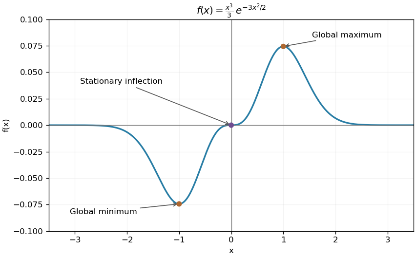

<h1 id="3/b/solution">Solution</h1>

↑ **Parent:** [B](../b.md)

The function is [odd](../../../../../odd-function.md), with a horizontal [tangent line](../../../../../tangent-line.md) at the origin and tails approaching zero from below on the negative side and above on the positive side. It decreases to its negative [minimum](../../../../../minimum-of-a-subset-of-a-total-order.md) at $x=-1$, rises through the stationary [inflection point](../../../../../inflection-point.md) at zero to its positive [maximum](../../../../../maximum-of-a-subset-of-a-total-order.md) at $x=1$, then decreases toward zero.

**[Figure 1](#3/b/image-an-odd-cubic-gaussian-profile-with-two-extrema-and-a-stationary-inflection). An odd cubic Gaussian profile with two extrema and a stationary inflection**. Original function plot with the three stationary points marked. The near-zero cubic behavior explains the flat crossing without an extremum.

## ↑ Ancestors (13)

1. [B](../b.md)
2. [3](../../3.md)
3. [Paper 1](../../../paper-1-split.md)
4. [2003](../../../split.md)
5. [Past exam of the mathematics course of the year 1 of the natural sciences course of the University of Cambridge](../../../../split.md)
6. [Mathematics course of the year 1 of the natural sciences course of the University of Cambridge](../../../../../mathematics-course-of-the-year-1-of-the-natural-sciences-course-of-the-university-of-cambridge.md)
7. [Year 1 of the natural sciences course of the University of Cambridge](../../../../../year-1-of-the-natural-sciences-course-of-the-university-of-cambridge.md)
8. [Year of the natural sciences course of the University of Cambridge](../../../../../year-of-the-natural-sciences-course-of-the-university-of-cambridge.md)
9. [Natural sciences course of the University of Cambridge](../../../../../natural-sciences-course-of-the-university-of-cambridge.md)
10. [Course of the University of Cambridge](../../../../../course-of-the-university-of-cambridge.md)
11. [University of Cambridge](../../../../../university-of-cambridge-split.md)
12. [List of universities](../../../../../list-of-universities.md)
13. [Codex Wiki](../../../../../split.md)
