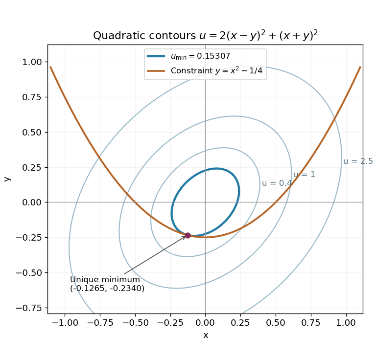

# Paper 2

↑ **Parent:** [2003](../2003.md)

[https://www.maths.cam.ac.uk/undergradnst/files/2003/PaperNST_IA_2.pdf](https://www.maths.cam.ac.uk/undergradnst/files/2003/PaperNST_IA_2.pdf)

**Table of contents**

- [1](#1)
  - [a](#1/a)
    - [Solution](#1/a/solution)
  - [b](#1/b)
    - [Solution](#1/b/solution)
- [2](#2)
  - [Solution](#2/solution)
- [3](#3)
  - [a](#3/a)
    - [Solution](#3/a/solution)
  - [b](#3/b)
    - [Solution](#3/b/solution)
- [4](#4)
  - [a](#4/a)
    - [Solution](#4/a/solution)
  - [b](#4/b)
    - [Solution](#4/b/solution)
  - [c](#4/c)
    - [Solution](#4/c/solution)
- [5](#5)
  - [a](#5/a)
    - [Solution](#5/a/solution)
  - [b](#5/b)
    - [i](#5/b/i)
      - [Solution](#5/b/i/solution)
    - [ii](#5/b/ii)
      - [Solution](#5/b/ii/solution)
    - [iii](#5/b/iii)
      - [Solution](#5/b/iii/solution)
- [6](#6)
  - [Solution](#6/solution)
- [7](#7)
  - [Solution](#7/solution)
- [8](#8)
  - [a](#8/a)
    - [i](#8/a/i)
      - [Solution](#8/a/i/solution)
    - [ii](#8/a/ii)
      - [Solution](#8/a/ii/solution)
    - [iii](#8/a/iii)
      - [Solution](#8/a/iii/solution)
  - [b](#8/b)
    - [i](#8/b/i)
      - [Solution](#8/b/i/solution)
    - [ii](#8/b/ii)
      - [Solution](#8/b/ii/solution)
- [9](#9)
  - [a](#9/a)
    - [Solution](#9/a/solution)
  - [b](#9/b)
    - [Solution](#9/b/solution)
- [10](#10)
  - [a](#10/a)
    - [Solution](#10/a/solution)
  - [b](#10/b)
    - [Solution](#10/b/solution)
- [11](#11)
  - [Solution](#11/solution)
- [12](#12)
  - [Solution](#12/solution)

## 1

↑ **Parent:** [Paper 2](paper-2.md)

<h3 id="1/a">a</h3>

↑ **Parent:** [1](#1)

<h4 id="1/a/solution">Solution</h4>

↑ **Parent:** [A](#1/a)

With [normal vector](../../differential-geometry.md#normal-vector) $n=(-1,-2,2)$, a [plane](../../geometry-and-topology.md#plane) through $A=(2,-1,1)$ has equation $n\cdot(r-A)=0$. As $n\cdot A=2$, its [plane equation](../../geometry-and-topology.md#cartesian-equation-of-a-plane) is

$$
\boxed{-x-2y+2z=2.}
$$

The [distance from a point to a plane](../../geometry-and-topology.md#distance-from-a-point-to-a-plane) is the absolute signed offset divided by the [Euclidean norm](../../normed-vector-space.md#euclidean-norm) of its [normal vector](../../differential-geometry.md#normal-vector). Hence the [Euclidean distance](../../topological-analysis.md#euclidean-distance) from the origin is $\boxed{2/3}$, since $|n|=3$. The closest point is $2n/9=(-2,-4,4)/9$, whose [Euclidean distance](../../topological-analysis.md#euclidean-distance) from the origin is $2/3$ and which satisfies the [plane equation](../../geometry-and-topology.md#cartesian-equation-of-a-plane).

<h3 id="1/b">b</h3>

↑ **Parent:** [1](#1)

<h4 id="1/b/solution">Solution</h4>

↑ **Parent:** [B](#1/b)

The displacement [vectors](../../vector-space.md#vector) are $B-A=(-1,2,-2)$ and $C-A=(1,0,1)$. Their [cross product](../../vector-space.md#cross-product) is $(2,-1,-2)$, with [Euclidean norm](../../normed-vector-space.md#euclidean-norm) three. Thus either sign of

$$
\boxed{\hat n_2=\frac{(2,-1,-2)}3}
$$

is a [unit normal vector](../../differential-geometry.md#unit-normal) to the second [plane](../../geometry-and-topology.md#plane), whose equation is $2x-y-2z=3$. A [direction vector](../../euclidean-geometry.md#direction-vector) for the intersection is the [cross product](../../vector-space.md#cross-product) of the two [normal vectors](../../differential-geometry.md#normal-vector):

$$
\boxed{(-1,-2,2)\times(2,-1,-2)=(6,2,5).}
$$

It is [orthogonal](../../inner-product.md#orthogonal-vectors) to each [normal vector](../../differential-geometry.md#normal-vector). Since both [planes](../../geometry-and-topology.md#plane) contain $A$, the whole intersection line is $r=(2,-1,1)+t(6,2,5)$, $t\in\mathbb R$.

## 2

↑ **Parent:** [Paper 2](paper-2.md)

<h3 id="2/solution">Solution</h3>

↑ **Parent:** [2](#2)

For an [odd](../../calculus.md#odd-function) integrable [function](../../function.md), both $f(x)$ and $f(x)\cos nx$ are [odd](../../calculus.md#odd-function). Their [integrals](../../integral.md) over $[-\pi,\pi]$ therefore vanish, so the constant and [cosine](../../geometry-and-topology.md#cosine) [Fourier coefficients](../../fourier-series.md#fourier-coefficient) are zero. For $f(x)=\sin ax$, the remaining [Fourier sine coefficients](../../fourier-series.md#fourier-sine-coefficient) are

$$
b_n=\frac2\pi\int_0^\pi\sin ax\sin nx\,dx=\frac1\pi\left[\frac{\sin\pi(a-n)}{a-n}-\frac{\sin\pi(a+n)}{a+n}\right]=\frac{2(-1)^{n+1}n\sin\pi a}{\pi(n^2-a^2)}.
$$

The product-to-sum identity in the first step reduces the [integral](../../integral.md) to two [cosines](../../geometry-and-topology.md#cosine). Here $a$ is real and noninteger, so no denominator vanishes. Consequently the [Fourier series of a noninteger-frequency sine](../../fourier-series.md#fourier-series-of-a-noninteger-frequency-sine) is

$$
\boxed{\sin ax=\sum_{n=1}^\infty\frac{2(-1)^{n+1}n\sin\pi a}{\pi(n^2-a^2)}\sin nx,\qquad -\pi<x<\pi.}
$$

At $x=\pm\pi$ every term is zero. The [Fourier series](../../fourier-series.md) converges there to the average of the two limits of the [periodic extension](../../function.md#periodic-extension), namely zero, rather than to the nonzero endpoint values $\pm\sin\pi a$.

**[Figure 1](#2/image-fourier-approximation-to-a-noninteger-frequency-sine-and-its-periodic-jump). Fourier approximation to a noninteger-frequency sine and its periodic jump**. Original illustration with $a=1/2$. Increasing the number of modes improves the interior approximation while the periodic endpoint jumps retain their Gibbs overshoot. The series has value zero at each endpoint.

## 3

↑ **Parent:** [Paper 2](paper-2.md)

<h3 id="3/a">a</h3>

↑ **Parent:** [3](#3)

<h4 id="3/a/solution">Solution</h4>

↑ **Parent:** [A](#3/a)

The unique [symmetric and antisymmetric parts of a matrix](../../linear-algebra.md#symmetric-and-antisymmetric-parts-of-a-matrix) are $S=(M+M^T)/2$ and $A=(M-M^T)/2$, giving

$$
\boxed{S=\frac12\begin{pmatrix}0&a+b\\a+b&0\end{pmatrix},\qquad A=\frac12\begin{pmatrix}0&b-a\\a-b&0\end{pmatrix}.}
$$

Their [matrix products](../../vector-space.md#matrix-product) with their [transposes](../../vector-space.md#transpose) are $S^TS=(a+b)^2I/4$ and $A^TA=(a-b)^2I/4$. Each is an [orthogonal matrix](../../linear-algebra.md#orthogonal-matrix) precisely when the corresponding factor is one. Thus $a+b=\pm2$ and $a-b=\pm2$, with independent sign choices, and the simultaneous possibilities are

$$
\boxed{(a,b)=(2,0),\ (-2,0),\ (0,2),\ (0,-2).}
$$

<h3 id="3/b">b</h3>

↑ **Parent:** [3](#3)

<h4 id="3/b/solution">Solution</h4>

↑ **Parent:** [B](#3/b)

The [characteristic polynomial](../../linear-operator-theory.md#characteristic-polynomial) is $(5-\lambda)(2-\lambda)-4=\lambda^2-7\lambda+6=(\lambda-1)(\lambda-6)$. For $\lambda=1$, the [eigenvector](../../linear-operator-theory.md#eigenvector) equation gives $y=2x$; for $\lambda=6$, it gives $x=-2y$. The normalized [eigenvectors](../../linear-operator-theory.md#eigenvector) can therefore be chosen as

$$
\boxed{\lambda_1=1,\quad v_1=\frac{(1,2)}{\sqrt5};\qquad\lambda_2=6,\quad v_2=\frac{(-2,1)}{\sqrt5}.}
$$

Both have unit [Euclidean norm](../../normed-vector-space.md#euclidean-norm), and their [dot product](../../inner-product.md#dot-product) is $(-2+2)/5=0$, explicitly verifying [orthogonality](../../inner-product.md#orthogonal-vectors). This also follows from the [spectral theorem](../../hilbert-space.md#spectral-theorem) for a real [symmetric matrix](../../linear-algebra.md#symmetric-matrix) with distinct [eigenvalues](../../linear-operator-theory.md#eigenvalue).

## 4

↑ **Parent:** [Paper 2](paper-2.md)

<h3 id="4/a">a</h3>

↑ **Parent:** [4](#4)

<h4 id="4/a/solution">Solution</h4>

↑ **Parent:** [A](#4/a)

For a bounded [volume](../../geometry-and-topology.md#volume) $V$ with piecewise smooth closed boundary $\partial V$, oriented by the outward [unit normal vector](../../differential-geometry.md#unit-normal), and a continuously differentiable [vector field](../../multivariable-calculus.md#vector-field) on a neighborhood of $\overline V$, the [divergence theorem](../../multivariable-calculus.md#divergence-theorem) states

$$
\int_V\nabla\cdot F\,dV=\int_{\partial V}F\cdot n\,dS.
$$

For an oriented piecewise smooth [surface](../../topological-surface.md) $S$ with piecewise smooth boundary $C=\partial S$, and a continuously differentiable [vector field](../../multivariable-calculus.md#vector-field) on a neighborhood of $S$, [Stokes theorem](../../multivariable-calculus.md#stokes-theorem) states

$$
\int_S(\nabla\times F)\cdot n\,dS=\oint_CF\cdot dr.
$$

The boundary orientation follows the right-hand rule relative to the chosen [normal vector](../../differential-geometry.md#normal-vector). Reversing that orientation reverses both sides of the latter identity.

<h3 id="4/b">b</h3>

↑ **Parent:** [4](#4)

<h4 id="4/b/solution">Solution</h4>

↑ **Parent:** [B](#4/b)

The [divergence](../../multivariable-calculus.md#divergence) is $\nabla\cdot F=2xyz+2xyz+2xyz=6xyz$. With outward orientation, the [divergence theorem](../../multivariable-calculus.md#divergence-theorem) converts the [surface flux](../../multivariable-calculus.md#flux-integral) into a [volume integral](../../multivariable-calculus.md#volume-integral):

$$
\boxed{\int_SF\cdot dS=6\int_0^1\int_0^1\int_0^1xyz\,dx\,dy\,dz=6\left(\frac12\right)^3=\frac34.}
$$

Directly, the three faces lying in coordinate [planes](../../geometry-and-topology.md#plane) contribute zero, and each opposite face contributes $1/4$, confirming the sign and normalization.

<h3 id="4/c">c</h3>

↑ **Parent:** [4](#4)

<h4 id="4/c/solution">Solution</h4>

↑ **Parent:** [C](#4/c)

Take the outward orientation on the upper [hemisphere](../../euclidean-geometry.md#hemisphere); its boundary [circle](../../topology.md#circle) is then counterclockwise viewed from above. Parametrize that [circle](../../topology.md#circle) by $r(\phi)=(r\cos\phi,r\sin\phi,0)$, $0\leq\phi\leq2\pi$. Then $G\cdot dr=r^2(3\cos^2\phi-4\sin^2\phi)d\phi$, so [Stokes theorem](../../multivariable-calculus.md#stokes-theorem) gives

$$
\boxed{\int_S(\nabla\times G)\cdot dS=\int_0^{2\pi}r^2(3\cos^2\phi-4\sin^2\phi)d\phi=-\pi r^2.}
$$

Equivalently $\nabla\times G=(0,0,-1)$, and the upward projected area of the [hemisphere](../../euclidean-geometry.md#hemisphere) is $\pi r^2$. The opposite orientation gives the negative of this answer.

## 5

↑ **Parent:** [Paper 2](paper-2.md)

<h3 id="5/a">a</h3>

↑ **Parent:** [5](#5)

<h4 id="5/a/solution">Solution</h4>

↑ **Parent:** [A](#5/a)

Let $D$ denote having the [disease](../../biology.md#disease) and $+$ a positive result. Assume I am sampled uniformly from the stated population, so $\mathbb P(D)=n/N$. By the [law of total probability](../../probability-space.md#law-of-total-probability), $\mathbb P(+)=a n/N+b(N-n)/N$. Thus [Bayes' theorem](../../probability-theory.md#bayes-theorem) gives

$$
\boxed{\mathbb P(D\mid+)=\frac{an}{an+b(N-n)}.}
$$

The denominator must be positive; otherwise the observed event has zero [probability](../../probability-theory.md#probability) in this model and the [conditional probability](../../probability-theory.md#conditional-probability) is undefined. The answer depends on [disease](../../biology.md#disease) prevalence as well as the test's two error rates.

<h3 id="5/b">b</h3>

↑ **Parent:** [5](#5)

<h4 id="5/b/i">i</h4>

↑ **Parent:** [B](#5/b)

<h5 id="5/b/i/solution">Solution</h5>

↑ **Parent:** [I](#5/b/i)

An integrable nonnegative [probability density](../../wave-function.md#probability-density) of this form requires $k>0$. Normalization gives $1=A\int_0^\infty e^{-kt}dt=A/k$, so $\boxed{A=k}$. This is the [exponential distribution](../../continuous-probability-distribution.md#exponential-distribution) with rate $k$.

<h4 id="5/b/ii">ii</h4>

↑ **Parent:** [B](#5/b)

<h5 id="5/b/ii/solution">Solution</h5>

↑ **Parent:** [Ii](#5/b/ii)

The [survival function](../../survival-analysis.md#survival-function) of this [exponential distribution](../../continuous-probability-distribution.md#exponential-distribution) is $\mathbb P(X\geq t)=e^{-kt}$ for $t\geq0$. Since $\{X\geq3\}\subseteq\{X\geq1\}$, the [conditional probability](../../probability-theory.md#conditional-probability) is

$$
\boxed{\mathbb P(X\geq3\mid X\geq1)=\frac{e^{-3k}}{e^{-k}}=e^{-2k}.}
$$

This is the [memoryless property](../../continuous-probability-distribution.md#memorylessness-of-the-exponential-distribution): after surviving the first unit, surviving two additional units has the same [probability](../../probability-theory.md#probability) as it did initially.

<h4 id="5/b/iii">iii</h4>

↑ **Parent:** [B](#5/b)

<h5 id="5/b/iii/solution">Solution</h5>

↑ **Parent:** [Iii](#5/b/iii)

The [expectation](../../expected-value.md) is $\mathbb E[X]=k\int_0^\infty te^{-kt}dt$. An [integration by parts](../../calculus.md#integration-by-parts), with the boundary term $te^{-kt}$ tending to zero, gives

$$
\boxed{\mathbb E[X]=\int_0^\infty e^{-kt}dt=\frac1k.}
$$

## 6

↑ **Parent:** [Paper 2](paper-2.md)

<h3 id="6/solution">Solution</h3>

↑ **Parent:** [6](#6)

Use [Gaussian elimination](../../numerical-linear-algebra.md#gaussian-elimination). The last equation gives $y=c-z$, and the second then gives $x=b-4c-2z$. Substitute these into the first equation to obtain $3b-10c-z=a$. Back-substitution yields

$$
\boxed{x=2a-5b+16c,\qquad y=a-3b+11c,\qquad z=-a+3b-10c.}
$$

The [linear system](../../linear-algebra.md#system-of-linear-equations) has [matrix](../../vector-space.md#matrix) form

$$
\begin{pmatrix}3&2&7\\1&4&6\\0&1&1\end{pmatrix}\begin{pmatrix}x\\y\\z\end{pmatrix}=\begin{pmatrix}a\\b\\c\end{pmatrix}.
$$

The coefficients of the arbitrary right-hand side in the solved expressions are the rows of the [matrix inverse](../../matrix-inverse.md). Therefore

$$
\boxed{\begin{pmatrix}3&2&7\\1&4&6\\0&1&1\end{pmatrix}^{-1}=\begin{pmatrix}2&-5&16\\1&-3&11\\-1&3&-10\end{pmatrix}.}
$$

Multiplying the original [matrix](../../vector-space.md#matrix) by this candidate gives the [identity matrix](../../vector-space.md#identity-matrix); its [determinant](../../multilinear-algebra.md#determinant) is $-1$, so the solution is unique for every $(a,b,c)$.

## 7

↑ **Parent:** [Paper 2](paper-2.md)

<h3 id="7/solution">Solution</h3>

↑ **Parent:** [7](#7)

For $h=x^2/a^2+y^2/b^2+z^2-1$, the [gradient](../../multivariable-calculus.md#gradient) $\nabla h=2(x/a^2,y/b^2,z)$ is a [normal vector](../../differential-geometry.md#normal-vector) to the [ellipsoid](../../euclidean-geometry.md#ellipsoid). The outward [unit normal vector](../../differential-geometry.md#unit-normal) is $(x/a^2,y/b^2,z)/\sqrt{x^2/a^4+y^2/b^4+z^2}$. The conditions $a,b>\sqrt2$ ensure that $z=\sqrt{1-x^2/a^2-y^2/b^2}>0$ everywhere on the rectangular projection.

The [dot product](../../inner-product.md#dot-product) $F\cdot\nabla h=2xy(1/b^2-1/a^2)$ vanishes pointwise when $a=b$. In that case $F$ has no normal component, so **the [surface flux](../../multivariable-calculus.md#flux-integral) is zero**. For unequal axes, the given [vector surface element](../../differential-geometry.md#vector-area-element) gives

$$
\Phi=\left(\frac1{b^2}-\frac1{a^2}\right)\int_0^1\int_0^1\frac{xy}{\sqrt{1-x^2/a^2-y^2/b^2}}\,dy\,dx.
$$

Put $u=x^2/a^2$, $v=y^2/b^2$. Then $xy\,dxdy=a^2b^2\,dudv/4$, and

$$
\Phi=\frac{a^2-b^2}{4}\int_0^{1/a^2}\int_0^{1/b^2}(1-u-v)^{-1/2}\,dv\,du.
$$

Two elementary [integrations](../../integral.md) now give

$$
\boxed{\Phi=\frac{a^2-b^2}{3}\left[1-\left(1-\frac1{a^2}\right)^{3/2}-\left(1-\frac1{b^2}\right)^{3/2}+\left(1-\frac1{a^2}-\frac1{b^2}\right)^{3/2}\right].}
$$

This is the [rotational flux through an ellipsoidal graph patch](../../multivariable-calculus.md#rotational-flux-through-an-ellipsoidal-graph-patch) with unit vertical semiaxis and unit projection lengths. It also tends continuously to zero when $a=b$, agreeing with the pointwise argument.

## 8

↑ **Parent:** [Paper 2](paper-2.md)

<h3 id="8/a">a</h3>

↑ **Parent:** [8](#8)

<h4 id="8/a/i">i</h4>

↑ **Parent:** [A](#8/a)

<h5 id="8/a/i/solution">Solution</h5>

↑ **Parent:** [I](#8/a/i)

The [trace](../../linear-algebra.md#matrix-trace) sums the diagonal entries, so $\operatorname{tr}P=\sum_i1-\sum_i a_i^2-\sum_i b_i^2$. The two [unit vectors](../../vector-space.md#unit-vector) have squared [Euclidean norms](../../normed-vector-space.md#euclidean-norm) one, giving $\boxed{\operatorname{tr}P=n-2}$.

<h4 id="8/a/ii">ii</h4>

↑ **Parent:** [A](#8/a)

<h5 id="8/a/ii/solution">Solution</h5>

↑ **Parent:** [Ii](#8/a/ii)

Write $P=I-Q$ with $Q=aa^T+bb^T$. The [orthonormality](../../inner-product.md#orthonormal-set) conditions $a^Ta=b^Tb=1$ and $a^Tb=b^Ta=0$ give

$$
Q^2=a(a^Ta)a^T+a(a^Tb)b^T+b(b^Ta)a^T+b(b^Tb)b^T=aa^T+bb^T=Q.
$$

Consequently $P^2=I-2Q+Q^2=I-Q=P$. It is the [orthogonal projection matrix](../../inner-product.md#orthogonal-projection-matrix) onto the [orthogonal complement](../../hilbert-space.md#orthogonal-complement) of the [linear span](../../vector-space.md#linear-span) of $a,b$.

<h4 id="8/a/iii">iii</h4>

↑ **Parent:** [A](#8/a)

<h5 id="8/a/iii/solution">Solution</h5>

↑ **Parent:** [Iii](#8/a/iii)

The [matrix product](../../vector-space.md#matrix-product) is $Pa=a-a(a^Ta)-b(b^Ta)=a-a=0$. Thus $\boxed{Pa=0}$, and the nonzero [vector](../../vector-space.md#vector) $a$ is in its [kernel](../../kernel-of-a-linear-map.md). Hence $P$ is singular and $\boxed{\det P=0}$. This includes $n=2$, when $a,b$ span the whole space and $P=0$.

<h3 id="8/b">b</h3>

↑ **Parent:** [8](#8)

<h4 id="8/b/i">i</h4>

↑ **Parent:** [B](#8/b)

<h5 id="8/b/i/solution">Solution</h5>

↑ **Parent:** [I](#8/b/i)

The [transpose](../../vector-space.md#transpose) reverses a [matrix product](../../vector-space.md#matrix-product). Since $S^T=S$, we have $(S^2)^T=S^TS^T=S^2$. Therefore **$S^2$ is a [symmetric matrix](../../linear-algebra.md#symmetric-matrix)**.

<h4 id="8/b/ii">ii</h4>

↑ **Parent:** [B](#8/b)

<h5 id="8/b/ii/solution">Solution</h5>

↑ **Parent:** [Ii](#8/b/ii)

Apply [trace orthogonality of symmetric and antisymmetric matrices](../../inner-product.md#trace-orthogonality-of-symmetric-and-antisymmetric-matrices). In detail, invariance of the [trace](../../linear-algebra.md#matrix-trace) under [transpose](../../vector-space.md#transpose) and its cyclic property give

$$
\operatorname{tr}(SA)=\operatorname{tr}((SA)^T)=\operatorname{tr}(A^TS^T)=-\operatorname{tr}(AS)=-\operatorname{tr}(SA).
$$

Therefore $\boxed{\operatorname{tr}(SA)=0}$. The negative sign comes from $A^T=-A$, while $S^T=S$.

## 9

↑ **Parent:** [Paper 2](paper-2.md)

<h3 id="9/a">a</h3>

↑ **Parent:** [9](#9)

<h4 id="9/a/solution">Solution</h4>

↑ **Parent:** [A](#9/a)

At fixed particle number, the differential of the [internal energy](../../internal-energy.md) identifies $T=(\partial U/\partial S)_V$ and $p=-(\partial U/\partial V)_S$. Equality of continuous [mixed partial derivatives](../../multivariable-calculus.md#mixed-partial-derivative) gives the first [Maxwell relation](../../thermodynamics.md#maxwell-relations):

$$
\boxed{\left(\frac{\partial T}{\partial V}\right)_S=\frac{\partial^2U}{\partial V\partial S}=-\left(\frac{\partial p}{\partial S}\right)_V.}
$$

For the [enthalpy](../../enthalpy.md), $dH=dU+p\,dV+V\,dp=T\,dS+V\,dp$. Thus $T=(\partial H/\partial S)_p$, $V=(\partial H/\partial p)_S$, and the same argument gives the [enthalpy Maxwell relation](../../enthalpy.md#enthalpy-maxwell-relation)

$$
\boxed{\left(\frac{\partial T}{\partial p}\right)_S=\frac{\partial^2H}{\partial p\partial S}=\left(\frac{\partial V}{\partial S}\right)_p.}
$$

The smoothness and independent thermodynamic coordinates are understood within a single phase.

<h3 id="9/b">b</h3>

↑ **Parent:** [9](#9)

<h4 id="9/b/solution">Solution</h4>

↑ **Parent:** [B](#9/b)

Differentiate $H=U+pV$ at fixed [pressure](../../pressure.md) and subtract the [heat capacity at constant volume](../../heat.md#heat-capacity-at-constant-volume):

$$
C_p-C_V=\left(\frac{\partial U}{\partial T}\right)_p+p\left(\frac{\partial V}{\partial T}\right)_p-\left(\frac{\partial U}{\partial T}\right)_V.
$$

Now use $U=U(T,V)$ and the [multivariable chain rule](../../calculus.md#multivariable-chain-rule) along a constant-pressure path:

$$
\left(\frac{\partial U}{\partial T}\right)_p=\left(\frac{\partial U}{\partial T}\right)_V+\left(\frac{\partial U}{\partial V}\right)_T\left(\frac{\partial V}{\partial T}\right)_p.
$$

Substitution cancels the fixed-volume [derivative](../../calculus.md#derivative) and gives the [volume derivative form of the heat-capacity difference](../../enthalpy.md#volume-derivative-form-of-the-heat-capacity-difference),

$$
\boxed{C_p-C_V=\left[\left(\frac{\partial U}{\partial V}\right)_T+p\right]\left(\frac{\partial V}{\partial T}\right)_p.}
$$

For the [ideal gas](../../ideal-gas.md), the first term in brackets vanishes and $V=NkT/p$, so $(\partial V/\partial T)_p=Nk/p$. Consequently $\boxed{C_p-C_V=Nk}$ for the entire gas, with fixed particle number $N$. The extra [heat capacity](../../heat.md#heat-capacity) accounts for expansion [work](../../energy.md#work) at constant [pressure](../../pressure.md).

## 10

↑ **Parent:** [Paper 2](paper-2.md)

<h3 id="10/a">a</h3>

↑ **Parent:** [10](#10)

<h4 id="10/a/solution">Solution</h4>

↑ **Parent:** [A](#10/a)

Away from the origin, the [chain rule](../../calculus.md#chain-rule) gives $r_x=x/r$ and $r_y=y/r$. Differentiating once more yields the two-dimensional case of the [Hessian of the Euclidean norm](../../normed-vector-space.md#hessian-of-the-euclidean-norm):

$$
\boxed{r_x=\frac xr,\quad r_y=\frac yr,\quad r_{xx}=\frac{y^2}{r^3},\quad r_{yy}=\frac{x^2}{r^3},\quad r_{xy}=-\frac{xy}{r^3}.}
$$

These [partial derivatives](../../multivariable-calculus.md#partial-derivative) are smooth wherever $r>0$, so [Clairaut's theorem](../../multivariable-calculus.md#symmetry-of-second-derivatives) gives $\boxed{r_{yx}=r_{xy}=-xy/r^3}$. None of these formulas supplies a [derivative](../../calculus.md#derivative) at the origin: even the restriction $r(x,0)=|x|$ has no two-sided [derivative](../../calculus.md#derivative) there.

<h3 id="10/b">b</h3>

↑ **Parent:** [10](#10)

<h4 id="10/b/solution">Solution</h4>

↑ **Parent:** [B](#10/b)

Write $c=\cos\theta$, $s=\sin\theta$. Since $\theta$ is constant, the [multivariable chain rule](../../calculus.md#multivariable-chain-rule) gives $\partial_x=c\partial_u-s\partial_v$ and $\partial_y=s\partial_u+c\partial_v$. Applying these operators twice to a twice continuously differentiable [function](../../function.md) gives

$$
g_{xx}=c^2g_{uu}-2csg_{uv}+s^2g_{vv},\qquad g_{yy}=s^2g_{uu}+2csg_{uv}+c^2g_{vv}.
$$

The mixed terms cancel and $c^2+s^2=1$, so

$$
\boxed{g_{xx}+g_{yy}=g_{uu}+g_{vv}.}
$$

This is [rotational invariance of the Laplacian](../../multivariable-calculus.md#rotational-invariance-of-the-laplacian): an [orthogonal change of coordinates](../../linear-algebra.md#orthogonal-change-of-coordinates) preserves the [trace](../../linear-algebra.md#matrix-trace) of the [Hessian matrix](../../multivariable-calculus.md#hessian-matrix). A nonconstant angle would introduce additional [derivatives](../../calculus.md#derivative) and is not covered by this constant rotation calculation.

## 11

↑ **Parent:** [Paper 2](paper-2.md)

<h3 id="11/solution">Solution</h3>

↑ **Parent:** [11](#11)

Use the [method of undetermined coefficients](../../linear-ordinary-differential-equation.md#method-of-undetermined-coefficients). Substitution of $y_p=(a+bx)\sin x+(c+dx)\cos x$ gives

$$
y_p''-2y_p'+y_p=(-2b+2c-2d+2dx)\sin x+(-2a+2b-2d-2bx)\cos x.
$$

Equating the coefficients of $x\sin x$, $x\cos x$, $\sin x$, and $\cos x$ to the forcing gives $d=1$, $b=0$, $c=1$, $a=-1$. Thus

$$
\boxed{y_p=-\sin x+(1+x)\cos x.}
$$

The [characteristic equation](../../linear-ordinary-differential-equation.md#characteristic-equation-of-a-constant-coefficient-differential-equation) of the homogeneous equation is $(r-1)^2=0$, with a [repeated root](../../polynomial.md#multiple-root). Its [complementary function](../../linear-ordinary-differential-equation.md#homogeneous-solution) is $(C_1+C_2x)e^x$. Since $y_p(0)=1$ and $y_p'(0)=0$, the initial conditions give $C_1=-1$ and $C_2=1$. Therefore

$$
\boxed{y=(x-1)e^x-\sin x+(1+x)\cos x.}
$$

Direct differentiation verifies both zero initial data and the original forcing.

## 12

↑ **Parent:** [Paper 2](paper-2.md)

<h3 id="12/solution">Solution</h3>

↑ **Parent:** [12](#12)

Expand $u=3x^2-2xy+3y^2$. The [Lagrange multiplier](../../mathematical-optimization.md#lagrange-multiplier) equations for $u-\lambda v$ are $(6-2\lambda)x-2y=0$ and $-2x+6y+\lambda=0$, together with the [constraint](../../classical-mechanics.md#constraint-mechanics) $y=x^2-1/4$. The first two imply $y=(3-\lambda)x$ and $(6\lambda-16)x=\lambda$. The value $\lambda=8/3$ would make the latter equation inconsistent, so division is allowed:

$$
\boxed{x=\frac{\lambda}{6\lambda-16},\qquad y=\frac{\lambda(3-\lambda)}{6\lambda-16}.}
$$

Insert these into $x^2-y-1/4=0$ and multiply by $(6\lambda-16)^2$. Simplification gives $2(3\lambda^3-21\lambda^2+48\lambda-32)=0$, hence

$$
\boxed{3\lambda^3-21\lambda^2+48\lambda-32=0.}
$$

The [gradient](../../multivariable-calculus.md#gradient) of the [constraint](../../classical-mechanics.md#constraint-mechanics) $(2x,-1)$ is never zero, so the [Lagrange multiplier](../../mathematical-optimization.md#lagrange-multiplier) condition is necessary at every constrained [extremum](../../mathematical-optimization.md#maximum-and-minimum). To establish a global [minimum](../../set.md#minimum-of-a-subset-of-a-total-order), parametrize the whole [parabola](../../euclidean-geometry.md#parabola) by $y=x^2-1/4$. The restricted [function](../../function.md) becomes

$$
q(x)=3x^4-2x^3+\frac32x^2+\frac12x+\frac3{16}.
$$

It is [coercive](../../bilinear-form.md#coercive-bilinear-form): $q(x)\to\infty$ as $|x|\to\infty$, so it attains a global [minimum](../../set.md#minimum-of-a-subset-of-a-total-order). Moreover $q''(x)=36(x-1/6)^2+2>0$, making it [strictly convex](../../real-analysis.md#strictly-convex-function) and ensuring that this [minimum](../../set.md#minimum-of-a-subset-of-a-total-order) is unique. This proves more than the permitted assumption of one real multiplier root.

The [level sets](../../topology.md#level-set) of $u$ are nested [ellipses](../../euclidean-geometry.md#ellipse) centered at the origin. In the rotated coordinates $p=(x+y)/\sqrt2$, $q=(x-y)/\sqrt2$, they have equation $2p^2+4q^2=\text{constant}$, with the longer axis along $x=y$. The smallest one meeting the [parabola](../../euclidean-geometry.md#parabola) is tangent to it at the unique minimizing point, approximately $(x,y)=(-0.12654,-0.23399)$, where $u\simeq0.15307$ and $\lambda\simeq1.15085$.

**[Figure 2](#12/image-the-smallest-quadratic-contour-touching-a-parabolic-constraint). The smallest quadratic contour touching a parabolic constraint**. Original level-set plot. The highlighted ellipse is tangent to the parabola at the unique global minimum; larger quadratic contours intersect the constraint.

## ↑ Ancestors (10)

1. [2003](../2003.md)
2. [Past exam of the mathematics course of the year 1 of the natural sciences course of the University of Cambridge](../../past-exam-of-the-mathematics-course-of-the-year-1-of-the-natural-sciences-course-of-the-university-of-cambridge.md)
3. [Mathematics course of the year 1 of the natural sciences course of the University of Cambridge](../../university-of-cambridge.md#mathematics-course-of-the-year-1-of-the-natural-sciences-course-of-the-university-of-cambridge)
4. [Year 1 of the natural sciences course of the University of Cambridge](../../university-of-cambridge.md#year-1-of-the-natural-sciences-course-of-the-university-of-cambridge)
5. [Year of the natural sciences course of the University of Cambridge](../../university-of-cambridge.md#year-of-the-natural-sciences-course-of-the-university-of-cambridge)
6. [Natural sciences course of the University of Cambridge](../../university-of-cambridge.md#natural-sciences-course-of-the-university-of-cambridge)
7. [Course of the University of Cambridge](../../university-of-cambridge.md#course-of-the-university-of-cambridge)
8. [University of Cambridge](../../university-of-cambridge.md)
9. [List of universities](../../README.md#list-of-universities)
10. [Codex Wiki](../../README.md)
