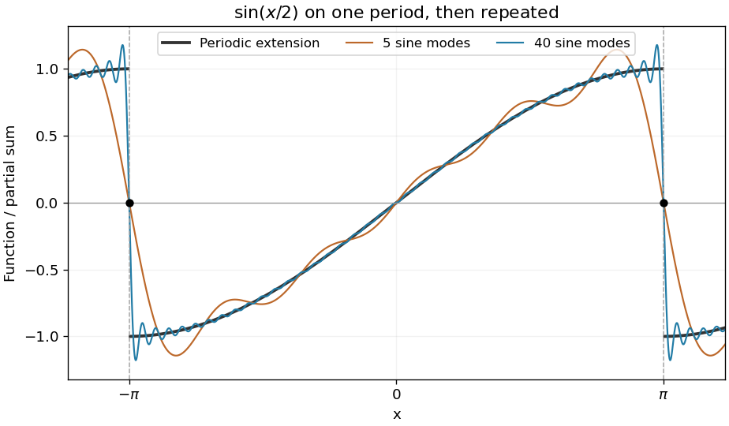

<h1 id="2/solution">Solution</h1>

↑ **Parent:** [2](../2.md)

For an [odd](../../../../odd-function.md) integrable [function](../../../../function-split.md), both $f(x)$ and $f(x)\cos nx$ are [odd](../../../../odd-function.md). Their [integrals](../../../../integral-split.md) over $[-\pi,\pi]$ therefore vanish, so the constant and [cosine](../../../../cosine.md) [Fourier coefficients](../../../../fourier-coefficient.md) are zero. For $f(x)=\sin ax$, the remaining [Fourier sine coefficients](../../../../fourier-sine-coefficient.md) are

$$
b_n=\frac2\pi\int_0^\pi\sin ax\sin nx\,dx=\frac1\pi\left[\frac{\sin\pi(a-n)}{a-n}-\frac{\sin\pi(a+n)}{a+n}\right]=\frac{2(-1)^{n+1}n\sin\pi a}{\pi(n^2-a^2)}.
$$

The product-to-sum identity in the first step reduces the [integral](../../../../integral-split.md) to two [cosines](../../../../cosine.md). Here $a$ is real and noninteger, so no denominator vanishes. Consequently the [Fourier series of a noninteger-frequency sine](../../../../fourier-series-of-a-noninteger-frequency-sine.md) is

$$
\boxed{\sin ax=\sum_{n=1}^\infty\frac{2(-1)^{n+1}n\sin\pi a}{\pi(n^2-a^2)}\sin nx,\qquad -\pi<x<\pi.}
$$

At $x=\pm\pi$ every term is zero. The [Fourier series](../../../../fourier-series-split.md) converges there to the average of the two limits of the [periodic extension](../../../../periodic-extension.md), namely zero, rather than to the nonzero endpoint values $\pm\sin\pi a$.

**[Figure 1](#2/image-fourier-approximation-to-a-noninteger-frequency-sine-and-its-periodic-jump). Fourier approximation to a noninteger-frequency sine and its periodic jump**. Original illustration with $a=1/2$. Increasing the number of modes improves the interior approximation while the periodic endpoint jumps retain their Gibbs overshoot. The series has value zero at each endpoint.

## ↑ Ancestors (12)

1. [2](../2.md)
2. [Paper 2](../../paper-2-split.md)
3. [2003](../../split.md)
4. [Past exam of the mathematics course of the year 1 of the natural sciences course of the University of Cambridge](../../../split.md)
5. [Mathematics course of the year 1 of the natural sciences course of the University of Cambridge](../../../../mathematics-course-of-the-year-1-of-the-natural-sciences-course-of-the-university-of-cambridge.md)
6. [Year 1 of the natural sciences course of the University of Cambridge](../../../../year-1-of-the-natural-sciences-course-of-the-university-of-cambridge.md)
7. [Year of the natural sciences course of the University of Cambridge](../../../../year-of-the-natural-sciences-course-of-the-university-of-cambridge.md)
8. [Natural sciences course of the University of Cambridge](../../../../natural-sciences-course-of-the-university-of-cambridge.md)
9. [Course of the University of Cambridge](../../../../course-of-the-university-of-cambridge.md)
10. [University of Cambridge](../../../../university-of-cambridge-split.md)
11. [List of universities](../../../../list-of-universities.md)
12. [Codex Wiki](../../../../split.md)
