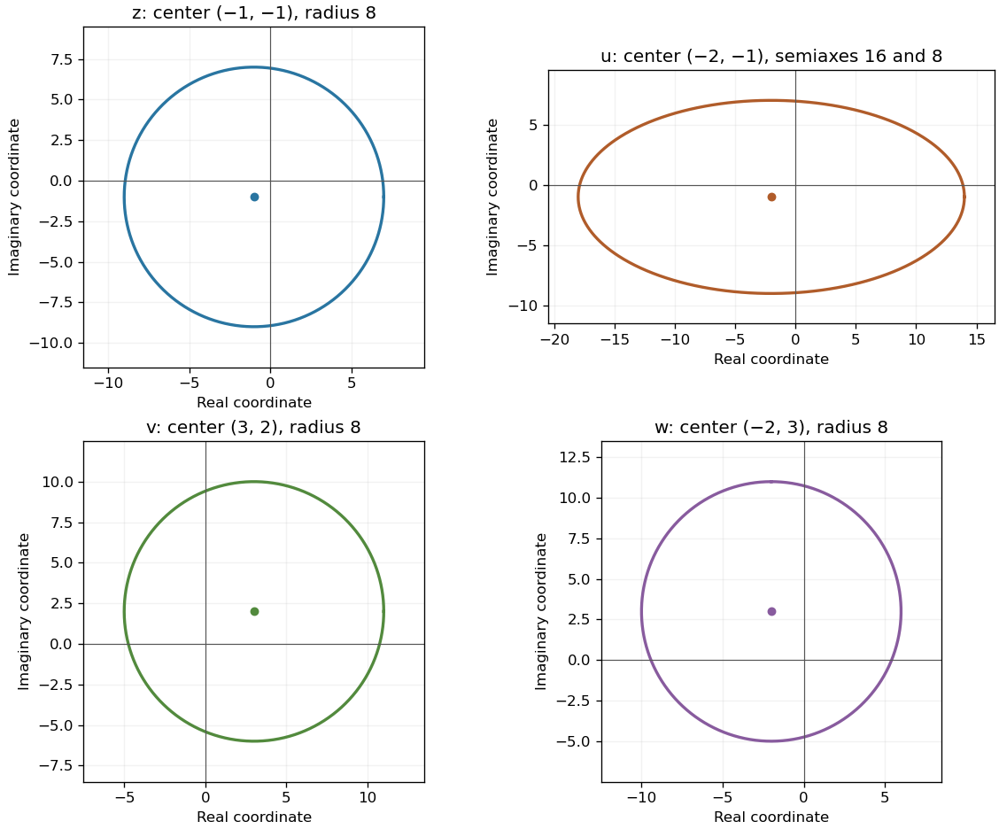

<h1 id="10/b/solution">Solution</h1>

↑ **Parent:** [B](../b.md)

The modulus equation says that $z$ has fixed distance eight from $-1-i$. Thus its locus is **a circle of radius eight centered at $(-1,-1)$**, with Cartesian equation $(x+1)^2+(y+1)^2=64$.

**[Figure 2](#10/b/image-the-original-circle-a-horizontal-stretch-a-translation-and-a-quarter-turn). The original circle, a horizontal stretch, a translation and a quarter-turn**. Original complex-plane loci. The map $u=2x+iy$ stretches only the horizontal coordinate; $v=z+4+3i$ translates the circle; $w=iv$ rotates that translated circle about the origin. Marked dots show each center.

## ↑ Ancestors (13)

1. [B](../b.md)
2. [10](../../10.md)
3. [Paper 1](../../../paper-1-split.md)
4. [2004](../../../split.md)
5. [Past exam of the mathematics course of the year 1 of the natural sciences course of the University of Cambridge](../../../../split.md)
6. [Mathematics course of the year 1 of the natural sciences course of the University of Cambridge](../../../../../mathematics-course-of-the-year-1-of-the-natural-sciences-course-of-the-university-of-cambridge.md)
7. [Year 1 of the natural sciences course of the University of Cambridge](../../../../../year-1-of-the-natural-sciences-course-of-the-university-of-cambridge.md)
8. [Year of the natural sciences course of the University of Cambridge](../../../../../year-of-the-natural-sciences-course-of-the-university-of-cambridge.md)
9. [Natural sciences course of the University of Cambridge](../../../../../natural-sciences-course-of-the-university-of-cambridge.md)
10. [Course of the University of Cambridge](../../../../../course-of-the-university-of-cambridge.md)
11. [University of Cambridge](../../../../../university-of-cambridge-split.md)
12. [List of universities](../../../../../list-of-universities.md)
13. [Codex Wiki](../../../../../split.md)
