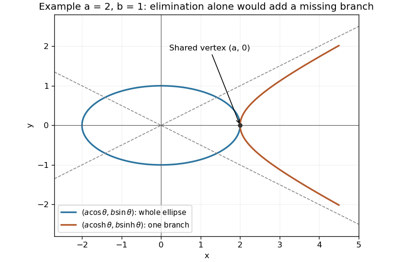

<h1 id="10/c/ii/solution">Solution</h1>

↑ **Parent:** [Ii](../ii.md)

For $ab\ne0$, the hyperbolic identity gives $x^2/a^2-y^2/b^2=1$. The [hyperbolic parametrization of a hyperbola](../../../../../../hyperbolic-parametrization-of-a-hyperbola.md) also imposes $x/a=\cosh\theta\geq1$, so the exact traced locus is

$$
\boxed{\frac{x^2}{a^2}-\frac{y^2}{b^2}=1,\qquad\frac xa\geq1.}
$$

It is only one branch: the right branch for $a>0$ and the left branch for $a<0$. Its vertex is $(a,0)$ and its asymptotes are $y=\pm(b/a)x$. If $a=0$, $b\ne0$, the entire vertical axis is traced. If $b=0$, $a\ne0$, the locus is the ray $y=0$, $x/a\geq1$. Both zero give the origin.

**[Figure 3](#10/c/ii/image-a-trigonometric-ellipse-and-the-single-hyperbolic-branch-traced-by-real-parameters). A trigonometric ellipse and the single hyperbolic branch traced by real parameters**. Original example with $a=2,b=1$. The ellipse is closed, whereas $(a\cosh\theta,b\sinh\theta)$ traces only the right branch of the hyperbola. Dashed lines show its two asymptotes.

## ↑ Ancestors (14)

1. [Ii](../ii.md)
2. [C](../../c.md)
3. [10](../../../10.md)
4. [Paper 1](../../../../paper-1-split.md)
5. [2004](../../../../split.md)
6. [Past exam of the mathematics course of the year 1 of the natural sciences course of the University of Cambridge](../../../../../split.md)
7. [Mathematics course of the year 1 of the natural sciences course of the University of Cambridge](../../../../../../mathematics-course-of-the-year-1-of-the-natural-sciences-course-of-the-university-of-cambridge.md)
8. [Year 1 of the natural sciences course of the University of Cambridge](../../../../../../year-1-of-the-natural-sciences-course-of-the-university-of-cambridge.md)
9. [Year of the natural sciences course of the University of Cambridge](../../../../../../year-of-the-natural-sciences-course-of-the-university-of-cambridge.md)
10. [Natural sciences course of the University of Cambridge](../../../../../../natural-sciences-course-of-the-university-of-cambridge.md)
11. [Course of the University of Cambridge](../../../../../../course-of-the-university-of-cambridge.md)
12. [University of Cambridge](../../../../../../university-of-cambridge-split.md)
13. [List of universities](../../../../../../list-of-universities.md)
14. [Codex Wiki](../../../../../../split.md)
