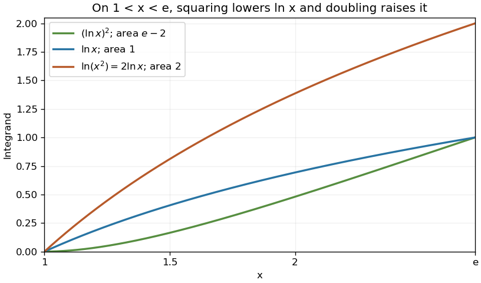

<h1 id="4/c/solution">Solution</h1>

↑ **Parent:** [C](../c.md)

For $1<x<e$, the [natural logarithm](../../../../../natural-logarithm.md) satisfies $0<\ln x<1$. Squaring therefore decreases its value, while $\ln(x^2)=2\ln x$. Pointwise comparison gives $(\ln x)^2<\ln x<\ln(x^2)$, so

$$
\boxed{I_3<I_1<I_2.}
$$

As a check, [integration by parts](../../../../../integration-by-parts.md) gives $I_1=1$, $I_2=2$ and $I_3=e-2$, consistent with this order.

**[Figure 1](#4/c/image-pointwise-ordering-of-the-three-logarithmic-integrands). Pointwise ordering of the three logarithmic integrands**. Original plot on $[1,e]$. The natural logarithm rises from zero to one, so its square lies below it, and twice the logarithm lies above it. Integrating preserves the strict order.

## ↑ Ancestors (13)

1. [C](../c.md)
2. [4](../../4.md)
3. [Paper 1](../../../paper-1-split.md)
4. [2004](../../../split.md)
5. [Past exam of the mathematics course of the year 1 of the natural sciences course of the University of Cambridge](../../../../split.md)
6. [Mathematics course of the year 1 of the natural sciences course of the University of Cambridge](../../../../../mathematics-course-of-the-year-1-of-the-natural-sciences-course-of-the-university-of-cambridge.md)
7. [Year 1 of the natural sciences course of the University of Cambridge](../../../../../year-1-of-the-natural-sciences-course-of-the-university-of-cambridge.md)
8. [Year of the natural sciences course of the University of Cambridge](../../../../../year-of-the-natural-sciences-course-of-the-university-of-cambridge.md)
9. [Natural sciences course of the University of Cambridge](../../../../../natural-sciences-course-of-the-university-of-cambridge.md)
10. [Course of the University of Cambridge](../../../../../course-of-the-university-of-cambridge.md)
11. [University of Cambridge](../../../../../university-of-cambridge-split.md)
12. [List of universities](../../../../../list-of-universities.md)
13. [Codex Wiki](../../../../../split.md)
