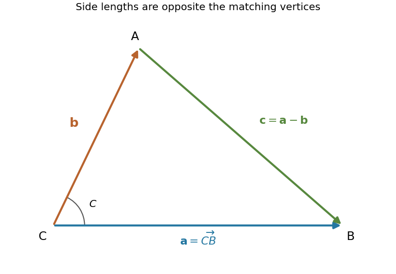

<h1 id="1/a/solution">Solution</h1>

↑ **Parent:** [A](../a.md)

Choose a common origin at vertex $C$, set $\mathbf a=\overrightarrow{CB}$ and $\mathbf b=\overrightarrow{CA}$, and orient the remaining edge as $\mathbf c=\overrightarrow{AB}$. Then

$$
\boxed{\mathbf c=\mathbf a-\mathbf b.}
$$

This convention makes the interior angle between $\mathbf a$ and $\mathbf b$ equal to $C$, and their lengths equal to the opposite side lengths $a$ and $b$.

**[Figure 1](#1/a/image-consistently-oriented-triangle-edge-vectors-for-the-sine-and-cosine-rules). Consistently oriented triangle edge vectors for the sine and cosine rules**. An original illustrative triangle with two vectors from vertex $C$ and their difference from $A$ to $B$. Side labels are opposite the corresponding vertices.

Take the [dot product](../../../../../dot-product.md) of the difference with itself. Since $\mathbf a\cdot\mathbf b=ab\cos C$, the [law of cosines](../../../../../law-of-cosines.md) follows:

$$
\boxed{c^2=a^2+b^2-2ab\cos C.}
$$

The magnitude of the [cross product](../../../../../cross-product.md) of two edge vectors is twice the triangle's [area](../../../../../surface-area.md) $K$. Applying this at each vertex gives $2K=ab\sin C=bc\sin A=ca\sin B$. Divide by the nonzero product $abc$ to obtain the [law of sines](../../../../../law-of-sines.md):

$$
\boxed{\frac{\sin A}{a}=\frac{\sin B}{b}=\frac{\sin C}{c}.}
$$

## ↑ Ancestors (13)

1. [A](../a.md)
2. [1](../../1.md)
3. [Paper 2](../../../paper-2-split.md)
4. [2004](../../../split.md)
5. [Past exam of the mathematics course of the year 1 of the natural sciences course of the University of Cambridge](../../../../split.md)
6. [Mathematics course of the year 1 of the natural sciences course of the University of Cambridge](../../../../../mathematics-course-of-the-year-1-of-the-natural-sciences-course-of-the-university-of-cambridge.md)
7. [Year 1 of the natural sciences course of the University of Cambridge](../../../../../year-1-of-the-natural-sciences-course-of-the-university-of-cambridge.md)
8. [Year of the natural sciences course of the University of Cambridge](../../../../../year-of-the-natural-sciences-course-of-the-university-of-cambridge.md)
9. [Natural sciences course of the University of Cambridge](../../../../../natural-sciences-course-of-the-university-of-cambridge.md)
10. [Course of the University of Cambridge](../../../../../course-of-the-university-of-cambridge.md)
11. [University of Cambridge](../../../../../university-of-cambridge-split.md)
12. [List of universities](../../../../../list-of-universities.md)
13. [Codex Wiki](../../../../../split.md)
