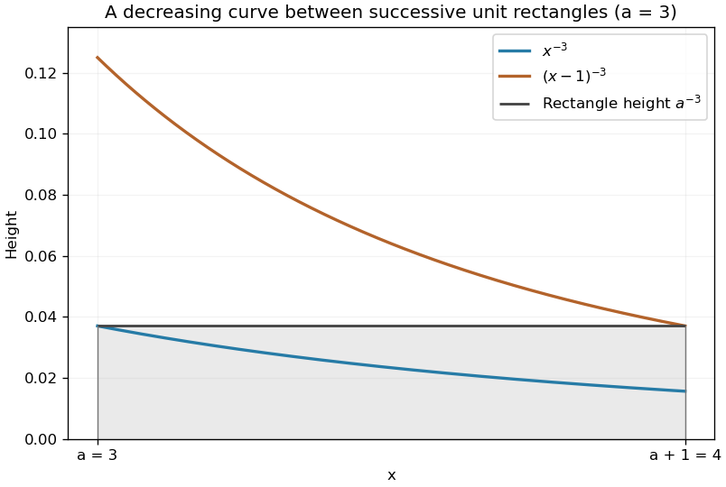

<h1 id="10/a/solution">Solution</h1>

↑ **Parent:** [A](../a.md)

The function $x^{-3}$ is strictly decreasing for positive $x$. On $a<x<a+1$, this gives $x^{-3}<a^{-3}<(x-1)^{-3}$. Integrate across that unit interval to obtain

$$
\int_a^{a+1}x^{-3}dx<a^{-3}<\int_a^{a+1}(x-1)^{-3}dx.
$$

Applying this to every integer $n\geq a$ and summing proves the [integral test](../../../../../integral-test-for-convergence.md) tail bounds

$$
\boxed{\frac1{2a^2}<\sum_{n=a}^\infty\frac1{n^3}<\frac1{2(a-1)^2}.}
$$

Both remain strict: the sum of the positive differences between rectangles and integrals is already bounded below by its positive first difference. Convergence of the integrals and the [p-series](../../../../../p-series.md) makes the passage to infinity valid.

**[Figure 4](#10/a/image-unit-rectangles-bounding-a-reciprocal-cube-tail). Unit rectangles bounding a reciprocal-cube tail**. Original comparison for the illustrative choice $a=3$. On the first unit interval the constant rectangle lies strictly above $x^{-3}$ and below $(x-1)^{-3}$ except at the appropriate endpoints.

## ↑ Ancestors (13)

1. [A](../a.md)
2. [10](../../10.md)
3. [Paper 2](../../../paper-2-split.md)
4. [2004](../../../split.md)
5. [Past exam of the mathematics course of the year 1 of the natural sciences course of the University of Cambridge](../../../../split.md)
6. [Mathematics course of the year 1 of the natural sciences course of the University of Cambridge](../../../../../mathematics-course-of-the-year-1-of-the-natural-sciences-course-of-the-university-of-cambridge.md)
7. [Year 1 of the natural sciences course of the University of Cambridge](../../../../../year-1-of-the-natural-sciences-course-of-the-university-of-cambridge.md)
8. [Year of the natural sciences course of the University of Cambridge](../../../../../year-of-the-natural-sciences-course-of-the-university-of-cambridge.md)
9. [Natural sciences course of the University of Cambridge](../../../../../natural-sciences-course-of-the-university-of-cambridge.md)
10. [Course of the University of Cambridge](../../../../../course-of-the-university-of-cambridge.md)
11. [University of Cambridge](../../../../../university-of-cambridge-split.md)
12. [List of universities](../../../../../list-of-universities.md)
13. [Codex Wiki](../../../../../split.md)
