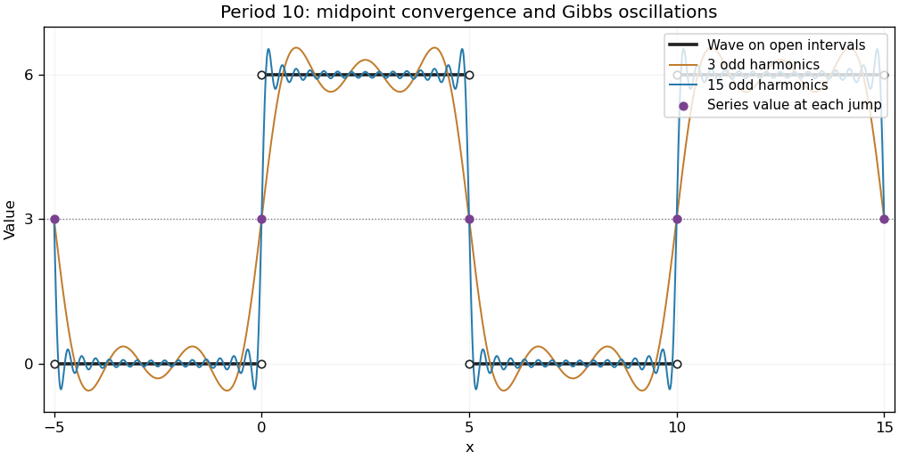

<h1 id="2/solution">Solution</h1>

↑ **Parent:** [2](../2.md)

The [square wave](../../../../square-wave.md) alternates between a low interval of length five and a high interval of length five; its [integral average](../../../../integral-average.md) is three. In the real [Fourier series](../../../../fourier-series-split.md) convention

$$
f(x)\sim\frac{a_0}{2}+\sum_{n=1}^\infty\left[a_n\cos\frac{n\pi x}{5}+b_n\sin\frac{n\pi x}{5}\right],
$$

integration over one period gives

$$
a_0=\frac15\int_{-5}^5 f(x)\,dx=6,\qquad a_n=\frac65\int_0^5\cos\frac{n\pi x}{5}\,dx=0,
$$

and

$$
b_n=\frac65\int_0^5\sin\frac{n\pi x}{5}\,dx=\frac6{n\pi}[1-(-1)^n].
$$

Thus only odd [harmonics](../../../../harmonic-function.md) occur:

$$
\boxed{f(x)\sim3+\frac{12}{\pi}\sum_{j=0}^\infty\frac{\sin((2j+1)\pi x/5)}{2j+1}.}
$$

The [Dirichlet-Jordan convergence theorem](../../../../dirichlet-jordan-convergence-theorem.md) makes the sum equal to the function at its continuity points and to the mean of its one-sided limits at a jump. Consequently **the sum is 3 at each of $x=-5,0,5$**, regardless of any separately assigned values of the original function at those endpoints.

**[Figure 2](#2/image-a-periodic-square-wave-and-its-fourier-approximations). A periodic square wave and its Fourier approximations**. Original plot of the alternating low and high intervals and two partial Fourier sums. The jump values of the Fourier series are their midpoint; finite sums exhibit Gibbs oscillations.

## ↑ Ancestors (12)

1. [2](../2.md)
2. [Paper 2](../../paper-2-split.md)
3. [2004](../../split.md)
4. [Past exam of the mathematics course of the year 1 of the natural sciences course of the University of Cambridge](../../../split.md)
5. [Mathematics course of the year 1 of the natural sciences course of the University of Cambridge](../../../../mathematics-course-of-the-year-1-of-the-natural-sciences-course-of-the-university-of-cambridge.md)
6. [Year 1 of the natural sciences course of the University of Cambridge](../../../../year-1-of-the-natural-sciences-course-of-the-university-of-cambridge.md)
7. [Year of the natural sciences course of the University of Cambridge](../../../../year-of-the-natural-sciences-course-of-the-university-of-cambridge.md)
8. [Natural sciences course of the University of Cambridge](../../../../natural-sciences-course-of-the-university-of-cambridge.md)
9. [Course of the University of Cambridge](../../../../course-of-the-university-of-cambridge.md)
10. [University of Cambridge](../../../../university-of-cambridge-split.md)
11. [List of universities](../../../../list-of-universities.md)
12. [Codex Wiki](../../../../split.md)
