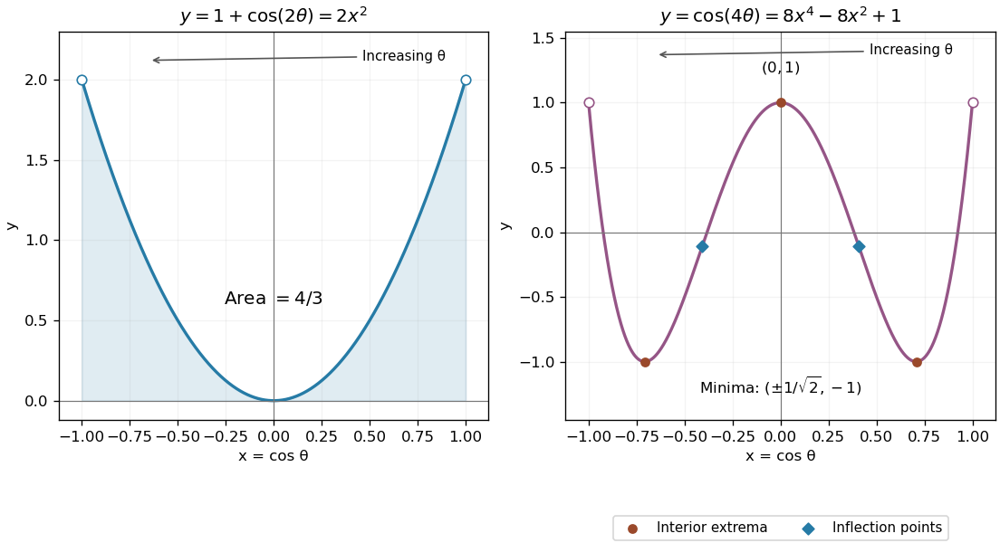

<h1 id="4/b/ii/solution">Solution</h1>

↑ **Parent:** [Ii](../ii.md)

The fourth [Chebyshev polynomial](../../../../../../chebyshev-polynomial.md) eliminates the parameter:

$$
y=\cos4\theta=8x^4-8x^2+1,\qquad -1<x<1.
$$

Its derivatives are $y'=16x(2x^2-1)$ and $y''=16(6x^2-1)$. The interior [stationary points](../../../../../../stationary-point.md) are a local maximum $(0,1)$ at $\theta=\pi/2$, and two minima $(\pm1/\sqrt2,-1)$ at $\theta=\pi/4,3\pi/4$. At the maximum $y''=-16<0$, while at either minimum $y''=32>0$.

The two [inflection points](../../../../../../inflection-point.md) are

$$
\boxed{(x,y)=\left(\pm\frac1{\sqrt6},-\frac19\right),\qquad \theta=\arccos\frac1{\sqrt6},\ \pi-\arccos\frac1{\sqrt6}.}
$$

The curvature changes sign there. The endpoint limits are $(\pm1,1)$, at $\theta=0,\pi$; they are excluded from the open curve. The central maximum and the two minima are also the attained global extremal values on that open curve.

**[Figure 3](#4/b/ii/image-parametric-curves-after-eliminating-the-cosine-parameter). Parametric curves after eliminating the cosine parameter**. Original plots of the parabola and fourth Chebyshev polynomial on their open parameter domains. Arrows show traversal from right to left; the quartic's extrema and inflection points are marked.

## ↑ Ancestors (14)

1. [Ii](../ii.md)
2. [B](../../b.md)
3. [4](../../../4.md)
4. [Paper 2](../../../../paper-2-split.md)
5. [2004](../../../../split.md)
6. [Past exam of the mathematics course of the year 1 of the natural sciences course of the University of Cambridge](../../../../../split.md)
7. [Mathematics course of the year 1 of the natural sciences course of the University of Cambridge](../../../../../../mathematics-course-of-the-year-1-of-the-natural-sciences-course-of-the-university-of-cambridge.md)
8. [Year 1 of the natural sciences course of the University of Cambridge](../../../../../../year-1-of-the-natural-sciences-course-of-the-university-of-cambridge.md)
9. [Year of the natural sciences course of the University of Cambridge](../../../../../../year-of-the-natural-sciences-course-of-the-university-of-cambridge.md)
10. [Natural sciences course of the University of Cambridge](../../../../../../natural-sciences-course-of-the-university-of-cambridge.md)
11. [Course of the University of Cambridge](../../../../../../course-of-the-university-of-cambridge.md)
12. [University of Cambridge](../../../../../../university-of-cambridge-split.md)
13. [List of universities](../../../../../../list-of-universities.md)
14. [Codex Wiki](../../../../../../split.md)
