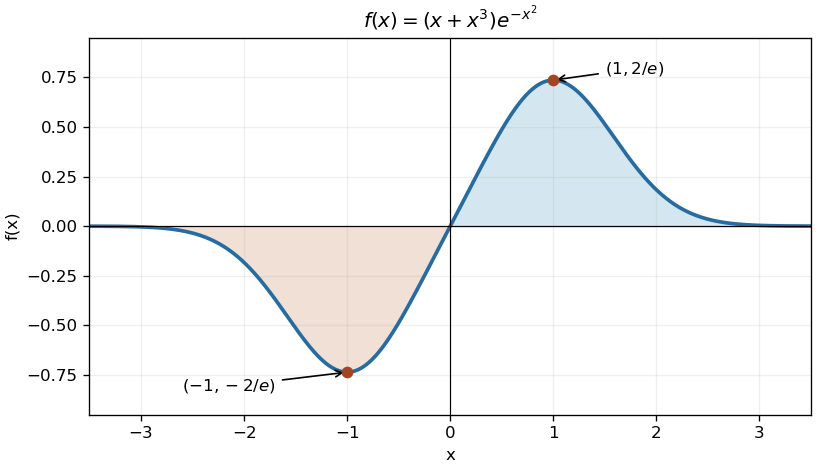

<h1 id="11/solution">Solution</h1>

↑ **Parent:** [11](../11.md)

Differentiation and factorization give $f'(x)=e^{-x^2}(1+x^2-2x^4)=e^{-x^2}(1-x^2)(1+2x^2)$. The exponential and $1+2x^2$ are positive, so the only [stationary points](../../../../stationary-point.md) are at $x=\pm1$. The derivative is positive for $|x|<1$ and negative for $|x|>1$, giving

$$
\boxed{(-1,-2/e)\text{ a global minimum},\qquad(1,2/e)\text{ a global maximum}.}
$$

The function is [odd](../../../../odd-function.md), crosses the origin with slope one, and tends to zero from below as $x\to-\infty$ and from above as $x\to\infty$. These facts determine the sketch.

**[Figure 2](#11/image-stationary-points-and-gaussian-decay-of-the-odd-polynomial-exponential-profile). Stationary points and Gaussian decay of the odd polynomial-exponential profile**. Original plot of $(x+x^3)e^{-x^2}$, with its global extrema marked. Shading indicates the equal and opposite signed areas on the two half-lines.

## ↑ Ancestors (12)

1. [11](../11.md)
2. [Paper 1](../../paper-1-split.md)
3. [2005](../../split.md)
4. [Past exam of the mathematics course of the year 1 of the natural sciences course of the University of Cambridge](../../../split.md)
5. [Mathematics course of the year 1 of the natural sciences course of the University of Cambridge](../../../../mathematics-course-of-the-year-1-of-the-natural-sciences-course-of-the-university-of-cambridge.md)
6. [Year 1 of the natural sciences course of the University of Cambridge](../../../../year-1-of-the-natural-sciences-course-of-the-university-of-cambridge.md)
7. [Year of the natural sciences course of the University of Cambridge](../../../../year-of-the-natural-sciences-course-of-the-university-of-cambridge.md)
8. [Natural sciences course of the University of Cambridge](../../../../natural-sciences-course-of-the-university-of-cambridge.md)
9. [Course of the University of Cambridge](../../../../course-of-the-university-of-cambridge.md)
10. [University of Cambridge](../../../../university-of-cambridge-split.md)
11. [List of universities](../../../../list-of-universities.md)
12. [Codex Wiki](../../../../split.md)
