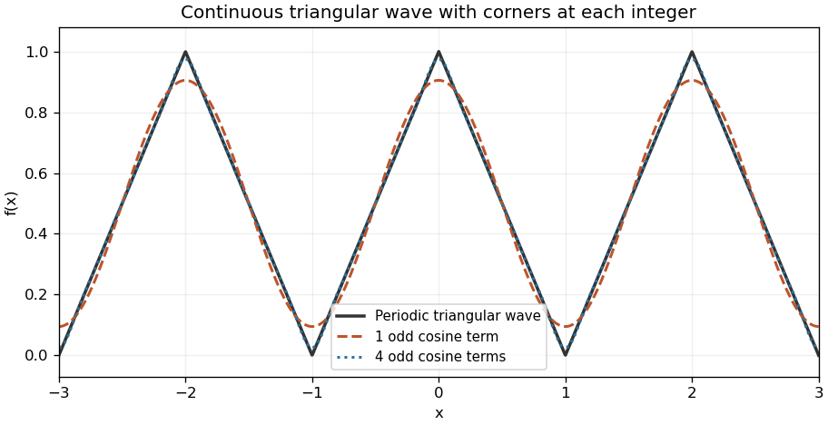

<h1 id="12/a/solution">Solution</h1>

↑ **Parent:** [A](../a.md)

The periodic extension is an [even](../../../../../even-function.md) [triangular wave](../../../../../triangular-wave.md): peaks of height one occur at the even integers $x=2k$ and valleys of height zero at the odd integers $x=2k+1$. Adjacent peaks and valleys are joined by straight segments of slopes $\pm1$. The function is continuous and has corners at every integer.

**[Figure 3](#12/a/image-period-two-triangular-wave-and-its-first-odd-cosine-harmonics). Period-two triangular wave and its first odd cosine harmonics**. Original graph of the periodic extension of $1-|x|$, together with the first one and four nonconstant terms of its Fourier cosine series.

## ↑ Ancestors (13)

1. [A](../a.md)
2. [12](../../12.md)
3. [Paper 1](../../../paper-1-split.md)
4. [2005](../../../split.md)
5. [Past exam of the mathematics course of the year 1 of the natural sciences course of the University of Cambridge](../../../../split.md)
6. [Mathematics course of the year 1 of the natural sciences course of the University of Cambridge](../../../../../mathematics-course-of-the-year-1-of-the-natural-sciences-course-of-the-university-of-cambridge.md)
7. [Year 1 of the natural sciences course of the University of Cambridge](../../../../../year-1-of-the-natural-sciences-course-of-the-university-of-cambridge.md)
8. [Year of the natural sciences course of the University of Cambridge](../../../../../year-of-the-natural-sciences-course-of-the-university-of-cambridge.md)
9. [Natural sciences course of the University of Cambridge](../../../../../natural-sciences-course-of-the-university-of-cambridge.md)
10. [Course of the University of Cambridge](../../../../../course-of-the-university-of-cambridge.md)
11. [University of Cambridge](../../../../../university-of-cambridge-split.md)
12. [List of universities](../../../../../list-of-universities.md)
13. [Codex Wiki](../../../../../split.md)
