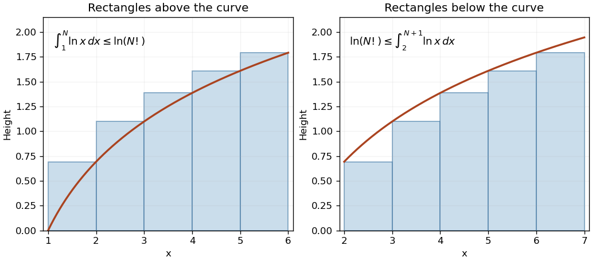

<h1 id="7/a/solution">Solution</h1>

↑ **Parent:** [A](../a.md)

The logarithm turns the product defining the [factorial](../../../../../factorial.md) into $\ln(N!)=\sum_{k=2}^N\ln k$. Since $\ln x$ is increasing, each term bounds integrals on its adjacent unit intervals:

$$
\int_{k-1}^k\ln x\,dx\leq\ln k\leq\int_k^{k+1}\ln x\,dx.
$$

Summing from $k=2$ to $N$ proves the [integral bounds for a logarithmic factorial](../../../../../integral-bounds-for-a-logarithmic-factorial.md):

$$
\boxed{N\ln N-N+1\leq\ln(N!)\leq(N+1)\ln(N+1)-N+1-2\ln2.}
$$

For $N=1$, both sides and the empty sum are zero. For $N\geq2$, the rectangle diagram gives the same inequalities geometrically. These bounds establish the leading $N\ln N-N$ growth, while [Stirling's formula](../../../../../stirling-formula.md) gives finer corrections.

**[Figure 1](#7/a/image-unit-rectangles-bound-the-logarithm-of-a-factorial-between-two-integrals). Unit rectangles bound the logarithm of a factorial between two integrals**. Original example with $N=6$. Left: each right-endpoint rectangle lies above $\ln x$ on $[k-1,k]$. Right: the same rectangle heights shifted to $[k,k+1]$ lie below $\ln x$. Both rectangle totals equal $\ln(6!)$.

## ↑ Ancestors (13)

1. [A](../a.md)
2. [7](../../7.md)
3. [Paper 1](../../../paper-1-split.md)
4. [2005](../../../split.md)
5. [Past exam of the mathematics course of the year 1 of the natural sciences course of the University of Cambridge](../../../../split.md)
6. [Mathematics course of the year 1 of the natural sciences course of the University of Cambridge](../../../../../mathematics-course-of-the-year-1-of-the-natural-sciences-course-of-the-university-of-cambridge.md)
7. [Year 1 of the natural sciences course of the University of Cambridge](../../../../../year-1-of-the-natural-sciences-course-of-the-university-of-cambridge.md)
8. [Year of the natural sciences course of the University of Cambridge](../../../../../year-of-the-natural-sciences-course-of-the-university-of-cambridge.md)
9. [Natural sciences course of the University of Cambridge](../../../../../natural-sciences-course-of-the-university-of-cambridge.md)
10. [Course of the University of Cambridge](../../../../../course-of-the-university-of-cambridge.md)
11. [University of Cambridge](../../../../../university-of-cambridge-split.md)
12. [List of universities](../../../../../list-of-universities.md)
13. [Codex Wiki](../../../../../split.md)
