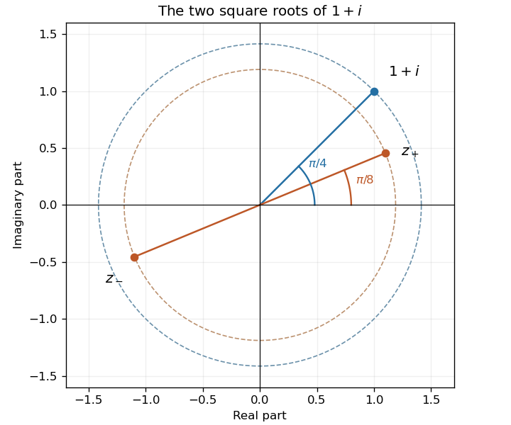
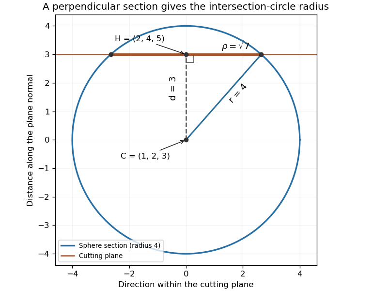
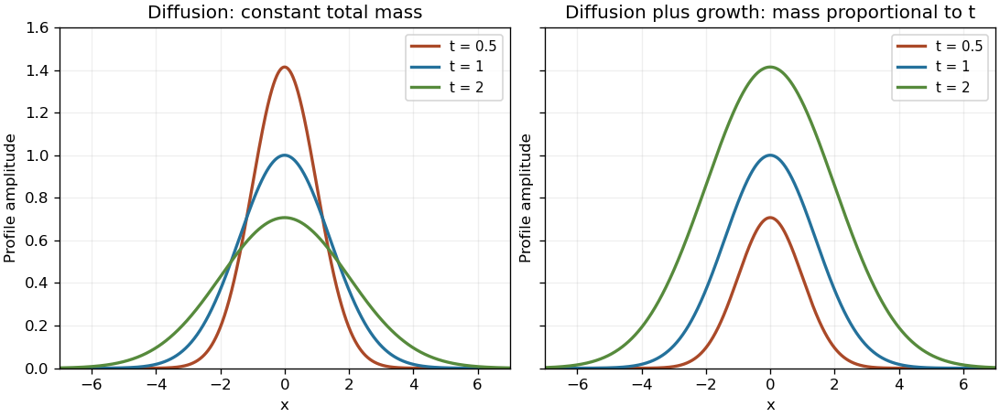

# Paper 2

↑ **Parent:** [2005](../2005.md)

[https://www.maths.cam.ac.uk/undergradnst/files/2005/PaperNST_IA_2.pdf](https://www.maths.cam.ac.uk/undergradnst/files/2005/PaperNST_IA_2.pdf)

**Table of contents**

- [1](#1)
  - [a](#1/a)
    - [i](#1/a/i)
      - [Solution](#1/a/i/solution)
    - [ii](#1/a/ii)
      - [Solution](#1/a/ii/solution)
  - [b](#1/b)
    - [Solution](#1/b/solution)
- [2](#2)
  - [Solution](#2/solution)
- [3](#3)
  - [a](#3/a)
    - [Solution](#3/a/solution)
  - [b](#3/b)
    - [i](#3/b/i)
      - [Solution](#3/b/i/solution)
    - [ii](#3/b/ii)
      - [Solution](#3/b/ii/solution)
- [4](#4)
  - [a](#4/a)
    - [Solution](#4/a/solution)
  - [b](#4/b)
    - [Solution](#4/b/solution)
  - [c](#4/c)
    - [Solution](#4/c/solution)
- [5](#5)
  - [a](#5/a)
    - [Solution](#5/a/solution)
  - [b](#5/b)
    - [Solution](#5/b/solution)
  - [c](#5/c)
    - [Solution](#5/c/solution)
- [6](#6)
  - [a](#6/a)
    - [Solution](#6/a/solution)
  - [b](#6/b)
    - [Solution](#6/b/solution)
  - [c](#6/c)
    - [Solution](#6/c/solution)
  - [d](#6/d)
    - [Solution](#6/d/solution)
- [7](#7)
  - [a](#7/a)
    - [Solution](#7/a/solution)
  - [b](#7/b)
    - [Solution](#7/b/solution)
- [8](#8)
  - [a](#8/a)
    - [Solution](#8/a/solution)
  - [b](#8/b)
    - [Solution](#8/b/solution)
  - [c](#8/c)
    - [Solution](#8/c/solution)
- [9](#9)
  - [a](#9/a)
    - [Solution](#9/a/solution)
  - [b](#9/b)
    - [Solution](#9/b/solution)
  - [c](#9/c)
    - [Solution](#9/c/solution)
- [10](#10)
  - [a](#10/a)
    - [Solution](#10/a/solution)
  - [b](#10/b)
    - [Solution](#10/b/solution)
  - [c](#10/c)
    - [Solution](#10/c/solution)
- [11](#11)
  - [a](#11/a)
    - [Solution](#11/a/solution)
  - [b](#11/b)
    - [Solution](#11/b/solution)
  - [c](#11/c)
    - [Solution](#11/c/solution)
- [12](#12)
  - [Solution](#12/solution)

## 1

↑ **Parent:** [Paper 2](paper-2.md)

<h3 id="1/a">a</h3>

↑ **Parent:** [1](#1)

<h4 id="1/a/i">i</h4>

↑ **Parent:** [A](#1/a)

<h5 id="1/a/i/solution">Solution</h5>

↑ **Parent:** [I](#1/a/i)

A differentiable [gradient field](../../multivariable-calculus.md#gradient-field) must have equal mixed derivatives. Here $\partial F_y/\partial z=3z^2$ but $\partial F_z/\partial y=-x$, which are not identically equal on any open region. Equivalently,

$$
\nabla\times\mathbf F=(-x-3z^2,\ x+y-3z^2,\ 0).
$$

Thus **no scalar potential exists for this field on an open region**. Vanishing of the [curl](../../multivariable-calculus.md#curl) on a special lower-dimensional set would not supply a three-dimensional potential.

<h4 id="1/a/ii">ii</h4>

↑ **Parent:** [A](#1/a)

<h5 id="1/a/ii/solution">Solution</h5>

↑ **Parent:** [Ii](#1/a/ii)

The $y$ component integrates to $\phi=xy e^{z-x}+g(x,z)$. Matching the $x$ component gives $g_x=2x$, and matching the $z$ component then gives the remaining derivative zero. Consequently

$$
\boxed{\phi(x,y,z)=xy e^{z-x}+x^2+C.}
$$

Direct differentiation recovers all three components, proving this is a [gradient field](../../multivariable-calculus.md#gradient-field) globally on $\mathbb R^3$.

<h3 id="1/b">b</h3>

↑ **Parent:** [1](#1)

<h4 id="1/b/solution">Solution</h4>

↑ **Parent:** [B](#1/b)

Write the surfaces as level sets $f_1=x^2y^2z-3x-z^2=0$ and $f_2=3x^2-y^2+2z-1=0$. Their [gradients](../../multivariable-calculus.md#gradient) are [normal vectors](../../differential-geometry.md#normal-vector) to their tangent planes. At the specified point they are $\mathbf n_1=(5,-4,2)$ and $\mathbf n_2=(6,4,2)$, with dot product $18$ and squared norms $45,56$. The [angle between intersecting regular surfaces](../../geometry-and-topology.md#angle-between-intersecting-regular-surfaces) is the angle between their tangent planes, so

$$
\boxed{\theta=\arccos\frac{|18|}{\sqrt{45}\sqrt{56}}=\arccos\frac3{\sqrt{70}}\simeq68.99^\circ.}
$$

Both gradients are nonzero, ensuring that the tangent planes are defined.

## 2

↑ **Parent:** [Paper 2](paper-2.md)

<h3 id="2/solution">Solution</h3>

↑ **Parent:** [2](#2)

Write $\mathbf F=\mathbf r\,r^{-\gamma-1}$. For $r>0$, direct Cartesian differentiation gives the [divergence and curl of a radial vector field](../../multivariable-calculus.md#divergence-and-curl-of-a-radial-vector-field):

$$
\partial_i(x_i r^{-\gamma-1})=3r^{-\gamma-1}-(\gamma+1)r^{-\gamma-3}x_ix_i=(2-\gamma)r^{-\gamma-1}.
$$

The volume element in [spherical coordinates](../../multivariable-calculus.md#spherical-coordinate-system) therefore gives, for $\gamma\ne2$,

$$
\boxed{\int_V\nabla\cdot\mathbf F\,dV=4\pi(2-\gamma)\int_\epsilon^R r^{1-\gamma}dr=4\pi(R^{2-\gamma}-\epsilon^{2-\gamma}).}
$$

For the direct [surface integral](../../multivariable-calculus.md#surface-integral), the outer sphere has outward normal $+\mathbf n$ and contributes $4\pi R^{2-\gamma}$. The inner boundary's outward normal relative to the shell is $-\mathbf n$, so it contributes $-4\pi\epsilon^{2-\gamma}$. Hence

$$
\boxed{\int_S\mathbf F\cdot d\mathbf A=4\pi(R^{2-\gamma}-\epsilon^{2-\gamma}).}
$$

For $\gamma=2$, the field has zero ordinary divergence everywhere in this shell. The separate surface contributions are $4\pi$ and $-4\pi$, so **both full integrals are zero**. This [radial power-law flux through a spherical shell](../../multivariable-calculus.md#radial-power-law-flux-through-a-spherical-shell) was obtained by direct differentiation and integration; the excluded origin is never part of the volume.

## 3

↑ **Parent:** [Paper 2](paper-2.md)

<h3 id="3/a">a</h3>

↑ **Parent:** [3](#3)

<h4 id="3/a/solution">Solution</h4>

↑ **Parent:** [A](#3/a)

A homogeneous [linear system](../../linear-algebra.md#system-of-linear-equations) has a nonzero solution exactly when its coefficient [matrix](../../vector-space.md#matrix) is singular. Expansion of the [determinant](../../multilinear-algebra.md#determinant) gives

$$
\det M=5\alpha^2+3\alpha-8=(\alpha-1)(5\alpha+8).
$$

Thus the allowed values are $\boxed{\alpha=1\text{ or }-8/5}$. Solving the first two equations and checking the third gives

$$
\boxed{\alpha=1:\ x=\frac z5,\ y=-\frac{7z}5;\qquad \alpha=-\frac85:\ x=-5z,\ y=\frac{5z}2.}
$$

In each case $z\ne0$ gives a nonzero solution and spans the one-dimensional [null space](../../kernel-of-a-linear-map.md); $z=0$ gives only the zero vector.

<h3 id="3/b">b</h3>

↑ **Parent:** [3](#3)

<h4 id="3/b/i">i</h4>

↑ **Parent:** [B](#3/b)

<h5 id="3/b/i/solution">Solution</h5>

↑ **Parent:** [I](#3/b/i)

Since $A^2=-\epsilon^2I$, its even powers are $A^{2k}=(-1)^k\epsilon^{2k}I$ and its odd powers are $A^{2k+1}=(-1)^k\epsilon^{2k}A$. Splitting the [matrix exponential](../../linear-operator-theory.md#matrix-exponential) into these two absolutely convergent subseries gives the [matrix exponential for a scalar square](../../linear-operator-theory.md#matrix-exponential-for-a-scalar-square):

$$
\boxed{S=e^A=I\cos\epsilon+\frac{\sin\epsilon}{\epsilon}A=\begin{pmatrix}\cos\epsilon&\sin\epsilon\\-\sin\epsilon&\cos\epsilon\end{pmatrix}.}
$$

At $\epsilon=0$, the coefficient $\sin\epsilon/\epsilon$ has limiting value one and $A=0$, so $S=I$. The result is a planar rotation through angle $-\epsilon$.

<h4 id="3/b/ii">ii</h4>

↑ **Parent:** [B](#3/b)

<h5 id="3/b/ii/solution">Solution</h5>

↑ **Parent:** [Ii](#3/b/ii)

Now $B^2=\epsilon^2I$, so splitting its [matrix exponential](../../linear-operator-theory.md#matrix-exponential) into even and odd powers yields hyperbolic functions:

$$
\boxed{T=e^B=I\cosh\epsilon+\frac{\sinh\epsilon}{\epsilon}B=\begin{pmatrix}\cosh\epsilon&\sinh\epsilon\\\sinh\epsilon&\cosh\epsilon\end{pmatrix}.}
$$

The limiting coefficient at $\epsilon=0$ is again one, and $T=I$. The [eigenvectors](../../linear-operator-theory.md#eigenvector) $(1,1)$ and $(1,-1)$ have factors $e^\epsilon$ and $e^{-\epsilon}$, respectively, showing how this hyperbolic transformation differs from a rotation.

## 4

↑ **Parent:** [Paper 2](paper-2.md)

<h3 id="4/a">a</h3>

↑ **Parent:** [4](#4)

<h4 id="4/a/solution">Solution</h4>

↑ **Parent:** [A](#4/a)

The [Lagrange multiplier](../../mathematical-optimization.md#lagrange-multiplier) equations are $2x=2\lambda x$, $-2y=2\lambda y$, together with $x^2+y^2=1$. If $x\ne0$, then $\lambda=1$ and $y=0$; if $y\ne0$, then $\lambda=-1$ and $x=0$. Thus

$$
\boxed{z_{\max}=1\text{ at }(\pm1,0),\qquad z_{\min}=-1\text{ at }(0,\pm1).}
$$

The constraint is compact and its gradient never vanishes, so these exhaust the possible global extrema. Equivalently, substituting $x=\cos\theta$, $y=\sin\theta$ gives $z=\cos2\theta$ along the boundary.

<h3 id="4/b">b</h3>

↑ **Parent:** [4](#4)

<h4 id="4/b/solution">Solution</h4>

↑ **Parent:** [B](#4/b)

Minimize the squared distance $D^2=(x-x_0)^2+(y-y_0)^2$ subject to $g=y-mx-c=0$. The [Lagrange multiplier](../../mathematical-optimization.md#lagrange-multiplier) condition $\nabla D^2=\lambda\nabla g$ gives $x=x_0-m\lambda/2$ and $y=y_0+\lambda/2$. Enforcing the line constraint gives $\lambda=2(mx_0+c-y_0)/(1+m^2)$, hence

$$
\boxed{x_*=\frac{x_0+m(y_0-c)}{1+m^2},\qquad y_*=\frac{mx_0+m^2y_0+c}{1+m^2}.}
$$

The displacement to this point is parallel to the line's [normal vector](../../differential-geometry.md#normal-vector) $(-m,1)$, so it is the [orthogonal projection](../../hilbert-space.md#orthogonal-projection). The squared distance restricted to the line has positive quadratic coefficient $1+m^2$, proving this stationary point is the unique global minimum.

<h3 id="4/c">c</h3>

↑ **Parent:** [4](#4)

<h4 id="4/c/solution">Solution</h4>

↑ **Parent:** [C](#4/c)

Let $w>0$ denote the stated cost per area of the cylindrical wall. Charge for the curved wall and cap as specified; no floor cost is supplied. The volume and cost are $V=\pi r^2h+2\pi r^3/3$ and $C=2\pi wrh+4\pi wr^2$. To minimize cost at fixed volume, apply a [Lagrange multiplier](../../mathematical-optimization.md#lagrange-multiplier) to $C-\lambda(\pi r^2h+2\pi r^3/3-V)$. Differentiation with respect to $h$ gives $\lambda=2w/r$. The $r$ derivative then gives $2\pi wh+8\pi wr=\lambda(2\pi rh+2\pi r^2)$, reducing to $h=2r$. Thus the [optimal cylinder and hemispherical cap with unequal surface costs](../../mathematical-optimization.md#optimal-cylinder-and-hemispherical-cap-with-unequal-surface-costs) has

$$
\boxed{r=\left(\frac{3V}{8\pi}\right)^{1/3},\qquad h=2\left(\frac{3V}{8\pi}\right)^{1/3}.}
$$

For a global check, eliminate $h$ to obtain $C(r)=2wV/r+(8\pi w/3)r^2$. Its second derivative is positive for $r>0$, and its critical radius gives $h>0$, so the constrained optimum lies inside the physically feasible range and is the unique minimum.

## 5

↑ **Parent:** [Paper 2](paper-2.md)

<h3 id="5/a">a</h3>

↑ **Parent:** [5](#5)

<h4 id="5/a/solution">Solution</h4>

↑ **Parent:** [A](#5/a)

The point $1+i$ has [modulus](../../complex-analysis.md#modulus) $\sqrt2$ and [argument](../../complex-analysis.md#argument-complex-analysis) $\pi/4$ modulo $2\pi$. Taking complex square roots halves the argument and takes the square root of the modulus:

$$
\boxed{|z|=2^{1/4},\qquad \arg z=\frac\pi8+k\pi\pmod{2\pi},\quad k=0,1.}
$$

The two roots are opposite points in the [complex plane](../../complex-analysis.md#complex-plane), explicitly $\pm[\sqrt{(\sqrt2+1)/2}+i\sqrt{(\sqrt2-1)/2}]$.

**[Figure 1](#5/a/image-the-complex-number-1-plus-i-and-its-two-square-roots). The complex number $1+i$ and its two square roots**. Original Argand diagram. Dashed circles show moduli $\sqrt2$ and $2^{1/4}$; the root rays differ by $\pi$ and each squares to the ray of argument $\pi/4$.

<h3 id="5/b">b</h3>

↑ **Parent:** [5](#5)

<h4 id="5/b/solution">Solution</h4>

↑ **Parent:** [B](#5/b)

Take the imaginary part of [De Moivre's theorem](../../analysis.md#de-moivre-s-theorem), $(\cos\theta+i\sin\theta)^5=\cos5\theta+i\sin5\theta$. With $s=\sin\theta$ and $\cos^2\theta=1-s^2$,

$$
\sin5\theta=5(1-s^2)^2s-10(1-s^2)s^3+s^5=\boxed{16s^5-20s^3+5s}.
$$

The required equation cancels the fifth powers and becomes $5s(1-4s^2)=0$. Thus $\sin\theta=0,\pm1/2$, giving all real solutions

$$
\boxed{\theta=n\pi\quad\text{or}\quad\theta=n\pi\pm\frac\pi6,\qquad n\in\mathbb Z.}
$$

<h3 id="5/c">c</h3>

↑ **Parent:** [5](#5)

<h4 id="5/c/solution">Solution</h4>

↑ **Parent:** [C](#5/c)

Use the exponential definitions of [complex sine function](../../calculus.md#complex-sine-function) and [complex cosine](../../geometry-and-topology.md#complex-cosine). Multiplying the equation by $2i$ gives $e^{iz}-e^{-iz}=-2(e^{iz}+e^{-iz})$, hence $3e^{iz}+e^{-iz}=0$. Since exponentials never vanish, this is equivalent to $e^{2iz}=-1/3$. All branches of the [complex logarithm](../../analysis.md#complex-logarithm) give

$$
2iz=-\ln3+i(\pi+2\pi n),\qquad\boxed{z=\frac\pi2+n\pi+\frac i2\ln3,\quad n\in\mathbb Z.}
$$

The derivation does not divide by $\cos z$, so it introduces no lost zero-denominator cases.

## 6

↑ **Parent:** [Paper 2](paper-2.md)

<h3 id="6/a">a</h3>

↑ **Parent:** [6](#6)

<h4 id="6/a/solution">Solution</h4>

↑ **Parent:** [A](#6/a)

The [sphere](../../euclidean-geometry.md#sphere) consists of points whose displacement from its center has fixed norm. Its vector and Cartesian equations are

$$
\boxed{|\mathbf r-(1,2,3)|=4,\qquad(x-1)^2+(y-2)^2+(z-3)^2=16.}
$$

Equivalently, $\mathbf r=(1,2,3)+4\mathbf n$ with $|\mathbf n|=1$.

<h3 id="6/b">b</h3>

↑ **Parent:** [6](#6)

<h4 id="6/b/solution">Solution</h4>

↑ **Parent:** [B](#6/b)

The coefficient vector $\mathbf n=(1,2,2)$ is a [normal vector](../../differential-geometry.md#normal-vector), so a vector equation of the plane is

$$
\boxed{\mathbf n\cdot\mathbf r=20.}
$$

A parametric version is $\mathbf r=(20,0,0)+s(-2,1,0)+t(-2,0,1)$, since both independent direction vectors are perpendicular to $\mathbf n$.

<h3 id="6/c">c</h3>

↑ **Parent:** [6](#6)

<h4 id="6/c/solution">Solution</h4>

↑ **Parent:** [C](#6/c)

The [distance from a point to a plane](../../geometry-and-topology.md#distance-from-a-point-to-a-plane) is the absolute residual of the plane equation divided by its normal's length. Here $\mathbf n\cdot\mathbf c=11$ and $|\mathbf n|=3$, so

$$
\boxed{d=\frac{|11-20|}{3}=3.}
$$

<h3 id="6/d">d</h3>

↑ **Parent:** [6](#6)

<h4 id="6/d/solution">Solution</h4>

↑ **Parent:** [D](#6/d)

The center of the [sphere-plane intersection](../../geometry-and-topology.md#sphere-plane-intersection) is the perpendicular projection of the sphere's center onto the plane:

$$
\boxed{\mathbf c_\circ=\mathbf c+\frac{20-\mathbf n\cdot\mathbf c}{|\mathbf n|^2}\mathbf n=(1,2,3)+(1,2,2)=(2,4,5).}
$$

The distance from $\mathbf c$ to the plane is $3<4$, so the intersection is a genuine circle. A [right triangle](../../euclidean-geometry.md#right-triangle) with hypotenuse equal to the sphere radius gives

$$
\boxed{\rho=\sqrt{4^2-3^2}=\sqrt7.}
$$

Its plane is the given plane; displacements within it are perpendicular to $\mathbf n$.

**[Figure 2](#6/d/image-meridional-section-of-the-sphere-and-its-intersection-circle). Meridional section of the sphere and its intersection circle**. Original section through the sphere center and the plane normal. The horizontal chord is a diameter of the intersection circle; the right triangle gives $4^2=3^2+\rho^2$. Labels give the centers' original three-dimensional coordinates.

## 7

↑ **Parent:** [Paper 2](paper-2.md)

<h3 id="7/a">a</h3>

↑ **Parent:** [7](#7)

<h4 id="7/a/solution">Solution</h4>

↑ **Parent:** [A](#7/a)

The required [Legendre transform](../../convex-optimization.md#convex-conjugate) is the [Helmholtz free energy](../../thermodynamic-potential.md#helmholtz-free-energy), $\boxed{F=U-TS}$ up to an additive constant. Its differential is $dF=dU-TdS-SdT=-SdT-pdV$, so $F_T|_V=-S$ and $F_V|_T=-p$. Equality of mixed partial derivatives for a smooth thermodynamic state gives the [Maxwell relation](../../thermodynamics.md#maxwell-relations)

$$
\boxed{\left(\frac{\partial S}{\partial V}\right)_T=\left(\frac{\partial p}{\partial T}\right)_V.}
$$

Next use the [total differential](../../multivariable-calculus.md#total-differential) $dS=S_T|_VdT+S_V|_TdV$. Along a fixed-pressure path, divide by $dT$ to get $S_T|_p=S_T|_V+S_V|_T V_T|_p$. Substitute the Maxwell relation to obtain

$$
\boxed{\left(\frac{\partial S}{\partial T}\right)_p-\left(\frac{\partial S}{\partial T}\right)_V=\left(\frac{\partial p}{\partial T}\right)_V\left(\frac{\partial V}{\partial T}\right)_p.}
$$

Multiplying by $T$ gives the usual difference between the [heat capacity at constant pressure](../../enthalpy.md#heat-capacity-at-constant-pressure) and the [heat capacity at constant volume](../../heat.md#heat-capacity-at-constant-volume).

<h3 id="7/b">b</h3>

↑ **Parent:** [7](#7)

<h4 id="7/b/solution">Solution</h4>

↑ **Parent:** [B](#7/b)

At fixed entropy, the [total differential](../../multivariable-calculus.md#total-differential) in coordinates $(T,p)$ is $0=S_T|_p\,dT+S_p|_T\,dp$. Dividing by $dT$ along that path gives $S_T|_p=-S_p|_T p_T|_S$. The same argument in coordinates $(T,V)$ gives $S_T|_V=-S_V|_T V_T|_S$. These are the two required intermediate identities.

To prove the final result without cancelling a possibly vanishing thermal-expansion derivative, write $a=S_T|_V$, $b=S_V|_T$, $c=p_T|_V$, $d=p_V|_T$. In a regular thermodynamic region with $a,d\ne0$, fixed pressure gives $V_T|_p=-c/d$, while fixed entropy gives $T_V|_S=-b/a$. The [chain rule](../../calculus.md#chain-rule) then gives $S_T|_p=a-bc/d$ and $p_V|_S=d-bc/a$. Both cross-products equal $ad-bc$, proving

$$
\boxed{\left(\frac{\partial S}{\partial T}\right)_p\left(\frac{\partial p}{\partial V}\right)_T=\left(\frac{\partial p}{\partial V}\right)_S\left(\frac{\partial S}{\partial T}\right)_V.}
$$

The [heat-capacity and compressibility ratio identity](../../thermodynamics.md#heat-capacity-and-compressibility-ratio-identity) rewrites this as $C_p/C_V=\kappa_T/\kappa_S$: keeping entropy fixed rather than temperature fixed changes the mechanical stiffness by the same factor as the two thermal responses.

## 8

↑ **Parent:** [Paper 2](paper-2.md)

<h3 id="8/a">a</h3>

↑ **Parent:** [8](#8)

<h4 id="8/a/solution">Solution</h4>

↑ **Parent:** [A](#8/a)

Here $P_y=5=Q_x$, and direct integration constructs a global potential for this [exact differential form](../../differential-form.md#exact-differential-form). Integrate $P$ with respect to $x$ to obtain $f=6x^2+5xy-9x+g(y)$; matching $f_y=Q$ gives $g'=3y-4$. Thus

$$
\boxed{f(x,y)=6x^2+5xy-9x+\frac32y^2-4y+C.}
$$

Both derivatives recover the supplied coefficients.

<h3 id="8/b">b</h3>

↑ **Parent:** [8](#8)

<h4 id="8/b/solution">Solution</h4>

↑ **Parent:** [B](#8/b)

The form is **not exact**, because $P_y=1$ and $Q_x=2$. For an [integrating factor depending on one coordinate](../../linear-ordinary-differential-equation.md#integrating-factor-depending-on-one-coordinate), the condition $(\mu P)_y=(\mu Q)_x$ with $\mu=\mu(x)$ gives $\mu'/\mu=(P_y-Q_x)/Q=-1/(2x)$. Thus

$$
\boxed{\mu(x)=|x|^{-1/2}\quad\text{on either half-plane }x\ne0.}
$$

For example, on $x>0$, the multiplied form is $(\sqrt x+y/\sqrt x)dx+2\sqrt x\,dy$, with potential $\boxed{f=\tfrac23x^{3/2}+2y\sqrt x+C}$. On $x<0$, a corresponding potential is $f=\tfrac23(-x)^{3/2}-2y\sqrt{-x}+C$. The factor is local to these domains and is singular on the excluded line $x=0$.

<h3 id="8/c">c</h3>

↑ **Parent:** [8](#8)

<h4 id="8/c/solution">Solution</h4>

↑ **Parent:** [C](#8/c)

The origin is excluded by the denominator. On the punctured plane, direct differentiation gives

$$
d\left(-\frac{x}{x^2+y^2}\right)=\frac{(x^2-y^2)dx+2xy\,dy}{(x^2+y^2)^2}.
$$

Hence the form is **exact on its whole stated domain**, with $\boxed{f=-x/(x^2+y^2)+C}$. Although the punctured plane is not simply connected, the explicitly constructed single-valued potential establishes global exactness directly; a topological sufficiency criterion is unnecessary here.

## 9

↑ **Parent:** [Paper 2](paper-2.md)

<h3 id="9/a">a</h3>

↑ **Parent:** [9](#9)

<h4 id="9/a/solution">Solution</h4>

↑ **Parent:** [A](#9/a)

A real [normal matrix](../../linear-operator-theory.md#normal-matrix) satisfies $MM^T=M^TM$. For a [symmetric matrix](../../linear-algebra.md#symmetric-matrix), $M^T=M$ and both products equal $M^2$. For an [antisymmetric matrix](../../linear-algebra.md#skew-symmetric-matrix), $M^T=-M$ and both equal $-M^2$. For an [orthogonal matrix](../../linear-algebra.md#orthogonal-matrix), both products are the identity. Thus **each of the three classes consists of normal matrices**.

<h3 id="9/b">b</h3>

↑ **Parent:** [9](#9)

<h4 id="9/b/solution">Solution</h4>

↑ **Parent:** [B](#9/b)

The upper $2\times2$ block has trace zero and determinant $-\cos^22\theta-\sin^22\theta=-1$, so its characteristic polynomial is $\lambda^2-1$. The third coordinate has eigenvalue two. Angle-addition identities give the normalized [eigenvectors](../../linear-operator-theory.md#eigenvector)

$$
\boxed{\lambda_+=1:\ \mathbf u_+=(\cos\theta,\sin\theta,0),\qquad\lambda_-=-1:\ \mathbf u_-=(-\sin\theta,\cos\theta,0),\qquad\lambda_3=2:\ \mathbf u_3=(0,0,1).}
$$

These formulas apply to every real $\theta$, including values where an expression obtained by dividing by $\sin2\theta$ would fail. Geometrically the planar block is a reflection: it fixes the axis at angle $\theta$ and reverses its perpendicular direction.

<h3 id="9/c">c</h3>

↑ **Parent:** [9](#9)

<h4 id="9/c/solution">Solution</h4>

↑ **Parent:** [C](#9/c)

The [dot product](../../inner-product.md#dot-product) is $\mathbf u_+\cdot\mathbf u_-=-\cos\theta\sin\theta+\sin\theta\cos\theta=0$. Each planar vector is perpendicular to $\mathbf u_3$ because its third component vanishes. Each has norm one, so the three vectors form an [orthonormal eigenbasis](../../linear-operator-theory.md#orthonormal-eigenbasis). This also follows from the [spectral theorem](../../hilbert-space.md#spectral-theorem) for the real symmetric coefficient matrix.

## 10

↑ **Parent:** [Paper 2](paper-2.md)

<h3 id="10/a">a</h3>

↑ **Parent:** [10](#10)

<h4 id="10/a/solution">Solution</h4>

↑ **Parent:** [A](#10/a)

For a strictly decreasing function, $f(n+1)<f(x)<f(n)$ in the interior of $[n,n+1]$. Integrating over the unit interval and summing from $n=r$ to $s-1$ gives the [integral comparison for a nonincreasing nonnegative function](../../sequence-and-series.md#integral-comparison-for-a-nonincreasing-nonnegative-function):

$$
\boxed{\sum_{n=r+1}^sf(n)<\int_r^sf(x)dx<\sum_{n=r}^{s-1}f(n).}
$$

Geometrically, right-endpoint rectangles lie below the curve and left-endpoint rectangles above it. If “decreasing” permits flat pieces, use non-strict inequalities unless strictness is ensured on some interval. When $r=1$, the endpoint value $f(1)$ is also needed; the power function below is defined there.

<h3 id="10/b">b</h3>

↑ **Parent:** [10](#10)

<h4 id="10/b/solution">Solution</h4>

↑ **Parent:** [B](#10/b)

For $f(x)=x^{-1-p}$ with $p>0$, the [integral comparison](../../sequence-and-series.md#integral-comparison-for-a-nonincreasing-nonnegative-function) on $[1,N]$ gives $\sum_{n=2}^Nn^{-1-p}<I_N<\sum_{n=1}^{N-1}n^{-1-p}$, where $I_N=(1-N^{-p})/p$. Add the missing endpoint term on each side to obtain

$$
\boxed{\frac{1-N^{-p}}p+N^{-1-p}<\sum_{n=1}^Nn^{-1-p}<\frac{1-N^{-p}}p+1.}
$$

The lower bound uses the right inequality for $I_N$ and adds $N^{-1-p}$; the upper uses the left inequality and adds one.

<h3 id="10/c">c</h3>

↑ **Parent:** [10](#10)

<h4 id="10/c/solution">Solution</h4>

↑ **Parent:** [C](#10/c)

For fixed $p>0$, the partial sums are increasing and bounded above by $1+1/p$. The [monotone convergence theorem for sequences](../../sequence-and-series.md#bounded-monotone-sequence-theorem) therefore proves convergence to a finite sum $S(p)$. Passing to the limit $N\to\infty$ in the two bounds gives

$$
\frac1p\leq S(p)\leq\frac1p+1,\qquad1\leq pS(p)\leq1+p.
$$

The [squeeze theorem](../../calculus.md#squeeze-theorem) now yields

$$
\boxed{\lim_{p\downarrow0}p\sum_{n=1}^\infty n^{-1-p}=1.}
$$

Since $S(p)=\zeta(1+p)$, this is the [real-axis singular limit of the Riemann zeta function at one](../../analytic-number-theory.md#real-axis-singular-limit-of-the-riemann-zeta-function-at-one). The limiting sum is taken at fixed $p$ before sending $p$ to zero; setting $p=0$ inside the convergent-series argument would instead give the divergent harmonic series.

## 11

↑ **Parent:** [Paper 2](paper-2.md)

<h3 id="11/a">a</h3>

↑ **Parent:** [11](#11)

<h4 id="11/a/solution">Solution</h4>

↑ **Parent:** [A](#11/a)

The [partial fraction decomposition](../../isolated-singularity.md#partial-fraction-decomposition) is

$$
\frac{3x^2+5x+1}{x(x+1)(x+2)}=\frac1{2x}+\frac1{x+1}+\frac3{2(x+2)}.
$$

Integrating between one and two gives

$$
\boxed{\frac12\ln2+\ln\frac32+\frac32\ln\frac43=\frac12\ln\frac{32}{3}.}
$$

All logarithm arguments are positive on this integration interval.

<h3 id="11/b">b</h3>

↑ **Parent:** [11](#11)

<h4 id="11/b/solution">Solution</h4>

↑ **Parent:** [B](#11/b)

The double-angle identity gives $1+\cos2\theta=2\cos^2\theta$. Therefore

$$
\boxed{\int_0^{\pi/4}\frac{d\theta}{1+\cos2\theta}=\frac12\int_0^{\pi/4}\sec^2\theta\,d\theta=\frac12[\tan\theta]_0^{\pi/4}=\frac12.}
$$

<h3 id="11/c">c</h3>

↑ **Parent:** [11](#11)

<h4 id="11/c/solution">Solution</h4>

↑ **Parent:** [C](#11/c)

Use [integration by substitution](../../integral.md#integration-by-substitution) with $\theta=\pi/4-\varphi/2$, so $\sin\varphi=\cos2\theta$ and $d\varphi=-2d\theta$. Reversing the transformed limits gives

$$
\boxed{\int_0^{\pi/2}\frac{d\varphi}{1+\sin\varphi}=2\int_0^{\pi/4}\frac{d\theta}{1+\cos2\theta}=1.}
$$

The original integrand is finite at both endpoints.

## 12

↑ **Parent:** [Paper 2](paper-2.md)

<h3 id="12/solution">Solution</h3>

↑ **Parent:** [12](#12)

Work with $t>0$ and write $u=t^{-1/2}e^{-x^2/(4t)}$. The [chain rule](../../calculus.md#chain-rule) gives

$$
u_x=-\frac{x}{2t}u,\qquad u_{xx}=\left(\frac{x^2}{4t^2}-\frac1{2t}\right)u,\qquad u_t=\left(\frac{x^2}{4t^2}-\frac1{2t}\right)u.
$$

Thus $u_{xx}=u_t$: it is a constant multiple of the one-dimensional [Gaussian heat kernel](../../diffusion-equation.md#gaussian-heat-kernel).

For the modified equation, put $f=g(t)u$. Substitution gives $g u_{xx}=g'u+gu_t-gu/t$. The heat-equation terms cancel, and $u>0$ permits division to obtain $\boxed{g'=g/t}$. Solving this [separable differential equation](../../differential-equation.md#separable-differential-equation) gives

$$
\boxed{g(t)=Ct,\qquad f(x,t)=C\sqrt t\,e^{-x^2/(4t)},\quad t>0.}
$$

The zero solution is included by $C=0$. This is the [scalar integrating factor for a reaction-diffusion equation](../../diffusion-equation.md#scalar-integrating-factor-for-a-reaction-diffusion-equation) with reaction coefficient $1/t$, because the modified equation is $f_t=f_{xx}+f/t$. Its sign produces growth. Indeed $\int_{\mathbb R}u\,dx=2\sqrt\pi$ is constant, while $\int_{\mathbb R}f\,dx=2C\sqrt\pi\,t$ increases linearly for $C>0$; neither profile is being assigned unit normalization here.

**[Figure 3](#12/image-diffusive-spreading-with-conserved-mass-versus-the-same-spreading-with-amplitude-growth). Diffusive spreading with conserved mass versus the same spreading with amplitude growth**. Original profiles at $t=0.5,1,2$. The left solution is $t^{-1/2}e^{-x^2/(4t)}$; the right is $\sqrt t\,e^{-x^2/(4t)}$ with $C=1$. Their widths both grow as $\sqrt t$, but their spatial integrals are respectively constant and proportional to $t$.

## ↑ Ancestors (10)

1. [2005](../2005.md)
2. [Past exam of the mathematics course of the year 1 of the natural sciences course of the University of Cambridge](../../past-exam-of-the-mathematics-course-of-the-year-1-of-the-natural-sciences-course-of-the-university-of-cambridge.md)
3. [Mathematics course of the year 1 of the natural sciences course of the University of Cambridge](../../university-of-cambridge.md#mathematics-course-of-the-year-1-of-the-natural-sciences-course-of-the-university-of-cambridge)
4. [Year 1 of the natural sciences course of the University of Cambridge](../../university-of-cambridge.md#year-1-of-the-natural-sciences-course-of-the-university-of-cambridge)
5. [Year of the natural sciences course of the University of Cambridge](../../university-of-cambridge.md#year-of-the-natural-sciences-course-of-the-university-of-cambridge)
6. [Natural sciences course of the University of Cambridge](../../university-of-cambridge.md#natural-sciences-course-of-the-university-of-cambridge)
7. [Course of the University of Cambridge](../../university-of-cambridge.md#course-of-the-university-of-cambridge)
8. [University of Cambridge](../../university-of-cambridge.md)
9. [List of universities](../../README.md#list-of-universities)
10. [Codex Wiki](../../README.md)
