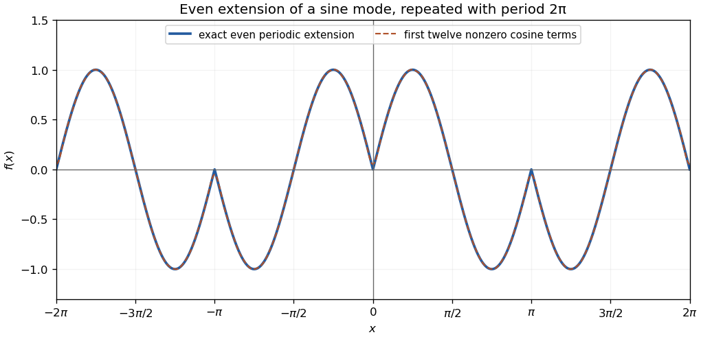

<h1 id="11/a/solution">Solution</h1>

↑ **Parent:** [A](../a.md)

The function is [even](../../../../../even-function.md) and continuous, with period $2\pi$. On $0<x<\pi$ it is $\sin2x$, so it rises from zero to one at $\pi/4$, crosses zero at $\pi/2$, reaches minus one at $3\pi/4$, and returns to zero at $\pi$. Reflect this curve about the vertical axis and repeat periodically. The joins at integer multiples of $\pi$ have corners, but no jumps.

**[Figure 1](#11/a/image-even-periodic-extension-of-a-sine-mode-and-its-fourier-approximation). Even periodic extension of a sine mode and its Fourier approximation**. Original plot over two periods. The dashed approximation uses the first twelve nonzero cosine coefficients; the exact function is continuous with corners at integer multiples of $\pi$.

## ↑ Ancestors (13)

1. [A](../a.md)
2. [11](../../11.md)
3. [Paper 1](../../../paper-1-split.md)
4. [2006](../../../split.md)
5. [Past exam of the mathematics course of the year 1 of the natural sciences course of the University of Cambridge](../../../../split.md)
6. [Mathematics course of the year 1 of the natural sciences course of the University of Cambridge](../../../../../mathematics-course-of-the-year-1-of-the-natural-sciences-course-of-the-university-of-cambridge.md)
7. [Year 1 of the natural sciences course of the University of Cambridge](../../../../../year-1-of-the-natural-sciences-course-of-the-university-of-cambridge.md)
8. [Year of the natural sciences course of the University of Cambridge](../../../../../year-of-the-natural-sciences-course-of-the-university-of-cambridge.md)
9. [Natural sciences course of the University of Cambridge](../../../../../natural-sciences-course-of-the-university-of-cambridge.md)
10. [Course of the University of Cambridge](../../../../../course-of-the-university-of-cambridge.md)
11. [University of Cambridge](../../../../../university-of-cambridge-split.md)
12. [List of universities](../../../../../list-of-universities.md)
13. [Codex Wiki](../../../../../split.md)
