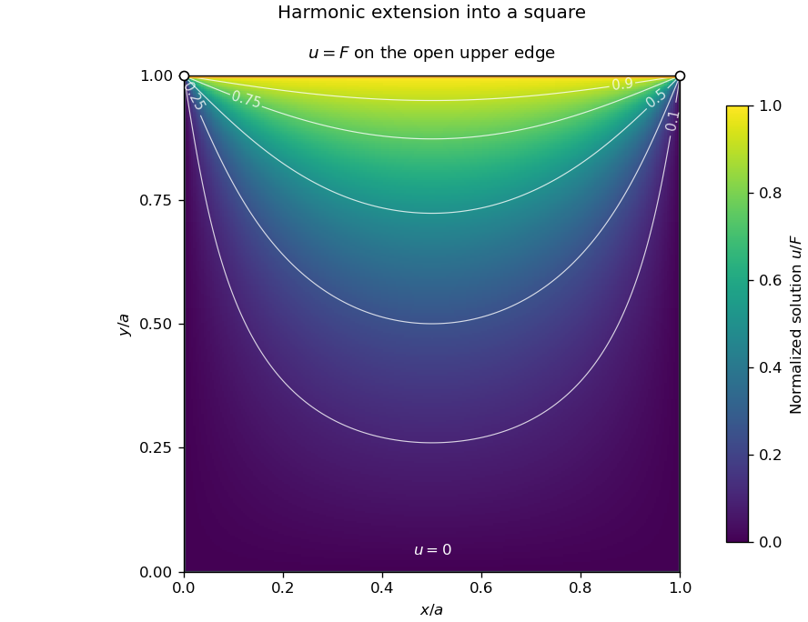

<h1 id="12/b/solution">Solution</h1>

↑ **Parent:** [B](../b.md)

The zero values at $x=0,a$ select $X_n=\sin(n\pi x/a)$, and the zero value at $y=0$ selects $Y_n=\sinh(n\pi y/a)$. Expanding the constant upper-edge value as a [Fourier sine series](../../../../../fourier-sine-series.md) gives coefficients $b_n=2F[1-(-1)^n]/(n\pi)$. The resulting [harmonic function in a rectangle with one constant boundary value](../../../../../harmonic-function-in-a-rectangle-with-one-constant-boundary-value.md) is

$$
\boxed{f(x,y)=\frac{4F}{\pi}\sum_{m=0}^\infty\frac{\sin((2m+1)\pi x/a)}{2m+1}\frac{\sinh((2m+1)\pi y/a)}{\sinh((2m+1)\pi)},\qquad0<x,y<a.}
$$

Each term satisfies [Laplace's equation](../../../../../laplace-equation.md) and the three zero boundary values. At $y=a$, the series equals $F$ for $0<x<a$. On compact subsets of the interior it and its derivatives converge exponentially, which justifies the termwise equation.

For $F\ne0$, the top-corner boundary prescriptions conflict: a corner cannot be both zero on a vertical edge and $F$ on the upper edge. The bounded interior solution has the specified limits along the open sides; it has no single continuous extension at those two corners. Values assigned only at the isolated corners do not change the interior solution.

**[Figure 2](#12/b/image-harmonic-extension-from-one-heated-edge-of-a-square). Harmonic extension from one heated edge of a square**. Original normalized solution $f/F$, with the upper open edge fixed at one and the other three open edges at zero. The top corner circles mark incompatible side limits, not prescribed continuous corner temperatures.

## ↑ Ancestors (13)

1. [B](../b.md)
2. [12](../../12.md)
3. [Paper 1](../../../paper-1-split.md)
4. [2006](../../../split.md)
5. [Past exam of the mathematics course of the year 1 of the natural sciences course of the University of Cambridge](../../../../split.md)
6. [Mathematics course of the year 1 of the natural sciences course of the University of Cambridge](../../../../../mathematics-course-of-the-year-1-of-the-natural-sciences-course-of-the-university-of-cambridge.md)
7. [Year 1 of the natural sciences course of the University of Cambridge](../../../../../year-1-of-the-natural-sciences-course-of-the-university-of-cambridge.md)
8. [Year of the natural sciences course of the University of Cambridge](../../../../../year-of-the-natural-sciences-course-of-the-university-of-cambridge.md)
9. [Natural sciences course of the University of Cambridge](../../../../../natural-sciences-course-of-the-university-of-cambridge.md)
10. [Course of the University of Cambridge](../../../../../course-of-the-university-of-cambridge.md)
11. [University of Cambridge](../../../../../university-of-cambridge-split.md)
12. [List of universities](../../../../../list-of-universities.md)
13. [Codex Wiki](../../../../../split.md)
