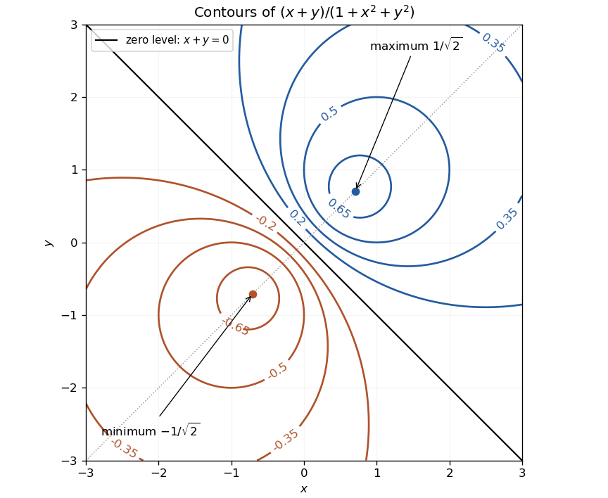

<h1 id="12/c/solution">Solution</h1>

↑ **Parent:** [C](../c.md)

For a nonzero level $h$, completing the square gives

$$
\boxed{\left(x-\frac1{2h}\right)^2+\left(y-\frac1{2h}\right)^2=\frac1{2h^2}-1.}
$$

Thus the [level sets of a linear numerator over a radial quadratic](../../../../../level-sets-of-a-linear-numerator-over-a-radial-quadratic.md) are circles centred on $y=x$, real only for $0<|h|\leq1/\sqrt2$. The extreme levels shrink to points. The zero contour is the straight line $x+y=0$, separating positive and negative heights; near it, small nonzero levels are large circles. Heights tend to zero at infinity.

**[Figure 3](#12/c/image-circular-nonzero-contours-around-the-two-extrema-of-a-rational-height-function). Circular nonzero contours around the two extrema of a rational height function**. Original contour plot. Blue positive and orange negative circles surround the marked maximum and minimum; the black line is the zero contour. Circle centres lie on $y=x$.

## ↑ Ancestors (13)

1. [C](../c.md)
2. [12](../../12.md)
3. [Paper 2](../../../paper-2-split.md)
4. [2006](../../../split.md)
5. [Past exam of the mathematics course of the year 1 of the natural sciences course of the University of Cambridge](../../../../split.md)
6. [Mathematics course of the year 1 of the natural sciences course of the University of Cambridge](../../../../../mathematics-course-of-the-year-1-of-the-natural-sciences-course-of-the-university-of-cambridge.md)
7. [Year 1 of the natural sciences course of the University of Cambridge](../../../../../year-1-of-the-natural-sciences-course-of-the-university-of-cambridge.md)
8. [Year of the natural sciences course of the University of Cambridge](../../../../../year-of-the-natural-sciences-course-of-the-university-of-cambridge.md)
9. [Natural sciences course of the University of Cambridge](../../../../../natural-sciences-course-of-the-university-of-cambridge.md)
10. [Course of the University of Cambridge](../../../../../course-of-the-university-of-cambridge.md)
11. [University of Cambridge](../../../../../university-of-cambridge-split.md)
12. [List of universities](../../../../../list-of-universities.md)
13. [Codex Wiki](../../../../../split.md)
