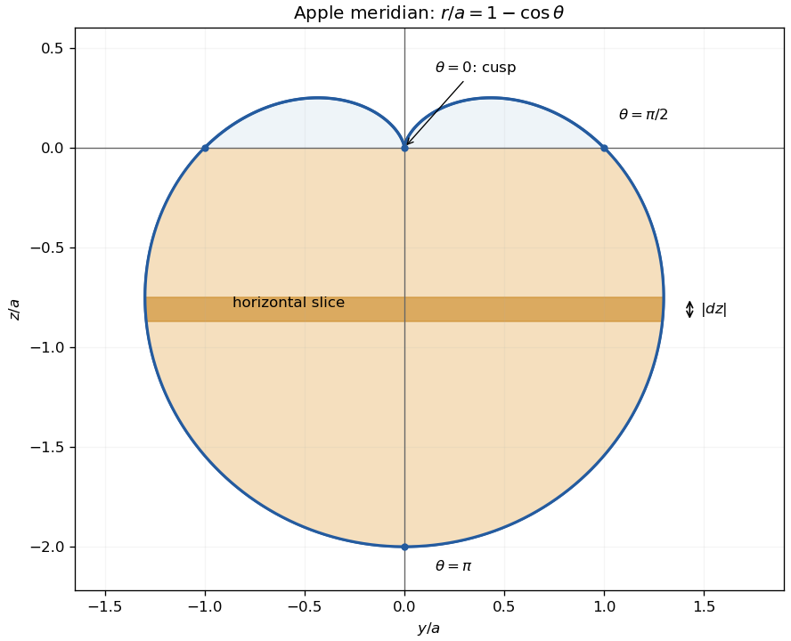

<h1 id="5/a/solution">Solution</h1>

↑ **Parent:** [A](../a.md)

In the plane $x=0$, the right half of the cross-section has coordinates $y=a(1-\cos\theta)\sin\theta$, $z=a(1-\cos\theta)\cos\theta$, $0\leq\theta\leq\pi$. Reflect across the $z$ axis for the other half. The [cardioid](../../../../../cardioid.md) has a cusp at $(y,z)=(0,0)$ for $\theta=0$, crosses $z=0$ at $(\pm a,0)$ for $\theta=\pi/2$, and reaches $(0,-2a)$ for $\theta=\pi$. The small upper lobes reach $z=a/4$; the widest section is below the equator.

**[Figure 1](#5/a/image-cardioid-cross-section-and-a-horizontal-slice-of-the-apple-shaped-solid). Cardioid cross-section and a horizontal slice of the apple-shaped solid**. Original plot in units of $a$. The shaded lower portion has polar angles above $\pi/2$. The thin marked slice is bounded by horizontal planes, rather than by rays from the origin.

## ↑ Ancestors (13)

1. [A](../a.md)
2. [5](../../5.md)
3. [Paper 2](../../../paper-2-split.md)
4. [2006](../../../split.md)
5. [Past exam of the mathematics course of the year 1 of the natural sciences course of the University of Cambridge](../../../../split.md)
6. [Mathematics course of the year 1 of the natural sciences course of the University of Cambridge](../../../../../mathematics-course-of-the-year-1-of-the-natural-sciences-course-of-the-university-of-cambridge.md)
7. [Year 1 of the natural sciences course of the University of Cambridge](../../../../../year-1-of-the-natural-sciences-course-of-the-university-of-cambridge.md)
8. [Year of the natural sciences course of the University of Cambridge](../../../../../year-of-the-natural-sciences-course-of-the-university-of-cambridge.md)
9. [Natural sciences course of the University of Cambridge](../../../../../natural-sciences-course-of-the-university-of-cambridge.md)
10. [Course of the University of Cambridge](../../../../../course-of-the-university-of-cambridge.md)
11. [University of Cambridge](../../../../../university-of-cambridge-split.md)
12. [List of universities](../../../../../list-of-universities.md)
13. [Codex Wiki](../../../../../split.md)
