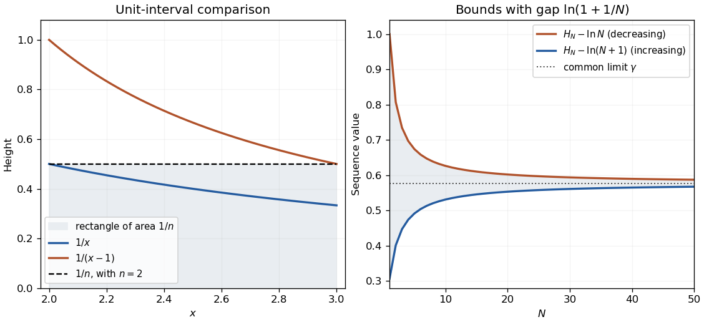

<h1 id="6/b/solution">Solution</h1>

↑ **Parent:** [B](../b.md)

For $n<x<n+1$, monotonicity gives $1/x<1/n<1/(x-1)$. Integrating over that unit interval proves the strict inequalities, equivalently $\ln(1+1/n)<1/n<\ln(n/(n-1))$ for $n>1$.

Let $H_N$ be the [harmonic number](../../../../../harmonic-number.md) and define $u_N=H_N-\ln N$, $v_N=H_N-\ln(N+1)$. The same integral comparison gives $u_{N+1}-u_N=1/(N+1)-\ln(1+1/N)<0$ and $v_{N+1}-v_N=1/(N+1)-\ln(1+1/(N+1))>0$. Also $v_N<u_N$ and $u_N-v_N=\ln(1+1/N)\to0$. The [monotone convergence theorem for sequences](../../../../../bounded-monotone-sequence-theorem.md) therefore gives a common finite limit, [Euler's constant](../../../../../euler-s-constant.md) $\gamma$.

The [integral bounds for Euler's constant](../../../../../integral-bounds-for-euler-s-constant.md) start at $v_1=1-\ln2$ and $u_1=1$. Strict monotonicity, already at the next index, makes the limit bounds strict:

$$
\boxed{0<1-\ln2<\gamma<1.}
$$

Positivity is explicit because $\ln2=\int_1^2dx/x<1$. This establishes the required limit without assuming its decimal value.

**[Figure 2](#6/b/image-integral-comparison-and-nested-bounds-for-euler-s-constant). Integral comparison and nested bounds for Euler's constant**. Original graph: the height $1/n$ lies between $1/x$ and $1/(x-1)$ on $[n,n+1]$, illustrated for $n=2$. The second panel shows the decreasing upper and increasing lower sequences; their gap tends to zero.

## ↑ Ancestors (13)

1. [B](../b.md)
2. [6](../../6.md)
3. [Paper 2](../../../paper-2-split.md)
4. [2006](../../../split.md)
5. [Past exam of the mathematics course of the year 1 of the natural sciences course of the University of Cambridge](../../../../split.md)
6. [Mathematics course of the year 1 of the natural sciences course of the University of Cambridge](../../../../../mathematics-course-of-the-year-1-of-the-natural-sciences-course-of-the-university-of-cambridge.md)
7. [Year 1 of the natural sciences course of the University of Cambridge](../../../../../year-1-of-the-natural-sciences-course-of-the-university-of-cambridge.md)
8. [Year of the natural sciences course of the University of Cambridge](../../../../../year-of-the-natural-sciences-course-of-the-university-of-cambridge.md)
9. [Natural sciences course of the University of Cambridge](../../../../../natural-sciences-course-of-the-university-of-cambridge.md)
10. [Course of the University of Cambridge](../../../../../course-of-the-university-of-cambridge.md)
11. [University of Cambridge](../../../../../university-of-cambridge-split.md)
12. [List of universities](../../../../../list-of-universities.md)
13. [Codex Wiki](../../../../../split.md)
