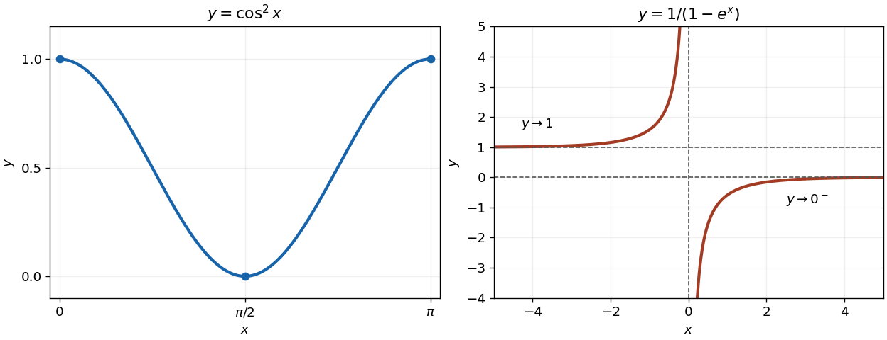
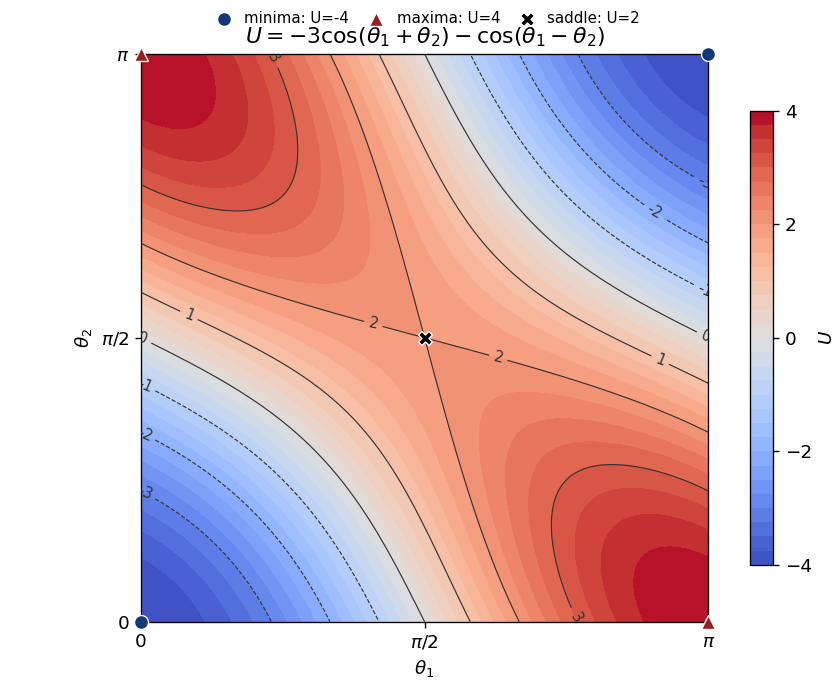

# Paper 1

↑ **Parent:** [2007](../2007.md)

[https://www.maths.cam.ac.uk/undergradnst/files/2007/PaperNST_IA_1.pdf](https://www.maths.cam.ac.uk/undergradnst/files/2007/PaperNST_IA_1.pdf)

**Table of contents**

- [Section A](#section-a)
  - [1](#section-a/1)
    - [Solution](#section-a/1/solution)
  - [2](#section-a/2)
    - [a](#section-a/2/a)
      - [Solution](#section-a/2/a/solution)
    - [b](#section-a/2/b)
      - [Solution](#section-a/2/b/solution)
  - [3](#section-a/3)
    - [a](#section-a/3/a)
      - [Solution](#section-a/3/a/solution)
    - [b](#section-a/3/b)
      - [Solution](#section-a/3/b/solution)
  - [4](#section-a/4)
    - [Solution](#section-a/4/solution)
  - [5](#section-a/5)
    - [a](#section-a/5/a)
      - [Solution](#section-a/5/a/solution)
    - [b](#section-a/5/b)
      - [Solution](#section-a/5/b/solution)
  - [6](#section-a/6)
    - [Solution](#section-a/6/solution)
  - [7](#section-a/7)
    - [Solution](#section-a/7/solution)
  - [8](#section-a/8)
    - [Solution](#section-a/8/solution)
  - [9](#section-a/9)
    - [Solution](#section-a/9/solution)
  - [10](#section-a/10)
    - [a](#section-a/10/a)
      - [Solution](#section-a/10/a/solution)
    - [b](#section-a/10/b)
      - [Solution](#section-a/10/b/solution)
  - [11](#section-a/11)
    - [a](#section-a/11/a)
      - [Solution](#section-a/11/a/solution)
    - [b](#section-a/11/b)
      - [Solution](#section-a/11/b/solution)
- [Section B](#section-b)
  - [1](#section-b/1)
    - [a](#section-b/1/a)
      - [Solution](#section-b/1/a/solution)
    - [b](#section-b/1/b)
      - [Solution](#section-b/1/b/solution)
    - [c](#section-b/1/c)
      - [Solution](#section-b/1/c/solution)
  - [2](#section-b/2)
    - [a](#section-b/2/a)
      - [Solution](#section-b/2/a/solution)
    - [b](#section-b/2/b)
      - [Solution](#section-b/2/b/solution)
    - [c](#section-b/2/c)
      - [Solution](#section-b/2/c/solution)
  - [3](#section-b/3)
    - [a](#section-b/3/a)
      - [i](#section-b/3/a/i)
        - [Solution](#section-b/3/a/i/solution)
      - [ii](#section-b/3/a/ii)
        - [Solution](#section-b/3/a/ii/solution)
      - [iii](#section-b/3/a/iii)
        - [Solution](#section-b/3/a/iii/solution)
    - [b](#section-b/3/b)
      - [Solution](#section-b/3/b/solution)
  - [4](#section-b/4)
    - [a](#section-b/4/a)
      - [Solution](#section-b/4/a/solution)
    - [b](#section-b/4/b)
      - [Solution](#section-b/4/b/solution)
  - [5](#section-b/5)
    - [a](#section-b/5/a)
      - [i](#section-b/5/a/i)
        - [Solution](#section-b/5/a/i/solution)
      - [ii](#section-b/5/a/ii)
        - [Solution](#section-b/5/a/ii/solution)
    - [b](#section-b/5/b)
      - [Solution](#section-b/5/b/solution)
  - [6](#section-b/6)
    - [Solution](#section-b/6/solution)
  - [7](#section-b/7)
    - [i](#section-b/7/i)
      - [Solution](#section-b/7/i/solution)
    - [ii](#section-b/7/ii)
      - [Solution](#section-b/7/ii/solution)
  - [8](#section-b/8)
    - [a](#section-b/8/a)
      - [i](#section-b/8/a/i)
        - [Solution](#section-b/8/a/i/solution)
      - [ii](#section-b/8/a/ii)
        - [Solution](#section-b/8/a/ii/solution)
      - [iii](#section-b/8/a/iii)
        - [Solution](#section-b/8/a/iii/solution)
    - [b](#section-b/8/b)
      - [i](#section-b/8/b/i)
        - [Solution](#section-b/8/b/i/solution)
      - [ii](#section-b/8/b/ii)
        - [Solution](#section-b/8/b/ii/solution)
    - [c](#section-b/8/c)
      - [i](#section-b/8/c/i)
        - [Solution](#section-b/8/c/i/solution)
      - [ii](#section-b/8/c/ii)
        - [Solution](#section-b/8/c/ii/solution)
  - [9](#section-b/9)
    - [a](#section-b/9/a)
      - [Solution](#section-b/9/a/solution)
    - [b](#section-b/9/b)
      - [Solution](#section-b/9/b/solution)
  - [10](#section-b/10)
    - [a](#section-b/10/a)
      - [Solution](#section-b/10/a/solution)
    - [b](#section-b/10/b)
      - [i](#section-b/10/b/i)
        - [Solution](#section-b/10/b/i/solution)
      - [ii](#section-b/10/b/ii)
        - [Solution](#section-b/10/b/ii/solution)
      - [iii](#section-b/10/b/iii)
        - [Solution](#section-b/10/b/iii/solution)

## Section A

↑ **Parent:** [Paper 1](paper-1.md)

<h3 id="section-a/1">1</h3>

↑ **Parent:** [Section A](#section-a)

<h4 id="section-a/1/solution">Solution</h4>

↑ **Parent:** [1](#section-a/1)

The [factor theorem](../../polynomial.md#factor-theorem) gives a factor $x-1$. [Polynomial division](../../polynomial.md#polynomial-division) and then factorization give

$$
2x^3+x^2-5x+2=(x-1)(2x^2+3x-2)=(x-1)(2x-1)(x+2).
$$

Consequently all three [roots of a polynomial](../../polynomial.md#root-of-a-polynomial) are

$$
\boxed{x=1,\quad\frac12,\quad-2.}
$$

<h3 id="section-a/2">2</h3>

↑ **Parent:** [Section A](#section-a)

<h4 id="section-a/2/a">a</h4>

↑ **Parent:** [2](#section-a/2)

<h5 id="section-a/2/a/solution">Solution</h5>

↑ **Parent:** [A](#section-a/2/a)

The [chain rule](../../calculus.md#chain-rule) for the [cosine](../../geometry-and-topology.md#cosine) gives

$$
\boxed{\frac{d}{dx}\cos(5x)=-5\sin(5x).}
$$

<h4 id="section-a/2/b">b</h4>

↑ **Parent:** [2](#section-a/2)

<h5 id="section-a/2/b/solution">Solution</h5>

↑ **Parent:** [B](#section-a/2/b)

The [product rule](../../calculus.md#product-rule) and the [derivative](../../calculus.md#derivative) of the [exponential function](../../calculus.md#exponential-function) give

$$
\boxed{\frac{d}{dx}(x^2e^x)=2xe^x+x^2e^x=e^x(x^2+2x).}
$$

<h3 id="section-a/3">3</h3>

↑ **Parent:** [Section A](#section-a)

<h4 id="section-a/3/a">a</h4>

↑ **Parent:** [3](#section-a/3)

<h5 id="section-a/3/a/solution">Solution</h5>

↑ **Parent:** [A](#section-a/3/a)

With the [change of variables](../../multivariable-calculus.md#change-of-variables-formula) $u=3+2x$, $du=2\,dx$, an [antiderivative](../../integral.md#antiderivative) is

$$
\boxed{\int\frac{dx}{\sqrt{3+2x}}=\sqrt{3+2x}+C,\qquad x>-\frac32.}
$$

Here $C$ is the [constant of integration](../../integral.md#constant-of-integration).

<h4 id="section-a/3/b">b</h4>

↑ **Parent:** [3](#section-a/3)

<h5 id="section-a/3/b/solution">Solution</h5>

↑ **Parent:** [B](#section-a/3/b)

[Integration by parts](../../calculus.md#integration-by-parts) with $u=\ln x$ and $dv=x\,dx$ gives

$$
\boxed{\int x\ln x\,dx=\frac{x^2}{2}\ln x-\frac{x^2}{4}+C,\qquad x>0.}
$$

The remaining [integral](../../integral.md) is $\frac12\int x\,dx$.

<h3 id="section-a/4">4</h3>

↑ **Parent:** [Section A](#section-a)

<h4 id="section-a/4/solution">Solution</h4>

↑ **Parent:** [4](#section-a/4)

[Completing the square](../../polynomial.md#completing-the-square) puts the equation of the [circle](../../topology.md#circle) in the form

$$
x^2+(y+3)^2=4.
$$

Hence its **centre is $(0,-3)$** and its [radius](../../topology.md#radius) is **$2$**.

<h3 id="section-a/5">5</h3>

↑ **Parent:** [Section A](#section-a)

<h4 id="section-a/5/a">a</h4>

↑ **Parent:** [5](#section-a/5)

<h5 id="section-a/5/a/solution">Solution</h5>

↑ **Parent:** [A](#section-a/5/a)

This [arithmetic series](../../arithmetic.md#arithmetic-series) has $101$ terms, from $1$ to $201$. Thus

$$
\boxed{\sum_{n=0}^{100}(2n+1)=\frac{101(1+201)}2=101^2=10201.}
$$

<h4 id="section-a/5/b">b</h4>

↑ **Parent:** [5](#section-a/5)

<h5 id="section-a/5/b/solution">Solution</h5>

↑ **Parent:** [B](#section-a/5/b)

The [geometric series](../../sequence-and-series.md#geometric-series) has first term $1$ and common ratio $1/3$, whose [absolute value](../../real-analysis.md#absolute-value) is less than one. Therefore

$$
\boxed{\sum_{n=0}^{\infty}\left(\frac13\right)^n=\frac1{1-1/3}=\frac32.}
$$

<h3 id="section-a/6">6</h3>

↑ **Parent:** [Section A](#section-a)

<h4 id="section-a/6/solution">Solution</h4>

↑ **Parent:** [6](#section-a/6)

On this [parametric curve](../../topology.md#parametric-curve), $x=1$ permits $t=0$ or $t=-2$, but only $t=0$ also gives $y=0$. The [chain rule](../../calculus.md#chain-rule) gives the [slope](../../euclidean-geometry.md#slope)

$$
\frac{dy}{dx}=\frac{dy/dt}{dx/dt}=\frac{12-3t^2}{2(1+t)}.
$$

At the required point, $t=0$, so

$$
\boxed{\frac{dy}{dx}=6.}
$$

<h3 id="section-a/7">7</h3>

↑ **Parent:** [Section A](#section-a)

<h4 id="section-a/7/solution">Solution</h4>

↑ **Parent:** [7](#section-a/7)

The double-angle identity for the [sine](../../geometry-and-topology.md#sine) factors the equation as $2\cos\theta(\sin\theta-\cos\theta)=0$. The first factor gives $\theta=\pi/2$ in the specified interval; the second gives $\tan\theta=1$ and hence $\theta=\pi/4$. Thus

$$
\boxed{\theta=\frac\pi4,\quad\frac\pi2.}
$$

Keeping the first factor avoids losing the solution where division by $\cos\theta$ would be invalid.

<h3 id="section-a/8">8</h3>

↑ **Parent:** [Section A](#section-a)

<h4 id="section-a/8/solution">Solution</h4>

↑ **Parent:** [8](#section-a/8)

Call the centre of the [circle](../../topology.md#circle) $O$, the left endpoint on the diameter $A$, the point of tangency $T$, and the external intersection $E$. Since $OA=OT$ are [radii](../../topology.md#radius), the [isosceles triangle](../../euclidean-geometry.md#isosceles-triangle) $AOT$ has equal base [angles](../../geometry-and-topology.md#angle): $\angle OAT=\angle ATO=30^\circ$. Therefore $\angle AOT=120^\circ$, and, because $OA$ and $OE$ point in opposite directions, $\angle TOE=60^\circ$. The [tangent to a circle](../../topology.md#tangent-to-a-circle) $TE$ is perpendicular to the [radius](../../topology.md#radius) $OT$, so in the right [triangle](../../euclidean-geometry.md#triangle) $OTE$,

$$
\boxed{\theta=180^\circ-90^\circ-60^\circ=30^\circ.}
$$

<h3 id="section-a/9">9</h3>

↑ **Parent:** [Section A](#section-a)

<h4 id="section-a/9/solution">Solution</h4>

↑ **Parent:** [9](#section-a/9)

[Rationalizing a denominator](../../algebra.md#rationalizing-a-denominator) by multiplying by $\sqrt5-1$ gives $2/(\sqrt5+1)=(\sqrt5-1)/2$. Consequently the sum inside the parentheses is $\sqrt5$, and the entire expression is

$$
\boxed{5.}
$$

<h3 id="section-a/10">10</h3>

↑ **Parent:** [Section A](#section-a)

<h4 id="section-a/10/a">a</h4>

↑ **Parent:** [10](#section-a/10)

<h5 id="section-a/10/a/solution">Solution</h5>

↑ **Parent:** [A](#section-a/10/a)

The [function](../../function.md) is nonnegative and satisfies $\cos^2(\pi-x)=\cos^2x$. Its [derivative](../../calculus.md#derivative) is $-\sin(2x)$, so it decreases from $(0,1)$ to its [minimum](../../set.md#minimum-of-a-subset-of-a-total-order) $(\pi/2,0)$ and then increases to $(\pi,1)$. These three points all have horizontal [tangent lines](../../calculus.md#tangent-line).

**[Figure 1](#section-a/10/a/image-the-cosine-squared-curve-and-the-two-branches-of-the-exponential-quotient). The cosine-squared curve and the two branches of the exponential quotient**. The left panel shows the symmetric minimum of $\cos^2x$. The right panel marks the vertical and horizontal [asymptotes](../../topology.md#asymptote) of $1/(1-e^x)$.

<h4 id="section-a/10/b">b</h4>

↑ **Parent:** [10](#section-a/10)

<h5 id="section-a/10/b/solution">Solution</h5>

↑ **Parent:** [B](#section-a/10/b)

The denominator vanishes only at $x=0$, giving a vertical [asymptote](../../topology.md#asymptote). Since $1-e^x=-x+O(x^2)$, the [function](../../function.md) tends to $+\infty$ from the left and $-\infty$ from the right. Its [derivative](../../calculus.md#derivative) is

$$
\frac{d}{dx}\frac1{1-e^x}=\frac{e^x}{(1-e^x)^2}>0,
$$

so each branch is increasing. The horizontal [asymptotes](../../topology.md#asymptote) are $y=1$ as $x\to-\infty$ and $y=0$ as $x\to+\infty$. The left branch lies above $1$; the right branch lies below $0$, as in the preceding figure.

<h3 id="section-a/11">11</h3>

↑ **Parent:** [Section A](#section-a)

<h4 id="section-a/11/a">a</h4>

↑ **Parent:** [11](#section-a/11)

<h5 id="section-a/11/a/solution">Solution</h5>

↑ **Parent:** [A](#section-a/11/a)

If tangency occurs at $x_*$, the [slope](../../euclidean-geometry.md#slope) must satisfy both $k=2e^{2x_*}$ and $kx_*=e^{2x_*}$. Eliminating $k$ gives $2x_*=1$, so the [tangent through the origin to an exponential curve](../../calculus.md#tangent-through-the-origin-to-an-exponential-curve) has

$$
\boxed{k=2e.}
$$

<h4 id="section-a/11/b">b</h4>

↑ **Parent:** [11](#section-a/11)

<h5 id="section-a/11/b/solution">Solution</h5>

↑ **Parent:** [B](#section-a/11/b)

The preceding [tangent line](../../calculus.md#tangent-line) calculation gives $x_*=1/2$ and $y_*=e^{2x_*}=e$. The point of tangency is

$$
\boxed{\left(\frac12,e\right).}
$$

## Section B

↑ **Parent:** [Paper 1](paper-1.md)

<h3 id="section-b/1">1</h3>

↑ **Parent:** [Section B](#section-b)

<h4 id="section-b/1/a">a</h4>

↑ **Parent:** [1](#section-b/1)

<h5 id="section-b/1/a/solution">Solution</h5>

↑ **Parent:** [A](#section-b/1/a)

Because $\mathbf b\cdot\mathbf x$ is a [scalar](../../vector-space.md#scalar), applying the [linear operator](../../vector-space.md#linear-operator) again gives

$$
K^2\mathbf x=K\bigl[\mathbf a(\mathbf b\cdot\mathbf x)\bigr]=\mathbf a\bigl[\mathbf b\cdot\mathbf a(\mathbf b\cdot\mathbf x)\bigr]=(\mathbf a\cdot\mathbf b)K\mathbf x.
$$

This is the first nontrivial case of the [powers of a rank-one operator](../../compact-operator.md#powers-of-a-rank-one-operator); its [matrix](../../vector-space.md#matrix) is the [outer product](../../vector-space.md#outer-product) $\mathbf a\mathbf b^T$.

<h4 id="section-b/1/b">b</h4>

↑ **Parent:** [1](#section-b/1)

<h5 id="section-b/1/b/solution">Solution</h5>

↑ **Parent:** [B](#section-b/1/b)

The [vector triple product identity](../../multivariable-calculus.md#vector-triple-product) and $\mathbf n\cdot\mathbf n=1$ give

$$
H^2\mathbf x=\alpha^2\mathbf n\times(\mathbf n\times\mathbf x)=\alpha^2\bigl[\mathbf n(\mathbf n\cdot\mathbf x)-\mathbf x\bigr].
$$

Apply $H$ once more. The term parallel to $\mathbf n$ vanishes under its [cross product](../../vector-space.md#cross-product) with $\mathbf n$, leaving $H^3\mathbf x=-\alpha^3\mathbf n\times\mathbf x=-\alpha^2H\mathbf x$. The result includes $\alpha=0$.

<h4 id="section-b/1/c">c</h4>

↑ **Parent:** [1](#section-b/1)

<h5 id="section-b/1/c/solution">Solution</h5>

↑ **Parent:** [C](#section-b/1/c)

The displayed [power series](../../sequence-and-series.md#power-series) is the [matrix exponential](../../linear-operator-theory.md#matrix-exponential) $G=e^H$. From $H^3=-\alpha^2H$, its odd powers and nonconstant even powers sum separately:

$$
G=I+\left(1-\frac{\alpha^2}{3!}+\frac{\alpha^4}{5!}-\cdots\right)H+\left(\frac1{2!}-\frac{\alpha^2}{4!}+\frac{\alpha^4}{6!}-\cdots\right)H^2.
$$

The scalar [power series](../../sequence-and-series.md#power-series) are $\sin\alpha/\alpha$ and $(1-\cos\alpha)/\alpha^2$, with continuous values $1$ and $1/2$ at zero. Substituting $H\mathbf x=\alpha\mathbf n\times\mathbf x$ and the preceding formula for $H^2\mathbf x$ yields

$$
G\mathbf x=\mathbf x+\sin\alpha\,\mathbf n\times\mathbf x+(1-\cos\alpha)\mathbf n\times(\mathbf n\times\mathbf x).
$$

This is the [Rodrigues rotation formula](../../mathematics.md#rodrigues-rotation-formula): the component parallel to $\mathbf n$ is fixed, while the perpendicular component undergoes a [rotation](../../riemannian-geometry.md#rotation-mathematics) through $\alpha$. For $\alpha=0$ the [linear operator](../../vector-space.md#linear-operator) is the [identity operator](../../vector-space.md#identity-operator).

<h3 id="section-b/2">2</h3>

↑ **Parent:** [Section B](#section-b)

<h4 id="section-b/2/a">a</h4>

↑ **Parent:** [2](#section-b/2)

<h5 id="section-b/2/a/solution">Solution</h5>

↑ **Parent:** [A](#section-b/2/a)

Using the [principal complex logarithm](../../analysis.md#principal-complex-logarithm), $\operatorname{Log}i=i\pi/2$ and $\operatorname{Log}(-e)=1+i\pi$. Thus the values and their [real parts](../../complex-analysis.md#real-part) and [imaginary parts](../../complex-analysis.md#imaginary-part) are

$$
\begin{array}{c|c|c|c}
\text{expression}&\text{principal value}&\operatorname{Re}&\operatorname{Im}\\\hline
\sqrt i&(1+i)/\sqrt2&1/\sqrt2&1/\sqrt2\\
\ln(-e)&1+i\pi&1&\pi\\
2^i&e^{i\ln2}&\cos(\ln2)&\sin(\ln2)\\
(i^i)^i&-i&0&-1
\end{array}
$$

For the final row, first calculate $i^i=e^{-\pi/2}$ and only then raise this positive real number to the power $i$. Treating nested powers as ordinary real powers would ignore the branching of [complex exponentiation](../../analysis.md#complex-exponentiation).

If all branches are requested, $\sqrt i$ also has the negative of its principal value, and the [complex logarithm](../../analysis.md#complex-logarithm) of $-e$ is $1+i(\pi+2\pi k)$. Allowing nonprincipal logarithms of the positive base $2$ gives $e^{-2\pi k}e^{i\ln2}$. Finally, all values of $(i^i)^i$ are $-ie^{-2\pi m}$, for integers $k,m$ as appropriate. These alternatives do not alter the principal-value table.

<h4 id="section-b/2/b">b</h4>

↑ **Parent:** [2](#section-b/2)

<h5 id="section-b/2/b/solution">Solution</h5>

↑ **Parent:** [B](#section-b/2/b)

[Euler's formula](../../complex-analysis.md#euler-s-formula) gives

$$
\sin x=\frac{e^{ix}-e^{-ix}}{2i},\qquad\cos x=\frac{e^{ix}+e^{-ix}}2.
$$

Cubing the expression for the [sine](../../geometry-and-topology.md#sine), and grouping the $e^{3ix}$ and $e^{-3ix}$ terms, gives

$$
\sin^3x=-\frac14\bigl(\sin3x-3\sin x\bigr),\qquad\sin3x=3\sin x-4\sin^3x.
$$

The required equation therefore becomes $\sin x(1-4\sin^2x)=0$. The complete real solution set is

$$
\boxed{x=n\pi\quad\text{or}\quad x=n\pi\pm\frac\pi6,\qquad n\in\mathbb Z.}
$$

<h4 id="section-b/2/c">c</h4>

↑ **Parent:** [2](#section-b/2)

<h5 id="section-b/2/c/solution">Solution</h5>

↑ **Parent:** [C](#section-b/2/c)

The [quadratic formula](../../polynomial.md#quadratic-formula) gives $z=-b\pm\sqrt{b^2-1}$. For $-1\leq b\leq1$, write this as

$$
\boxed{z_\pm=-b\pm i\sqrt{1-b^2}.}
$$

Each [root of a polynomial](../../polynomial.md#root-of-a-polynomial) has [modulus](../../complex-analysis.md#modulus) $1$, since $b^2+(1-b^2)=1$. As $b$ increases from $-1$ to $1$, the upper root traverses the upper unit semicircle from $1$ to $-1$, and the lower root traverses the lower semicircle in the opposite angular direction. At $b=-1$ the roots coincide at $1$; at $b=1$ they coincide at $-1$. For intermediate $b$ they are [complex conjugates](../../complex-analysis.md#complex-conjugate).

**[Figure 2](#section-b/2/c/image-the-conjugate-roots-travel-along-the-two-unit-semicircles). The conjugate roots travel along the two unit semicircles**. Arrows show increasing $b$, with endpoints $b=-1$ and $b=1$ and the midpoint pair $b=0$. The figure is an original plot of the solution formula.

<h3 id="section-b/3">3</h3>

↑ **Parent:** [Section B](#section-b)

<h4 id="section-b/3/a">a</h4>

↑ **Parent:** [3](#section-b/3)

<h5 id="section-b/3/a/i">i</h5>

↑ **Parent:** [A](#section-b/3/a)

<h6 id="section-b/3/a/i/solution">Solution</h6>

↑ **Parent:** [I](#section-b/3/a/i)

Since the [derivative](../../calculus.md#derivative) of the [arctangent](../../geometry-and-topology.md#inverse-tangent) is $1/(1+x^2)=1-x^2+O(x^4)$ near zero, termwise [integration](../../integral.md) gives

$$
\boxed{\arctan x=x-\frac{x^3}{3}+O(x^5).}
$$

The integration constant is zero because $\arctan0=0$.

<h5 id="section-b/3/a/ii">ii</h5>

↑ **Parent:** [A](#section-b/3/a)

<h6 id="section-b/3/a/ii/solution">Solution</h6>

↑ **Parent:** [Ii](#section-b/3/a/ii)

The expression in the PDF is $1/a^x-1$, with the subtraction outside the fraction. Using the [exponential series](../../calculus.md#exponential-series) with $a^{-x}=e^{-x\ln a}$ gives

$$
\boxed{a^{-x}-1=-(\ln a)x+\frac{(\ln a)^2}{2}x^2+O(x^3).}
$$

For $a>0$, $a\ne1$, these are the first two nonzero terms. If $a=1$, the [function](../../function.md) is identically zero, so there are no nonvanishing terms.

<h5 id="section-b/3/a/iii">iii</h5>

↑ **Parent:** [A](#section-b/3/a)

<h6 id="section-b/3/a/iii/solution">Solution</h6>

↑ **Parent:** [Iii](#section-b/3/a/iii)

The square is on the [cosine](../../geometry-and-topology.md#cosine): near zero, $\ln(\cos^2x)=2\ln(\cos x)$. Substituting $\cos x=1-x^2/2+x^4/24+O(x^6)$ into the [logarithmic series](../../calculus.md#mercator-series) gives

$$
\ln(\cos x)=-\frac{x^2}{2}+\frac{x^4}{24}-\frac12\frac{x^4}{4}+O(x^6)=-\frac{x^2}{2}-\frac{x^4}{12}+O(x^6).
$$

Therefore

$$
\boxed{\ln(\cos^2x)=-x^2-\frac{x^4}{6}+O(x^6).}
$$

<h4 id="section-b/3/b">b</h4>

↑ **Parent:** [3](#section-b/3)

<h5 id="section-b/3/b/solution">Solution</h5>

↑ **Parent:** [B](#section-b/3/b)

Since $g(0)=0$, only the first three positive powers of $g$ contribute through degree three. The [composition coefficients of power series](../../sequence-and-series.md#composition-coefficients-of-power-series) follow by using $g^2=g_1^2x^2+2g_1g_2x^3+O(x^4)$ and $g^3=g_1^3x^3+O(x^4)$ in $f_0+f_1g+f_2g^2+f_3g^3+\cdots$. Hence

$$
\boxed{f(g(x))=f_0+f_1g_1x+(f_1g_2+f_2g_1^2)x^2+(f_1g_3+2f_2g_1g_2+f_3g_1^3)x^3+O(x^4).}
$$

Here $f_m$ and $g_m$ are coefficients of the [power series](../../sequence-and-series.md#power-series), rather than raw [derivatives](../../calculus.md#derivative); their definitions already contain any factorial factors.

<h3 id="section-b/4">4</h3>

↑ **Parent:** [Section B](#section-b)

<h4 id="section-b/4/a">a</h4>

↑ **Parent:** [4](#section-b/4)

<h5 id="section-b/4/a/solution">Solution</h5>

↑ **Parent:** [A](#section-b/4/a)

The [exponential series](../../calculus.md#exponential-series) proves [normalization of a probability distribution](../../probability-distribution.md#normalization-of-a-probability-distribution):

$$
\sum_{n=0}^\infty e^{-\lambda}\frac{\lambda^n}{n!}=e^{-\lambda}e^\lambda=1.
$$

Let $M$ and $F$ count the two labels. Conditional on $N=M+F=k+l$, independent labeling gives a [binomial distribution](../../discrete-probability-distribution.md#binomial-distribution), so the [joint probability mass function](../../random-variable.md#joint-probability-mass-function) is

$$
\begin{aligned}
\mathbb P(M=k,F=l)&=\mathbb P(N=k+l)\binom{k+l}{k}p^k(1-p)^l\\
&=e^{-\lambda}\frac{(\lambda p)^k}{k!}\frac{[\lambda(1-p)]^l}{l!}\\
&=\left[e^{-\lambda p}\frac{(\lambda p)^k}{k!}\right]\left[e^{-\lambda(1-p)}\frac{[\lambda(1-p)]^l}{l!}\right].
\end{aligned}
$$

Each bracket is a normalized [Poisson distribution](../../discrete-probability-distribution.md#poisson-distribution). Summing over $l\geq0$ therefore gives

$$
\boxed{\mathbb P(M=k)=e^{-\lambda p}\frac{(\lambda p)^k}{k!},\qquad M\sim\operatorname{Poisson}(\lambda p).}
$$

The factorization also proves that $M$ and $F$ are [independent random variables](../../random-variable.md#independent-random-variables). This is [Poisson thinning](../../poisson-process.md#poisson-thinning); the phrase about ignoring the other count refers to taking a [marginal distribution](../../probability-distribution.md#marginal-distribution), rather than fixing that count.

<h4 id="section-b/4/b">b</h4>

↑ **Parent:** [4](#section-b/4)

<h5 id="section-b/4/b/solution">Solution</h5>

↑ **Parent:** [B](#section-b/4/b)

Let $D$, $C$, and $V_0$ denote the three disjoint categories, and $+$ or $-$ the test result. The [law of total probability](../../probability-space.md#law-of-total-probability) gives

$$
\boxed{\mathbb P(+)=0.1(0.95)+0.2(0.9)+0.7(0.05)=0.31.}
$$

To calculate the requested [conditional probability](../../probability-theory.md#conditional-probability), first combine the two categories with the virus. Their joint negative-test [probability](../../probability-theory.md#probability) is $0.1(0.05)+0.2(0.1)=0.025$, whereas $\mathbb P(-)=1-0.31=0.69$. [Bayes' theorem](../../probability-theory.md#bayes-theorem) therefore gives

$$
\boxed{\mathbb P(D\cup C\mid-)=\frac{0.025}{0.69}=\frac5{138}\approx0.03623.}
$$

These numbers use the specified population proportions and test [probabilities](../../probability-theory.md#probability); the negative result reduces the initial combined proportion $0.3$ to about $3.62\%$ within this model.

<h3 id="section-b/5">5</h3>

↑ **Parent:** [Section B](#section-b)

<h4 id="section-b/5/a">a</h4>

↑ **Parent:** [5](#section-b/5)

<h5 id="section-b/5/a/i">i</h5>

↑ **Parent:** [A](#section-b/5/a)

<h6 id="section-b/5/a/i/solution">Solution</h6>

↑ **Parent:** [I](#section-b/5/a/i)

Writing the [differential one-form](../../differential-form.md#one-form) as $M\,dx+N\,dy$, its coefficients satisfy $M_y=e^y\cos x=N_x$. It is an [exact differential form](../../differential-form.md#exact-differential-form), with potential $F=(1+e^y)\sin x$, because

$$
dF=(1+e^y)\cos x\,dx+e^y\sin x\,dy.
$$

The implicit solution is therefore

$$
\boxed{(1+e^y)\sin x=C.}
$$

<h5 id="section-b/5/a/ii">ii</h5>

↑ **Parent:** [A](#section-b/5/a)

<h6 id="section-b/5/a/ii/solution">Solution</h6>

↑ **Parent:** [Ii](#section-b/5/a/ii)

On the real domain $y>0$, $M=y(x^2+\ln y)$ and $N=x$ have $M_y=x^2+\ln y+1$ and $N_x=1$, so this [differential one-form](../../differential-form.md#one-form) is not exact. An [integrating factor for a differential one-form](../../linear-ordinary-differential-equation.md#integrating-factor-for-a-differential-one-form) is $\mu=1/y$, which is nonzero on this domain. Multiplication gives

$$
(x^2+\ln y)\,dx+\frac{x}{y}\,dy=d\left(\frac{x^3}{3}+x\ln y\right).
$$

Hence the implicit solution is

$$
\boxed{\frac{x^3}{3}+x\ln y=C,\qquad y>0.}
$$

<h4 id="section-b/5/b">b</h4>

↑ **Parent:** [5](#section-b/5)

<h5 id="section-b/5/b/solution">Solution</h5>

↑ **Parent:** [B](#section-b/5/b)

On the interval $x>-1$ containing the [initial condition](../../differential-equation.md#initial-condition), division by $1+x$ gives a [linear ordinary differential equation](../../linear-ordinary-differential-equation.md) with [integrating factor](../../linear-ordinary-differential-equation.md#integrating-factor) $(1+x)^{-3}$. Consequently

$$
\frac{d}{dx}\bigl[(1+x)^{-3}y\bigr]=1+x,\qquad (1+x)^{-3}y=\frac{(1+x)^2}{2}+C.
$$

The initial value gives $C=1$. Thus

$$
\boxed{y=(1+x)^3\left[1+\frac{(1+x)^2}{2}\right].}
$$

This [polynomial](../../polynomial.md) also satisfies the original equation at $x=-1$ and gives an extension to all real $x$. The [initial value problem](../../differential-equation.md#initial-value-problem) is uniquely determined on $x>-1$; the vanishing leading coefficient at $-1$ does not ensure unique continuation to its left.

<h3 id="section-b/6">6</h3>

↑ **Parent:** [Section B](#section-b)

<h4 id="section-b/6/solution">Solution</h4>

↑ **Parent:** [6](#section-b/6)

Put $S=\theta_1+\theta_2$ and $D=\theta_1-\theta_2$. The [gradient](../../multivariable-calculus.md#gradient) has components $3\sin S+\sin D$ and $3\sin S-\sin D$, so a [stationary point](../../calculus-of-variations.md#stationary-point) requires $\sin S=\sin D=0$. In the closed square, $S\in[0,2\pi]$ and $D\in[-\pi,\pi]$, and the compatible possibilities are precisely the four corners and $(\pi/2,\pi/2)$.

The [Hessian matrix](../../multivariable-calculus.md#hessian-matrix) is

$$
\begin{pmatrix}3\cos S+\cos D&3\cos S-\cos D\\3\cos S-\cos D&3\cos S+\cos D\end{pmatrix}.
$$

Its [eigenvectors](../../linear-operator-theory.md#eigenvector) $(1,1)$ and $(1,-1)$ have [eigenvalues](../../linear-operator-theory.md#eigenvalue) $6\cos S$ and $2\cos D$. The [second-derivative test](../../multivariable-calculus.md#second-derivative-test) gives the following classification:

| Point || $U$ || Hessian eigenvalues || Classification | $(0,0),(\pi,\pi)$ | $-4$ | $6,2$ | [Minima](../../set.md#minimum-of-a-subset-of-a-total-order) | $(\pi,0),(0,\pi)$ | $4$ | $-6,-2$ | [Maxima](../../set.md#maximum-of-a-subset-of-a-total-order) | $(\pi/2,\pi/2)$ | $2$ | $-6,2$ | [Saddle point of a scalar function](../../analysis.md#saddle-point-of-a-scalar-function) |
| --- | --- | --- | --- |

The corner classifications also hold for the smooth extension beyond the square, and hence for the restricted region. The global bounds $-4\leq U\leq4$ show that the stated [minima](../../set.md#minimum-of-a-subset-of-a-total-order) and [maxima](../../set.md#maximum-of-a-subset-of-a-total-order) are global within it. The central point has opposite curvature along the two diagonal directions.

**[Figure 3](#section-b/6/image-energy-contours-show-two-minima-two-maxima-and-a-central-saddle). Energy contours show two minima, two maxima and a central saddle**. The $U=2$ contour crosses at the saddle. Filled markers locate all five points where the [gradient](../../multivariable-calculus.md#gradient) vanishes; color and labeled [level curves](../../topology.md#level-curve) show how the energy changes between them.

<h3 id="section-b/7">7</h3>

↑ **Parent:** [Section B](#section-b)

<h4 id="section-b/7/i">i</h4>

↑ **Parent:** [7](#section-b/7)

<h5 id="section-b/7/i/solution">Solution</h5>

↑ **Parent:** [I](#section-b/7/i)

The region is $0\leq y\leq1$, $2y\leq x\leq2$. Reversing the order describes the same triangle as $0\leq x\leq2$, $0\leq y\leq x/2$. Since the [integrand](../../integral.md#integrand) is continuous on this compact region, [Fubini's theorem](../../measure-theory.md#fubini-s-theorem) permits

$$
\int_0^1\int_{2y}^2 e^{x^2}\,dx\,dy=\int_0^2\int_0^{x/2}e^{x^2}\,dy\,dx=\frac12\int_0^2xe^{x^2}\,dx=\boxed{\frac{e^4-1}{4}}.
$$

The new inner [integral](../../integral.md) introduces the factor $x$ needed for the [change of variables](../../multivariable-calculus.md#change-of-variables-formula) $u=x^2$.

<h4 id="section-b/7/ii">ii</h4>

↑ **Parent:** [7](#section-b/7)

<h5 id="section-b/7/ii/solution">Solution</h5>

↑ **Parent:** [Ii](#section-b/7/ii)

In [cylindrical coordinates](../../multivariable-calculus.md#cylindrical-coordinate-system) the [spherical cap](../../euclidean-geometry.md#spherical-cap) has $1<z<\sqrt2$, $0<r<\sqrt{2-z^2}$ and $0<\theta<2\pi$. Its [mass density](../../fluid-mechanics.md#density) is $kz$ and the [volume element](../../integral.md#volume-element) is $r\,dr\,d\theta\,dz$. Therefore

$$
M=\int_1^{\sqrt2}\int_0^{2\pi}\int_0^{\sqrt{2-z^2}}kzr\,dr\,d\theta\,dz=\pi k\int_1^{\sqrt2}z(2-z^2)\,dz=\boxed{\frac{\pi k}{4}}.
$$

This is the [mass of a spherical cap with height-proportional density](../../euclidean-geometry.md#mass-of-a-spherical-cap-with-height-proportional-density) with $R=\sqrt2$ and $c=1$.

For its curved [surface area](../../differential-geometry.md#surface-area), write $z=\sqrt{2-r^2}$ with $0\leq r\leq1$. The [surface integral](../../multivariable-calculus.md#surface-integral) of one becomes

$$
A=\int_0^{2\pi}\int_0^1\sqrt{1+\left(\frac{dz}{dr}\right)^2}\,r\,dr\,d\theta=2\pi\sqrt2\int_0^1\frac{r}{\sqrt{2-r^2}}\,dr=\boxed{2\pi(2-\sqrt2)}.
$$

It agrees with the [curved area of a spherical cap](../../euclidean-geometry.md#curved-area-of-a-spherical-cap), $2\pi Rh$, for $h=\sqrt2-1$. The planar closing disk is not part of the requested curved surface.

<h3 id="section-b/8">8</h3>

↑ **Parent:** [Section B](#section-b)

<h4 id="section-b/8/a">a</h4>

↑ **Parent:** [8](#section-b/8)

<h5 id="section-b/8/a/i">i</h5>

↑ **Parent:** [A](#section-b/8/a)

<h6 id="section-b/8/a/i/solution">Solution</h6>

↑ **Parent:** [I](#section-b/8/a/i)

**False.** Take the [diagonal matrix](../../linear-algebra.md#diagonal-matrix) $A=\operatorname{diag}(1,2)$ and its [eigenvectors](../../linear-operator-theory.md#eigenvector) $\mathbf x=(1,0)^T$, $\mathbf y=(0,1)^T$. Their sum $(1,1)^T$ is mapped to $(1,2)^T$, which is not a [scalar multiple](../../vector-space.md#scalar-multiple) of that sum. More generally, $A(\mathbf x+\mathbf y)=a\mathbf x+c\mathbf y$ need not have the form $\lambda(\mathbf x+\mathbf y)$ when $a\ne c$.

<h5 id="section-b/8/a/ii">ii</h5>

↑ **Parent:** [A](#section-b/8/a)

<h6 id="section-b/8/a/ii/solution">Solution</h6>

↑ **Parent:** [Ii](#section-b/8/a/ii)

**True.** By [linearity](../../vector-space.md#linearity), $(A+B)\mathbf x=A\mathbf x+B\mathbf x=(a+b)\mathbf x$. Since $\mathbf x\ne0$, it is an [eigenvector](../../linear-operator-theory.md#eigenvector) of $A+B$ with [eigenvalue](../../linear-operator-theory.md#eigenvalue)

$$
\boxed{a+b.}
$$

<h5 id="section-b/8/a/iii">iii</h5>

↑ **Parent:** [A](#section-b/8/a)

<h6 id="section-b/8/a/iii/solution">Solution</h6>

↑ **Parent:** [Iii](#section-b/8/a/iii)

**True.** Applying the [matrices](../../vector-space.md#matrix) in order gives $AB\mathbf x=A(b\mathbf x)=ab\mathbf x$. The [eigenvalue](../../linear-operator-theory.md#eigenvalue) is

$$
\boxed{ab.}
$$

This conclusion only uses the shared [eigenvector](../../linear-operator-theory.md#eigenvector); it does not require $A$ and $B$ to commute on other [vectors](../../vector-space.md#vector).

<h4 id="section-b/8/b">b</h4>

↑ **Parent:** [8](#section-b/8)

<h5 id="section-b/8/b/i">i</h5>

↑ **Parent:** [B](#section-b/8/b)

<h6 id="section-b/8/b/i/solution">Solution</h6>

↑ **Parent:** [I](#section-b/8/b/i)

If $A\mathbf v=\lambda\mathbf v$ for a nonzero [eigenvector](../../linear-operator-theory.md#eigenvector), then $A^2\mathbf v=\lambda^2\mathbf v=A\mathbf v=\lambda\mathbf v$. Thus $\lambda(\lambda-1)=0$, so

$$
\boxed{\text{every eigenvalue is }0\text{ or }1.}
$$

Both values need not occur: the zero [matrix](../../vector-space.md#matrix) has only $0$, and the [identity matrix](../../vector-space.md#identity-matrix) only $1$. More precisely, an [idempotent linear map](../../vector-space.md#projection-linear-algebra) whose [rank of a linear map](../../vector-space.md#rank-of-a-linear-map) is $r$ has $r$ copies of $1$ and $n-r$ copies of $0$. Indeed, its [image of a linear map](../../vector-space.md#image-of-a-linear-map) and [kernel of a linear map](../../kernel-of-a-linear-map.md) form a [direct sum](../../vector-space.md#direct-sum), giving an [eigenbasis](../../linear-operator-theory.md#eigenbasis) without assuming an [orthogonal projection](../../hilbert-space.md#orthogonal-projection).

<h5 id="section-b/8/b/ii">ii</h5>

↑ **Parent:** [B](#section-b/8/b)

<h6 id="section-b/8/b/ii/solution">Solution</h6>

↑ **Parent:** [Ii](#section-b/8/b/ii)

On an [eigenvector](../../linear-operator-theory.md#eigenvector) of $A$ with [eigenvalue](../../linear-operator-theory.md#eigenvalue) $\lambda$, the [linear operator](../../vector-space.md#linear-operator) $B=I-A$ has [eigenvalue](../../linear-operator-theory.md#eigenvalue) $1-\lambda$. Therefore

$$
\boxed{\operatorname{spec}(B)\subseteq\{0,1\}.}
$$

The multiplicities are exchanged: if the [matrix rank](../../vector-space.md#matrix-rank) of $A$ is $r$, then $B$ has $n-r$ copies of $1$ and $r$ copies of $0$. Again, a value with zero multiplicity is absent.

<h4 id="section-b/8/c">c</h4>

↑ **Parent:** [8](#section-b/8)

<h5 id="section-b/8/c/i">i</h5>

↑ **Parent:** [C](#section-b/8/c)

<h6 id="section-b/8/c/i/solution">Solution</h6>

↑ **Parent:** [I](#section-b/8/c/i)

Computing the [characteristic polynomial](../../linear-operator-theory.md#characteristic-polynomial) with the convention $\det(\lambda I-H)$ gives

$$
\det(\lambda I-H)=\lambda(\lambda+1)(\lambda-3).
$$

Thus the three [eigenvalues](../../linear-operator-theory.md#eigenvalue) are

$$
\boxed{-1,\quad0,\quad3.}
$$

They can also be checked directly on the respective [eigenvectors](../../linear-operator-theory.md#eigenvector) $(1,0,-1)^T$, $(1,-1,1)^T$, and $(1,2,1)^T$.

<h5 id="section-b/8/c/ii">ii</h5>

↑ **Parent:** [C](#section-b/8/c)

<h6 id="section-b/8/c/ii/solution">Solution</h6>

↑ **Parent:** [Ii](#section-b/8/c/ii)

For the lowest [eigenvalue](../../linear-operator-theory.md#eigenvalue), $-1$, solving $(H+I)\mathbf v=0$ gives $v_2=0$ and $v_3=-v_1$. A unit [eigenvector](../../linear-operator-theory.md#eigenvector) is therefore

$$
\boxed{\mathbf v=\frac1{\sqrt2}(1,0,-1)^T.}
$$

Any nonzero [scalar multiple](../../vector-space.md#scalar-multiple) is an equally valid [eigenvector](../../linear-operator-theory.md#eigenvector).

<h3 id="section-b/9">9</h3>

↑ **Parent:** [Section B](#section-b)

<h4 id="section-b/9/a">a</h4>

↑ **Parent:** [9](#section-b/9)

<h5 id="section-b/9/a/solution">Solution</h5>

↑ **Parent:** [A](#section-b/9/a)

For $x\in(n,n+1)$, strict decrease gives $f(x)<f(n)$, while for $x\in(n-1,n)$ it gives $f(x)>f(n)$. Integrating over these unit intervals proves

$$
S_n=\int_n^{n+1}f(x)\,dx<f(n)<\int_{n-1}^nf(x)\,dx=S_{n-1}.
$$

Summing the rectangle bounds gives

$$
\int_2^{M+1}f(x)\,dx<\sum_{n=2}^Mf(n)<f(2)+\int_2^Mf(x)\,dx.
$$

The [partial sums](../../sequence-and-series.md#partial-sum) and the [improper integral](../../real-analysis.md#improper-integral) are nondecreasing. These bounds show that one is bounded exactly when the other is bounded, proving the [integral test for convergence](../../sequence-and-series.md#integral-test-for-convergence). In the convergent case, sum the same interval inequalities for $n=N+1,N+2,\ldots$ to obtain

$$
\int_{N+1}^\infty f(x)\,dx<R_N:=\sum_{n=N+1}^\infty f(n)<\int_N^\infty f(x)\,dx.
$$

For $f(x)=1/(x\ln x)$, the [antiderivative](../../integral.md#antiderivative) is $\ln(\ln x)$, which grows without bound, so the first [series](../../sequence-and-series.md#series-mathematics) **diverges**. For $f(x)=1/[x(\ln x)^2]$, the [antiderivative](../../integral.md#antiderivative) is $-1/\ln x$, whose tail [integral](../../integral.md) is finite, so the second [series](../../sequence-and-series.md#series-mathematics) **converges**, with

$$
\boxed{\frac1{\ln(N+1)}<R_N<\frac1{\ln N},\qquad N\geq2.}
$$

Both [functions](../../function.md) are positive and strictly decreasing on $[2,\infty)$, as required.

<h4 id="section-b/9/b">b</h4>

↑ **Parent:** [9](#section-b/9)

<h5 id="section-b/9/b/solution">Solution</h5>

↑ **Parent:** [B](#section-b/9/b)

The [ratio test](../../sequence-and-series.md#ratio-test) uses $L=\lim_{n\to\infty}|a_{n+1}/a_n|$, when it exists for eventually nonzero terms: $L<1$ gives [absolute convergence](../../sequence-and-series.md#absolute-convergence), $L>1$ gives divergence, and $L=1$ is inconclusive.

For $a_n=n/(2^n-1)$,

$$
\frac{a_{n+1}}{a_n}=\frac{n+1}{n}\frac{2^n-1}{2^{n+1}-1}\longrightarrow\frac12.
$$

Thus the first [series](../../sequence-and-series.md#series-mathematics) **converges absolutely**. For the alternating second [series](../../sequence-and-series.md#series-mathematics),

$$
\left|\frac{a_{n+1}}{a_n}\right|=2\left(\frac n{n+1}\right)^5\longrightarrow2,
$$

so it **diverges**. Alternating signs cannot rescue terms whose [absolute values](../../real-analysis.md#absolute-value) fail to tend to zero.

<h3 id="section-b/10">10</h3>

↑ **Parent:** [Section B](#section-b)

<h4 id="section-b/10/a">a</h4>

↑ **Parent:** [10](#section-b/10)

<h5 id="section-b/10/a/solution">Solution</h5>

↑ **Parent:** [A](#section-b/10/a)

For $x>0$ write $f(x)=x^{-a}I(x)$, where $I(x)=\int_0^xe^{-t}t^{a-1}\,dt$. Because $a>0$, the lower endpoint is [integrable](../../measure-theory.md#integrability). At each positive upper endpoint the [fundamental theorem of calculus](../../calculus.md#fundamental-theorem-of-calculus) gives $I'(x)=e^{-x}x^{a-1}$. The [product rule](../../calculus.md#product-rule) therefore yields

$$
\boxed{f'(x)=\frac{e^{-x}}x-\frac{a}{x}f(x).}
$$

Differentiating once more and substituting this expression for $f'$ gives

$$
\boxed{f''(x)=-\frac{e^{-x}}x-\frac{(a+1)e^{-x}}{x^2}+\frac{a(a+1)}{x^2}f(x).}
$$

Substitution now cancels the $e^{-x}$ terms and the terms proportional to $f$, proving $xf''+(1+a+x)f'+af=0$.

The [change of variables](../../multivariable-calculus.md#change-of-variables-formula) $t=xu$ identifies $f$ as the [scaled lower incomplete gamma integral](../../analysis.md#scaled-lower-incomplete-gamma-integral) $\int_0^1e^{-xu}u^{a-1}du$. It has a smooth extension at zero, with $f(0)=1/a$, $f'(0)=-1/(a+1)$ and $f''(0)=1/(a+2)$. Thus the apparent singularities in the derivative formulas cancel there; those formulas with denominators $x$ were derived for $x>0$.

<h4 id="section-b/10/b">b</h4>

↑ **Parent:** [10](#section-b/10)

<h5 id="section-b/10/b/i">i</h5>

↑ **Parent:** [B](#section-b/10/b)

<h6 id="section-b/10/b/i/solution">Solution</h6>

↑ **Parent:** [I](#section-b/10/b/i)

The kernel has an [integrable singularity](../../real-analysis.md#integrable-singularity) at the moving endpoint $t=x$. Direct substitution into the ordinary [Leibniz integral rule](../../analysis.md#leibniz-integral-rule) would produce the undefined boundary value $h(x)/\sqrt{x-x}$ and the nonintegrable differentiated kernel $-h(t)/[2(x-t)^{3/2}]$. Those separately divergent expressions cannot be treated as ordinary finite terms. The [derivative of an Abel integral](../../analysis.md#derivative-of-an-abel-integral) is obtained by rewriting the [integral](../../integral.md) before differentiating.

<h5 id="section-b/10/b/ii">ii</h5>

↑ **Parent:** [B](#section-b/10/b)

<h6 id="section-b/10/b/ii/solution">Solution</h6>

↑ **Parent:** [Ii](#section-b/10/b/ii)

Assume $h$ is continuously [differentiable](../../analysis.md#differentiable-function) on the interval concerned. For fixed $x>0$, take $u=h(t)$ and $dv=(x-t)^{-1/2}dt$, so $v=-2\sqrt{x-t}$. [Integration by parts](../../calculus.md#integration-by-parts), interpreted first with an endpoint cutoff and then by a [limit](../../calculus.md#limit-of-a-function), gives

$$
g(x)=\left[-2h(t)\sqrt{x-t}\right]_{t=0}^{t=x}+2\int_0^xh'(t)\sqrt{x-t}\,dt=2h(0)\sqrt x+2\int_0^xh'(t)\sqrt{x-t}\,dt.
$$

The upper endpoint term vanishes, and the lower endpoint supplies the explicit square-root term.

<h5 id="section-b/10/b/iii">iii</h5>

↑ **Parent:** [B](#section-b/10/b)

<h6 id="section-b/10/b/iii/solution">Solution</h6>

↑ **Parent:** [Iii](#section-b/10/b/iii)

Differentiate the rewritten expression. Its new kernel vanishes at the moving upper endpoint, and its [partial derivative](../../multivariable-calculus.md#partial-derivative) is an [integrable](../../measure-theory.md#integrability) inverse square root. The [derivative of an Abel integral](../../analysis.md#derivative-of-an-abel-integral) is

$$
\boxed{g'(x)=\frac{h(0)}{\sqrt x}+\int_0^x\frac{h'(t)}{\sqrt{x-t}}\,dt,\qquad x>0.}
$$

For a rigorous route, rewrite $2\int_0^xh'(t)\sqrt{x-t}\,dt$ as $\int_0^x\int_0^s h'(t)/\sqrt{s-t}\,dt\,ds$ using [Fubini's theorem](../../measure-theory.md#fubini-s-theorem), and apply the [fundamental theorem of calculus](../../calculus.md#fundamental-theorem-of-calculus) to the continuous inner [integral](../../integral.md). The assumption $h(0)\ne0$ implies $g(x)=2h(0)\sqrt x+O(x^{3/2})$, so the extension $g(0)=0$ has no finite right [derivative](../../calculus.md#derivative) at zero.

## ↑ Ancestors (10)

1. [2007](../2007.md)
2. [Past exam of the mathematics course of the year 1 of the natural sciences course of the University of Cambridge](../../past-exam-of-the-mathematics-course-of-the-year-1-of-the-natural-sciences-course-of-the-university-of-cambridge.md)
3. [Mathematics course of the year 1 of the natural sciences course of the University of Cambridge](../../university-of-cambridge.md#mathematics-course-of-the-year-1-of-the-natural-sciences-course-of-the-university-of-cambridge)
4. [Year 1 of the natural sciences course of the University of Cambridge](../../university-of-cambridge.md#year-1-of-the-natural-sciences-course-of-the-university-of-cambridge)
5. [Year of the natural sciences course of the University of Cambridge](../../university-of-cambridge.md#year-of-the-natural-sciences-course-of-the-university-of-cambridge)
6. [Natural sciences course of the University of Cambridge](../../university-of-cambridge.md#natural-sciences-course-of-the-university-of-cambridge)
7. [Course of the University of Cambridge](../../university-of-cambridge.md#course-of-the-university-of-cambridge)
8. [University of Cambridge](../../university-of-cambridge.md)
9. [List of universities](../../README.md#list-of-universities)
10. [Codex Wiki](../../README.md)
