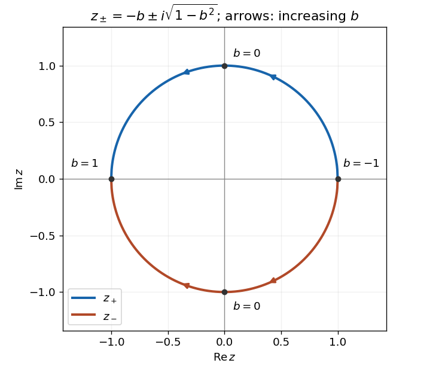

<h1 id="section-b/2/c/solution">Solution</h1>

↑ **Parent:** [C](../c.md)

The [quadratic formula](../../../../../../quadratic-formula.md) gives $z=-b\pm\sqrt{b^2-1}$. For $-1\leq b\leq1$, write this as

$$
\boxed{z_\pm=-b\pm i\sqrt{1-b^2}.}
$$

Each [root of a polynomial](../../../../../../root-of-a-polynomial.md) has [modulus](../../../../../../modulus.md) $1$, since $b^2+(1-b^2)=1$. As $b$ increases from $-1$ to $1$, the upper root traverses the upper unit semicircle from $1$ to $-1$, and the lower root traverses the lower semicircle in the opposite angular direction. At $b=-1$ the roots coincide at $1$; at $b=1$ they coincide at $-1$. For intermediate $b$ they are [complex conjugates](../../../../../../complex-conjugate.md).

**[Figure 2](#section-b/2/c/image-the-conjugate-roots-travel-along-the-two-unit-semicircles). The conjugate roots travel along the two unit semicircles**. Arrows show increasing $b$, with endpoints $b=-1$ and $b=1$ and the midpoint pair $b=0$. The figure is an original plot of the solution formula.

## ↑ Ancestors (14)

1. [C](../c.md)
2. [2](../../2.md)
3. [Section B](../../../section-b.md)
4. [Paper 1](../../../../paper-1-split.md)
5. [2007](../../../../split.md)
6. [Past exam of the mathematics course of the year 1 of the natural sciences course of the University of Cambridge](../../../../../split.md)
7. [Mathematics course of the year 1 of the natural sciences course of the University of Cambridge](../../../../../../mathematics-course-of-the-year-1-of-the-natural-sciences-course-of-the-university-of-cambridge.md)
8. [Year 1 of the natural sciences course of the University of Cambridge](../../../../../../year-1-of-the-natural-sciences-course-of-the-university-of-cambridge.md)
9. [Year of the natural sciences course of the University of Cambridge](../../../../../../year-of-the-natural-sciences-course-of-the-university-of-cambridge.md)
10. [Natural sciences course of the University of Cambridge](../../../../../../natural-sciences-course-of-the-university-of-cambridge.md)
11. [Course of the University of Cambridge](../../../../../../course-of-the-university-of-cambridge.md)
12. [University of Cambridge](../../../../../../university-of-cambridge-split.md)
13. [List of universities](../../../../../../list-of-universities.md)
14. [Codex Wiki](../../../../../../split.md)
