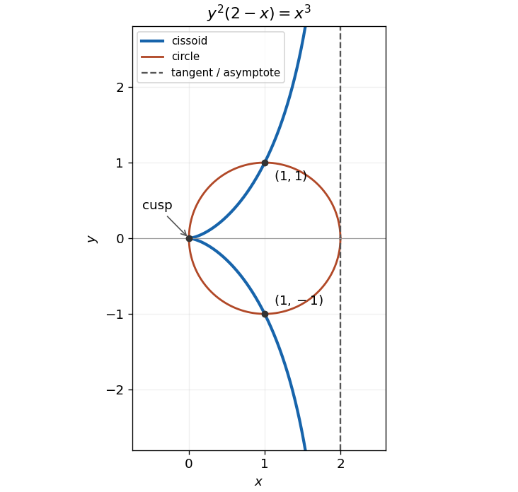

# Paper 2

↑ **Parent:** [2007](../2007.md)

[https://www.maths.cam.ac.uk/undergradnst/files/2007/PaperNST_IA_2.pdf](https://www.maths.cam.ac.uk/undergradnst/files/2007/PaperNST_IA_2.pdf)

**Table of contents**

- [Section A](#section-a)
  - [1](#section-a/1)
    - [Solution](#section-a/1/solution)
  - [2](#section-a/2)
    - [a](#section-a/2/a)
      - [Solution](#section-a/2/a/solution)
    - [b](#section-a/2/b)
      - [Solution](#section-a/2/b/solution)
  - [3](#section-a/3)
    - [a](#section-a/3/a)
      - [Solution](#section-a/3/a/solution)
    - [b](#section-a/3/b)
      - [Solution](#section-a/3/b/solution)
  - [4](#section-a/4)
    - [a](#section-a/4/a)
      - [Solution](#section-a/4/a/solution)
    - [b](#section-a/4/b)
      - [Solution](#section-a/4/b/solution)
    - [c](#section-a/4/c)
      - [Solution](#section-a/4/c/solution)
  - [5](#section-a/5)
    - [a](#section-a/5/a)
      - [Solution](#section-a/5/a/solution)
    - [b](#section-a/5/b)
      - [Solution](#section-a/5/b/solution)
  - [6](#section-a/6)
    - [Solution](#section-a/6/solution)
  - [7](#section-a/7)
    - [Solution](#section-a/7/solution)
  - [8](#section-a/8)
    - [Solution](#section-a/8/solution)
  - [9](#section-a/9)
    - [a](#section-a/9/a)
      - [Solution](#section-a/9/a/solution)
    - [b](#section-a/9/b)
      - [Solution](#section-a/9/b/solution)
- [Section B](#section-b)
  - [1](#section-b/1)
    - [Solution](#section-b/1/solution)
  - [2](#section-b/2)
    - [Solution](#section-b/2/solution)
  - [3](#section-b/3)
    - [a](#section-b/3/a)
      - [Solution](#section-b/3/a/solution)
    - [b](#section-b/3/b)
      - [Solution](#section-b/3/b/solution)
  - [4](#section-b/4)
    - [a](#section-b/4/a)
      - [Solution](#section-b/4/a/solution)
    - [b](#section-b/4/b)
      - [Solution](#section-b/4/b/solution)
  - [5](#section-b/5)
    - [a](#section-b/5/a)
      - [Solution](#section-b/5/a/solution)
    - [b](#section-b/5/b)
      - [Solution](#section-b/5/b/solution)
  - [6](#section-b/6)
    - [a](#section-b/6/a)
      - [Solution](#section-b/6/a/solution)
    - [b](#section-b/6/b)
      - [Solution](#section-b/6/b/solution)
    - [c](#section-b/6/c)
      - [Solution](#section-b/6/c/solution)
    - [d](#section-b/6/d)
      - [Solution](#section-b/6/d/solution)
  - [7](#section-b/7)
    - [a](#section-b/7/a)
      - [i](#section-b/7/a/i)
        - [Solution](#section-b/7/a/i/solution)
      - [ii](#section-b/7/a/ii)
        - [Solution](#section-b/7/a/ii/solution)
      - [iii](#section-b/7/a/iii)
        - [Solution](#section-b/7/a/iii/solution)
    - [b](#section-b/7/b)
      - [Solution](#section-b/7/b/solution)
    - [c](#section-b/7/c)
      - [i](#section-b/7/c/i)
        - [Solution](#section-b/7/c/i/solution)
      - [ii](#section-b/7/c/ii)
        - [Solution](#section-b/7/c/ii/solution)
    - [d](#section-b/7/d)
      - [i](#section-b/7/d/i)
        - [Solution](#section-b/7/d/i/solution)
      - [ii](#section-b/7/d/ii)
        - [Solution](#section-b/7/d/ii/solution)
  - [8](#section-b/8)
    - [Solution](#section-b/8/solution)
  - [9](#section-b/9)
    - [Solution](#section-b/9/solution)
  - [10](#section-b/10)
    - [Solution](#section-b/10/solution)

## Section A

↑ **Parent:** [Paper 2](paper-2.md)

<h3 id="section-a/1">1</h3>

↑ **Parent:** [Section A](#section-a)

<h4 id="section-a/1/solution">Solution</h4>

↑ **Parent:** [1](#section-a/1)

The [cross product](../../vector-space.md#cross-product) is $\mathbf a\times\mathbf b=(-2,0,2)$, which is perpendicular to both [vectors](../../vector-space.md#vector). Any nonzero [scalar multiple](../../vector-space.md#scalar-multiple) works, so a simple answer is

$$
\boxed{(-1,0,1).}
$$

Its [dot product](../../inner-product.md#dot-product) with each given [vector](../../vector-space.md#vector) is zero.

<h3 id="section-a/2">2</h3>

↑ **Parent:** [Section A](#section-a)

<h4 id="section-a/2/a">a</h4>

↑ **Parent:** [2](#section-a/2)

<h5 id="section-a/2/a/solution">Solution</h5>

↑ **Parent:** [A](#section-a/2/a)

The product-to-sum identity for the [sine](../../geometry-and-topology.md#sine) gives $\sin2x\sin4x=\frac12(\cos2x-\cos6x)$. Each [cosine](../../geometry-and-topology.md#cosine) has zero [integral](../../integral.md) on this interval, so

$$
\boxed{I=0.}
$$

This is also an instance of [Fourier orthogonality](../../fourier-series.md#fourier-orthogonality).

<h4 id="section-a/2/b">b</h4>

↑ **Parent:** [2](#section-a/2)

<h5 id="section-a/2/b/solution">Solution</h5>

↑ **Parent:** [B](#section-a/2/b)

Using $d(\sin^2x)/dx=2\sin x\cos x$, the [definite integral](../../integral.md#definite-integral) is

$$
\boxed{J=\left[\frac12\sin^2x\right]_0^{\pi/2}=\frac12.}
$$

<h3 id="section-a/3">3</h3>

↑ **Parent:** [Section A](#section-a)

<h4 id="section-a/3/a">a</h4>

↑ **Parent:** [3](#section-a/3)

<h5 id="section-a/3/a/solution">Solution</h5>

↑ **Parent:** [A](#section-a/3/a)

The [gradient](../../multivariable-calculus.md#gradient) is $(f_x,f_y)=(2-2xy,1-x^2)$. Both [partial derivatives](../../multivariable-calculus.md#partial-derivative) vanish at $(1,1)$, so it is a [stationary point](../../calculus-of-variations.md#stationary-point).

<h4 id="section-a/3/b">b</h4>

↑ **Parent:** [3](#section-a/3)

<h5 id="section-a/3/b/solution">Solution</h5>

↑ **Parent:** [B](#section-a/3/b)

The second component of the [gradient](../../multivariable-calculus.md#gradient) forces $x=\pm1$. The first then requires $xy=1$. Apart from $(1,1)$, the only [stationary point](../../calculus-of-variations.md#stationary-point) is

$$
\boxed{(-1,-1).}
$$

<h3 id="section-a/4">4</h3>

↑ **Parent:** [Section A](#section-a)

<h4 id="section-a/4/a">a</h4>

↑ **Parent:** [4](#section-a/4)

<h5 id="section-a/4/a/solution">Solution</h5>

↑ **Parent:** [A](#section-a/4/a)

Taking the negative [gradient](../../multivariable-calculus.md#gradient) of the [potential energy](../../energy.md#potential-energy) gives the [force](../../force.md)

$$
\boxed{\mathbf f=(-6x,-6y,-2z).}
$$

<h4 id="section-a/4/b">b</h4>

↑ **Parent:** [4](#section-a/4)

<h5 id="section-a/4/b/solution">Solution</h5>

↑ **Parent:** [B](#section-a/4/b)

The [divergence](../../multivariable-calculus.md#divergence) is the sum of the three diagonal [partial derivatives](../../multivariable-calculus.md#partial-derivative):

$$
\boxed{\nabla\cdot\mathbf f=-6-6-2=-14.}
$$

<h4 id="section-a/4/c">c</h4>

↑ **Parent:** [4](#section-a/4)

<h5 id="section-a/4/c/solution">Solution</h5>

↑ **Parent:** [C](#section-a/4/c)

Each component depends only on its own coordinate, so all cross [partial derivatives](../../multivariable-calculus.md#partial-derivative) vanish. Therefore the [curl](../../multivariable-calculus.md#curl) is

$$
\boxed{\nabla\times\mathbf f=\mathbf0.}
$$

This also follows from the identity that the [curl of a gradient](../../multivariable-calculus.md#curl-of-a-gradient) vanishes for a twice continuously [differentiable](../../analysis.md#differentiable-function) [potential energy](../../energy.md#potential-energy).

<h3 id="section-a/5">5</h3>

↑ **Parent:** [Section A](#section-a)

<h4 id="section-a/5/a">a</h4>

↑ **Parent:** [5](#section-a/5)

<h5 id="section-a/5/a/solution">Solution</h5>

↑ **Parent:** [A](#section-a/5/a)

The [matrix product](../../vector-space.md#matrix-product) of the transposed first [vector](../../vector-space.md#vector) with the second is their [dot product](../../inner-product.md#dot-product):

$$
\boxed{\mathbf a^T\mathbf b=1\cdot2+3\cdot1=5.}
$$

<h4 id="section-a/5/b">b</h4>

↑ **Parent:** [5](#section-a/5)

<h5 id="section-a/5/b/solution">Solution</h5>

↑ **Parent:** [B](#section-a/5/b)

The reverse arrangement is an [outer product](../../vector-space.md#outer-product), with entries $a_i b_j$:

$$
\boxed{\mathbf a\mathbf b^T=\begin{pmatrix}2&1\\6&3\end{pmatrix}.}
$$

<h3 id="section-a/6">6</h3>

↑ **Parent:** [Section A](#section-a)

<h4 id="section-a/6/solution">Solution</h4>

↑ **Parent:** [6](#section-a/6)

The two factors have [moduli](../../complex-analysis.md#modulus) $\sqrt2$ and $2$, and [complex arguments](../../complex-analysis.md#argument-complex-analysis) $\pi/4$ and $\pi/6$. Multiplication multiplies the [moduli](../../complex-analysis.md#modulus) and adds the [complex arguments](../../complex-analysis.md#argument-complex-analysis), giving

$$
\boxed{|z|=2\sqrt2,\qquad\arg z=\frac{5\pi}{12}\pmod{2\pi}.}
$$

The displayed angle is the [principal argument](../../complex-analysis.md#principal-argument) in radians; equivalently the argument is $75^\circ$ modulo $360^\circ$.

<h3 id="section-a/7">7</h3>

↑ **Parent:** [Section A](#section-a)

<h4 id="section-a/7/solution">Solution</h4>

↑ **Parent:** [7](#section-a/7)

The [logarithmic series](../../calculus.md#mercator-series) gives the first two nonzero terms:

$$
\boxed{\ln(1+x)=x-\frac{x^2}{2}+O(x^3).}
$$

<h3 id="section-a/8">8</h3>

↑ **Parent:** [Section A](#section-a)

<h4 id="section-a/8/solution">Solution</h4>

↑ **Parent:** [8](#section-a/8)

For $x_0>0$, [separation of variables](../../partial-differential-equation.md#separation-of-variables) gives $1/x=kt+1/x_0$, hence $x(t)=x_0/(1+kx_0t)$. Setting $x(t)=x_0/2$ gives the [half-life](../../analysis.md#half-life)

$$
\boxed{t_{1/2}=\frac1{kx_0}.}
$$

This is the same reciprocal decay law as a [second-order reaction](../../chemical-kinetics.md#second-order-reaction) with the specified [disappearance rate](../../chemical-kinetics.md#disappearance-rate) coefficient. A positive initial value is needed for a positive half-time; $x_0=0$ instead gives the identically zero solution.

<h3 id="section-a/9">9</h3>

↑ **Parent:** [Section A](#section-a)

<h4 id="section-a/9/a">a</h4>

↑ **Parent:** [9](#section-a/9)

<h5 id="section-a/9/a/solution">Solution</h5>

↑ **Parent:** [A](#section-a/9/a)

There are $\binom72=21$ equally likely unordered pairs, and $3\cdot4=12$ contain one ball of each colour. Thus the [hypergeometric distribution](../../discrete-probability-distribution.md#hypergeometric-distribution) gives

$$
\boxed{\mathbb P(\text{different colours})=\frac{12}{21}=\frac47.}
$$

<h4 id="section-a/9/b">b</h4>

↑ **Parent:** [9](#section-a/9)

<h5 id="section-a/9/b/solution">Solution</h5>

↑ **Parent:** [B](#section-a/9/b)

Let $I_1,I_2$ be [indicator random variables](../../expected-value.md#indicator-random-variable) for the two draws being red. Each draw has red [probability](../../probability-theory.md#probability) $3/7$, even though the draws are dependent. By [linearity of expectation](../../expected-value.md#linearity-of-expectation), the number $R=I_1+I_2$ satisfies

$$
\boxed{\mathbb E[R]=\frac37+\frac37=\frac67.}
$$

## Section B

↑ **Parent:** [Paper 2](paper-2.md)

<h3 id="section-b/1">1</h3>

↑ **Parent:** [Section B](#section-b)

<h4 id="section-b/1/solution">Solution</h4>

↑ **Parent:** [1](#section-b/1)

Substituting $x=r\cos\theta$, $y=r\sin\theta$ into the [circle](../../topology.md#circle) equation gives $r^2-2r\cos\theta=0$. Thus its nonzero radial intersection is $r_Q=2\cos\theta$, with the origin also on the [circle](../../topology.md#circle). The [tangent to a circle](../../topology.md#tangent-to-a-circle) at the rightmost point is $x=2$, or $r_R\cos\theta=2$.

Take rays with $-\pi/2<\theta<\pi/2$. The difference of the two radial distances gives the [cissoid of Diocles](../../algebraic-variety.md#cissoid-of-diocles):

$$
\boxed{r_P=2\sec\theta-2\cos\theta=\frac{2\sin^2\theta}{\cos\theta}.}
$$

Multiplying by $\cos\theta$ gives $x=2\sin^2\theta=2y^2/(x^2+y^2)$, hence the Cartesian equation $y^2(2-x)=x^3$. A convenient [parametric curve](../../topology.md#parametric-curve), with $t=\tan\theta$, is

$$
x=\frac{2t^2}{1+t^2},\qquad y=\frac{2t^3}{1+t^2},\qquad -\infty<t<\infty.
$$

The real [curve](../../topology.md#curve) has $0\leq x<2$, a [cusp](../../algebraic-geometry.md#cusp-algebraic-geometry) at the origin, symmetry about the $x$ axis, and the vertical [asymptote](../../topology.md#asymptote) $x=2$. Near the origin, $x\sim2t^2$ and $y\sim2t^3$, so its cusp has horizontal tangent direction. As $|t|\to\infty$, $x\to2^-$ while $|y|\to\infty$. The circle and curve meet away from the origin at $(1,\pm1)$.

**[Figure 1](#section-b/1/image-the-cissoid-has-a-cusp-at-the-origin-and-approaches-the-tangent-line). The cissoid has a cusp at the origin and approaches the tangent line**. An original plot of the derived parametric formula, with the unit [circle](../../topology.md#circle) centred at $(1,0)$ and its [tangent line](../../calculus.md#tangent-line) $x=2$.

<h3 id="section-b/2">2</h3>

↑ **Parent:** [Section B](#section-b)

<h4 id="section-b/2/solution">Solution</h4>

↑ **Parent:** [2](#section-b/2)

The [tangent half-angle substitution](../../geometry-and-topology.md#tangent-half-angle-substitution) $t=\tan(x/2)$ gives $\sin x=2t/(1+t^2)$ and $dx=2\,dt/(1+t^2)$. The endpoints $x=0,\pi/2$ become $t=0,1$, respectively. Hence

$$
\int_0^{\pi/2}\frac{dx}{2+\sin x}=\int_0^1\frac{2\,dt}{2(1+t^2)+2t}=\int_0^1\frac{dt}{t^2+t+1}.
$$

[Completing the square](../../polynomial.md#completing-the-square), $t^2+t+1=(t+1/2)^2+3/4$, then gives

$$
\int_0^1\frac{dt}{t^2+t+1}=\frac2{\sqrt3}\left[\arctan\frac{2t+1}{\sqrt3}\right]_0^1=\frac2{\sqrt3}\left(\frac\pi3-\frac\pi6\right)=\boxed{\frac\pi{3\sqrt3}}.
$$

<h3 id="section-b/3">3</h3>

↑ **Parent:** [Section B](#section-b)

<h4 id="section-b/3/a">a</h4>

↑ **Parent:** [3](#section-b/3)

<h5 id="section-b/3/a/solution">Solution</h5>

↑ **Parent:** [A](#section-b/3/a)

[Normalization of a probability distribution](../../probability-distribution.md#normalization-of-a-probability-distribution) and the [geometric series](../../sequence-and-series.md#geometric-series) give $1=A/(1-\rho)$, so $A=1-\rho$. For a nonnegative [integer](../../integer.md) $n$, the strict tail starts at $n+1$:

$$
\boxed{\mathbb P(N>n)=\sum_{j=n+1}^\infty(1-\rho)\rho^j=\rho^{n+1}.}
$$

For nonnegative [integers](../../integer.md) $n>m$, the [event](../../probability-space.md#event) $\{N>n\}$ is contained in $\{N>m\}$. Therefore

$$
\boxed{\mathbb P(N>n\mid N>m)=\frac{\rho^{n+1}}{\rho^{m+1}}=\rho^{n-m}.}
$$

This is the [memorylessness of the geometric distribution](../../discrete-probability-distribution.md#memorylessness-of-the-geometric-distribution) with the zero-based counting convention. Keeping strict versus non-strict inequalities explicit is essential: $N-m-1$, conditional on $N>m$, has the original distribution of $N$.

<h4 id="section-b/3/b">b</h4>

↑ **Parent:** [3](#section-b/3)

<h5 id="section-b/3/b/solution">Solution</h5>

↑ **Parent:** [B](#section-b/3/b)

Write $\lambda=\ln(\rho^{-1})>0$. The [probability density function](../../continuous-probability-distribution.md#probability-density-function) normalizes when $1=B\int_0^\infty e^{-\lambda x}dx=B/\lambda$, so $B=\lambda$. Its [survival function](../../survival-analysis.md#survival-function) is $e^{-\lambda x}$ for $x\geq0$; hence, for $x>y\geq0$,

$$
\boxed{\mathbb P(X>x\mid X>y)=e^{-\lambda(x-y)}.}
$$

Differentiating this conditional tail gives

$$
\boxed{f_{X\mid X>y}(x)=\begin{cases}\lambda e^{-\lambda(x-y)},&x>y,\\0,&x<y.\end{cases}}
$$

The value assigned at the single endpoint does not affect any [probability](../../probability-theory.md#probability). The [memorylessness of the exponential distribution](../../continuous-probability-distribution.md#memorylessness-of-the-exponential-distribution) says that $X-y$, conditional on $X>y$, is again an [exponential distribution](../../continuous-probability-distribution.md#exponential-distribution) of rate $\lambda$. Its first two [moments](../../expected-value.md#moment) are $1/\lambda$ and $2/\lambda^2$, found by [integration by parts](../../calculus.md#integration-by-parts), so translation leaves the [variance](../../variance.md) unchanged:

$$
\boxed{\operatorname{Var}(X\mid X>y)=\frac1{\lambda^2}=\frac1{[\ln(\rho^{-1})]^2}.}
$$

<h3 id="section-b/4">4</h3>

↑ **Parent:** [Section B](#section-b)

<h4 id="section-b/4/a">a</h4>

↑ **Parent:** [4](#section-b/4)

<h5 id="section-b/4/a/solution">Solution</h5>

↑ **Parent:** [A](#section-b/4/a)

The [characteristic equation](../../linear-ordinary-differential-equation.md#characteristic-equation-of-a-constant-coefficient-differential-equation) for the [homogeneous solution](../../linear-ordinary-differential-equation.md#homogeneous-solution) is $(r+2)^2=0$, giving $(C_1+C_2x)e^{-2x}$. For a [particular solution](../../linear-ordinary-differential-equation.md#particular-solution), substitute $Ae^{2x}$: the left side becomes $16Ae^{2x}$, so $A=1/16$. The [general solution](../../linear-ordinary-differential-equation.md#general-solution) is

$$
\boxed{y=(C_1+C_2x)e^{-2x}+\frac1{16}e^{2x}.}
$$

<h4 id="section-b/4/b">b</h4>

↑ **Parent:** [4](#section-b/4)

<h5 id="section-b/4/b/solution">Solution</h5>

↑ **Parent:** [B](#section-b/4/b)

The [characteristic equation](../../linear-ordinary-differential-equation.md#characteristic-equation-of-a-constant-coefficient-differential-equation) has roots $-3\pm4i$, giving the [homogeneous solution](../../linear-ordinary-differential-equation.md#homogeneous-solution) $e^{-3x}(A\cos4x+B\sin4x)$. For the sinusoidal [forcing term](../../differential-equation.md#forcing-term), $y_p=\sin5x$ is a [particular solution](../../linear-ordinary-differential-equation.md#particular-solution), since its second [derivative](../../calculus.md#derivative) cancels $25y_p$ and $6y_p'=30\cos5x$. The zero initial displacement gives $A=0$; zero initial [derivative](../../calculus.md#derivative) gives $4B+5=0$. Thus

$$
\boxed{y(x)=\sin5x-\frac54e^{-3x}\sin4x.}
$$

The [transient response](../../dynamical-systems.md#transient-response) decays as $e^{-3x}$, leaving the [steady-state response](../../analysis.md#steady-state-response) $\sin5x$. Near zero, $y(0)=y'(0)=0$ and $y''(0)=30$, so the sketch starts with $y\sim15x^2$ and a horizontal [tangent line](../../calculus.md#tangent-line).

**[Figure 2](#section-b/4/b/image-the-decaying-transient-brings-the-initially-stationary-solution-to-a-sinusoidal-response). The decaying transient brings the initially stationary solution to a sinusoidal response**. Solid: the complete solution. Dashed: the surviving $\sin5x$ term. The lower panel resolves the exponentially decaying difference.

<h3 id="section-b/5">5</h3>

↑ **Parent:** [Section B](#section-b)

<h4 id="section-b/5/a">a</h4>

↑ **Parent:** [5](#section-b/5)

<h5 id="section-b/5/a/solution">Solution</h5>

↑ **Parent:** [A](#section-b/5/a)

If $u\,dx+v\,dy=dF$ with continuous second [partial derivatives](../../multivariable-calculus.md#partial-derivative) of $F$, then $u=F_x$ and $v=F_y$. The [symmetry of second derivatives](../../multivariable-calculus.md#symmetry-of-second-derivatives) gives the necessary condition for an [exact differential form](../../differential-form.md#exact-differential-form):

$$
\boxed{\left(\frac{\partial u}{\partial y}\right)_x=\left(\frac{\partial v}{\partial x}\right)_y.}
$$

This condition is also locally sufficient on a small rectangle for continuously [differentiable](../../analysis.md#differentiable-function) coefficients; global sufficiency additionally needs suitable topology of the domain.

<h4 id="section-b/5/b">b</h4>

↑ **Parent:** [5](#section-b/5)

<h5 id="section-b/5/b/solution">Solution</h5>

↑ **Parent:** [B](#section-b/5/b)

Holding $y$ fixed, the [chain rule](../../calculus.md#chain-rule) gives

$$
\boxed{\left(\frac{\partial v}{\partial u}\right)_y\left(\frac{\partial u}{\partial x}\right)_y=\left(\frac{\partial v}{\partial x}\right)_y,}
$$

where the local change of variable from $x$ to $u$ is valid.

For the [internal energy](../../internal-energy.md) $U(S,V)$, its [exact differential](../../differential-form.md#exact-differential) identifies $T=U_S$ and $p=-U_V$. The [Maxwell relation](../../thermodynamics.md#maxwell-relations) from equality of mixed [partial derivatives](../../multivariable-calculus.md#partial-derivative) is $T_V|_S=-p_S|_V$. At fixed [volume](../../thermodynamics.md#volume-thermodynamics), the [constant-volume heat capacity](../../heat.md#heat-capacity-at-constant-volume) satisfies

$$
C_V=\left(\frac{\partial U}{\partial T}\right)_V=T\left(\frac{\partial S}{\partial T}\right)_V,
$$

so $T_S|_V=T/C_V$, assuming nonzero $C_V$ and a locally invertible relation. Applying the [chain rule](../../calculus.md#chain-rule) to $p(T,V)$ gives the [isentropic temperature-volume derivative](../../thermodynamics.md#isentropic-temperature-volume-derivative)

$$
\boxed{\left(\frac{\partial T}{\partial V}\right)_S=-\left(\frac{\partial p}{\partial T}\right)_V\left(\frac{\partial T}{\partial S}\right)_V=-\frac{T}{C_V}\left(\frac{\partial p}{\partial T}\right)_V.}
$$

For the stated one-mole [ideal gas](../../ideal-gas.md), the [equation of state](../../pressure.md#equation-of-state) gives $p_T|_V=R/V$ and $C_V=3R/2$, so the right side is $-2T/(3V)$. Along an [isentropic process](../../first-law-of-thermodynamics.md#isentropic-process), $p\propto V^{-5/3}$ and $T=pV/R\propto V^{-2/3}$, giving the same left side:

$$
\boxed{\left(\frac{\partial T}{\partial V}\right)_S=-\frac{2T}{3V}.}
$$

<h3 id="section-b/6">6</h3>

↑ **Parent:** [Section B](#section-b)

<h4 id="section-b/6/a">a</h4>

↑ **Parent:** [6](#section-b/6)

<h5 id="section-b/6/a/solution">Solution</h5>

↑ **Parent:** [A](#section-b/6/a)

Taking the [curl](../../multivariable-calculus.md#curl) component by component gives

$$
\nabla\times\mathbf F=\bigl(\partial_yx-\partial_z(x^2+2y),\ \partial_z(2xy+z)-\partial_xx,\ \partial_x(x^2+2y)-\partial_y(2xy+z)\bigr)=\boxed{\mathbf0}.
$$

<h4 id="section-b/6/b">b</h4>

↑ **Parent:** [6](#section-b/6)

<h5 id="section-b/6/b/solution">Solution</h5>

↑ **Parent:** [B](#section-b/6/b)

Integrating $\psi_x=-(2xy+z)$ with respect to $x$ gives $\psi=-x^2y-xz+h(y,z)$. Matching $\psi_y=-(x^2+2y)$ requires $h=-y^2+j(z)$, and matching $\psi_z=-x$ requires $j$ constant. A [scalar potential](../../classical-field-theory.md#scalar-potential) with the requested sign is

$$
\boxed{\psi=-x^2y-xz-y^2+C.}
$$

Thus the [force field](../../force.md#force-field-physics) is a [conservative vector field](../../multivariable-calculus.md#conservative-vector-field) on all of $\mathbb R^3$.

<h4 id="section-b/6/c">c</h4>

↑ **Parent:** [6](#section-b/6)

<h5 id="section-b/6/c/solution">Solution</h5>

↑ **Parent:** [C](#section-b/6/c)

Parametrize the [straight line](../../euclidean-geometry.md#straight-line) by $\mathbf x(t)=(t,t,t)$, $0\leq t\leq1$. The [line integral](../../multivariable-calculus.md#line-integral) is

$$
\int\mathbf F\cdot d\mathbf x=\int_0^1\bigl[(2t^2+t)+(t^2+2t)+t\bigr]dt=\int_0^1(3t^2+4t)dt=\boxed{3}.
$$

The change in [scalar potential](../../classical-field-theory.md#scalar-potential) is $\psi(1,1,1)-\psi(0,0,0)=-3$, so the answer is $-\Delta\psi$, as required by the [fundamental theorem for line integrals](../../multivariable-calculus.md#fundamental-theorem-for-line-integrals) for $\mathbf F=-\nabla\psi$.

<h4 id="section-b/6/d">d</h4>

↑ **Parent:** [6](#section-b/6)

<h5 id="section-b/6/d/solution">Solution</h5>

↑ **Parent:** [D](#section-b/6/d)

For positive semiaxes $a,b$, the [cross product](../../vector-space.md#cross-product) of the two parametric [tangent vectors](../../tangent-vector.md) gives the outward [oriented surface element of an ellipsoid of revolution](../../multivariable-calculus.md#oriented-surface-element-of-an-ellipsoid-of-revolution):

$$
\mathbf x_\theta\times\mathbf x_\phi=(ab\sin^2\theta\cos\phi,\ ab\sin^2\theta\sin\phi,\ b^2\sin\theta\cos\theta).
$$

Substituting the parametrization into the [vector field](../../multivariable-calculus.md#vector-field) and taking its [dot product](../../inner-product.md#dot-product) with this element gives

$$
\mathbf G\cdot(\mathbf x_\theta\times\mathbf x_\phi)=a^3b^2\sin^3\theta\cos^2\theta\cos^2\phi+ab^4\sin^5\theta\cos\phi\sin^3\phi+a^3b^2\sin\theta\cos^4\theta.
$$

The middle term has zero [integral](../../integral.md) over $0\leq\phi\leq2\pi$. In the other terms, $\int_0^{2\pi}\cos^2\phi\,d\phi=\pi$, $\int_0^\pi\sin^3\theta\cos^2\theta\,d\theta=4/15$, and $\int_0^\pi\sin\theta\cos^4\theta\,d\theta=2/5$. The directly evaluated [flux](../../mathematical-physics.md#flux) is therefore

$$
\boxed{\int_S\mathbf G\cdot d\mathbf S=a^3b^2\left(\frac{4\pi}{15}+\frac{4\pi}{5}\right)=\frac{16\pi a^3b^2}{15}.}
$$

<h3 id="section-b/7">7</h3>

↑ **Parent:** [Section B](#section-b)

<h4 id="section-b/7/a">a</h4>

↑ **Parent:** [7](#section-b/7)

<h5 id="section-b/7/a/i">i</h5>

↑ **Parent:** [A](#section-b/7/a)

<h6 id="section-b/7/a/i/solution">Solution</h6>

↑ **Parent:** [I](#section-b/7/a/i)

**True.** Multiplicativity of the [determinant](../../multilinear-algebra.md#determinant) and the identity $\det(B^{-1})=1/\det B$ give $\det(B^{-1}AB)=\det(B^{-1})\det A\det B=\det A$. This is invariance under [matrix similarity](../../linear-algebra.md#matrix-similarity).

<h5 id="section-b/7/a/ii">ii</h5>

↑ **Parent:** [A](#section-b/7/a)

<h6 id="section-b/7/a/ii/solution">Solution</h6>

↑ **Parent:** [Ii](#section-b/7/a/ii)

**False.** The [cyclic property of the trace](../../linear-algebra.md#cyclic-property-of-the-trace) permits $ABC\mapsto BCA$, but not an arbitrary interchange. Even with $A$ and $B$ both [invertible matrices](../../linear-algebra.md#invertible-matrix), take

$$
A=\begin{pmatrix}1&0\\0&2\end{pmatrix},\quad B=\begin{pmatrix}1&1\\0&1\end{pmatrix},\quad C=\begin{pmatrix}0&0\\1&0\end{pmatrix}.
$$

Then $\operatorname{Tr}(ABC)=1$ and $\operatorname{Tr}(BAC)=2$, providing a counterexample.

<h5 id="section-b/7/a/iii">iii</h5>

↑ **Parent:** [A](#section-b/7/a)

<h6 id="section-b/7/a/iii/solution">Solution</h6>

↑ **Parent:** [Iii](#section-b/7/a/iii)

**True.** Distribute the [matrix product](../../vector-space.md#matrix-product) while retaining its order:

$$
A^{-1}(A+B)B^{-1}=A^{-1}AB^{-1}+A^{-1}BB^{-1}=B^{-1}+A^{-1}=A^{-1}+B^{-1}.
$$

Only addition is commuted; no commutation of $A$ and $B$ is assumed.

<h4 id="section-b/7/b">b</h4>

↑ **Parent:** [7](#section-b/7)

<h5 id="section-b/7/b/solution">Solution</h5>

↑ **Parent:** [B](#section-b/7/b)

The [permutation matrix](../../vector-space.md#permutation-matrix) cycles the three coordinate [vectors](../../vector-space.md#vector), so three applications give $C^3=I$. Consequently $C^2C=CC^2=I$, proving $C^{-1}=C^2$. Since $16=5\cdot3+1$,

$$
\boxed{C^{16}=C=\begin{pmatrix}0&0&1\\1&0&0\\0&1&0\end{pmatrix}.}
$$

<h4 id="section-b/7/c">c</h4>

↑ **Parent:** [7](#section-b/7)

<h5 id="section-b/7/c/i">i</h5>

↑ **Parent:** [C](#section-b/7/c)

<h6 id="section-b/7/c/i/solution">Solution</h6>

↑ **Parent:** [I](#section-b/7/c/i)

Expansion of the [determinant](../../multilinear-algebra.md#determinant) gives $\det M=-\mu-\mu=-2\mu$. The [matrix inverse](../../matrix-inverse.md) exists precisely when

$$
\boxed{\mu\ne0.}
$$

<h5 id="section-b/7/c/ii">ii</h5>

↑ **Parent:** [C](#section-b/7/c)

<h6 id="section-b/7/c/ii/solution">Solution</h6>

↑ **Parent:** [Ii](#section-b/7/c/ii)

For $\mu\ne0$, the [adjugate matrix](../../linear-algebra.md#adjugate-matrix) formula, or elimination on the three unit right-hand sides, gives

$$
\boxed{M^{-1}=\begin{pmatrix}\frac1{2\mu}&\frac12&-\frac1{2\mu}\\\frac12&-\frac\mu2&\frac12\\-\frac1{2\mu}&\frac12&\frac1{2\mu}\end{pmatrix}.}
$$

Multiplication by $M$ gives the [identity matrix](../../vector-space.md#identity-matrix), checking all signs and coefficients.

<h4 id="section-b/7/d">d</h4>

↑ **Parent:** [7](#section-b/7)

<h5 id="section-b/7/d/i">i</h5>

↑ **Parent:** [D](#section-b/7/d)

<h6 id="section-b/7/d/i/solution">Solution</h6>

↑ **Parent:** [I](#section-b/7/d/i)

Subtracting the first and third equations gives $\mu(x-z)=0$. Since $\mu\ne0$, $x=z$, and the second equation gives $x=z=1$. The first then gives $y=1-\mu$, so the unique solution of the [system of linear equations](../../linear-algebra.md#system-of-linear-equations) is

$$
\boxed{(x,y,z)=(1,1-\mu,1).}
$$

<h5 id="section-b/7/d/ii">ii</h5>

↑ **Parent:** [D](#section-b/7/d)

<h6 id="section-b/7/d/ii/solution">Solution</h6>

↑ **Parent:** [Ii](#section-b/7/d/ii)

At $\mu=0$, the first and third equations both reduce to $y=1$, while the second gives $x+z=2$. All solutions form the [straight line](../../euclidean-geometry.md#straight-line)

$$
\boxed{(x,y,z)=(1,1,1)+t(1,0,-1),\qquad t\in\mathbb R.}
$$

The limit of the nonzero-$\mu$ solution selects only the point $(1,1,1)$ on this whole line; setting a parameter to its singular value can enlarge the solution set.

<h3 id="section-b/8">8</h3>

↑ **Parent:** [Section B](#section-b)

<h4 id="section-b/8/solution">Solution</h4>

↑ **Parent:** [8](#section-b/8)

Use the real [Fourier series](../../fourier-series.md) convention $f(x)\sim a_0/2+\sum_{n\geq1}[a_n\cos(n\pi x)+b_n\sin(n\pi x)]$ for period two. The [Fourier coefficients](../../fourier-series.md#fourier-coefficient) are

$$
a_0=\int_0^1 2x\,dx=1,\quad a_n=\int_0^1 2x\cos(n\pi x)\,dx=\frac{2[(-1)^n-1]}{n^2\pi^2},\quad b_n=\int_0^1 2x\sin(n\pi x)\,dx=\frac{2(-1)^{n+1}}{n\pi}.
$$

The last two [integrals](../../integral.md) follow by [integration by parts](../../calculus.md#integration-by-parts). Thus the [Fourier series of a half-wave rectified ramp](../../fourier-series.md#fourier-series-of-a-half-wave-rectified-ramp) is

$$
f(x)\sim\frac12-\frac4{\pi^2}\sum_{r=0}^\infty\frac{\cos((2r+1)\pi x)}{(2r+1)^2}+\frac2\pi\sum_{n=1}^\infty\frac{(-1)^{n+1}}n\sin(n\pi x).
$$

On $(-1,1)$, $f(x)=|x|+x$. Its [even](../../calculus.md#even-function) part is $f_e(x)=|x|$ and its [odd](../../calculus.md#odd-function) part is $f_o(x)=x$, so the cosine and sine terms separate:

$$
\boxed{f_e(x)=\frac12-\frac4{\pi^2}\sum_{r=0}^\infty\frac{\cos((2r+1)\pi x)}{(2r+1)^2},\qquad f_o(x)=\frac2\pi\sum_{n=1}^\infty\frac{(-1)^{n+1}}n\sin(n\pi x).}
$$

At a jump, the [Fourier series](../../fourier-series.md) converges to the average of the one-sided limits. Thus the first series for $f$ takes the value $1$ at odd integers, while the [Fourier series of a periodic sawtooth](../../fourier-series.md#fourier-series-of-a-periodic-sawtooth) for $f_o$ takes the value $0$ there. The even function has a continuous periodic extension.

At $x=0$, the formula for $f_e$ gives $0=1/2-(4/\pi^2)\sum_{r\geq0}(2r+1)^{-2}$. At $x=1/2$, the formula for $f_o$ has only odd-index terms and gives $1/2=(2/\pi)\sum_{r\geq0}(-1)^r/(2r+1)$. Hence

$$
\boxed{\sum_{r=0}^\infty\frac1{(2r+1)^2}=\frac{\pi^2}{8},\qquad\sum_{r=0}^\infty\frac{(-1)^r}{2r+1}=\frac\pi4.}
$$

<h3 id="section-b/9">9</h3>

↑ **Parent:** [Section B](#section-b)

<h4 id="section-b/9/solution">Solution</h4>

↑ **Parent:** [9](#section-b/9)

Set $g(x,y)=y-(x-2)^2$. The [gradient](../../multivariable-calculus.md#gradient) of $g$ never vanishes, so the [Lagrange multiplier](../../mathematical-optimization.md#lagrange-multiplier) equations $\nabla f=\lambda\nabla g$ apply at a constrained [stationary point](../../calculus-of-variations.md#stationary-point). They are $4x=-2\lambda(x-2)$, $2y=\lambda$, and $y=(x-2)^2$. Eliminating $\lambda,y$ gives

$$
x+(x-2)^3=0.
$$

With $t=x-2$, this becomes $t^3+t+2=(t+1)(t^2-t+2)=0$. The quadratic factor is $(t-1/2)^2+7/4>0$, so the only real possibility is $t=-1$. Therefore

$$
\boxed{(x,y)=(1,1),\qquad f=3,\qquad\lambda=2.}
$$

The [level curve](../../topology.md#level-curve) through this point is the [ellipse](../../euclidean-geometry.md#ellipse) $2x^2+y^2=3$, meeting the coordinate axes at $(\pm\sqrt{3/2},0)$ and $(0,\pm\sqrt3)$. Its [tangent line](../../calculus.md#tangent-line) at $(1,1)$ has [slope](../../euclidean-geometry.md#slope) $-2x/y=-2$, equal to the [derivative](../../calculus.md#derivative) $2(x-2)$ of the constraint [parabola](../../euclidean-geometry.md#parabola) there. The two [curves](../../topology.md#curve) are tangent.

**[Figure 3](#section-b/9/image-the-smallest-elliptical-contour-meeting-the-constraint-is-tangent-at-the-minimum). The smallest elliptical contour meeting the constraint is tangent at the minimum**. The highlighted contour is $2x^2+y^2=3$ and the constraint is $y=(x-2)^2$. Its four axis intercepts and the unique contact point $(1,1)$ are marked.

The [parabola](../../euclidean-geometry.md#parabola) touches this [ellipse](../../euclidean-geometry.md#ellipse) from outside; every other point on the constraint lies on a larger contour. An exact check of this geometric argument is

$$
2x^2+(x-2)^4-3=(x-1)^2\bigl[(x-3)^2+4\bigr]\geq0,
$$

with equality only at $x=1$. Thus the point is the unique constrained [global minimum](../../analysis.md#global-minimum).

<h3 id="section-b/10">10</h3>

↑ **Parent:** [Section B](#section-b)

<h4 id="section-b/10/solution">Solution</h4>

↑ **Parent:** [10](#section-b/10)

Substitute $u(y,t)=Y(y)T(t)$ into the [diffusion equation](../../diffusion-equation.md) and divide on a region where both factors are nonzero. This gives $Y''/Y=T'/(\nu T)$. The two sides depend on different variables, so they equal a separation [constant](../../mathematics.md#constant-mathematics) $a$:

$$
\boxed{Y''=aY,\qquad T'=\nu aT.}
$$

These identities then extend through the zeros of the separated factors. The zero [Dirichlet boundary conditions](../../differential-equation.md#dirichlet-boundary-condition) require $Y(0)=Y(1)=0$. For a nontrivial solution, $a$ must be negative: $a=0$ gives only a vanishing linear function and $a>0$ gives only a vanishing hyperbolic-sine solution. Writing $a=-k^2$ gives $Y=A\sin(ky)$, and $k=n\pi$, $n=1,2,\ldots$. Consequently the separated modes of [free viscous decay between parallel plates](../../viscous-fluid-flow.md#free-viscous-decay-between-parallel-plates) are $\sin(n\pi y)e^{-\nu n^2\pi^2t}$.

The first initial condition selects the lowest mode:

$$
\boxed{u(y,t)=\sin(\pi y)e^{-\nu\pi^2t}.}
$$

The [superposition principle](../../vector-space.md#superposition-principle) for a homogeneous [linear differential equation](../../differential-equation.md#linear-differential-equation) states that any linear combination of solutions is again a solution, with the same combination of homogeneous [boundary conditions](../../differential-equation.md#boundary-condition) and initial data. It therefore gives

$$
\boxed{u(y,t)=\sin(\pi y)e^{-\nu\pi^2t}+\frac1{10}\sin(3\pi y)e^{-9\nu\pi^2t}.}
$$

The higher spatial mode decays nine times as fast, so the [velocity](../../classical-mechanics.md#velocity) profile approaches a multiple of the first sine mode before vanishing altogether.

## ↑ Ancestors (10)

1. [2007](../2007.md)
2. [Past exam of the mathematics course of the year 1 of the natural sciences course of the University of Cambridge](../../past-exam-of-the-mathematics-course-of-the-year-1-of-the-natural-sciences-course-of-the-university-of-cambridge.md)
3. [Mathematics course of the year 1 of the natural sciences course of the University of Cambridge](../../university-of-cambridge.md#mathematics-course-of-the-year-1-of-the-natural-sciences-course-of-the-university-of-cambridge)
4. [Year 1 of the natural sciences course of the University of Cambridge](../../university-of-cambridge.md#year-1-of-the-natural-sciences-course-of-the-university-of-cambridge)
5. [Year of the natural sciences course of the University of Cambridge](../../university-of-cambridge.md#year-of-the-natural-sciences-course-of-the-university-of-cambridge)
6. [Natural sciences course of the University of Cambridge](../../university-of-cambridge.md#natural-sciences-course-of-the-university-of-cambridge)
7. [Course of the University of Cambridge](../../university-of-cambridge.md#course-of-the-university-of-cambridge)
8. [University of Cambridge](../../university-of-cambridge.md)
9. [List of universities](../../README.md#list-of-universities)
10. [Codex Wiki](../../README.md)
