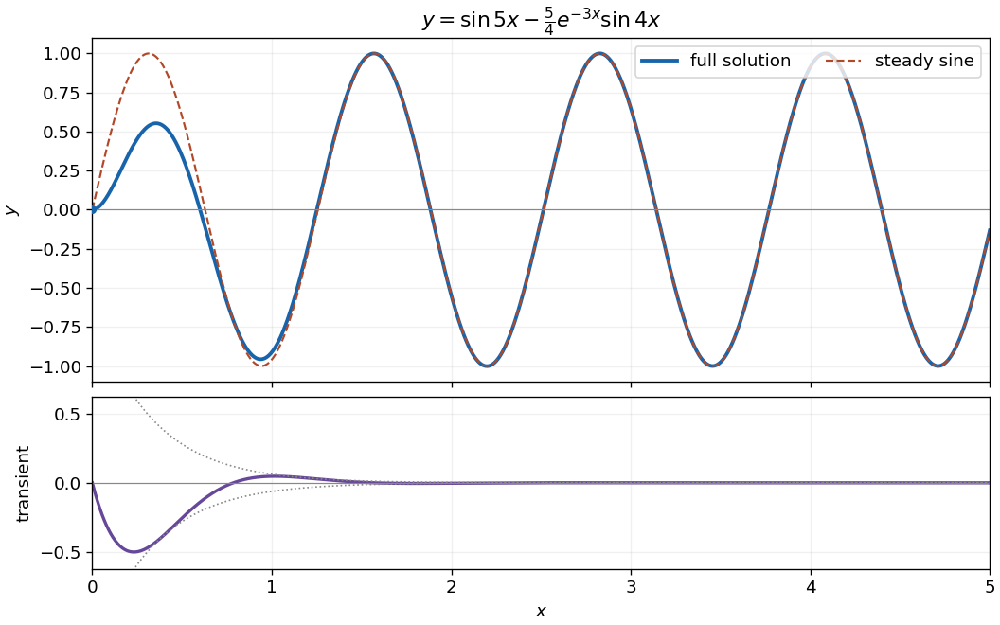

<h1 id="section-b/4/b/solution">Solution</h1>

↑ **Parent:** [B](../b.md)

The [characteristic equation](../../../../../../characteristic-equation-of-a-constant-coefficient-differential-equation.md) has roots $-3\pm4i$, giving the [homogeneous solution](../../../../../../homogeneous-solution.md) $e^{-3x}(A\cos4x+B\sin4x)$. For the sinusoidal [forcing term](../../../../../../forcing-term.md), $y_p=\sin5x$ is a [particular solution](../../../../../../particular-solution.md), since its second [derivative](../../../../../../derivative.md) cancels $25y_p$ and $6y_p'=30\cos5x$. The zero initial displacement gives $A=0$; zero initial [derivative](../../../../../../derivative.md) gives $4B+5=0$. Thus

$$
\boxed{y(x)=\sin5x-\frac54e^{-3x}\sin4x.}
$$

The [transient response](../../../../../../transient-response.md) decays as $e^{-3x}$, leaving the [steady-state response](../../../../../../steady-state-response.md) $\sin5x$. Near zero, $y(0)=y'(0)=0$ and $y''(0)=30$, so the sketch starts with $y\sim15x^2$ and a horizontal [tangent line](../../../../../../tangent-line.md).

**[Figure 2](#section-b/4/b/image-the-decaying-transient-brings-the-initially-stationary-solution-to-a-sinusoidal-response). The decaying transient brings the initially stationary solution to a sinusoidal response**. Solid: the complete solution. Dashed: the surviving $\sin5x$ term. The lower panel resolves the exponentially decaying difference.

## ↑ Ancestors (14)

1. [B](../b.md)
2. [4](../../4.md)
3. [Section B](../../../section-b.md)
4. [Paper 2](../../../../paper-2-split.md)
5. [2007](../../../../split.md)
6. [Past exam of the mathematics course of the year 1 of the natural sciences course of the University of Cambridge](../../../../../split.md)
7. [Mathematics course of the year 1 of the natural sciences course of the University of Cambridge](../../../../../../mathematics-course-of-the-year-1-of-the-natural-sciences-course-of-the-university-of-cambridge.md)
8. [Year 1 of the natural sciences course of the University of Cambridge](../../../../../../year-1-of-the-natural-sciences-course-of-the-university-of-cambridge.md)
9. [Year of the natural sciences course of the University of Cambridge](../../../../../../year-of-the-natural-sciences-course-of-the-university-of-cambridge.md)
10. [Natural sciences course of the University of Cambridge](../../../../../../natural-sciences-course-of-the-university-of-cambridge.md)
11. [Course of the University of Cambridge](../../../../../../course-of-the-university-of-cambridge.md)
12. [University of Cambridge](../../../../../../university-of-cambridge-split.md)
13. [List of universities](../../../../../../list-of-universities.md)
14. [Codex Wiki](../../../../../../split.md)
