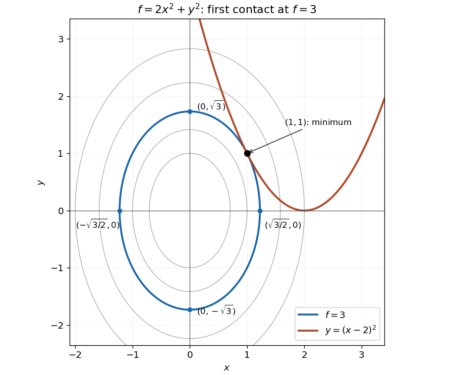

<h1 id="section-b/9/solution">Solution</h1>

↑ **Parent:** [9](../9.md)

Set $g(x,y)=y-(x-2)^2$. The [gradient](../../../../../gradient.md) of $g$ never vanishes, so the [Lagrange multiplier](../../../../../lagrange-multiplier.md) equations $\nabla f=\lambda\nabla g$ apply at a constrained [stationary point](../../../../../stationary-point.md). They are $4x=-2\lambda(x-2)$, $2y=\lambda$, and $y=(x-2)^2$. Eliminating $\lambda,y$ gives

$$
x+(x-2)^3=0.
$$

With $t=x-2$, this becomes $t^3+t+2=(t+1)(t^2-t+2)=0$. The quadratic factor is $(t-1/2)^2+7/4>0$, so the only real possibility is $t=-1$. Therefore

$$
\boxed{(x,y)=(1,1),\qquad f=3,\qquad\lambda=2.}
$$

The [level curve](../../../../../level-curve.md) through this point is the [ellipse](../../../../../ellipse.md) $2x^2+y^2=3$, meeting the coordinate axes at $(\pm\sqrt{3/2},0)$ and $(0,\pm\sqrt3)$. Its [tangent line](../../../../../tangent-line.md) at $(1,1)$ has [slope](../../../../../slope.md) $-2x/y=-2$, equal to the [derivative](../../../../../derivative.md) $2(x-2)$ of the constraint [parabola](../../../../../parabola.md) there. The two [curves](../../../../../curve.md) are tangent.

**[Figure 3](#section-b/9/image-the-smallest-elliptical-contour-meeting-the-constraint-is-tangent-at-the-minimum). The smallest elliptical contour meeting the constraint is tangent at the minimum**. The highlighted contour is $2x^2+y^2=3$ and the constraint is $y=(x-2)^2$. Its four axis intercepts and the unique contact point $(1,1)$ are marked.

The [parabola](../../../../../parabola.md) touches this [ellipse](../../../../../ellipse.md) from outside; every other point on the constraint lies on a larger contour. An exact check of this geometric argument is

$$
2x^2+(x-2)^4-3=(x-1)^2\bigl[(x-3)^2+4\bigr]\geq0,
$$

with equality only at $x=1$. Thus the point is the unique constrained [global minimum](../../../../../global-minimum.md).

## ↑ Ancestors (13)

1. [9](../9.md)
2. [Section B](../../section-b.md)
3. [Paper 2](../../../paper-2-split.md)
4. [2007](../../../split.md)
5. [Past exam of the mathematics course of the year 1 of the natural sciences course of the University of Cambridge](../../../../split.md)
6. [Mathematics course of the year 1 of the natural sciences course of the University of Cambridge](../../../../../mathematics-course-of-the-year-1-of-the-natural-sciences-course-of-the-university-of-cambridge.md)
7. [Year 1 of the natural sciences course of the University of Cambridge](../../../../../year-1-of-the-natural-sciences-course-of-the-university-of-cambridge.md)
8. [Year of the natural sciences course of the University of Cambridge](../../../../../year-of-the-natural-sciences-course-of-the-university-of-cambridge.md)
9. [Natural sciences course of the University of Cambridge](../../../../../natural-sciences-course-of-the-university-of-cambridge.md)
10. [Course of the University of Cambridge](../../../../../course-of-the-university-of-cambridge.md)
11. [University of Cambridge](../../../../../university-of-cambridge-split.md)
12. [List of universities](../../../../../list-of-universities.md)
13. [Codex Wiki](../../../../../split.md)
