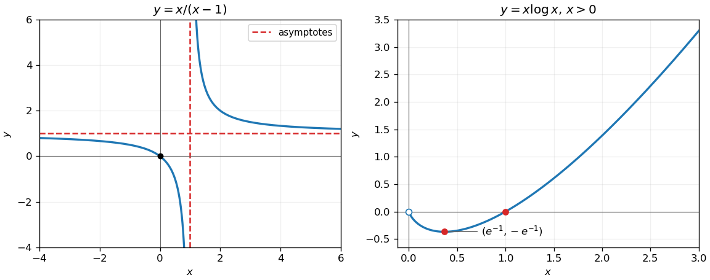
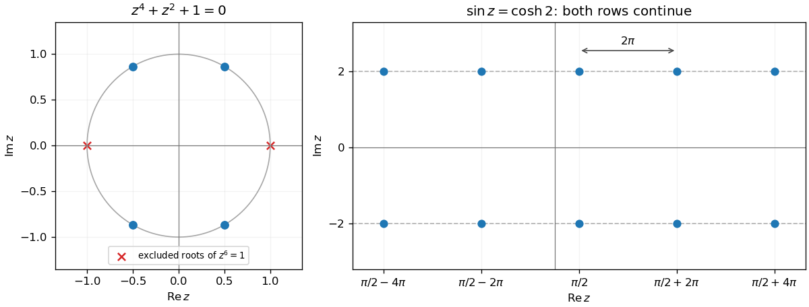
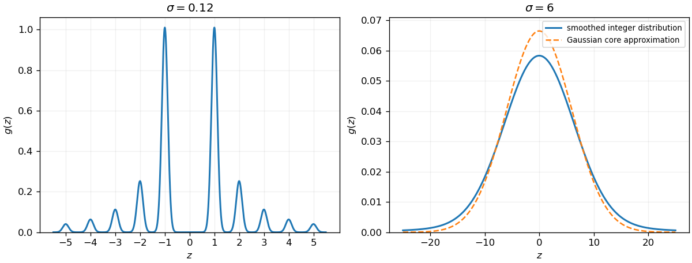
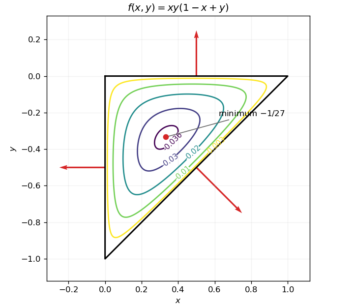

# Paper 1

↑ **Parent:** [2008](../2008.md)

[https://www.maths.cam.ac.uk/undergradnst/files/2008/PaperNST_IA_1.pdf](https://www.maths.cam.ac.uk/undergradnst/files/2008/PaperNST_IA_1.pdf)

**Table of contents**

- [1](#1)
  - [Solution](#1/solution)
- [2](#2)
  - [i](#2/i)
    - [Solution](#2/i/solution)
  - [ii](#2/ii)
    - [Solution](#2/ii/solution)
- [3](#3)
  - [i](#3/i)
    - [Solution](#3/i/solution)
  - [ii](#3/ii)
    - [Solution](#3/ii/solution)
- [4](#4)
  - [Solution](#4/solution)
- [5](#5)
  - [Solution](#5/solution)
- [6](#6)
  - [Solution](#6/solution)
- [7](#7)
  - [i](#7/i)
    - [Solution](#7/i/solution)
  - [ii](#7/ii)
    - [Solution](#7/ii/solution)
- [8](#8)
  - [Solution](#8/solution)
- [9](#9)
  - [Solution](#9/solution)
- [10](#10)
  - [i](#10/i)
    - [Solution](#10/i/solution)
  - [ii](#10/ii)
    - [Solution](#10/ii/solution)
- [11](#11)
  - [Solution](#11/solution)
- [12](#12)
  - [a](#12/a)
    - [Solution](#12/a/solution)
  - [b](#12/b)
    - [i](#12/b/i)
      - [Solution](#12/b/i/solution)
    - [ii](#12/b/ii)
      - [Solution](#12/b/ii/solution)
    - [iii](#12/b/iii)
      - [Solution](#12/b/iii/solution)
  - [c](#12/c)
    - [i](#12/c/i)
      - [Solution](#12/c/i/solution)
    - [ii](#12/c/ii)
      - [Solution](#12/c/ii/solution)
- [13](#13)
  - [a](#13/a)
    - [Solution](#13/a/solution)
  - [b](#13/b)
    - [Solution](#13/b/solution)
  - [c](#13/c)
    - [Solution](#13/c/solution)
- [14](#14)
  - [a](#14/a)
    - [Solution](#14/a/solution)
  - [b](#14/b)
    - [Solution](#14/b/solution)
- [15](#15)
  - [a](#15/a)
    - [Solution](#15/a/solution)
  - [b](#15/b)
    - [Solution](#15/b/solution)
    - [i](#15/b/i)
      - [Solution](#15/b/i/solution)
    - [ii](#15/b/ii)
      - [Solution](#15/b/ii/solution)
- [16](#16)
  - [a](#16/a)
    - [i](#16/a/i)
      - [Solution](#16/a/i/solution)
    - [ii](#16/a/ii)
      - [Solution](#16/a/ii/solution)
    - [iii](#16/a/iii)
      - [Solution](#16/a/iii/solution)
  - [b](#16/b)
    - [i](#16/b/i)
      - [Solution](#16/b/i/solution)
    - [ii](#16/b/ii)
      - [Solution](#16/b/ii/solution)
- [17](#17)
  - [a](#17/a)
    - [i](#17/a/i)
      - [Solution](#17/a/i/solution)
    - [ii](#17/a/ii)
      - [Solution](#17/a/ii/solution)
    - [iii](#17/a/iii)
      - [Solution](#17/a/iii/solution)
    - [iv](#17/a/iv)
      - [Solution](#17/a/iv/solution)
  - [b](#17/b)
    - [Solution](#17/b/solution)
- [18](#18)
  - [a](#18/a)
    - [i](#18/a/i)
      - [Solution](#18/a/i/solution)
    - [ii](#18/a/ii)
      - [Solution](#18/a/ii/solution)
    - [iii](#18/a/iii)
      - [Solution](#18/a/iii/solution)
  - [b](#18/b)
    - [i](#18/b/i)
      - [Solution](#18/b/i/solution)
    - [ii](#18/b/ii)
      - [Solution](#18/b/ii/solution)
    - [iii](#18/b/iii)
      - [Solution](#18/b/iii/solution)
  - [c](#18/c)
    - [Solution](#18/c/solution)
- [19](#19)
  - [a](#19/a)
    - [Solution](#19/a/solution)
    - [i](#19/a/i)
      - [Solution](#19/a/i/solution)
    - [ii](#19/a/ii)
      - [Solution](#19/a/ii/solution)
    - [iii](#19/a/iii)
      - [Solution](#19/a/iii/solution)
  - [b](#19/b)
    - [Solution](#19/b/solution)
  - [c](#19/c)
    - [Solution](#19/c/solution)
    - [i](#19/c/i)
      - [Solution](#19/c/i/solution)
    - [ii](#19/c/ii)
      - [Solution](#19/c/ii/solution)
- [20](#20)
  - [a](#20/a)
    - [Solution](#20/a/solution)
  - [b](#20/b)
    - [Solution](#20/b/solution)

## 1

↑ **Parent:** [Paper 1](paper-1.md)

<h3 id="1/solution">Solution</h3>

↑ **Parent:** [1](#1)

The angle-subtraction identity gives $\sqrt3\cos\theta+\sin\theta=2\cos(\theta-\pi/6)$. Thus $\cos(\theta-\pi/6)=1/\sqrt2$, so $\theta-\pi/6=\pm\pi/4+2k\pi$. Keeping the two values in the specified interval gives

$$
\boxed{\theta=\frac{5\pi}{12},\quad\frac{23\pi}{12}.}
$$

## 2

↑ **Parent:** [Paper 1](paper-1.md)

<h3 id="2/i">i</h3>

↑ **Parent:** [2](#2)

<h4 id="2/i/solution">Solution</h4>

↑ **Parent:** [I](#2/i)

The [chain rule](../../calculus.md#chain-rule) gives

$$
\boxed{\frac{d}{dx}\sin(x^2)=2x\cos(x^2).}
$$

<h3 id="2/ii">ii</h3>

↑ **Parent:** [2](#2)

<h4 id="2/ii/solution">Solution</h4>

↑ **Parent:** [Ii](#2/ii)

The [quotient rule](../../calculus.md#quotient-rule) and the [derivative](../../calculus.md#derivative) of the [exponential function](../../calculus.md#exponential-function) give

$$
\boxed{\frac{d}{dx}\left(\frac{e^{2x}}x\right)=\frac{e^{2x}(2x-1)}{x^2},\qquad x\ne0.}
$$

## 3

↑ **Parent:** [Paper 1](paper-1.md)

<h3 id="3/i">i</h3>

↑ **Parent:** [3](#3)

<h4 id="3/i/solution">Solution</h4>

↑ **Parent:** [I](#3/i)

Use the [change of variables](../../multivariable-calculus.md#change-of-variables-formula) $u=x^2+1$, $du=2x\,dx$. Then

$$
\boxed{\int\frac{x}{\sqrt{x^2+1}}\,dx=\sqrt{x^2+1}+C.}
$$

Differentiating verifies this [antiderivative](../../integral.md#antiderivative) on the whole real line.

<h3 id="3/ii">ii</h3>

↑ **Parent:** [3](#3)

<h4 id="3/ii/solution">Solution</h4>

↑ **Parent:** [Ii](#3/ii)

[Integration by parts](../../calculus.md#integration-by-parts) with $u=x$ and $dv=e^x\,dx$ gives

$$
\boxed{\int xe^x\,dx=xe^x-\int e^x\,dx=(x-1)e^x+C.}
$$

## 4

↑ **Parent:** [Paper 1](paper-1.md)

<h3 id="4/solution">Solution</h3>

↑ **Parent:** [4](#4)

Factor the [polynomial](../../polynomial.md) as $(x^2-1)(x^2-2)$. Each factor must vanish, giving all four [roots of a polynomial](../../polynomial.md#root-of-a-polynomial):

$$
\boxed{x=1,-1,\sqrt2,-\sqrt2.}
$$

## 5

↑ **Parent:** [Paper 1](paper-1.md)

<h3 id="5/solution">Solution</h3>

↑ **Parent:** [5](#5)

Substituting $y=x/2$ into $xy=1$ gives $x^2=2$. The intersection points are $(\sqrt2,1/\sqrt2)$ and $(-\sqrt2,-1/\sqrt2)$. Their [Euclidean distance](../../topological-analysis.md#euclidean-distance) is

$$
\boxed{\sqrt{(2\sqrt2)^2+(\sqrt2)^2}=\sqrt{10}.}
$$

## 6

↑ **Parent:** [Paper 1](paper-1.md)

<h3 id="6/solution">Solution</h3>

↑ **Parent:** [6](#6)

The point on the [parabola](../../euclidean-geometry.md#parabola) is $(1,2)$. [Implicit differentiation](../../multivariable-calculus.md#implicit-differentiation) gives $2y\,dy/dx=4$, so the [tangent line](../../calculus.md#tangent-line) has slope one there. Its perpendicular [normal line to a plane curve](../../calculus.md#normal-line-to-a-plane-curve) therefore has slope $-1$. The required line is

$$
\boxed{y-2=-(x-1),\qquad\text{or }y=3-x.}
$$

## 7

↑ **Parent:** [Paper 1](paper-1.md)

<h3 id="7/i">i</h3>

↑ **Parent:** [7](#7)

<h4 id="7/i/solution">Solution</h4>

↑ **Parent:** [I](#7/i)

Write $x/(x-1)=1+1/(x-1)$. The graph is a translated [hyperbola](../../euclidean-geometry.md#hyperbola), with vertical [asymptote](../../topology.md#asymptote) $x=1$ and horizontal [asymptote](../../topology.md#asymptote) $y=1$. It passes through $(0,0)$, lies below $y=1$ for $x<1$ and above it for $x>1$, and has [derivative](../../calculus.md#derivative) $-1/(x-1)^2<0$ on each component of its domain. The left panel below shows both branches.

**[Figure 1](#7/i/image-the-rational-hyperbola-and-the-convex-graph-of-the-logarithmic-product). The rational hyperbola and the convex graph of the logarithmic product**.

<h3 id="7/ii">ii</h3>

↑ **Parent:** [7](#7)

<h4 id="7/ii/solution">Solution</h4>

↑ **Parent:** [Ii](#7/ii)

The domain is $x>0$, and $x\log x\to0$ from below as $x\downarrow0$. Its [derivative](../../calculus.md#derivative) is $1+\log x$, so it decreases up to $x=e^{-1}$ and then increases, with its unique global [minimum](../../set.md#minimum-of-a-subset-of-a-total-order) at $(e^{-1},-e^{-1})$. It crosses the horizontal axis at $(1,0)$ and tends to $+\infty$ as $x\to\infty$. Its [second derivative](../../calculus.md#second-derivative) is $1/x>0$, so it is strictly [convex](../../real-analysis.md#convex-function). The right panel of the preceding figure shows these features; zero is an excluded endpoint with a finite limiting value, rather than a vertical [asymptote](../../topology.md#asymptote).

## 8

↑ **Parent:** [Paper 1](paper-1.md)

<h3 id="8/solution">Solution</h3>

↑ **Parent:** [8](#8)

Evaluate the [absolute values](../../real-analysis.md#absolute-value) on the three intervals separated by one and two:

$$
|x-2|+|x-1|=\begin{cases}3-2x,&x<1,\\1,&1\leq x\leq2,\\2x-3,&x>2.\end{cases}
$$

The strict inequality therefore holds precisely for

$$
\boxed{x<1\quad\text{or}\quad x>2.}
$$

## 9

↑ **Parent:** [Paper 1](paper-1.md)

<h3 id="9/solution">Solution</h3>

↑ **Parent:** [9](#9)

Let $A$ be the top vertex, $O$ the center, and $B,C$ the two other points on the [circle](../../topology.md#circle). The diameter bisects the angle at $A$, so the two right [triangles](../../euclidean-geometry.md#triangle) obtained by drawing the diameter to the opposite point show that $B,C$ have coordinates $(\mp\sin\theta,-\cos\theta)$ when $O=(0,0)$ and $A=(0,1)$. The chord $BC$ cuts off a lower [circular segment](../../topology.md#circular-segment) of central angle $2\theta$. The [triangle](../../euclidean-geometry.md#triangle) $ABC$ has area $\sin\theta(1+\cos\theta)$, while the segment has area $\theta-\sin\theta\cos\theta$, by subtracting the central triangle from its [circular sector](../../topology.md#circular-sector). Adding gives

$$
\boxed{\text{shaded area}=\theta+\sin\theta,}
$$

with $\theta$ measured in [radians](../../geometry-and-topology.md#radian). This is the unit-radius case of the [area enclosed by two chords and a circular arc](../../topology.md#area-enclosed-by-two-chords-and-a-circular-arc).

## 10

↑ **Parent:** [Paper 1](paper-1.md)

<h3 id="10/i">i</h3>

↑ **Parent:** [10](#10)

<h4 id="10/i/solution">Solution</h4>

↑ **Parent:** [I](#10/i)

The two finite [summations](../../arithmetic.md#summation) cancel term by term after shifting the index. Only the final positive term remains:

$$
\boxed{\sum_{n=0}^N(n+1)^3-\sum_{n=0}^Nn^3=(N+1)^3.}
$$

This is a [telescoping sum](../../arithmetic.md#telescoping-sum).

<h3 id="10/ii">ii</h3>

↑ **Parent:** [10](#10)

<h4 id="10/ii/solution">Solution</h4>

↑ **Parent:** [Ii](#10/ii)

The identity $(n+1)^3-n^3=3n(n+1)+1$, summed from zero to $N$, gives $(N+1)^3=3\sum_{n=0}^Nn(n+1)+(N+1)$. Hence

$$
\boxed{\sum_{n=0}^Nn(n+1)=\frac{N(N+1)(N+2)}3.}
$$

## 11

↑ **Parent:** [Paper 1](paper-1.md)

<h3 id="11/solution">Solution</h3>

↑ **Parent:** [11](#11)

Since $\boldsymbol n\cdot\boldsymbol n=1$, the [vector](../../vector-space.md#vector) $K\boldsymbol r$ is perpendicular to $\boldsymbol n$:

$$
\boldsymbol n\cdot K\boldsymbol r=\boldsymbol n\cdot\boldsymbol r-(\boldsymbol n\cdot\boldsymbol r)(\boldsymbol n\cdot\boldsymbol n)=0.
$$

It follows that $K^2\boldsymbol r=K\boldsymbol r$. If $\boldsymbol r=t\boldsymbol n$, then $K\boldsymbol r=0$; if $\boldsymbol n\cdot\boldsymbol r=0$, then $K\boldsymbol r=\boldsymbol r$. Thus $K=I-\boldsymbol n\boldsymbol n^T$ is the [orthogonal projection matrix](../../inner-product.md#orthogonal-projection-matrix) onto $\boldsymbol n^\perp$: it removes exactly the component normal to the plane.

For the equally inclined plane choose $\boldsymbol n=(1,1,1)/\sqrt3$. Reversing its sign gives the same plane; other sign choices give equivalent reflections of the coordinate axes. One suitable [orthonormal basis](../../inner-product.md#orthonormal-basis) of this plane is

$$
\boldsymbol e_1=\frac{(1,1,-2)}{\sqrt6},\qquad \boldsymbol e_2=\frac{(-1,1,0)}{\sqrt2}.
$$

Their [dot products](../../inner-product.md#dot-product) with $\boldsymbol n$ vanish, their lengths are one, and their mutual [dot product](../../inner-product.md#dot-product) is zero. The equal first two components of $\boldsymbol e_1$ give its equal inclinations to $\boldsymbol i,\boldsymbol j$. Because $\boldsymbol e_j$ is already in the projection plane, $\boldsymbol e_j\cdot K\boldsymbol r=\boldsymbol e_j\cdot\boldsymbol r$. The coordinates of the projected point are therefore

$$
\boxed{u=\frac{x+y-2z}{\sqrt6},\qquad v=\frac{-x+y}{\sqrt2}.}
$$

For a [circle](../../topology.md#circle) of radius $R$ centered at the origin in $z=0$, its equation $x^2+y^2=R^2$ becomes $3u^2+v^2=R^2$. This is an [ellipse](../../euclidean-geometry.md#ellipse) with semiaxes $R/\sqrt3$ and $R$. Translating the original center only translates its [orthogonal projection](../../hilbert-space.md#orthogonal-projection), so the result applies to every circle in that plane. Consequently

$$
\boxed{\frac{\text{minor axis}}{\text{major axis}}=\frac1{\sqrt3}.}
$$

The general reason is the [orthogonal projection of a circle between planes](../../inner-product.md#orthogonal-projection-of-a-circle-between-planes): the direction common to the planes retains its length, while the perpendicular direction is shortened by the cosine of their angle.

## 12

↑ **Parent:** [Paper 1](paper-1.md)

<h3 id="12/a">a</h3>

↑ **Parent:** [12](#12)

<h4 id="12/a/solution">Solution</h4>

↑ **Parent:** [A](#12/a)

The relation rearranges to $(z_1+z_3)/2=(z_2+z_4)/2$, so the diagonals $AC$ and $BD$ have the same [midpoint](../../convex-set.md#midpoint). Equivalently $z_2-z_1=z_3-z_4$ and $z_4-z_1=z_3-z_2$: each pair of opposite sides has the same displacement [vector](../../vector-space.md#vector). Thus the given quadrilateral is a [parallelogram](../../euclidean-geometry.md#parallelogram). The identities also describe degenerate configurations if coincident or collinear vertices are allowed.

<h3 id="12/b">b</h3>

↑ **Parent:** [12](#12)

<h4 id="12/b/i">i</h4>

↑ **Parent:** [B](#12/b)

<h5 id="12/b/i/solution">Solution</h5>

↑ **Parent:** [I](#12/b/i)

Multiply numerator and denominator by the [complex conjugate](../../complex-analysis.md#complex-conjugate) of $1+z$. For $z\ne-1$ this gives

$$
\frac{1-z}{1+z}=\frac{1-x^2-y^2-2iy}{(1+x)^2+y^2}.
$$

Thus its [real part](../../complex-analysis.md#real-part) and [imaginary part](../../complex-analysis.md#imaginary-part) are respectively

$$
\boxed{\frac{1-x^2-y^2}{(1+x)^2+y^2},\qquad\frac{-2y}{(1+x)^2+y^2}.}
$$

<h4 id="12/b/ii">ii</h4>

↑ **Parent:** [B](#12/b)

<h5 id="12/b/ii/solution">Solution</h5>

↑ **Parent:** [Ii](#12/b/ii)

[Euler's formula](../../complex-analysis.md#euler-s-formula) gives $e^{iz}=e^{-y}(\cos x+i\sin x)$. Its [real part](../../complex-analysis.md#real-part) and [imaginary part](../../complex-analysis.md#imaginary-part) are

$$
\boxed{e^{-y}\cos x,\qquad e^{-y}\sin x.}
$$

<h4 id="12/b/iii">iii</h4>

↑ **Parent:** [B](#12/b)

<h5 id="12/b/iii/solution">Solution</h5>

↑ **Parent:** [Iii](#12/b/iii)

Use the complex [sine](../../geometry-and-topology.md#sine) identity $\sin(x+iy)=\sin x\cosh y+i\cos x\sinh y$, then multiply by $x+iy$. The [real part](../../complex-analysis.md#real-part) and [imaginary part](../../complex-analysis.md#imaginary-part) are

$$
\boxed{x\sin x\cosh y-y\cos x\sinh y,\qquad x\cos x\sinh y+y\sin x\cosh y.}
$$

<h3 id="12/c">c</h3>

↑ **Parent:** [12](#12)

<h4 id="12/c/i">i</h4>

↑ **Parent:** [C](#12/c)

<h5 id="12/c/i/solution">Solution</h5>

↑ **Parent:** [I](#12/c/i)

Multiplying by $z^2-1$ gives $z^6-1=0$. The sixth [roots of unity](../../algebra.md#root-of-unity) $1,-1$ do not solve the original equation, since substituting either gives three. The other four do, because the extra factor is nonzero. Hence

$$
\boxed{z=e^{ik\pi/3},\qquad k=1,2,4,5.}
$$

Their [real parts](../../complex-analysis.md#real-part) are $\pm1/2$ and their [imaginary parts](../../complex-analysis.md#imaginary-part) are $\pm\sqrt3/2$, giving the four corners in the left [Argand diagram](../../complex-analysis.md#complex-plane) below.

**[Figure 2](#12/c/i/image-four-roots-on-the-unit-circle-and-the-two-horizontal-rows-of-complex-sine-solutions). Four roots on the unit circle and the two horizontal rows of complex sine solutions**.

<h4 id="12/c/ii">ii</h4>

↑ **Parent:** [C](#12/c)

<h5 id="12/c/ii/solution">Solution</h5>

↑ **Parent:** [Ii](#12/c/ii)

Writing $z=x+iy$ and comparing [real parts](../../complex-analysis.md#real-part) and [imaginary parts](../../complex-analysis.md#imaginary-part) gives $\sin x\cosh y=\cosh2$ and $\cos x\sinh y=0$. A real solution $y=0$ is impossible since $\cosh2>1$. Thus $\cos x=0$, and positivity forces $\sin x=1$. Consequently $x=\pi/2+2k\pi$ and $\cosh y=\cosh2$, giving

$$
\boxed{z=\frac\pi2+2k\pi\pm2i,\qquad k\in\mathbb Z.}
$$

The right [Argand diagram](../../complex-analysis.md#complex-plane) in the preceding figure shows representative points on the lines $\operatorname{Im}z=\pm2$; each row continues with spacing $2\pi$.

## 13

↑ **Parent:** [Paper 1](paper-1.md)

<h3 id="13/a">a</h3>

↑ **Parent:** [13](#13)

<h4 id="13/a/solution">Solution</h4>

↑ **Parent:** [A](#13/a)

For $|t|<1$, the [geometric series](../../sequence-and-series.md#geometric-series) gives $(1+t)^{-1}=\sum_{n\geq0}(-t)^n$. Its uniform convergence on every closed interval strictly inside $(-1,1)$ permits [termwise integration](../../mathematics.md#termwise-integration) from zero to $x$. Therefore

$$
\log(1+x)=\sum_{n=1}^\infty\frac{(-1)^{n+1}x^n}{n},\qquad
\log(1-x)=-\sum_{n=1}^\infty\frac{x^n}{n}.
$$

Subtracting cancels every even power and doubles every odd power, giving the [Taylor series](../../calculus.md#taylor-series)

$$
\boxed{\log\frac{1+x}{1-x}=2\sum_{j=0}^\infty\frac{x^{2j+1}}{2j+1},\qquad |x|<1.}
$$

<h3 id="13/b">b</h3>

↑ **Parent:** [13](#13)

<h4 id="13/b/solution">Solution</h4>

↑ **Parent:** [B](#13/b)

Use the [binomial series](../../sequence-and-series.md#binomial-series) and exponential [Maclaurin series](../../calculus.md#maclaurin-series):

$$
(1+x/3)^{-3}=1-x+\frac23x^2-\frac{10}{27}x^3+O(x^4),\qquad
1-e^x=-x-\frac{x^2}2-\frac{x^3}6-\frac{x^4}{24}+O(x^5).
$$

The [Cauchy product](../../sequence-and-series.md#cauchy-product) is

$$
(1-e^x)(1+x/3)^{-3}=-x+\frac{x^2}2-\frac{x^3}3+\frac{35x^4}{216}+O(x^5).
$$

Adding $\log(1+x)=x-x^2/2+x^3/3-x^4/4+O(x^5)$ cancels the first three powers. Hence the first nonzero term is

$$
\boxed{-\frac{19}{216}x^4.}
$$

<h3 id="13/c">c</h3>

↑ **Parent:** [13](#13)

<h4 id="13/c/solution">Solution</h4>

↑ **Parent:** [C](#13/c)

Put $d=a-b$. The rational factor has [Taylor expansion](../../calculus.md#taylor-expansion) $1+dx-bdx^2+b^2dx^3+O(x^4)$. Multiplication by the logarithmic [power series](../../sequence-and-series.md#power-series) makes the coefficients of $x^2,x^3$ equal to $d-1/2$ and $1/3-d/2-bd$. Setting both to zero gives $d=1/2$ and $b=1/6$, hence

$$
\boxed{a=\frac23,\qquad b=\frac16.}
$$

The coefficient of $x^4$ is $-1/4+d/3+bd/2+b^2d=-1/36$. Thus the resulting expansion begins $x-x^4/36+O(x^5)$.

## 14

↑ **Parent:** [Paper 1](paper-1.md)

<h3 id="14/a">a</h3>

↑ **Parent:** [14](#14)

<h4 id="14/a/solution">Solution</h4>

↑ **Parent:** [A](#14/a)

The [domain of integration](../../integral.md#domain-of-integration) is $0\leq x\leq2$, $0\leq y\leq x^3$. Reversing the order in the [double integral](../../integral.md#double-integral) and then putting $u=x^4+1$ gives

$$
\int_0^2\int_0^{x^3}\sqrt{x^4+1}\,dy\,dx
=\int_0^2x^3\sqrt{x^4+1}\,dx
=\left[\frac{(x^4+1)^{3/2}}6\right]_0^2.
$$

Therefore

$$
\boxed{I=\frac{17\sqrt{17}-1}{6}.}
$$

<h3 id="14/b">b</h3>

↑ **Parent:** [14](#14)

<h4 id="14/b/solution">Solution</h4>

↑ **Parent:** [B](#14/b)

The base is the disk $D:(x-a)^2+y^2\leq a^2$, on which $x\geq0$. The vertical thickness is $(p-q)x$. Using the symmetry of the disk about $x=a$, or integrating with $x=a+r\cos\phi$, gives

$$
V=(p-q)\iint_Dx\,dA=(p-q)a\,\pi a^2,
\qquad \boxed{V=\pi a^3(p-q).}
$$

For the curved cylindrical surface use $x=a(1+\cos\phi)$, $y=a\sin\phi$, with $0\leq\phi\leq2\pi$ and $qx\leq z\leq px$. The [area element](../../differential-geometry.md#area-element-of-a-surface) is $a\,d\phi\,dz$. Its [surface area](../../differential-geometry.md#surface-area) is therefore

$$
A=\int_0^{2\pi}a(p-q)a(1+\cos\phi)\,d\phi,
\qquad \boxed{A=2\pi a^2(p-q).}
$$

The sloping planar faces are excluded from this curved [surface area](../../differential-geometry.md#surface-area).

## 15

↑ **Parent:** [Paper 1](paper-1.md)

<h3 id="15/a">a</h3>

↑ **Parent:** [15](#15)

<h4 id="15/a/solution">Solution</h4>

↑ **Parent:** [A](#15/a)

For the [binomial distribution](../../discrete-probability-distribution.md#binomial-distribution) and $T\geq1$, the identity $s\binom Ts=T\binom{T-1}{s-1}$ gives the [expectation](../../expected-value.md)

$$
\mathbb ES=\sum_{s=1}^Ts\binom Ts p^s(1-p)^{T-s}
=Tp\sum_{r=0}^{T-1}\binom{T-1}r p^r(1-p)^{T-1-r}=Tp.
$$

The final sum is one by the [binomial theorem](../../binomial-coefficient.md#binomial-theorem). For $T=0$ the variable is identically zero, so the same answer holds:

$$
\boxed{\mathbb ES=Tp.}
$$

<h3 id="15/b">b</h3>

↑ **Parent:** [15](#15)

<h4 id="15/b/solution">Solution</h4>

↑ **Parent:** [B](#15/b)

For an integrable [discrete random variable](../../random-variable.md#discrete-random-variable), its [expectation](../../expected-value.md) and [variance](../../variance.md) are $\mu=\sum_{n\in\mathbb Z}np_n$ and $\sum_{n\in\mathbb Z}(n-\mu)^2p_n$, respectively. The first formula requires $\sum|n|p_n<\infty$ for a finite ordinary mean; the variance may be infinite. A [probability density function](../../continuous-probability-distribution.md#probability-density-function) gives $P(\alpha<Y<\beta)=\int_\alpha^\beta f(y)\,dy$.

Conditioning on $X$ and using [independence](../../random-variable.md#independent-random-variables) gives

$$
P(\alpha<X+Y<\beta)=\sum_{n\in\mathbb Z}p_n\int_{\alpha-n}^{\beta-n}f(y)\,dy
=\int_\alpha^\beta\sum_{n\in\mathbb Z}p_nf(z-n)\,dz.
$$

The interchange is justified by [Tonelli's theorem](../../measure-theory.md#tonelli-theorem), since all integrands are nonnegative. Consequently $Z$ has an absolutely continuous distribution, with

$$
\boxed{g(z)=\sum_{n\in\mathbb Z}p_nf(z-n).}
$$

Its integral is $\sum_np_n=1$. This is the [convolution of independent random variables](../../probability-distribution.md#convolution-of-independent-random-variables), specifically a [Gaussian smoothing of an integer-valued distribution](../../probability-distribution.md#gaussian-smoothing-of-an-integer-valued-distribution) for the given normal density. The specified weights are normalized because $2(3/\pi^2)\sum_{n\geq1}n^{-2}=1$.

<h4 id="15/b/i">i</h4>

↑ **Parent:** [B](#15/b)

<h5 id="15/b/i/solution">Solution</h5>

↑ **Parent:** [I](#15/b/i)

The density is the symmetric sum

$$
g(z)=\frac3{\pi^2\sqrt{2\pi}\sigma}\sum_{n\ne0}\frac{e^{-(z-n)^2/(2\sigma^2)}}{n^2}.
$$

For small $\sigma$, the [normal distributions](../../probability-distribution.md#normal-distribution) are narrow and well separated, giving peaks near each nonzero integer. The largest two peaks lie near $-1$ and $1$; those near $\pm2$ have approximately one quarter of their height, and the envelope falls as $1/n^2$. There is no component centered at zero, and the density there is exponentially small. The left panel shows the resulting smooth comb.

**[Figure 3](#15/b/i/image-narrow-separated-peaks-and-a-broad-central-profile-after-gaussian-smoothing-of-heavy-discrete-tails). Narrow separated peaks and a broad central profile after Gaussian smoothing of heavy discrete tails**.

<h4 id="15/b/ii">ii</h4>

↑ **Parent:** [B](#15/b)

<h5 id="15/b/ii/solution">Solution</h5>

↑ **Parent:** [Ii](#15/b/ii)

For large $\sigma$, neighboring peaks overlap and the density has a broad, smooth, symmetric central hump, approximately $(\sqrt{2\pi}\sigma)^{-1}e^{-z^2/(2\sigma^2)}$ on the scale $z=O(\sigma)$. A precise central-profile statement follows from

$$
\sigma g(\sigma t)=\mathbb E\left[\frac{e^{-(t-X/\sigma)^2/2}}{\sqrt{2\pi}}\right]\longrightarrow\frac{e^{-t^2/2}}{\sqrt{2\pi}}:
$$

for each fixed $t$, $X/\sigma\to0$ almost surely and the integrand is bounded, so [dominated convergence](../../measure-theory.md#dominated-convergence-theorem) applies. The right panel of the preceding figure shows this Gaussian-looking core.

This approximation does not remove the [heavy-tailed distribution](../../probability-distribution.md#heavy-tailed-distribution). Here $\mathbb E|X|=(6/\pi^2)\sum_{n\geq1}1/n=\infty$, so the symmetric distribution has **no ordinary mean and no finite variance**. Adding the independent Gaussian, which has finite absolute moments, leaves these conclusions unchanged. In particular a central Gaussian sketch cannot justify assigning variance $\sigma^2$ to $Z$.

## 16

↑ **Parent:** [Paper 1](paper-1.md)

<h3 id="16/a">a</h3>

↑ **Parent:** [16](#16)

<h4 id="16/a/i">i</h4>

↑ **Parent:** [A](#16/a)

<h5 id="16/a/i/solution">Solution</h5>

↑ **Parent:** [I](#16/a/i)

The [separable differential equation](../../differential-equation.md#separable-differential-equation) gives $d(1-y)/(1-y)=-3\,dx/x$. Thus $1-y=Cx^{-3}$ on $x>0$, and the initial value gives $C=1$. Hence

$$
\boxed{y=1-x^{-3},\qquad x>0.}
$$

The initial-value branch cannot cross its singularity at zero.

<h4 id="16/a/ii">ii</h4>

↑ **Parent:** [A](#16/a)

<h5 id="16/a/ii/solution">Solution</h5>

↑ **Parent:** [Ii](#16/a/ii)

Multiplication by $e^y$ gives $d(e^y)/dx=x/\sqrt{1+x^2}$. Integrating and imposing $y(0)=0$ yields $e^y=\sqrt{1+x^2}$. Therefore

$$
\boxed{y=\tfrac12\log(1+x^2),\qquad x\in\mathbb R.}
$$

<h4 id="16/a/iii">iii</h4>

↑ **Parent:** [A](#16/a)

<h5 id="16/a/iii/solution">Solution</h5>

↑ **Parent:** [Iii](#16/a/iii)

On an interval avoiding zero put $v=y/x$. A real solution requires $|v|\leq1$, and the principal [square root](../../algebra.md#square-root) is $\sqrt{x^2-y^2}=|x|\sqrt{1-v^2}$. The [homogeneous first-order differential equation](../../differential-equation.md#homogeneous-first-order-differential-equation) reduces to

$$
v'=\frac{\sqrt{1-v^2}}{|x|}.
$$

Where $|v|<1$, [separation of variables](../../partial-differential-equation.md#separation-of-variables) gives $\arcsin v=\operatorname{sgn}(x)\log|x|+C$. Thus the nonconstant pieces are

$$
\boxed{y=x\sin\bigl(\operatorname{sgn}(x)\log|x|+C\bigr),}
$$

restricted to intervals where the cosine of the phase is nonnegative. This sign condition is essential when substituting back into the original [square root](../../algebra.md#square-root).

There are also the solutions $y=x$ and $y=-x$. They can join the nonconstant pieces with a continuous first [derivative](../../calculus.md#derivative), because the transformed rate vanishes but is not [Lipschitz continuous](../../real-analysis.md#lipschitz-continuity) at $v=\pm1$. For example, on the positive axis every $A>0$ gives

$$
y(x)=\begin{cases}-x,&0<x\leq A,\\x\sin\bigl(\log(x/A)-\pi/2\bigr),&A<x<Ae^\pi,\\x,&x\geq Ae^\pi.\end{cases}
$$

The [sticking solutions of a bounded square-root differential equation](../../differential-equation.md#sticking-solutions-of-a-bounded-square-root-differential-equation) describe the same joining mechanism on either half-axis after using the increasing variable $t=\operatorname{sgn}(x)\log|x|$.

<h3 id="16/b">b</h3>

↑ **Parent:** [16](#16)

<h4 id="16/b/i">i</h4>

↑ **Parent:** [B](#16/b)

<h5 id="16/b/i/solution">Solution</h5>

↑ **Parent:** [I](#16/b/i)

Near the initial point, division by $\cos x$ gives $y'+(1+\tan x)y=2\sec x+2\sin x$. An [integrating factor](../../linear-ordinary-differential-equation.md#integrating-factor) is $e^x\sec x$, and

$$
\frac{d}{dx}(e^x\sec x\,y)=2e^x\sec^2x+2e^x\tan x=\frac{d}{dx}(2e^x\tan x).
$$

Thus $y=2\sin x+Ce^{-x}\cos x$, and $y(0)=2$ gives

$$
\boxed{y=2\sin x+2e^{-x}\cos x.}
$$

Although division by $\cos x$ was local, direct substitution verifies this smooth solution in the original equation for every real $x$, including the zeros of $\cos x$.

<h4 id="16/b/ii">ii</h4>

↑ **Parent:** [B](#16/b)

<h5 id="16/b/ii/solution">Solution</h5>

↑ **Parent:** [Ii](#16/b/ii)

Set $u=1/y$, so $u'=-y'/y^2$. The equation becomes $x(x^2-1)u'+u=-x^3$. For $x>1$ its [integrating factor](../../linear-ordinary-differential-equation.md#integrating-factor) is $\sqrt{x^2-1}/x$, giving

$$
\frac{d}{dx}\left(\frac{\sqrt{x^2-1}}x u\right)=-\frac{x}{\sqrt{x^2-1}},\qquad
u=-x+\frac{Cx}{\sqrt{x^2-1}}.
$$

The initial value is $u(2)=-2$, forcing $C=0$. Hence

$$
\boxed{y=-\frac1x.}
$$

Substitution into the original equation verifies this answer throughout $x>0$, including $x=1$ where the divided linear equation was singular. Its maximal connected interval through the initial point is $(0,\infty)$.

## 17

↑ **Parent:** [Paper 1](paper-1.md)

<h3 id="17/a">a</h3>

↑ **Parent:** [17](#17)

<h4 id="17/a/i">i</h4>

↑ **Parent:** [A](#17/a)

<h5 id="17/a/i/solution">Solution</h5>

↑ **Parent:** [I](#17/a/i)

The zero set consists of the three lines $x=0$, $y=0$ and $y=x-1$. Their pairwise intersections are

$$
\boxed{(0,0),\quad(1,0),\quad(0,-1).}
$$

The bounded [triangle](../../euclidean-geometry.md#triangle) has $0\leq x\leq1$ and $x-1\leq y\leq0$. Its edges and interior [contours](../../complex-analysis.md#complex-integration-contour) are shown below.

**[Figure 4](#17/a/i/image-negative-contours-inside-the-zero-triangle-with-outward-boundary-gradients-and-the-interior-minimum). Negative contours inside the zero triangle, with outward boundary gradients and the interior minimum**.

<h4 id="17/a/ii">ii</h4>

↑ **Parent:** [A](#17/a)

<h5 id="17/a/ii/solution">Solution</h5>

↑ **Parent:** [Ii](#17/a/ii)

The [gradient](../../multivariable-calculus.md#gradient) is $\nabla f=(y(1-2x+y),x(1-x+2y))$. At the three specified points it is respectively

$$
\boxed{(0,1/4),\qquad(1/4,-1/4),\qquad(-1/4,0).}
$$

Each [vector](../../vector-space.md#vector) is perpendicular to its straight boundary edge and points out of the [triangle](../../euclidean-geometry.md#triangle), where $f$ increases from its negative interior values. The arrows in the preceding figure mark these directions.

<h4 id="17/a/iii">iii</h4>

↑ **Parent:** [A](#17/a)

<h5 id="17/a/iii/solution">Solution</h5>

↑ **Parent:** [Iii](#17/a/iii)

Inside the [triangle](../../euclidean-geometry.md#triangle), both $x$ and $y$ are nonzero. Thus $\nabla f=0$ reduces to $1-2x+y=0$ and $1-x+2y=0$, whose unique solution is $(1/3,-1/3)$. At that point

$$
H=\begin{pmatrix}2/3&-1/3\\-1/3&2/3\end{pmatrix},\qquad f=-\frac1{27}.
$$

The [Hessian matrix](../../multivariable-calculus.md#hessian-matrix) has positive [eigenvalues](../../linear-operator-theory.md#eigenvalue) $1$ and $1/3$, so this is a strict local [minimum](../../set.md#minimum-of-a-subset-of-a-total-order). It is also the minimum on the closed [triangle](../../euclidean-geometry.md#triangle): $f=0$ on the boundary, $f<0$ inside, and there is no other interior [stationary point](../../calculus-of-variations.md#stationary-point). Therefore

$$
\boxed{(x,y)=(1/3,-1/3),\qquad f_{\min}=-1/27.}
$$

<h4 id="17/a/iv">iv</h4>

↑ **Parent:** [A](#17/a)

<h5 id="17/a/iv/solution">Solution</h5>

↑ **Parent:** [Iv](#17/a/iv)

The interior values satisfy $-1/27<f<0$ away from the [minimum](../../set.md#minimum-of-a-subset-of-a-total-order). The [contours](../../complex-analysis.md#complex-integration-contour) are closed curves surrounding $(1/3,-1/3)$, approximately [ellipses](../../euclidean-geometry.md#ellipse) near that point, and approach the three edges as the level tends to zero. To see their shape globally, put $u=x$, $v=-y$, $w=1-x+y$. These are positive inside and satisfy $u+v+w=1$, while $f=-uvw$. Since $\log(uvw)=\log u+\log v+\log w$ is strictly [concave](../../real-analysis.md#concave-function), its nonempty superlevel sets are convex and surround the unique maximum of $uvw$. Thus the negative contours nest without additional components, as in the figure.

<h3 id="17/b">b</h3>

↑ **Parent:** [17](#17)

<h4 id="17/b/solution">Solution</h4>

↑ **Parent:** [B](#17/b)

The [gradient](../../multivariable-calculus.md#gradient) is $(-y^2-2x-3x^2,2y(1-x))$. Its second component vanishes only if $y=0$ or $x=1$. The latter gives the impossible first-component equation $-y^2-5=0$. With $y=0$, the first component gives $x=0$ or $x=-2/3$. The [Hessian matrix](../../multivariable-calculus.md#hessian-matrix) is

$$
H_g=\begin{pmatrix}-2-6x&-2y\\-2y&2(1-x)\end{pmatrix}.
$$

At $(0,0)$ it has [eigenvalues](../../linear-operator-theory.md#eigenvalue) $-2,2$, giving a **saddle point**. At $(-2/3,0)$ its [eigenvalues](../../linear-operator-theory.md#eigenvalue) are $2,10/3$, giving a **strict local minimum**, of value $-4/27$. These are all real [stationary points](../../calculus-of-variations.md#stationary-point). The minimum is local: for example $g(x,0)\to-\infty$ as $x\to+\infty$.

## 18

↑ **Parent:** [Paper 1](paper-1.md)

<h3 id="18/a">a</h3>

↑ **Parent:** [18](#18)

<h4 id="18/a/i">i</h4>

↑ **Parent:** [A](#18/a)

<h5 id="18/a/i/solution">Solution</h5>

↑ **Parent:** [I](#18/a/i)

Expanding the [determinant](../../multilinear-algebra.md#determinant) along the first row gives

$$
\boxed{\det S=(3-4)+(0-3)=-4.}
$$

<h4 id="18/a/ii">ii</h4>

↑ **Parent:** [A](#18/a)

<h5 id="18/a/ii/solution">Solution</h5>

↑ **Parent:** [Ii](#18/a/ii)

The matrix of [cofactors](../../linear-algebra.md#cofactor) is $\begin{pmatrix}-1&2&-3\\2&0&-2\\-3&-2&3\end{pmatrix}$. Transposing and dividing by the nonzero [determinant](../../multilinear-algebra.md#determinant) gives the [inverse matrix](../../matrix-inverse.md)

$$
\boxed{S^{-1}=\begin{pmatrix}1/4&-1/2&3/4\\-1/2&0&1/2\\3/4&1/2&-3/4\end{pmatrix}.}
$$

Multiplication by $S$ verifies the [identity matrix](../../vector-space.md#identity-matrix).

<h4 id="18/a/iii">iii</h4>

↑ **Parent:** [A](#18/a)

<h5 id="18/a/iii/solution">Solution</h5>

↑ **Parent:** [Iii](#18/a/iii)

Take the [diagonal matrix](../../linear-algebra.md#diagonal-matrix) $T=\operatorname{diag}(1,0,0)$. Multiplying on the left retains the first row of $S$, while multiplying on the right retains its first column. Thus

$$
TS=\begin{pmatrix}1&0&1\\0&0&0\\0&0&0\end{pmatrix},\qquad
ST=\begin{pmatrix}1&0&0\\0&0&0\\1&0&0\end{pmatrix}.
$$

Their $(1,3)$ entries differ, so this is an explicit example of noncommuting [matrices](../../vector-space.md#matrix).

<h3 id="18/b">b</h3>

↑ **Parent:** [18](#18)

<h4 id="18/b/i">i</h4>

↑ **Parent:** [B](#18/b)

<h5 id="18/b/i/solution">Solution</h5>

↑ **Parent:** [I](#18/b/i)

The [Leibniz formula for determinants](../../multilinear-algebra.md#leibniz-formula-for-determinants) gives $\det(A^T)=\sum_{\sigma\in S_3}\operatorname{sgn}(\sigma)\prod_i a_{\sigma(i),i}$. Relabel the product by $j=\sigma(i)$ and then the sum by $\tau=\sigma^{-1}$. The inverse [permutation](../../combinatorics.md#permutation) has the same sign, so

$$
\det(A^T)=\sum_{\tau\in S_3}\operatorname{sgn}(\tau)\prod_j a_{j,\tau(j)}=\det A.
$$

The proof applies to any finite square [matrix](../../vector-space.md#matrix).

<h4 id="18/b/ii">ii</h4>

↑ **Parent:** [B](#18/b)

<h5 id="18/b/ii/solution">Solution</h5>

↑ **Parent:** [Ii](#18/b/ii)

Expanding the [trace](../../linear-algebra.md#matrix-trace) of the product and exchanging the two finite summation indices gives

$$
\operatorname{Tr}(AB)=\sum_{i,j}a_{ij}b_{ji}=\sum_{j,i}b_{ji}a_{ij}=\operatorname{Tr}(BA).
$$

Scalar entries commute even though the [matrices](../../vector-space.md#matrix) need not.

<h4 id="18/b/iii">iii</h4>

↑ **Parent:** [B](#18/b)

<h5 id="18/b/iii/solution">Solution</h5>

↑ **Parent:** [Iii](#18/b/iii)

Apply the preceding [trace](../../linear-algebra.md#matrix-trace) identity first to the pair $AB,C$ and then to $CA,B$:

$$
\operatorname{Tr}(ABC)=\operatorname{Tr}(CAB)=\operatorname{Tr}(BCA).
$$

This is invariance under cyclic permutation. It does not assert invariance under arbitrary rearrangement of the [matrices](../../vector-space.md#matrix).

<h3 id="18/c">c</h3>

↑ **Parent:** [18](#18)

<h4 id="18/c/solution">Solution</h4>

↑ **Parent:** [C](#18/c)

The coefficient [matrix](../../vector-space.md#matrix) has [determinant](../../multilinear-algebra.md#determinant)

$$
\det\begin{pmatrix}2&1&0\\1&3&\mu\\0&1&2\end{pmatrix}=2(6-\mu)-2=10-2\mu.
$$

A homogeneous [linear system](../../linear-algebra.md#system-of-linear-equations) has a nonzero solution exactly when this is a [singular matrix](../../linear-algebra.md#singular-matrix). Therefore

$$
\boxed{\mu=5.}
$$

At this value all solutions are $(x,y,z)=t(1,-2,1)$, with $t\ne0$ for a nonzero solution.

## 19

↑ **Parent:** [Paper 1](paper-1.md)

<h3 id="19/a">a</h3>

↑ **Parent:** [19](#19)

<h4 id="19/a/solution">Solution</h4>

↑ **Parent:** [A](#19/a)

[Continuity](../../calculus.md#continuous-function) at $x_0$ requires that $f(x_0)$ be defined and that $\lim_{x\to x_0}f(x)=f(x_0)$. In the epsilon-delta definition, for each $\varepsilon>0$ there must be a $\delta>0$ such that $|f(x)-f(x_0)|<\varepsilon$ whenever $|x-x_0|<\delta$ within the domain. [Differentiability](../../analysis.md#differentiability) requires the finite two-sided limit

$$
f'(x_0)=\lim_{h\to0}\frac{f(x_0+h)-f(x_0)}h.
$$

In particular, merely having a punctured [limit of a function](../../calculus.md#limit-of-a-function) does not imply [continuity](../../calculus.md#continuous-function) unless the assigned value agrees with that limit.

<h4 id="19/a/i">i</h4>

↑ **Parent:** [A](#19/a)

<h5 id="19/a/i/solution">Solution</h5>

↑ **Parent:** [I](#19/a/i)

For every $n\geq1$, $|x^n\sin(1/x)|\leq|x|^n\to0$, so the [squeeze theorem](../../calculus.md#squeeze-theorem) gives limit zero. For $n=0$, sequences $x_k=(\pi/2+2k\pi)^{-1}$ and $\widetilde x_k=(3\pi/2+2k\pi)^{-1}$ give function values $1$ and $-1$, so no limit exists. Hence

$$
\boxed{n=1,2,3,4.}
$$

The value assigned at zero when $n=4$ does not affect this punctured [limit](../../calculus.md#limit-of-a-function).

<h4 id="19/a/ii">ii</h4>

↑ **Parent:** [A](#19/a)

<h5 id="19/a/ii/solution">Solution</h5>

↑ **Parent:** [Ii](#19/a/ii)

For $n=1,2,3$ the limit zero equals the assigned value at zero. For $n=4$ the limit is zero but the assigned value is one, giving a [removable discontinuity](../../calculus.md#removable-discontinuity). For $n=0$ there is no limit. Thus [continuity](../../calculus.md#continuous-function) at zero holds precisely for

$$
\boxed{n=1,2,3.}
$$

<h4 id="19/a/iii">iii</h4>

↑ **Parent:** [A](#19/a)

<h5 id="19/a/iii/solution">Solution</h5>

↑ **Parent:** [Iii](#19/a/iii)

For $n=1,2,3$, the difference quotient at zero is $x^{n-1}\sin(1/x)$. It oscillates without a limit for $n=1$, while the [squeeze theorem](../../calculus.md#squeeze-theorem) gives limit zero for $n=2,3$. The other two cases fail [continuity](../../calculus.md#continuous-function) and therefore cannot be differentiable. Hence

$$
\boxed{n=2,3,\qquad q_x(0,n)=0.}
$$

<h3 id="19/b">b</h3>

↑ **Parent:** [19](#19)

<h4 id="19/b/solution">Solution</h4>

↑ **Parent:** [B](#19/b)

If $A>B$, divide numerator and denominator by $e^{A/x^2}$. The expression becomes $(A+Be^{-(A-B)/x^2})/(1+e^{-(A-B)/x^2})$, which tends to $A$ since $A-B>0$. If $B>A$, the same argument gives $B$. If $A=B$, the expression equals $A$ for every $x\ne0$. Thus

$$
\boxed{\lim_{x\to0}\frac{Ae^{A/x^2}+Be^{B/x^2}}{e^{A/x^2}+e^{B/x^2}}=\max(A,B).}
$$

This is the two-term case of [exponential concentration of a weighted mean](../../calculus.md#exponential-concentration-of-a-weighted-mean), and holds for negative as well as positive parameters.

<h3 id="19/c">c</h3>

↑ **Parent:** [19](#19)

<h4 id="19/c/solution">Solution</h4>

↑ **Parent:** [C](#19/c)

For a series with eventually nonzero terms $a_n$, suppose $r=\lim_{n\to\infty}|a_{n+1}/a_n|$ exists. The [ratio test](../../sequence-and-series.md#ratio-test) says that $r<1$ implies [absolute convergence](../../sequence-and-series.md#absolute-convergence), while $r>1$ implies divergence because the terms fail to tend to zero. At $r=1$ the test is **inconclusive**.

<h4 id="19/c/i">i</h4>

↑ **Parent:** [C](#19/c)

<h5 id="19/c/i/solution">Solution</h5>

↑ **Parent:** [I](#19/c/i)

Here $|a_{n+1}/a_n|=n/(n+1)\to1$. Therefore the [ratio test](../../sequence-and-series.md#ratio-test) is **inconclusive**. The series does in fact converge by the [alternating series test](../../sequence-and-series.md#alternating-series-test), and fails to converge absolutely because the [harmonic series](../../sequence-and-series.md#harmonic-series) diverges; these facts use other tests.

<h4 id="19/c/ii">ii</h4>

↑ **Parent:** [C](#19/c)

<h5 id="19/c/ii/solution">Solution</h5>

↑ **Parent:** [Ii](#19/c/ii)

For the positive summand $a_n=(n!)^3e^{3n}/(3n)!$, the [ratio test](../../sequence-and-series.md#ratio-test) gives

$$
\frac{a_{n+1}}{a_n}=\frac{e^3(n+1)^3}{(3n+1)(3n+2)(3n+3)}\longrightarrow\frac{e^3}{27}<1.
$$

Thus the series **converges absolutely**.

## 20

↑ **Parent:** [Paper 1](paper-1.md)

<h3 id="20/a">a</h3>

↑ **Parent:** [20](#20)

<h4 id="20/a/solution">Solution</h4>

↑ **Parent:** [A](#20/a)

For functions with the required [derivatives](../../calculus.md#derivative), the [Leibniz rule](../../calculus.md#leibniz-rule) is

$$
(fg)^{(n)}=\sum_{k=0}^n\binom nk f^{(k)}g^{(n-k)}.
$$

At $n=0$ it is immediate. If it holds at $n$, differentiating each summand gives two sums. The coefficient of $f^{(k)}g^{(n+1-k)}$ after regrouping is $\binom nk+\binom n{k-1}=\binom{n+1}k$ by [Pascal's identity](../../binomial-coefficient.md#pascal-s-rule), including the two endpoint terms. This proves the formula by [mathematical induction](../../foundations-of-mathematics.md#mathematical-induction).

Apply it to $(fg)h$ and then expand the derivatives of $fg$. For $p+q+r=n$, the resulting coefficient is $\binom n{p+q}\binom{p+q}p=n!/(p!q!r!)$. Consequently

$$
\boxed{(fgh)^{(n)}=\sum_{p+q+r=n}\frac{n!}{p!q!r!}f^{(p)}g^{(q)}h^{(r)},}
$$

where $p,q,r$ range over nonnegative integers. This is the three-factor [generalized Leibniz rule](../../calculus.md#generalized-leibniz-rule).

<h3 id="20/b">b</h3>

↑ **Parent:** [20](#20)

<h4 id="20/b/solution">Solution</h4>

↑ **Parent:** [B](#20/b)

For real square-integrable $f,g$, nonnegativity of $\int(f-\lambda g)^2dx$ gives a quadratic in the real number $\lambda$. If $\int g^2dx>0$, choose $\lambda=\int fg\,dx/\int g^2dx$ to obtain

$$
\left(\int fg\,dx\right)^2\leq\left(\int f^2dx\right)\left(\int g^2dx\right).
$$

If $\int g^2dx=0$, then $g=0$ almost everywhere and the same inequality is immediate. This proves the integral [Cauchy-Schwarz inequality](../../probability-and-statistics.md#cauchy-schwarz-inequality).

Put $T=t_f-t_i>0$ and $L=x_f-x_i>0$. The forward [speed](../../classical-mechanics.md#speed) satisfies $L=\int_{t_i}^{t_f}v\,dt$, so $V_t=L/T$. The [change of variables](../../multivariable-calculus.md#change-of-variables-formula) $dx=v\,dt$ gives $V_x=L^{-1}\int_{t_i}^{t_f}v^2dt$. Apply the [Cauchy-Schwarz inequality](../../probability-and-statistics.md#cauchy-schwarz-inequality) to $v$ and the constant function one:

$$
L^2\leq T\int_{t_i}^{t_f}v^2dt,
\qquad\boxed{V_x\geq V_t.}
$$

Equality holds exactly when $v$ is constant almost everywhere. Equivalently, the [time and distance averages of speed](../../classical-mechanics.md#time-and-distance-averages-of-speed) satisfy $V_x-V_t=\operatorname{Var}_t(v)/V_t$, which identifies the excess as a measure of speed variation.

## ↑ Ancestors (10)

1. [2008](../2008.md)
2. [Past exam of the mathematics course of the year 1 of the natural sciences course of the University of Cambridge](../../past-exam-of-the-mathematics-course-of-the-year-1-of-the-natural-sciences-course-of-the-university-of-cambridge.md)
3. [Mathematics course of the year 1 of the natural sciences course of the University of Cambridge](../../university-of-cambridge.md#mathematics-course-of-the-year-1-of-the-natural-sciences-course-of-the-university-of-cambridge)
4. [Year 1 of the natural sciences course of the University of Cambridge](../../university-of-cambridge.md#year-1-of-the-natural-sciences-course-of-the-university-of-cambridge)
5. [Year of the natural sciences course of the University of Cambridge](../../university-of-cambridge.md#year-of-the-natural-sciences-course-of-the-university-of-cambridge)
6. [Natural sciences course of the University of Cambridge](../../university-of-cambridge.md#natural-sciences-course-of-the-university-of-cambridge)
7. [Course of the University of Cambridge](../../university-of-cambridge.md#course-of-the-university-of-cambridge)
8. [University of Cambridge](../../university-of-cambridge.md)
9. [List of universities](../../README.md#list-of-universities)
10. [Codex Wiki](../../README.md)
