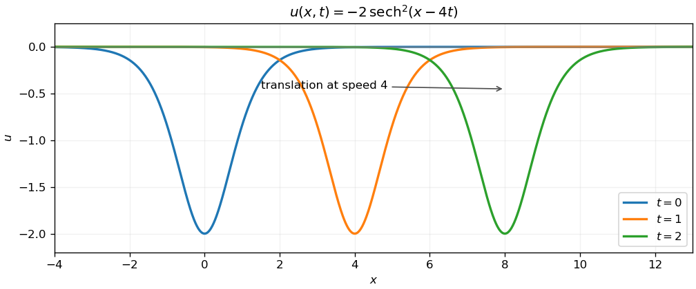

<h1 id="14/a/solution">Solution</h1>

↑ **Parent:** [A](../a.md)

Put $\xi=x-vt$ and $U(\xi)=A\operatorname{sech}^2\xi$. For $A\ne0$, differentiation gives $U''=4U-6U^2/A$ and therefore $U^{(3)}=4U'-(12/A)UU'$. The [Korteweg-De Vries equation](../../../../../korteweg-de-vries-equation.md) reduces to

$$
(4-v)U'-\left(6+\frac{12}A\right)UU'=0.
$$

Since $U$ is nonconstant, both coefficients must vanish. Thus the nonzero [solitary wave](../../../../../solitary-wave.md) is

$$
\boxed{A=-2,\qquad v=4,\qquad u=-2\operatorname{sech}^2(x-4t).}
$$

There is also the trivial solution $A=0$, for which $v$ has no effect. The negative amplitude follows from the minus sign of the nonlinear term; it agrees with the [sech-squared solitary wave of the KdV equation](../../../../../sech-squared-solitary-wave-of-the-kdv-equation.md).

**[Figure 1](#14/a/image-a-negative-solitary-wave-translates-to-the-right-without-changing-its-profile). A negative solitary wave translates to the right without changing its profile**.

## ↑ Ancestors (13)

1. [A](../a.md)
2. [14](../../14.md)
3. [Paper 2](../../../paper-2-split.md)
4. [2008](../../../split.md)
5. [Past exam of the mathematics course of the year 1 of the natural sciences course of the University of Cambridge](../../../../split.md)
6. [Mathematics course of the year 1 of the natural sciences course of the University of Cambridge](../../../../../mathematics-course-of-the-year-1-of-the-natural-sciences-course-of-the-university-of-cambridge.md)
7. [Year 1 of the natural sciences course of the University of Cambridge](../../../../../year-1-of-the-natural-sciences-course-of-the-university-of-cambridge.md)
8. [Year of the natural sciences course of the University of Cambridge](../../../../../year-of-the-natural-sciences-course-of-the-university-of-cambridge.md)
9. [Natural sciences course of the University of Cambridge](../../../../../natural-sciences-course-of-the-university-of-cambridge.md)
10. [Course of the University of Cambridge](../../../../../course-of-the-university-of-cambridge.md)
11. [University of Cambridge](../../../../../university-of-cambridge-split.md)
12. [List of universities](../../../../../list-of-universities.md)
13. [Codex Wiki](../../../../../split.md)
