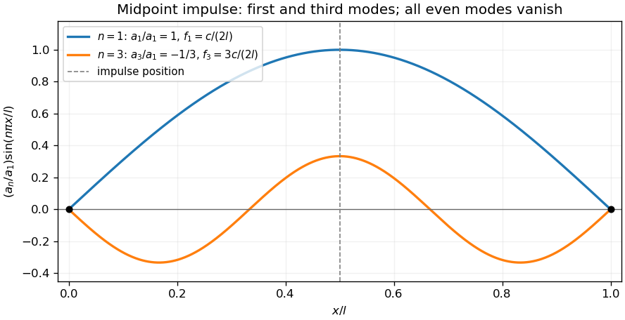

<h1 id="19/a/solution">Solution</h1>

↑ **Parent:** [A](../a.md)

For $c>0$ and $l>0$, the zero-endpoint [Dirichlet boundary conditions](../../../../../dirichlet-boundary-condition.md) select the [Fourier sine basis](../../../../../fourier-sine-basis.md) functions $\sin(n\pi x/l)$. [Separation of variables](../../../../../separation-of-variables.md) gives temporal factors with angular [frequencies](../../../../../frequency.md) $\omega_n=n\pi c/l$. Zero initial displacement removes the temporal cosine terms, giving

$$
y(x,t)=\sum_{n=1}^{\infty}a_n\sin(n\pi x/l)\sin(n\pi ct/l).
$$

Differentiating at $t=0$ and using [Fourier orthogonality](../../../../../fourier-orthogonality.md) gives

$$
\boxed{a_n=\frac2{n\pi c}\int_0^lv(x)\sin(n\pi x/l)\,dx.}
$$

The evaluation property of the given initial velocity means $v(x)=\delta(x-l/2)$ in the sense of a [Dirac delta](../../../../../dirac-delta-function.md), an idealized [impulsively struck fixed-end string](../../../../../impulsively-struck-fixed-end-string.md). Thus $a_n=2\sin(n\pi/2)/(n\pi c)$: every even mode vanishes, while the lowest two excited modes have $n=1,3$. Their ordinary [frequencies](../../../../../frequency.md) and amplitude ratio are

$$
\boxed{f_1=\frac c{2l},\quad f_3=\frac{3c}{2l},\qquad |a_1|:|a_3|=3:1.}
$$

The signed coefficient ratio is $a_3/a_1=-1/3$. The impulse solution is interpreted as a [distributional weak solution](../../../../../weak-solution.md), rather than one with a smooth initial velocity.

**[Figure 2](#19/a/image-the-two-lowest-string-modes-excited-by-a-midpoint-velocity-impulse-with-their-signed-relative-amplitudes). The two lowest string modes excited by a midpoint velocity impulse, with their signed relative amplitudes**.

## ↑ Ancestors (13)

1. [A](../a.md)
2. [19](../../19.md)
3. [Paper 2](../../../paper-2-split.md)
4. [2008](../../../split.md)
5. [Past exam of the mathematics course of the year 1 of the natural sciences course of the University of Cambridge](../../../../split.md)
6. [Mathematics course of the year 1 of the natural sciences course of the University of Cambridge](../../../../../mathematics-course-of-the-year-1-of-the-natural-sciences-course-of-the-university-of-cambridge.md)
7. [Year 1 of the natural sciences course of the University of Cambridge](../../../../../year-1-of-the-natural-sciences-course-of-the-university-of-cambridge.md)
8. [Year of the natural sciences course of the University of Cambridge](../../../../../year-of-the-natural-sciences-course-of-the-university-of-cambridge.md)
9. [Natural sciences course of the University of Cambridge](../../../../../natural-sciences-course-of-the-university-of-cambridge.md)
10. [Course of the University of Cambridge](../../../../../course-of-the-university-of-cambridge.md)
11. [University of Cambridge](../../../../../university-of-cambridge-split.md)
12. [List of universities](../../../../../list-of-universities.md)
13. [Codex Wiki](../../../../../split.md)
