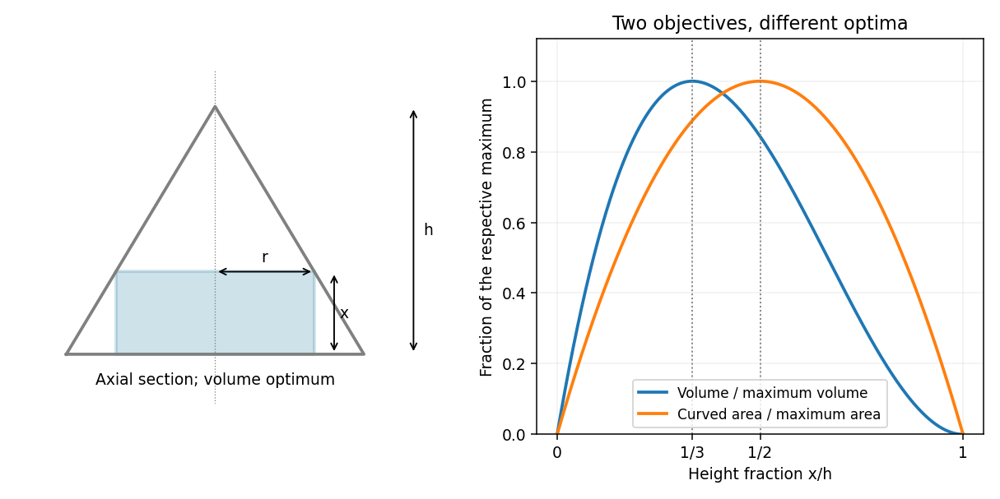

# Paper 1

↑ **Parent:** [2009](../2009.md)

[https://www.maths.cam.ac.uk/undergradnst/files/2009/PaperNST_IA_1.pdf](https://www.maths.cam.ac.uk/undergradnst/files/2009/PaperNST_IA_1.pdf)

**Table of contents**

- [1](#1)
  - [Solution](#1/solution)
- [2](#2)
  - [Solution](#2/solution)
- [3](#3)
  - [a](#3/a)
    - [Solution](#3/a/solution)
  - [b](#3/b)
    - [Solution](#3/b/solution)
- [4](#4)
  - [a](#4/a)
    - [Solution](#4/a/solution)
  - [b](#4/b)
    - [Solution](#4/b/solution)
- [5](#5)
  - [Solution](#5/solution)
- [6](#6)
  - [Solution](#6/solution)
- [7](#7)
  - [a](#7/a)
    - [Solution](#7/a/solution)
  - [b](#7/b)
    - [Solution](#7/b/solution)
- [8](#8)
  - [a](#8/a)
    - [Solution](#8/a/solution)
  - [b](#8/b)
    - [Solution](#8/b/solution)
- [9](#9)
  - [Solution](#9/solution)
- [10](#10)
  - [a](#10/a)
    - [Solution](#10/a/solution)
  - [b](#10/b)
    - [Solution](#10/b/solution)
- [11](#11)
  - [a](#11/a)
    - [i](#11/a/i)
      - [Solution](#11/a/i/solution)
    - [ii](#11/a/ii)
      - [Solution](#11/a/ii/solution)
  - [b](#11/b)
    - [Solution](#11/b/solution)
  - [c](#11/c)
    - [i](#11/c/i)
      - [Solution](#11/c/i/solution)
    - [ii](#11/c/ii)
      - [Solution](#11/c/ii/solution)
    - [iii](#11/c/iii)
      - [Solution](#11/c/iii/solution)
- [12](#12)
  - [a](#12/a)
    - [i](#12/a/i)
      - [Solution](#12/a/i/solution)
    - [ii](#12/a/ii)
      - [Solution](#12/a/ii/solution)
  - [b](#12/b)
    - [i](#12/b/i)
      - [Solution](#12/b/i/solution)
    - [ii](#12/b/ii)
      - [Solution](#12/b/ii/solution)
- [13](#13)
  - [a](#13/a)
    - [Solution](#13/a/solution)
  - [b](#13/b)
    - [Solution](#13/b/solution)
- [14](#14)
  - [a](#14/a)
    - [Solution](#14/a/solution)
  - [b](#14/b)
    - [Solution](#14/b/solution)
  - [c](#14/c)
    - [Solution](#14/c/solution)
  - [d](#14/d)
    - [Solution](#14/d/solution)
- [15](#15)
  - [a](#15/a)
    - [i](#15/a/i)
      - [Solution](#15/a/i/solution)
    - [ii](#15/a/ii)
      - [Solution](#15/a/ii/solution)
    - [iii](#15/a/iii)
      - [Solution](#15/a/iii/solution)
  - [b](#15/b)
    - [Solution](#15/b/solution)
  - [c](#15/c)
    - [Solution](#15/c/solution)
- [16](#16)
  - [a](#16/a)
    - [Solution](#16/a/solution)
  - [b](#16/b)
    - [Solution](#16/b/solution)
  - [c](#16/c)
    - [Solution](#16/c/solution)
  - [d](#16/d)
    - [Solution](#16/d/solution)
- [17](#17)
  - [a](#17/a)
    - [i](#17/a/i)
      - [Solution](#17/a/i/solution)
    - [ii](#17/a/ii)
      - [Solution](#17/a/ii/solution)
  - [b](#17/b)
    - [Solution](#17/b/solution)
- [18](#18)
  - [a](#18/a)
    - [Solution](#18/a/solution)
  - [b](#18/b)
    - [Solution](#18/b/solution)
  - [c](#18/c)
    - [Solution](#18/c/solution)
- [19](#19)
  - [a](#19/a)
    - [Solution](#19/a/solution)
  - [b](#19/b)
    - [Solution](#19/b/solution)
  - [c](#19/c)
    - [Solution](#19/c/solution)
- [20](#20)
  - [a](#20/a)
    - [i](#20/a/i)
      - [Solution](#20/a/i/solution)
    - [ii](#20/a/ii)
      - [Solution](#20/a/ii/solution)
    - [iii](#20/a/iii)
      - [Solution](#20/a/iii/solution)
  - [b](#20/b)
    - [i](#20/b/i)
      - [Solution](#20/b/i/solution)
    - [ii](#20/b/ii)
      - [Solution](#20/b/ii/solution)
    - [iii](#20/b/iii)
      - [Solution](#20/b/iii/solution)

## 1

↑ **Parent:** [Paper 1](paper-1.md)

<h3 id="1/solution">Solution</h3>

↑ **Parent:** [1](#1)

The [factor theorem](../../polynomial.md#factor-theorem) supplies the factor $x-3$. [Polynomial division](../../polynomial.md#polynomial-division) gives

$$
x^3-x^2-8x+6=(x-3)(x^2+2x-2).
$$

The [quadratic formula](../../polynomial.md#quadratic-formula) then gives the other two [roots of a polynomial](../../polynomial.md#root-of-a-polynomial):

$$
\boxed{x=-1+\sqrt3,\quad x=-1-\sqrt3.}
$$

## 2

↑ **Parent:** [Paper 1](paper-1.md)

<h3 id="2/solution">Solution</h3>

↑ **Parent:** [2](#2)

Isolate the [square root](../../algebra.md#square-root): $\sqrt{x+16}=x-4$. A real solution must have $x\geq4$, because a real principal [square root](../../algebra.md#square-root) is nonnegative. Squaring gives $x+16=(x-4)^2$, hence $x(x-9)=0$. The candidate zero violates $x\geq4$; substitution verifies the other candidate. Thus

$$
\boxed{x=9.}
$$

The sign restriction prevents the extraneous solution introduced by squaring.

## 3

↑ **Parent:** [Paper 1](paper-1.md)

<h3 id="3/a">a</h3>

↑ **Parent:** [3](#3)

<h4 id="3/a/solution">Solution</h4>

↑ **Parent:** [A](#3/a)

For the real [natural logarithm](../../calculus.md#natural-logarithm) the domain is $x>0$. The [chain rule](../../calculus.md#chain-rule) gives

$$
\boxed{\frac{d}{dx}\ln(x^3)=\frac{3x^2}{x^3}=\frac3x.}
$$

<h3 id="3/b">b</h3>

↑ **Parent:** [3](#3)

<h4 id="3/b/solution">Solution</h4>

↑ **Parent:** [B](#3/b)

The [product rule](../../calculus.md#product-rule) and [chain rule](../../calculus.md#chain-rule) give

$$
\boxed{\frac{d}{dx}[x\cos(2x)]=\cos(2x)-2x\sin(2x).}
$$

## 4

↑ **Parent:** [Paper 1](paper-1.md)

<h3 id="4/a">a</h3>

↑ **Parent:** [4](#4)

<h4 id="4/a/solution">Solution</h4>

↑ **Parent:** [A](#4/a)

Use [partial fraction decomposition](../../isolated-singularity.md#partial-fraction-decomposition):

$$
\frac1{x(x-4)}=-\frac1{4x}+\frac1{4(x-4)}.
$$

Integrating the two logarithmic [derivatives](../../calculus.md#derivative) gives

$$
\boxed{\int\frac{dx}{x^2-4x}=\frac14\log\left|\frac{x-4}{x}\right|+C.}
$$

This holds on each interval avoiding the two [poles](../../isolated-singularity.md#pole) $0$ and $4$, with an independent integration constant on each interval.

<h3 id="4/b">b</h3>

↑ **Parent:** [4](#4)

<h4 id="4/b/solution">Solution</h4>

↑ **Parent:** [B](#4/b)

The [change of variables](../../multivariable-calculus.md#change-of-variables-formula) $u=x^2$, $du=2x\,dx$, gives

$$
\boxed{\int xe^{x^2}\,dx=\frac12e^{x^2}+C.}
$$

Differentiation verifies the [antiderivative](../../integral.md#antiderivative) for every real $x$.

## 5

↑ **Parent:** [Paper 1](paper-1.md)

<h3 id="5/solution">Solution</h3>

↑ **Parent:** [5](#5)

The double-angle identity $\cos(2x)=2\cos^2x-1$ reduces the equation to $\cos x(1+2\cos x)=0$. On the specified interval the [cosine](../../geometry-and-topology.md#cosine) takes each of the values $0$ and $-1/2$ once, giving

$$
\boxed{x=\frac\pi2,\quad x=\frac{2\pi}3.}
$$

## 6

↑ **Parent:** [Paper 1](paper-1.md)

<h3 id="6/solution">Solution</h3>

↑ **Parent:** [6](#6)

Since $1-\log_{10}2=\log_{10}5\ne0$, the logarithm equation is $\log_{10}x=2\log_{10}5=\log_{10}25$. The real logarithm requires $x>0$, and is injective there. Hence

$$
\boxed{x=25.}
$$

## 7

↑ **Parent:** [Paper 1](paper-1.md)

<h3 id="7/a">a</h3>

↑ **Parent:** [7](#7)

<h4 id="7/a/solution">Solution</h4>

↑ **Parent:** [A](#7/a)

The [arithmetic series](../../arithmetic.md#arithmetic-series) formula, including both endpoints, gives

$$
\boxed{\sum_{n=0}^{100}(3n+2)=3\frac{100\cdot101}{2}+2\cdot101=15352.}
$$

<h3 id="7/b">b</h3>

↑ **Parent:** [7](#7)

<h4 id="7/b/solution">Solution</h4>

↑ **Parent:** [B](#7/b)

This [geometric series](../../sequence-and-series.md#geometric-series) has first term one and ratio $-1/4$, whose [absolute value](../../real-analysis.md#absolute-value) is less than one. Therefore

$$
\boxed{\sum_{n=0}^{\infty}\left(-\frac14\right)^n=\frac1{1+1/4}=\frac45.}
$$

## 8

↑ **Parent:** [Paper 1](paper-1.md)

<h3 id="8/a">a</h3>

↑ **Parent:** [8](#8)

<h4 id="8/a/solution">Solution</h4>

↑ **Parent:** [A](#8/a)

The graph is nonnegative, tends to $+\infty$ as $x\downarrow0$ and as $x\to\infty$, and vanishes only at $x=1$. Its [derivative](../../calculus.md#derivative) is $2\log x/x$, negative before one and positive after one, so $(1,0)$ is the unique global [minimum](../../set.md#minimum-of-a-subset-of-a-total-order). The second [derivative](../../calculus.md#derivative) is $2(1-\log x)/x^2$: the graph is convex for $0<x<e$ and concave for $x>e$, with an [inflection point](../../topology.md#inflection-point) at $(e,1)$. These features determine the sketch in the left panel.

**[Figure 1](#8/a/image-the-squared-logarithm-the-half-amplitude-double-frequency-sine-and-the-directed-elliptical-path). The squared logarithm, the half-amplitude double-frequency sine, and the directed elliptical path**.

<h3 id="8/b">b</h3>

↑ **Parent:** [8](#8)

<h4 id="8/b/solution">Solution</h4>

↑ **Parent:** [B](#8/b)

Write $y=\tfrac12\sin(2x)$. It is an [odd function](../../calculus.md#odd-function) with amplitude $1/2$ and [period](../../mathematics.md#period-of-a-function) $\pi$. Its zeros on the specified interval are $-\pi,-\pi/2,0,\pi/2,\pi$. The maxima are at $x=-3\pi/4,\pi/4$ and the minima at $x=-\pi/4,3\pi/4$, with values $1/2$ and $-1/2$. The middle panel of the preceding figure shows the two full oscillations.

## 9

↑ **Parent:** [Paper 1](paper-1.md)

<h3 id="9/solution">Solution</h3>

↑ **Parent:** [9](#9)

The line has equation $2x-y+2=0$, with normal [vector](../../vector-space.md#vector) $(2,-1)$. The [distance from a point to a line](../../topological-analysis.md#distance-from-a-point-to-a-line) is the [absolute value](../../real-analysis.md#absolute-value) of the normal component of the displacement:

$$
\boxed{d=\frac{|2(4)-(-6)+2|}{\sqrt{2^2+(-1)^2}}=\frac{16}{\sqrt5}.}
$$

The perpendicular foot is $(4,-6)-(16/5)(2,-1)=(-12/5,-14/5)$, which lies on the line and realizes this shortest distance.

## 10

↑ **Parent:** [Paper 1](paper-1.md)

<h3 id="10/a">a</h3>

↑ **Parent:** [10](#10)

<h4 id="10/a/solution">Solution</h4>

↑ **Parent:** [A](#10/a)

Eliminating the parameter gives $x^2+y^2/4=1$, an [ellipse](../../euclidean-geometry.md#ellipse) centered at the origin with horizontal semiaxis one and vertical semiaxis two. At $t=0$ the particle is at $(1,0)$ with [velocity](../../classical-mechanics.md#velocity) $(0,2)$, so it travels **counterclockwise**, reaching $(0,2),(-1,0),(0,-2)$ successively and returning after $2\pi$. The right panel of the graph figure shows this direction.

<h3 id="10/b">b</h3>

↑ **Parent:** [10](#10)

<h4 id="10/b/solution">Solution</h4>

↑ **Parent:** [B](#10/b)

For a [parametric curve](../../topology.md#parametric-curve) with $dx/dt\ne0$, the [chain rule](../../calculus.md#chain-rule) gives

$$
\frac{dy}{dx}=\frac{2\cos t}{-\sin t}.
$$

The specified point has $\cos t=\sin t=1/\sqrt2$, hence $t=\pi/4$ in the given traversal. Therefore

$$
\boxed{\frac{dy}{dx}=-2.}
$$

## 11

↑ **Parent:** [Paper 1](paper-1.md)

<h3 id="11/a">a</h3>

↑ **Parent:** [11](#11)

<h4 id="11/a/i">i</h4>

↑ **Parent:** [A](#11/a)

<h5 id="11/a/i/solution">Solution</h5>

↑ **Parent:** [I](#11/a/i)

Differentiate the numerator and denominator using the [product rule](../../calculus.md#product-rule) and [quotient rule](../../calculus.md#quotient-rule):

$$
y'=\frac{(4x^3+3x^2)(3x-2)-12x^3(x+1)}{(3x-2)^5}.
$$

The numerator simplifies to $-11x^3-6x^2$, giving

$$
\boxed{y'=-\frac{x^2(11x+6)}{(3x-2)^5},\qquad x\ne\frac23.}
$$

<h4 id="11/a/ii">ii</h4>

↑ **Parent:** [A](#11/a)

<h5 id="11/a/ii/solution">Solution</h5>

↑ **Parent:** [Ii](#11/a/ii)

For the real [inverse hyperbolic tangent](../../calculus.md#inverse-hyperbolic-tangent), take $a\ne0$ and $|x/a|<1$. Its logarithmic expression gives

$$
y=\frac12\log\frac{1+x/a}{1-x/a},\qquad
\boxed{y'=\frac{a}{a^2-x^2}.}
$$

The same [derivative](../../calculus.md#derivative) holds on a differentiable complex branch away from its singularities.

<h3 id="11/b">b</h3>

↑ **Parent:** [11](#11)

<h4 id="11/b/solution">Solution</h4>

↑ **Parent:** [B](#11/b)

First take $a>0$ and $|x|<a$, and put $u=\arcsin(x/a)$, $q=\sqrt{a^2-x^2}$. Then $u'=1/q$. The [chain rule](../../calculus.md#chain-rule) gives

$$
y'=\frac{2u}{q},\qquad y''=\frac2{q^2}+\frac{2xu}{q^3}.
$$

Consequently

$$
(a^2-x^2)y''-xy'=q^2\left(\frac2{q^2}+\frac{2xu}{q^3}\right)-\frac{2xu}{q}=2,
$$

which proves the identity on the open domain of differentiability. The squared inverse sine is unchanged when $a$ is replaced by $-a$, so the identity also holds for negative $a$ with $|x|<|a|$. The value $a=0$ is excluded.

<h3 id="11/c">c</h3>

↑ **Parent:** [11](#11)

<h4 id="11/c/i">i</h4>

↑ **Parent:** [C](#11/c)

<h5 id="11/c/i/solution">Solution</h5>

↑ **Parent:** [I](#11/c/i)

An axial section gives similar right triangles. At height $x$ above the base, the cone's remaining height is $h-x$, so the cylinder's radius is $r=(h-x)\tan\alpha$. Therefore its [volume](../../geometry-and-topology.md#volume) is

$$
\boxed{V(x)=\pi x(h-x)^2\tan^2\alpha,\qquad0\leq x\leq h.}
$$

Assume $h>0$ and $0<\alpha<\pi/2$ for a nondegenerate cone. The geometry and the dimensionless optimization curves are illustrated below.

**[Figure 2](#11/c/i/image-axial-section-and-different-optimal-heights-for-cylinder-volume-and-curved-area-inside-a-cone). Axial section and different optimal heights for cylinder volume and curved area inside a cone**.

<h4 id="11/c/ii">ii</h4>

↑ **Parent:** [C](#11/c)

<h5 id="11/c/ii/solution">Solution</h5>

↑ **Parent:** [Ii](#11/c/ii)

At fixed $h,\alpha$, the [derivative](../../calculus.md#derivative) is $V'=\pi\tan^2\alpha\,(h-x)(h-3x)$. It is positive for $0<x<h/3$ and negative for $h/3<x<h$. The endpoint volumes are zero. Thus the unique positive-volume global [maximum](../../set.md#maximum-of-a-subset-of-a-total-order) is at

$$
\boxed{x=\frac h3.}
$$

Its value is $4\pi h^3\tan^2\alpha/27$, whereas the cone volume is $\pi h^3\tan^2\alpha/3$. Hence

$$
\boxed{\frac{V_{\rm cylinder}}{V_{\rm cone}}=\frac49.}
$$

This is the volume case of the [optimal cylinder inscribed in a cone](../../euclidean-geometry.md#optimal-cylinder-inscribed-in-a-cone).

<h4 id="11/c/iii">iii</h4>

↑ **Parent:** [C](#11/c)

<h5 id="11/c/iii/solution">Solution</h5>

↑ **Parent:** [Iii](#11/c/iii)

The curved [surface area](../../differential-geometry.md#surface-area) excludes the two end disks, so $A=2\pi rx=2\pi\tan\alpha\,x(h-x)$. Completing the square gives

$$
A=2\pi\tan\alpha\left[\frac{h^2}{4}-\left(x-\frac h2\right)^2\right].
$$

Thus

$$
\boxed{x=\frac h2,\qquad A_{\max}=\frac{\pi h^2\tan\alpha}{2}.}
$$

It differs from the volume optimum because the objective contains one power of the radius rather than two.

## 12

↑ **Parent:** [Paper 1](paper-1.md)

<h3 id="12/a">a</h3>

↑ **Parent:** [12](#12)

<h4 id="12/a/i">i</h4>

↑ **Parent:** [A](#12/a)

<h5 id="12/a/i/solution">Solution</h5>

↑ **Parent:** [I](#12/a/i)

Neither biscuit type can run out in this case. Treat each freely made choice as an [independent](../../random-variable.md#independent-random-variables) [Bernoulli trial](../../discrete-probability-distribution.md#bernoulli-trial), with success meaning chocolate. The number taken after $n$ choices has a [binomial distribution](../../discrete-probability-distribution.md#binomial-distribution), so

$$
\boxed{P_{k,n}=\binom nkp^k(1-p)^{n-k},\quad k=0,\ldots,n.}
$$

The [binomial coefficient](../../binomial-coefficient.md) counts the possible success positions, and every such arrangement has the same probability. Independence of successive choices is the probabilistic model implicit in the question; identical marginal preferences alone would not imply it.

<h4 id="12/a/ii">ii</h4>

↑ **Parent:** [A](#12/a)

<h5 id="12/a/ii/solution">Solution</h5>

↑ **Parent:** [Ii](#12/a/ii)

Write the chocolate count as $K_n=\sum_{j=1}^nI_j$ with [independent](../../random-variable.md#independent-random-variables) [Bernoulli random variables](../../discrete-probability-distribution.md#bernoulli-distribution). Each has [expected value](../../expected-value.md) $p$ and [variance](../../variance.md) $p(1-p)$. By linearity of [expected value](../../expected-value.md) and additivity of [variance](../../variance.md) for independent variables,

$$
\boxed{\overline k_n=np,\qquad V_n=np(1-p).}
$$

<h3 id="12/b">b</h3>

↑ **Parent:** [12](#12)

<h4 id="12/b/i">i</h4>

↑ **Parent:** [B](#12/b)

<h5 id="12/b/i/solution">Solution</h5>

↑ **Parent:** [I](#12/b/i)

For the last chocolate to be taken on choice $n$, the first $n-1$ choices must include exactly $C-1$ chocolate choices, and choice $n$ must take chocolate. Before that final success there is still chocolate available, so no forced plain choice has yet occurred. The [negative binomial stopping argument](../../discrete-probability-distribution.md#negative-binomial-stopping-argument) gives

$$
\boxed{P_{\rm LastChoc,n}=\binom{n-1}{C-1}p^C(1-p)^{n-C},\qquad C\leq n\leq F.}
$$

This is the all-trials convention of the [negative binomial distribution](../../discrete-probability-distribution.md#negative-binomial-distribution). The finite examination scenario also has a remaining probability that the tray still contains chocolate after all $F$ choices; the displayed probabilities need not sum to one over $C\leq n\leq F$. At $p=0$ the last chocolate is never taken, and at $p=1$ it is taken on choice $C$.

<h4 id="12/b/ii">ii</h4>

↑ **Parent:** [B](#12/b)

<h5 id="12/b/ii/solution">Solution</h5>

↑ **Parent:** [Ii](#12/b/ii)

A forced plain choice occurs exactly when the last chocolate is taken before the final Fellow is served: if it is taken by choice $f\leq F-1$, choice $f+1$ has no chocolate available, whatever that person's preference would have been. Exhaustion precisely on choice $F$ forces nobody. The distinct possible exhaustion times are disjoint events, hence

$$
\boxed{P_{\rm Disaster}=\sum_{f=C}^{F-1}\binom{f-1}{C-1}p^C(1-p)^{f-C}.}
$$

Equivalently, imagine independent preferred choices even after stock is exhausted. The event is that at least $C$ preferred chocolate choices occur among the first $F-1$ people, so the [binomial distribution](../../discrete-probability-distribution.md#binomial-distribution) gives $P_{\rm Disaster}=\sum_{k=C}^{F-1}\binom{F-1}{k}p^k(1-p)^{F-1-k}$. The [success-count and waiting-time duality](../../discrete-probability-distribution.md#success-count-and-waiting-time-duality) explains equality of these two sums. Plain-biscuit depletion cannot interfere because $D>F$.

## 13

↑ **Parent:** [Paper 1](paper-1.md)

<h3 id="13/a">a</h3>

↑ **Parent:** [13](#13)

<h4 id="13/a/solution">Solution</h4>

↑ **Parent:** [A](#13/a)

The [characteristic polynomial](../../linear-operator-theory.md#characteristic-polynomial) is

$$
\det(A-\lambda I)=(2-\lambda)(4-\lambda)+2=(\lambda-3)^2+1.
$$

Thus the [eigenvalues](../../linear-operator-theory.md#eigenvalue) and corresponding [eigenvectors](../../linear-operator-theory.md#eigenvector) over $\mathbb C$ are

$$
\boxed{\lambda_+=3+i,\ v_+=(-1+i,1)^T;\qquad\lambda_-=3-i,\ v_-=(-1-i,1)^T.}
$$

All nonzero scalar multiples of these vectors are also [eigenvectors](../../linear-operator-theory.md#eigenvector). Distinct [eigenvalues](../../linear-operator-theory.md#eigenvalue) make them linearly independent. Put them in the columns of

$$
B=\begin{pmatrix}-1+i&-1-i\\1&1\end{pmatrix},\qquad
B^{-1}=\frac1{2i}\begin{pmatrix}1&1+i\\-1&-1+i\end{pmatrix}.
$$

The equations $Av_\pm=\lambda_\pm v_\pm$ are exactly $AB=BC$, giving the [diagonalization](../../linear-operator-theory.md#diagonalization-of-a-matrix)

$$
\boxed{C=B^{-1}AB=\begin{pmatrix}3+i&0\\0&3-i\end{pmatrix}.}
$$

There is no diagonalization over $\mathbb R$, since the matrix has no real [eigenvalues](../../linear-operator-theory.md#eigenvalue).

<h3 id="13/b">b</h3>

↑ **Parent:** [13](#13)

<h4 id="13/b/solution">Solution</h4>

↑ **Parent:** [B](#13/b)

Expanding the [determinant](../../multilinear-algebra.md#determinant) gives $\det(\lambda I-M)=(\lambda-1)[(\lambda-1)^2-25]$. Solving each [eigenvalue equation](../../linear-operator-theory.md#eigenvalue-equation) yields

$$
\boxed{\begin{array}{c|c}
\lambda&\text{one eigenvector}\\\hline
6&(4,5,3)^T\\
-4&(4,-5,3)^T\\
1&(3,0,-4)^T
\end{array}.}
$$

Their pairwise [inner products](../../inner-product.md) are $16-25+9=0$, $12-12=0$ and $12-12=0$. Their squared [Euclidean norms](../../normed-vector-space.md#euclidean-norm) are $50,50,25$, respectively, so division by $\sqrt{50},\sqrt{50},5$ gives an [orthonormal basis](../../inner-product.md#orthonormal-basis). This also follows from the [spectral theorem for real symmetric matrices](../../linear-algebra.md#spectral-theorem-for-real-symmetric-matrices): symmetry makes [eigenvectors](../../linear-operator-theory.md#eigenvector) for distinct [eigenvalues](../../linear-operator-theory.md#eigenvalue) orthogonal.

## 14

↑ **Parent:** [Paper 1](paper-1.md)

<h3 id="14/a">a</h3>

↑ **Parent:** [14](#14)

<h4 id="14/a/solution">Solution</h4>

↑ **Parent:** [A](#14/a)

The values of the [complex logarithm](../../analysis.md#complex-logarithm) at $-1$ are $i(2m+1)\pi$, $m\in\mathbb Z$. For any such value and any [integer](../../integer.md) $n$,

$$
-i(2n+1)\log(-1)=(2n+1)(2m+1)\pi.
$$

This is an integer multiple of $\pi$, so its [sine](../../geometry-and-topology.md#sine) is zero. In particular the result holds with the principal value $\log(-1)=i\pi$. The argument does not require treating the multivalued logarithm as a single globally defined function.

<h3 id="14/b">b</h3>

↑ **Parent:** [14](#14)

<h4 id="14/b/solution">Solution</h4>

↑ **Parent:** [B](#14/b)

Using the principal [complex square root](../../complex-analysis.md#complex-square-root), $\sqrt i=e^{i\pi/4}$. Its two square roots differ by a sign, giving

$$
\boxed{z=e^{i\pi/8},\quad z=-e^{i\pi/8}.}
$$

Equivalently their arguments are $\pi/8$ and $9\pi/8$ modulo $2\pi$. If instead the right-hand square root is allowed to take both values, the union has four elements $e^{i(\pi/8+k\pi/2)}$, $k=0,1,2,3$, satisfying $z^4=i$. Only the two boxed values square to the principal right-hand side.

<h3 id="14/c">c</h3>

↑ **Parent:** [14](#14)

<h4 id="14/c/solution">Solution</h4>

↑ **Parent:** [C](#14/c)

Substitute the exponential definitions of [hyperbolic cosine](../../calculus.md#hyperbolic-cosine) and [hyperbolic sine](../../calculus.md#hyperbolic-sine). The cross terms cancel:

$$
\begin{aligned}
\cosh x\cosh y-\sinh x\sinh y
&=\frac{(e^x+e^{-x})(e^y+e^{-y})-(e^x-e^{-x})(e^y-e^{-y})}{4}\\
&=\frac{e^{x-y}+e^{-x+y}}2=\cosh(x-y).
\end{aligned}
$$

This proves the identity for real arguments, and the same algebra proves it for complex arguments.

<h3 id="14/d">d</h3>

↑ **Parent:** [14](#14)

<h4 id="14/d/solution">Solution</h4>

↑ **Parent:** [D](#14/d)

The exponential definitions give

$$
2\sinh x\cosh x=\frac{(e^x-e^{-x})(e^x+e^{-x})}{2}=\frac{e^{2x}-e^{-2x}}2=\sinh(2x).
$$

Thus the double-angle identity follows directly, without any restriction beyond the domain of the exponential.

## 15

↑ **Parent:** [Paper 1](paper-1.md)

<h3 id="15/a">a</h3>

↑ **Parent:** [15](#15)

<h4 id="15/a/i">i</h4>

↑ **Parent:** [A](#15/a)

<h5 id="15/a/i/solution">Solution</h5>

↑ **Parent:** [I](#15/a/i)

The [scalar triple product](../../multilinear-algebra.md#scalar-triple-product) is the [determinant](../../multilinear-algebra.md#determinant) of the matrix with columns $a,b,c$. A cyclic permutation of three columns is a product of two swaps, so its determinant sign is positive. Therefore $[a,b,c]=[b,c,a]$. This uses the alternating multilinearity of the [determinant](../../multilinear-algebra.md#determinant), and remains true for linearly dependent vectors.

<h4 id="15/a/ii">ii</h4>

↑ **Parent:** [A](#15/a)

<h5 id="15/a/ii/solution">Solution</h5>

↑ **Parent:** [Ii](#15/a/ii)

The [determinant](../../multilinear-algebra.md#determinant) defining $[a,a,c]$ has two equal columns. Interchanging them both leaves it unchanged and reverses its sign, so it is zero. Equivalently, the [cross product](../../vector-space.md#cross-product) $a\times c$ is orthogonal to $a$, giving $a\cdot(a\times c)=0$.

<h4 id="15/a/iii">iii</h4>

↑ **Parent:** [A](#15/a)

<h5 id="15/a/iii/solution">Solution</h5>

↑ **Parent:** [Iii](#15/a/iii)

Three vectors in real three-dimensional space have zero [determinant](../../multilinear-algebra.md#determinant) exactly when they are [linearly dependent](../../vector-space.md#linear-dependence). Their [linear span](../../vector-space.md#linear-span) then has dimension at most two, so they lie in a common plane through the origin. Conversely vectors in such a plane span at most two dimensions, so their [scalar triple product](../../multilinear-algebra.md#scalar-triple-product) vanishes. This includes parallel nonzero vectors: they need not determine a unique plane, but they lie in at least one. Even zero vectors satisfy the determinant characterization, though the question excludes them.

<h3 id="15/b">b</h3>

↑ **Parent:** [15](#15)

<h4 id="15/b/solution">Solution</h4>

↑ **Parent:** [B](#15/b)

By the [vector triple product identity](../../multivariable-calculus.md#vector-triple-product),

$$
(a\times b)\times(a\times c)=a[(a\times b)\cdot c]-c[(a\times b)\cdot a]=[a,b,c]a.
$$

The last inner product vanishes by perpendicularity. Taking the [inner product](../../inner-product.md) with $d$ gives

$$
[a\times b,a\times c,d]=d\cdot[(a\times b)\times(a\times c)]=(a\cdot d)[a,b,c].
$$

This is the identity for [cross products with a common vector](../../multilinear-algebra.md#cross-products-with-a-common-vector), and holds without nondegeneracy assumptions.

<h3 id="15/c">c</h3>

↑ **Parent:** [15](#15)

<h4 id="15/c/solution">Solution</h4>

↑ **Parent:** [C](#15/c)

At an intersection, $a+tu=b+t'v$, so $b-a=tu-t'v$. Alternating multilinearity of the [scalar triple product](../../multilinear-algebra.md#scalar-triple-product) then gives $[v,b-a,u]=t[v,u,u]-t'[v,v,u]=0$, establishing $[v,b,u]=[v,a,u]$.

For the location, write $b=a+tu-t'v$ and take its [scalar triple product](../../multilinear-algebra.md#scalar-triple-product) with $a$ and $v$:

$$
[a,b,v]=[a,a+tu-t'v,v]=t[a,u,v].
$$

Under the additional stated assumption $[a,u,v]\ne0$, division gives

$$
\boxed{r=a+\frac{[a,b,v]}{[a,u,v]}u.}
$$

These are [intersection parameters from scalar triple products](../../multilinear-algebra.md#intersection-parameters-from-scalar-triple-products). The formula presupposes an intersection; the first coplanarity condition by itself also holds for distinct parallel lines. Intersections can exist with the displayed denominator zero, in which case a different auxiliary vector or a component calculation is needed.

## 16

↑ **Parent:** [Paper 1](paper-1.md)

<h3 id="16/a">a</h3>

↑ **Parent:** [16](#16)

<h4 id="16/a/solution">Solution</h4>

↑ **Parent:** [A](#16/a)

For $p>0$, [integration by parts](../../calculus.md#integration-by-parts) gives the [Gamma function recurrence](../../complex-analysis.md#gamma-function-recurrence):

$$
\Gamma(p+1)=\int_0^\infty x^pe^{-x}dx=[-x^pe^{-x}]_0^\infty+p\int_0^\infty x^{p-1}e^{-x}dx=p\Gamma(p).
$$

The endpoint terms vanish because $x^p\to0$ at zero and the exponential dominates the power at infinity. Also $\Gamma(1)=\int_0^\infty e^{-x}dx=1$. Iterating for nonnegative [integers](../../integer.md) $n$ therefore yields

$$
\boxed{\Gamma(n+1)=n!.}
$$

Negative integers are outside this integral definition and factorial conclusion.

<h3 id="16/b">b</h3>

↑ **Parent:** [16](#16)

<h4 id="16/b/solution">Solution</h4>

↑ **Parent:** [B](#16/b)

Set $t=\log(1/x)$, so $x=e^{-t}$ and $dx=-e^{-t}dt$. The [improper integral](../../real-analysis.md#improper-integral) becomes

$$
\int_0^1[\log(1/x)]^4dx=\int_0^\infty t^4e^{-t}dt=\Gamma(5).
$$

The [Gamma function recurrence](../../complex-analysis.md#gamma-function-recurrence) gives

$$
\boxed{\int_0^1[\log(1/x)]^4dx=24.}
$$

The exponential-transformed integrand also proves convergence at the logarithmically singular endpoint.

<h3 id="16/c">c</h3>

↑ **Parent:** [16](#16)

<h4 id="16/c/solution">Solution</h4>

↑ **Parent:** [C](#16/c)

In the [Gamma function](../../complex-analysis.md#gamma-function) integral at $p=1/2$, use $x=t^2$, $dx=2t\,dt$, with $t>0$. Then $x^{-1/2}dx=2\,dt$, so

$$
\Gamma(1/2)=\int_0^\infty x^{-1/2}e^{-x}dx=2\int_0^\infty e^{-t^2}dt.
$$

The substitution can first be made on finite positive intervals and then extended by monotone limits, justifying the endpoint passage.

<h3 id="16/d">d</h3>

↑ **Parent:** [16](#16)

<h4 id="16/d/solution">Solution</h4>

↑ **Parent:** [D](#16/d)

The integrand in the preceding expression is nonnegative. [Tonelli's theorem](../../measure-theory.md#tonelli-theorem) permits squaring as a quadrant integral; then [polar coordinates](../../multivariable-calculus.md#polar-coordinates) give

$$
\begin{aligned}
\Gamma(1/2)^2&=4\int_0^\infty\int_0^\infty e^{-(u^2+v^2)}du\,dv\\
&=4\int_0^{\pi/2}\int_0^\infty e^{-r^2}r\,dr\,d\theta=\pi.
\end{aligned}
$$

The defining [integral](../../integral.md) is positive, fixing the sign of the square root. Therefore

$$
\boxed{\Gamma(1/2)^2=\pi,\qquad\Gamma(1/2)=\sqrt\pi.}
$$

This is the positive-quadrant proof of the [Gaussian integral](../../integral.md#gaussian-integral).

## 17

↑ **Parent:** [Paper 1](paper-1.md)

<h3 id="17/a">a</h3>

↑ **Parent:** [17](#17)

<h4 id="17/a/i">i</h4>

↑ **Parent:** [A](#17/a)

<h5 id="17/a/i/solution">Solution</h5>

↑ **Parent:** [I](#17/a/i)

The [homogeneous first-order differential equation](../../differential-equation.md#homogeneous-first-order-differential-equation) suggests $v=y/x$, so $y'=v+xv'$. Wherever the original equation is defined,

$$
xv'=-\tan v,\qquad\frac{d}{dx}[x\sin v]=\sin v+x\cos v\,v'=0.
$$

Thus the implicit solution is $x\sin(y/x)=C$. The printed initial values force $C=x_0=2/\pi$.

**There is no classical solution through the printed initial point.** There $y/x=\pi/2$, so the tangent on the right is undefined. The implicit relation nevertheless has two neighboring real branches on $x>x_0$ which approach that point continuously:

$$
\boxed{y_1(x)=x\arcsin(x_0/x),\qquad y_2(x)=x[\pi-\arcsin(x_0/x)],\quad x_0=2/\pi.}
$$

Both tend to $y=1$ as $x\downarrow x_0$, but their [derivatives](../../calculus.md#derivative) become unbounded with opposite signs. They solve the equation on the open interval $x>x_0$, not at its endpoint. Other inverse-sine periods cannot approach the specified initial value. This is an [endpoint obstruction in a homogeneous differential equation](../../differential-equation.md#endpoint-obstruction-in-a-homogeneous-differential-equation). Constant-ratio branches $y=k\pi x$ also solve the general equation where $x\ne0$, but do not meet the initial data.

<h4 id="17/a/ii">ii</h4>

↑ **Parent:** [A](#17/a)

<h5 id="17/a/ii/solution">Solution</h5>

↑ **Parent:** [Ii](#17/a/ii)

Put $u=x+y$. Then $u'=1+\cos u=2\cos^2(u/2)$. Along the branch through $u(0)=0$, the [chain rule](../../calculus.md#chain-rule) yields $[\tan(u/2)]'=1$, hence $\tan(u/2)=x$. Choose the continuous branch through zero to obtain

$$
\boxed{y(x)=2\arctan x-x,\qquad x\in\mathbb R.}
$$

Indeed $y'=(1-x^2)/(1+x^2)=\cos(2\arctan x)=\cos(x+y)$, and $y(0)=0$. The right-hand side has a bounded derivative with respect to $y$, so the usual [uniqueness theorem for ordinary differential equations](../../analysis.md#uniqueness-theorem-for-ordinary-differential-equations) rules out another solution through the same point.

<h3 id="17/b">b</h3>

↑ **Parent:** [17](#17)

<h4 id="17/b/solution">Solution</h4>

↑ **Parent:** [B](#17/b)

The [product rule](../../calculus.md#product-rule) gives

$$
d(y\sin^2x)=y\sin(2x)dx+\sin^2x\,dy.
$$

Thus this is an [exact differential](../../differential-form.md#exact-differential), and its zero level differential means $y\sin^2x=C$. The initial data set $C=1$, giving

$$
\boxed{y=\csc^2x,\qquad0<x<\pi.}
$$

The displayed interval is the maximal connected real interval containing $\pi/2$ on which this finite-valued solution is defined.

## 18

↑ **Parent:** [Paper 1](paper-1.md)

<h3 id="18/a">a</h3>

↑ **Parent:** [18](#18)

<h4 id="18/a/solution">Solution</h4>

↑ **Parent:** [A](#18/a)

Regard $u=u(s,t(s,v))$. Applying the [multivariable chain rule](../../calculus.md#multivariable-chain-rule) while holding $v$ fixed gives

$$
\boxed{\left(\frac{\partial u}{\partial s}\right)_v=\left(\frac{\partial u}{\partial s}\right)_t+\left(\frac{\partial u}{\partial t}\right)_s\left(\frac{\partial t}{\partial s}\right)_v.}
$$

Each subscript records the variable held fixed. A differentiable local coordinate change from $(s,t)$ to $(s,v)$ requires $(\partial v/\partial t)_s\ne0$; the question's notation $t=t(s,v)$ presupposes such a branch.

<h3 id="18/b">b</h3>

↑ **Parent:** [18](#18)

<h4 id="18/b/solution">Solution</h4>

↑ **Parent:** [B](#18/b)

For an [exact differential](../../differential-form.md#exact-differential) $Pdx+Qdy$, equality of mixed [partial derivatives](../../multivariable-calculus.md#partial-derivative) requires $P_y=Q_x$. Here this gives

$$
2\mu\cos y=-(x\mu'+\mu)\cos y.
$$

On an open two-dimensional domain the coefficient relation is $x\mu'+3\mu=0$, so $\mu=Cx^{-3}$ on a connected interval avoiding zero. The normalization gives $C=1$ on the positive interval through $x=1$. Integrating $f_x=2x^{-3}\sin y$ and checking $f_y$ yields

$$
\boxed{\mu(x)=x^{-3},\qquad f(x,y)=-\frac{\sin y}{x^2}+C_0,\quad x>0.}
$$

There is no smooth extension of this normalized integrating factor across $x=0$; an independently specified factor on $x<0$ is not fixed by data at one.

<h3 id="18/c">c</h3>

↑ **Parent:** [18](#18)

<h4 id="18/c/solution">Solution</h4>

↑ **Parent:** [C](#18/c)

Let $a=f(b,c)$ and work where both $f_b$ and $f_c$ are nonzero, so the required inverse [partial derivatives](../../multivariable-calculus.md#partial-derivative) exist. At fixed $a$, the [total differential](../../multivariable-calculus.md#total-differential) gives $0=f_b\,db+f_c\,dc$, hence $(\partial b/\partial c)_a=-f_c/f_b$. At fixed $b$, $(\partial c/\partial a)_b=1/f_c$. Their product with $f_b$ is $-1$: this is the [cyclic partial derivative identity](../../multivariable-calculus.md#cyclic-partial-derivative-identity).

For explicit verification in this example, put $P=b^4-6b^2c^2+c^4$ and $H=(b^2+c^2)^3$. Direct [differentiation](../../calculus.md#differentiation) gives

$$
\left(\frac{\partial a}{\partial b}\right)_c=-\frac{cP}{H},\quad
\left(\frac{\partial a}{\partial c}\right)_b=\frac{bP}{H},\quad
\left(\frac{\partial b}{\partial c}\right)_a=\frac bc,\quad
\left(\frac{\partial c}{\partial a}\right)_b=\frac H{bP}.
$$

Therefore

$$
\boxed{\left(\frac{\partial a}{\partial b}\right)_c\left(\frac{\partial b}{\partial c}\right)_a\left(\frac{\partial c}{\partial a}\right)_b=-1.}
$$

The identity is local to regular branches: for these explicit formulas require $bcP\ne0$. At singular points one cannot justify cancellation of nonexistent inverse derivatives merely by writing a formal product.

## 19

↑ **Parent:** [Paper 1](paper-1.md)

<h3 id="19/a">a</h3>

↑ **Parent:** [19](#19)

<h4 id="19/a/solution">Solution</h4>

↑ **Parent:** [A](#19/a)

Assume $c\ne0$, so $(\xi,\eta)=(x-ct,x+ct)$ is an invertible coordinate change. The [chain rule](../../calculus.md#chain-rule) gives

$$
\partial_x=\partial_\xi+\partial_\eta,\qquad\partial_t=c(-\partial_\xi+\partial_\eta).
$$

For a twice continuously differentiable solution the mixed [partial derivatives](../../multivariable-calculus.md#partial-derivative) commute. Squaring the two operators therefore gives

$$
\partial_x^2-c^{-2}\partial_t^2=4\partial_\xi\partial_\eta.
$$

Thus the [one-dimensional wave equation](../../wave-equation.md#one-dimensional-wave-equation) becomes

$$
\boxed{\psi_{\xi\eta}=0.}
$$

<h3 id="19/b">b</h3>

↑ **Parent:** [19](#19)

<h4 id="19/b/solution">Solution</h4>

↑ **Parent:** [B](#19/b)

If $\psi=f(\xi)+g(\eta)$ with twice differentiable $f,g$, its mixed [partial derivative](../../multivariable-calculus.md#partial-derivative) vanishes because each summand depends on only one coordinate. Conversely $\psi_{\xi\eta}=0$ means $\psi_\xi$ is independent of $\eta$; integration in $\xi$ supplies $f(\xi)$ and an integration function $g(\eta)$. Hence, on a characteristic rectangle, the general solution is

$$
\boxed{\psi(x,t)=f(x-ct)+g(x+ct).}
$$

These terms travel in opposite directions without changing profile, as in [D'Alembert's formula](../../wave-equation.md#d-alembert-s-formula).

<h3 id="19/c">c</h3>

↑ **Parent:** [19](#19)

<h4 id="19/c/solution">Solution</h4>

↑ **Parent:** [C](#19/c)

Take the spatial interval $0<x<L$ with $L>0$, and write $v=|c|>0$. A separated nonzero solution satisfies

$$
\frac{X''}{X}=\frac{T''}{v^2T}=-\lambda.
$$

The zero-endpoint [Dirichlet boundary conditions](../../differential-equation.md#dirichlet-boundary-condition) rule out nonzero solutions for $\lambda\leq0$: linear or hyperbolic spatial factors cannot vanish at both ends. For $\lambda>0$, they give $X_n=\sin(n\pi x/L)$ and $\lambda_n=(n\pi/L)^2$, $n\geq1$. The temporal factors solve $T_n''+\omega_n^2T_n=0$, with the [fixed-end standing wave frequencies](../../mathematical-physics.md#fixed-end-standing-wave-frequencies) $\omega_n=n\pi v/L$. Superposition gives

$$
\boxed{\psi(x,t)=\sum_{n=1}^{\infty}\left[A_n\cos\left(\frac{n\pi vt}{L}\right)+B_n\sin\left(\frac{n\pi vt}{L}\right)\right]\sin\left(\frac{n\pi x}{L}\right).}
$$

The constants are arbitrary subject to the convergence and regularity required of the solution. For initial displacement $f$ and initial [velocity](../../classical-mechanics.md#velocity) $g$, their [Fourier sine series](../../fourier-series.md#fourier-sine-series) give $A_n=(2/L)\int_0^Lf(x)\sin(n\pi x/L)dx$ and $B_n=(2/(L\omega_n))\int_0^Lg(x)\sin(n\pi x/L)dx$. Smooth compatible data give classical solutions; weaker data have the corresponding energy interpretation. A negative printed $L$ describes the interval with endpoints reversed and gives the same modes after using its positive length.

## 20

↑ **Parent:** [Paper 1](paper-1.md)

<h3 id="20/a">a</h3>

↑ **Parent:** [20](#20)

<h4 id="20/a/i">i</h4>

↑ **Parent:** [A](#20/a)

<h5 id="20/a/i/solution">Solution</h5>

↑ **Parent:** [I](#20/a/i)

The summand is $\sqrt n/\sqrt{n+1}=\sqrt{n/(n+1)}\to1$, rather than zero. The necessary [term test for divergence](../../sequence-and-series.md#term-test-for-divergence) fails. Therefore the positive-term series **diverges to $+\infty$**.

<h4 id="20/a/ii">ii</h4>

↑ **Parent:** [A](#20/a)

<h5 id="20/a/ii/solution">Solution</h5>

↑ **Parent:** [Ii](#20/a/ii)

For $a_n=n^2/n!$, the [ratio test](../../sequence-and-series.md#ratio-test) gives

$$
\frac{a_{n+1}}{a_n}=\frac{(n+1)^2}{n^2(n+1)}=\frac{n+1}{n^2}\longrightarrow0<1.
$$

Thus the series **converges absolutely**. As a check, $n^2=n(n-1)+n$ and the exponential [power series](../../sequence-and-series.md#power-series) give the sum $e+e=2e$.

<h4 id="20/a/iii">iii</h4>

↑ **Parent:** [A](#20/a)

<h5 id="20/a/iii/solution">Solution</h5>

↑ **Parent:** [Iii](#20/a/iii)

For $a_n=n^n/n!$, successive terms satisfy

$$
\frac{a_{n+1}}{a_n}=\left(1+\frac1n\right)^n\longrightarrow e>1.
$$

They eventually grow by a factor strictly greater than one and cannot tend to zero. Hence the series **diverges to $+\infty$**, by the [ratio test](../../sequence-and-series.md#ratio-test) or the [term test for divergence](../../sequence-and-series.md#term-test-for-divergence).

<h3 id="20/b">b</h3>

↑ **Parent:** [20](#20)

<h4 id="20/b/i">i</h4>

↑ **Parent:** [B](#20/b)

<h5 id="20/b/i/solution">Solution</h5>

↑ **Parent:** [I](#20/b/i)

The [Maclaurin series](../../calculus.md#maclaurin-series) give $\sin(3x)=3x+O(x^3)$ and $\sinh x=x+O(x^3)$. Dividing by $x$ in a punctured neighborhood of zero gives

$$
\boxed{\lim_{x\to0}\frac{\sin(3x)}{\sinh x}=3.}
$$

<h4 id="20/b/ii">ii</h4>

↑ **Parent:** [B](#20/b)

<h5 id="20/b/ii/solution">Solution</h5>

↑ **Parent:** [Ii](#20/b/ii)

The linear terms cancel: $\tan x=x+x^3/3+O(x^5)$, whereas $\tanh x=x-x^3/3+O(x^5)$. Also $\sinh x-x=x^3/6+O(x^5)$. Their leading nonzero terms therefore give

$$
\boxed{\lim_{x\to0}\frac{\tan x-\tanh x}{\sinh x-x}=\frac{2/3}{1/6}=4.}
$$

The [Maclaurin series](../../calculus.md#maclaurin-series) remainder orders justify division after factoring out $x^3$.

<h4 id="20/b/iii">iii</h4>

↑ **Parent:** [B](#20/b)

<h5 id="20/b/iii/solution">Solution</h5>

↑ **Parent:** [Iii](#20/b/iii)

To retain the finite term after cancellation, expand far enough before dividing. The [Maclaurin series](../../calculus.md#maclaurin-series) are

$$
\csc x=x^{-1}+\frac x6+\frac{7x^3}{360}+O(x^5),\qquad
\sinh x=x+\frac{x^3}{6}+\frac{x^5}{120}+O(x^7).
$$

Thus

$$
\frac{\csc x}{x^3}-\frac{\sinh x}{x^5}
=\left(x^{-4}+\frac{x^{-2}}6+\frac7{360}\right)-\left(x^{-4}+\frac{x^{-2}}6+\frac1{120}\right)+O(x^2),
$$

and hence

$$
\boxed{\lim_{x\to0}\left(\frac{\csc x}{x^3}-\frac{\sinh x}{x^5}\right)=\frac1{90}.}
$$

## ↑ Ancestors (10)

1. [2009](../2009.md)
2. [Past exam of the mathematics course of the year 1 of the natural sciences course of the University of Cambridge](../../past-exam-of-the-mathematics-course-of-the-year-1-of-the-natural-sciences-course-of-the-university-of-cambridge.md)
3. [Mathematics course of the year 1 of the natural sciences course of the University of Cambridge](../../university-of-cambridge.md#mathematics-course-of-the-year-1-of-the-natural-sciences-course-of-the-university-of-cambridge)
4. [Year 1 of the natural sciences course of the University of Cambridge](../../university-of-cambridge.md#year-1-of-the-natural-sciences-course-of-the-university-of-cambridge)
5. [Year of the natural sciences course of the University of Cambridge](../../university-of-cambridge.md#year-of-the-natural-sciences-course-of-the-university-of-cambridge)
6. [Natural sciences course of the University of Cambridge](../../university-of-cambridge.md#natural-sciences-course-of-the-university-of-cambridge)
7. [Course of the University of Cambridge](../../university-of-cambridge.md#course-of-the-university-of-cambridge)
8. [University of Cambridge](../../university-of-cambridge.md)
9. [List of universities](../../README.md#list-of-universities)
10. [Codex Wiki](../../README.md)
