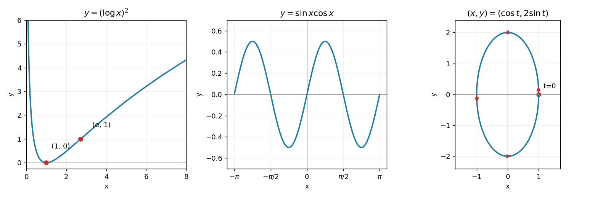

<h1 id="8/a/solution">Solution</h1>

↑ **Parent:** [A](../a.md)

The graph is nonnegative, tends to $+\infty$ as $x\downarrow0$ and as $x\to\infty$, and vanishes only at $x=1$. Its [derivative](../../../../../derivative.md) is $2\log x/x$, negative before one and positive after one, so $(1,0)$ is the unique global [minimum](../../../../../minimum-of-a-subset-of-a-total-order.md). The second [derivative](../../../../../derivative.md) is $2(1-\log x)/x^2$: the graph is convex for $0<x<e$ and concave for $x>e$, with an [inflection point](../../../../../inflection-point.md) at $(e,1)$. These features determine the sketch in the left panel.

**[Figure 1](#8/a/image-the-squared-logarithm-the-half-amplitude-double-frequency-sine-and-the-directed-elliptical-path). The squared logarithm, the half-amplitude double-frequency sine, and the directed elliptical path**.

## ↑ Ancestors (13)

1. [A](../a.md)
2. [8](../../8.md)
3. [Paper 1](../../../paper-1-split.md)
4. [2009](../../../split.md)
5. [Past exam of the mathematics course of the year 1 of the natural sciences course of the University of Cambridge](../../../../split.md)
6. [Mathematics course of the year 1 of the natural sciences course of the University of Cambridge](../../../../../mathematics-course-of-the-year-1-of-the-natural-sciences-course-of-the-university-of-cambridge.md)
7. [Year 1 of the natural sciences course of the University of Cambridge](../../../../../year-1-of-the-natural-sciences-course-of-the-university-of-cambridge.md)
8. [Year of the natural sciences course of the University of Cambridge](../../../../../year-of-the-natural-sciences-course-of-the-university-of-cambridge.md)
9. [Natural sciences course of the University of Cambridge](../../../../../natural-sciences-course-of-the-university-of-cambridge.md)
10. [Course of the University of Cambridge](../../../../../course-of-the-university-of-cambridge.md)
11. [University of Cambridge](../../../../../university-of-cambridge-split.md)
12. [List of universities](../../../../../list-of-universities.md)
13. [Codex Wiki](../../../../../split.md)
