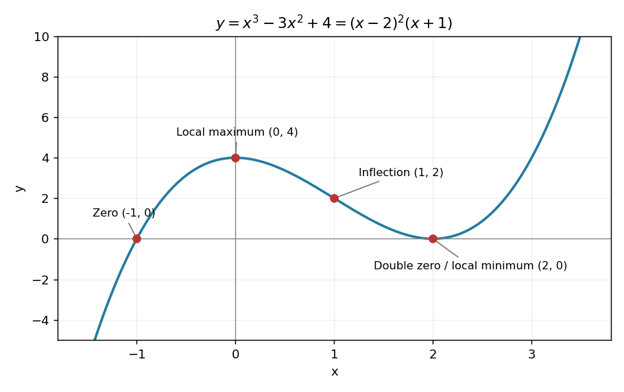

# Paper 2

↑ **Parent:** [2009](../2009.md)

[https://www.maths.cam.ac.uk/undergradnst/files/2009/PaperNST_IA_2.pdf](https://www.maths.cam.ac.uk/undergradnst/files/2009/PaperNST_IA_2.pdf)

**Table of contents**

- [1](#1)
  - [Solution](#1/solution)
- [2](#2)
  - [i](#2/i)
    - [Solution](#2/i/solution)
  - [ii](#2/ii)
    - [Solution](#2/ii/solution)
- [3](#3)
  - [Solution](#3/solution)
- [4](#4)
  - [Solution](#4/solution)
- [5](#5)
  - [Solution](#5/solution)
- [6](#6)
  - [Solution](#6/solution)
- [7](#7)
  - [Solution](#7/solution)
- [8](#8)
  - [Solution](#8/solution)
- [9](#9)
  - [Solution](#9/solution)
- [10](#10)
  - [Solution](#10/solution)
- [11](#11)
  - [a](#11/a)
    - [Solution](#11/a/solution)
  - [b](#11/b)
    - [Solution](#11/b/solution)
  - [c](#11/c)
    - [Solution](#11/c/solution)
- [12](#12)
  - [i](#12/i)
    - [Solution](#12/i/solution)
  - [ii](#12/ii)
    - [Solution](#12/ii/solution)
  - [iii](#12/iii)
    - [Solution](#12/iii/solution)
- [13](#13)
  - [a](#13/a)
    - [i](#13/a/i)
      - [Solution](#13/a/i/solution)
    - [ii](#13/a/ii)
      - [Solution](#13/a/ii/solution)
    - [iii](#13/a/iii)
      - [Solution](#13/a/iii/solution)
  - [b](#13/b)
    - [i](#13/b/i)
      - [Solution](#13/b/i/solution)
    - [ii](#13/b/ii)
      - [Solution](#13/b/ii/solution)
    - [iii](#13/b/iii)
      - [Solution](#13/b/iii/solution)
- [14](#14)
  - [a](#14/a)
    - [i](#14/a/i)
      - [Solution](#14/a/i/solution)
    - [ii](#14/a/ii)
      - [Solution](#14/a/ii/solution)
  - [b](#14/b)
    - [Solution](#14/b/solution)
  - [c](#14/c)
    - [Solution](#14/c/solution)
- [15](#15)
  - [a](#15/a)
    - [Solution](#15/a/solution)
  - [b](#15/b)
    - [Solution](#15/b/solution)
  - [c](#15/c)
    - [Solution](#15/c/solution)
- [16](#16)
  - [a](#16/a)
    - [i](#16/a/i)
      - [Solution](#16/a/i/solution)
    - [ii](#16/a/ii)
      - [Solution](#16/a/ii/solution)
    - [iii](#16/a/iii)
      - [Solution](#16/a/iii/solution)
  - [b](#16/b)
    - [Solution](#16/b/solution)
  - [c](#16/c)
    - [Solution](#16/c/solution)
- [17](#17)
  - [a](#17/a)
    - [Solution](#17/a/solution)
  - [b](#17/b)
    - [Solution](#17/b/solution)
  - [c](#17/c)
    - [i](#17/c/i)
      - [Solution](#17/c/i/solution)
    - [ii](#17/c/ii)
      - [Solution](#17/c/ii/solution)
    - [iii](#17/c/iii)
      - [Solution](#17/c/iii/solution)
    - [iv](#17/c/iv)
      - [Solution](#17/c/iv/solution)
    - [v](#17/c/v)
      - [Solution](#17/c/v/solution)
  - [d](#17/d)
    - [Solution](#17/d/solution)
- [18](#18)
  - [a](#18/a)
    - [Solution](#18/a/solution)
  - [b](#18/b)
    - [Solution](#18/b/solution)
  - [c](#18/c)
    - [Solution](#18/c/solution)
- [19](#19)
  - [a](#19/a)
    - [Solution](#19/a/solution)
  - [b](#19/b)
    - [Solution](#19/b/solution)
- [20](#20)
  - [a](#20/a)
    - [Solution](#20/a/solution)
  - [b](#20/b)
    - [Solution](#20/b/solution)
  - [c](#20/c)
    - [Solution](#20/c/solution)

## 1

↑ **Parent:** [Paper 2](paper-2.md)

<h3 id="1/solution">Solution</h3>

↑ **Parent:** [1](#1)

If $y\ne0$, the equation would imply $b=-(x/y)a$, contradicting the assumed nonparallel directions. Hence $y=0$. Then $xa=0$ and $a\ne0$ force $x=0$. This proves that the two [vectors](../../vector-space.md#vector) are [linearly independent](../../vector-space.md#linear-independence).

## 2

↑ **Parent:** [Paper 2](paper-2.md)

<h3 id="2/i">i</h3>

↑ **Parent:** [2](#2)

<h4 id="2/i/solution">Solution</h4>

↑ **Parent:** [I](#2/i)

The function $x^2\sin x$ is an [odd function](../../calculus.md#odd-function), since $x^2$ is even and the [sine](../../geometry-and-topology.md#sine) is odd. Its [integral](../../integral.md) on the symmetric interval therefore cancels:

$$
\boxed{\int_{-\pi}^{\pi}x^2\sin x\,dx=0.}
$$

<h3 id="2/ii">ii</h3>

↑ **Parent:** [2](#2)

<h4 id="2/ii/solution">Solution</h4>

↑ **Parent:** [Ii](#2/ii)

The double-angle identity gives $\cos^2x-\sin^2x=\cos(2x)$. Thus

$$
\boxed{\int_0^\pi(\cos^2x-\sin^2x)dx=\left[\tfrac12\sin(2x)\right]_0^\pi=0.}
$$

## 3

↑ **Parent:** [Paper 2](paper-2.md)

<h3 id="3/solution">Solution</h3>

↑ **Parent:** [3](#3)

The [gradients](../../multivariable-calculus.md#gradient) are $\nabla f=(1,1,1)$ and $\nabla g=(2x,2y,2z)$. Equality of their three components therefore gives the unique point

$$
\boxed{(x,y,z)=(1/2,1/2,1/2).}
$$

## 4

↑ **Parent:** [Paper 2](paper-2.md)

<h3 id="4/solution">Solution</h3>

↑ **Parent:** [4](#4)

Zero is an [eigenvalue](../../linear-operator-theory.md#eigenvalue) exactly when the [determinant](../../multilinear-algebra.md#determinant) vanishes. Here $\det A=1-\alpha^2$, so

$$
\boxed{\alpha=1\quad\text{or}\quad\alpha=-1.}
$$

For either value the other [eigenvalue](../../linear-operator-theory.md#eigenvalue) is two, as follows from the [trace](../../linear-algebra.md#matrix-trace).

## 5

↑ **Parent:** [Paper 2](paper-2.md)

<h3 id="5/solution">Solution</h3>

↑ **Parent:** [5](#5)

Factorization gives $y=(x-2)^2(x+1)$, so the zeros are $x=-1$ and $x=2$, with a double root at two. The [derivatives](../../calculus.md#derivative) are $y'=3x(x-2)$ and $y''=6(x-1)$. Thus

$$
\boxed{\text{local maximum }(0,4),\quad\text{local minimum }(2,0),\quad\text{inflection point }(1,2).}
$$

The second [derivative](../../calculus.md#derivative) changes sign at one, confirming the [inflection point](../../topology.md#inflection-point). The curve rises from $-\infty$, crosses at $-1$, reaches its local maximum, falls to touch the axis at two, then rises to $+\infty$. Neither local extremum is a global extremum on the whole real line.

**[Figure 1](#5/image-zeros-two-stationary-points-and-an-inflection-point-of-the-cubic). Zeros, two stationary points and an inflection point of the cubic**.

## 6

↑ **Parent:** [Paper 2](paper-2.md)

<h3 id="6/solution">Solution</h3>

↑ **Parent:** [6](#6)

Expanding gives $u=2x^2+2c^2t^2$, so $u_{tt}=4c^2$ and $u_{xx}=4$. Hence $u_{tt}=c^2u_{xx}$, proving that it solves the [one-dimensional wave equation](../../wave-equation.md#one-dimensional-wave-equation). Equivalently its two summands are oppositely travelling profiles, as in [D'Alembert's formula](../../wave-equation.md#d-alembert-s-formula).

## 7

↑ **Parent:** [Paper 2](paper-2.md)

<h3 id="7/solution">Solution</h3>

↑ **Parent:** [7](#7)

At $x=1$, the [natural logarithm](../../calculus.md#natural-logarithm) has value zero and [derivative](../../calculus.md#derivative) $1/x=1$. Its [tangent line](../../calculus.md#tangent-line) is therefore

$$
\boxed{y=x-1.}
$$

## 8

↑ **Parent:** [Paper 2](paper-2.md)

<h3 id="8/solution">Solution</h3>

↑ **Parent:** [8](#8)

The logarithm must be expanded about two, not about one. Factor

$$
1+e^x=2\left(1+\frac x2+\frac{x^2}4+O(x^3)\right).
$$

Applying the supplied logarithm expansion to the bracket gives $\log2+(x/2+x^2/4)-\tfrac12(x/2)^2+O(x^3)$. Thus, through second order,

$$
\boxed{\log(1+e^x)=\log2+\frac x2+\frac{x^2}{8}+O(x^3).}
$$

In fact the cubic coefficient vanishes, since $\log(1+e^x)=x/2+\log[2\cosh(x/2)]$ and the second term is even; the [Maclaurin series](../../calculus.md#maclaurin-series) remainder can be sharpened to $O(x^4)$.

## 9

↑ **Parent:** [Paper 2](paper-2.md)

<h3 id="9/solution">Solution</h3>

↑ **Parent:** [9](#9)

The inequality is equivalent to $|\cos\theta|>1/\sqrt2$. The [cosine](../../geometry-and-topology.md#cosine) exceeds $1/\sqrt2$ close to zero and $2\pi$, and is less than $-1/\sqrt2$ close to $\pi$. Within the specified interval this gives

$$
\boxed{\theta\in[0,\pi/4)\ \cup\ (3\pi/4,5\pi/4)\ \cup\ (7\pi/4,2\pi].}
$$

The four equality angles are excluded because the inequality is strict; zero and $2\pi$ satisfy it and are included.

## 10

↑ **Parent:** [Paper 2](paper-2.md)

<h3 id="10/solution">Solution</h3>

↑ **Parent:** [10](#10)

For $\lambda\geq0$, the exponential [power series](../../sequence-and-series.md#power-series) gives the normalization of the [Poisson distribution](../../discrete-probability-distribution.md#poisson-distribution):

$$
\sum_{k=0}^\infty\frac{\lambda^ke^{-\lambda}}{k!}=e^{-\lambda}e^\lambda=1.
$$

For $\lambda=0$, the limiting law assigns probability one to $k=0$ and zero to every positive [integer](../../integer.md) $k$. Negative $\lambda$ would not define the stated [probability distribution](../../probability-distribution.md).

## 11

↑ **Parent:** [Paper 2](paper-2.md)

<h3 id="11/a">a</h3>

↑ **Parent:** [11](#11)

<h4 id="11/a/solution">Solution</h4>

↑ **Parent:** [A](#11/a)

The direction [vector](../../vector-space.md#vector) is $b-a=(1,2,-2)$. The vector equation and symmetric Cartesian equation of the line are

$$
\boxed{r=(1,2,4)+t(1,2,-2),\qquad x-1=\frac{y-2}{2}=\frac{z-4}{-2}.}
$$

The $(x,y)$-plane has $z=0$, which gives $t=2$. Thus its intersection with the line has position

$$
\boxed{r=(3,6,0).}
$$

<h3 id="11/b">b</h3>

↑ **Parent:** [11](#11)

<h4 id="11/b/solution">Solution</h4>

↑ **Parent:** [B](#11/b)

The plane normals are $n_1=(2,-1,-1)$ and $n_2=(3,-1,-3)$. Their [cross product](../../vector-space.md#cross-product) is $(2,3,1)$, perpendicular to both normals and hence parallel to the intersection line. Setting $z=0$ in both equations gives the common point $(1,-1,0)$. Therefore

$$
\boxed{r=(1,-1,0)+t(2,3,1),\qquad t\in\mathbb R.}
$$

The normals are not parallel, so their intersection is a unique line.

<h3 id="11/c">c</h3>

↑ **Parent:** [11](#11)

<h4 id="11/c/solution">Solution</h4>

↑ **Parent:** [C](#11/c)

From the line point $r_0=(1,-1,0)$ to $P=(2,2,1)$, take $w=P-r_0=(1,3,1)$ and line direction $d=(2,3,1)$. [Orthogonal projection](../../hilbert-space.md#orthogonal-projection) gives the nearest parameter $t=(w\cdot d)/(d\cdot d)=12/14=6/7$. The perpendicular displacement has squared [Euclidean norm](../../normed-vector-space.md#euclidean-norm)

$$
|w|^2-\frac{(w\cdot d)^2}{|d|^2}=11-\frac{144}{14}=\frac57.
$$

Hence the [distance from a point to a line in three dimensions](../../topological-analysis.md#distance-from-a-point-to-a-line-in-three-dimensions) is

$$
\boxed{\sqrt{5/7}.}
$$

The nearest point is $(19/7,11/7,6/7)$; subtracting it from $P$ gives a vector orthogonal to $d$, verifying the minimum.

## 12

↑ **Parent:** [Paper 2](paper-2.md)

<h3 id="12/i">i</h3>

↑ **Parent:** [12](#12)

<h4 id="12/i/solution">Solution</h4>

↑ **Parent:** [I](#12/i)

The [characteristic equation](../../linear-ordinary-differential-equation.md#characteristic-equation-of-a-constant-coefficient-differential-equation) is $r^2+\lambda r+k=0$, whose roots are $r_\pm=(-\lambda\pm\sqrt{\lambda^2-4k})/2$. For distinct real roots, $y=C_1e^{r_+t}+C_2e^{r_-t}$; at the repeated-root threshold $\lambda^2=4k$, $y=(C_1+C_2t)e^{-\lambda t/2}$. In the complex-root case put $\Omega=\sqrt{k-\lambda^2/4}$ to obtain

$$
\boxed{y=e^{-\lambda t/2}(C_1\cos\Omega t+C_2\sin\Omega t),\qquad\lambda^2<4k.}
$$

This is precisely the oscillatory regime of the [damped harmonic oscillator](../../analysis.md#damped-harmonic-oscillator). The zero solution is of course nonoscillatory; the regime describes its nontrivial motions.

<h3 id="12/ii">ii</h3>

↑ **Parent:** [12](#12)

<h4 id="12/ii/solution">Solution</h4>

↑ **Parent:** [Ii](#12/ii)

The damped [angular frequency](../../lagrangian-mechanics.md#angular-frequency) is $\Omega=\sqrt{k-\lambda^2/4}$. The oscillation envelope is proportional to $e^{-\lambda t/2}$. A decrease by a quarter leaves three quarters of the original amplitude, so $e^{-\lambda t/2}=3/4$. Therefore

$$
\boxed{\Omega=\sqrt{k-\lambda^2/4},\qquad t=\frac2\lambda\log\frac43.}
$$

This concerns the envelope; it does not ask when the instantaneous displacement first equals three quarters of a chosen value.

<h3 id="12/iii">iii</h3>

↑ **Parent:** [12](#12)

<h4 id="12/iii/solution">Solution</h4>

↑ **Parent:** [Iii](#12/iii)

Let $D=1+\omega^2$, with $\omega>0$. A particular solution of the [forced harmonic oscillator](../../analysis.md#forced-harmonic-oscillator) is $y_p=e^{-t}(at+b)$. Substitution gives $Da=2$ and $Db-2a=0$, hence $a=2/D$ and $b=4/D^2$. Adding $A\cos\omega t+B\sin\omega t$ and imposing the two initial conditions gives $A=-4/D^2$ and $B=2(1-\omega^2)/(\omega D^2)$. Thus

$$
y(t)=e^{-t}\left(\frac{2t}{D}+\frac4{D^2}\right)-\frac4{D^2}\cos\omega t+\frac{2(1-\omega^2)}{\omega D^2}\sin\omega t.
$$

The first term tends to zero. The amplitude of the surviving sinusoid is

$$
\boxed{\sqrt{A^2+B^2}=\frac{2}{\omega(1+\omega^2)}.}
$$

As an independent interpretation, the [residual amplitude of an oscillator after an integrable force](../../analysis.md#residual-amplitude-of-an-oscillator-after-an-integrable-force) is $\omega^{-1}|\int_0^\infty F(t)e^{-i\omega t}dt|$. Here that integral is $2/(1+i\omega)^2$, giving the same result.

## 13

↑ **Parent:** [Paper 2](paper-2.md)

<h3 id="13/a">a</h3>

↑ **Parent:** [13](#13)

<h4 id="13/a/i">i</h4>

↑ **Parent:** [A](#13/a)

<h5 id="13/a/i/solution">Solution</h5>

↑ **Parent:** [I](#13/a/i)

Put $X=x-1$ and $H=e^{-(X^2+y^2)/2}>0$. The [gradient](../../multivariable-calculus.md#gradient) components are $z_x=y(1-X^2)H$ and $z_y=X(1-y^2)H$. If either $X$ or $y$ vanishes, both must vanish. Otherwise both squared coordinates must be one. Therefore the five [stationary points](../../calculus-of-variations.md#stationary-point) in the original $(x,y)$ coordinates are

$$
\boxed{(1,0),\quad(0,1),\quad(0,-1),\quad(2,1),\quad(2,-1).}
$$

<h4 id="13/a/ii">ii</h4>

↑ **Parent:** [A](#13/a)

<h5 id="13/a/ii/solution">Solution</h5>

↑ **Parent:** [Ii](#13/a/ii)

At $(X,y)=(0,0)$ the [Hessian matrix](../../multivariable-calculus.md#hessian-matrix) is $\begin{pmatrix}0&1\\1&0\end{pmatrix}$, with [eigenvalues](../../linear-operator-theory.md#eigenvalue) $1$ and $-1$, so $(x,y)=(1,0)$ is a [saddle point](../../analysis.md#saddle-point). At the other four points the mixed second [derivative](../../calculus.md#derivative) vanishes and the two diagonal entries both equal $-2Xy/e$. Hence

$$
\boxed{\begin{array}{c|c|c}
(x,y)&\text{type}&z\\\hline
(2,1),(0,-1)&\text{maxima}&e^{-1}\\
(0,1),(2,-1)&\text{minima}&-e^{-1}\\
(1,0)&\text{saddle}&0
\end{array}.}
$$

The four extrema are global: $|z|=(|X|e^{-X^2/2})(|y|e^{-y^2/2})\leq e^{-1}$ because each factor has maximum $e^{-1/2}$ at absolute argument one.

<h4 id="13/a/iii">iii</h4>

↑ **Parent:** [A](#13/a)

<h5 id="13/a/iii/solution">Solution</h5>

↑ **Parent:** [Iii](#13/a/iii)

The zero [level set](../../topology.md#level-set) consists of the lines $x=1$ and $y=0$. The height is positive where $(x-1)y>0$ and negative where that product is negative. In each of the four resulting regions, closed nonzero [contours](../../complex-analysis.md#complex-integration-contour) surround its extremum; levels closer to zero extend further from the extremum towards the zero-level axes and towards large distance. The height tends to zero at infinity. The figure marks the four extrema and central [saddle point](../../analysis.md#saddle-point), and includes the downhill path used below.

**[Figure 2](#13/a/iii/image-contours-stationary-points-and-the-steepest-downhill-path-on-the-gaussian-weighted-surface). Contours, stationary points and the steepest downhill path on the Gaussian-weighted surface**.

<h3 id="13/b">b</h3>

↑ **Parent:** [13](#13)

<h4 id="13/b/i">i</h4>

↑ **Parent:** [B](#13/b)

<h5 id="13/b/i/solution">Solution</h5>

↑ **Parent:** [I](#13/b/i)

For the graph surface $Z=z(x,y)$, an upward normal is $(-z_x,-z_y,1)$. At $x=y=1$, let $q=e^{-1/2}$; then $z_x=q$ and $z_y=0$. Normalizing gives the [unit normal vector](../../differential-geometry.md#unit-normal)

$$
\boxed{n=\frac{(-q,0,1)}{\sqrt{1+q^2}}=\frac{(-e^{-1/2},0,1)}{\sqrt{1+e^{-1}}}.}
$$

Its negative is the equally valid downward normal.

<h4 id="13/b/ii">ii</h4>

↑ **Parent:** [B](#13/b)

<h5 id="13/b/ii/solution">Solution</h5>

↑ **Parent:** [Ii](#13/b/ii)

A tangent displacement has the form $(dx,dy,z_xdx+z_ydy)$. At the specified point, $z_y=0$ and $z_x=q>0$, so the fastest decrease of height per unit surface distance has $dy=0$ and $dx<0$. The unit downhill tangent is $(-1,0,-q)/\sqrt{1+q^2}$. Therefore, for speed $u$ measured along the surface,

$$
\boxed{v=-\frac{u}{\sqrt{1+e^{-1}}}(1,0,e^{-1/2}).}
$$

Its [Euclidean norm](../../normed-vector-space.md#euclidean-norm) is $u$, and it is orthogonal to the surface normal. The general construction is [steepest descent on a graph surface](../../riemannian-geometry.md#steepest-descent-on-a-graph-surface); using a horizontal speed equal to $u$ would overestimate the full three-dimensional speed.

<h4 id="13/b/iii">iii</h4>

↑ **Parent:** [B](#13/b)

<h5 id="13/b/iii/solution">Solution</h5>

↑ **Parent:** [Iii](#13/b/iii)

The horizontal direction of [steepest descent on a graph surface](../../riemannian-geometry.md#steepest-descent-on-a-graph-surface) is parallel to $-\nabla z$. On the line $y=1$, the component $z_y=X(1-y^2)H$ vanishes identically, so that line is invariant under the downhill path. Starting at $X=0$, $z_x=(1-X^2)e^{-(X^2+1)/2}>0$ for $-1<X<0$, so $x$ decreases towards zero. The path reaches the minimum

$$
\boxed{(x,y,z)=(0,1,-e^{-1}).}
$$

At the minimum no strictly downhill direction remains. A constant-speed parametrization reaches it after the finite arc length divided by $u$; the unnormalized [gradient flow](../../analysis.md#gradient-flow) approaches the same endpoint only asymptotically in its own time parameter.

## 14

↑ **Parent:** [Paper 2](paper-2.md)

<h3 id="14/a">a</h3>

↑ **Parent:** [14](#14)

<h4 id="14/a/i">i</h4>

↑ **Parent:** [A](#14/a)

<h5 id="14/a/i/solution">Solution</h5>

↑ **Parent:** [I](#14/a/i)

Expanding the [determinant](../../multilinear-algebra.md#determinant) along the first row gives

$$
\boxed{\det A=1(-2-1)-2(0+1)+(-1)(0-1)=-4.}
$$

In particular the matrix is invertible.

<h4 id="14/a/ii">ii</h4>

↑ **Parent:** [A](#14/a)

<h5 id="14/a/ii/solution">Solution</h5>

↑ **Parent:** [Ii](#14/a/ii)

The [cofactor matrix](../../linear-algebra.md#cofactor-matrix) is $\begin{pmatrix}-3&-1&-1\\5&-1&3\\-1&1&1\end{pmatrix}$. Transpose it to form the [adjugate matrix](../../linear-algebra.md#adjugate-matrix), and divide by the determinant $-4$:

$$
\boxed{A^{-1}=\frac14\begin{pmatrix}3&-5&1\\1&1&-1\\1&-3&-1\end{pmatrix}.}
$$

Direct matrix multiplication gives $AA^{-1}=I$, checking all entries.

<h3 id="14/b">b</h3>

↑ **Parent:** [14](#14)

<h4 id="14/b/solution">Solution</h4>

↑ **Parent:** [B](#14/b)

A homogeneous square [linear system](../../linear-algebra.md#system-of-linear-equations) has a nonzero solution exactly when its coefficient matrix is singular. Here

$$
\det\begin{pmatrix}1&1&1\\1&2&0\\1&-3&\lambda\end{pmatrix}=\lambda-5.
$$

Thus

$$
\boxed{\lambda=5.}
$$

For this value, the second equation gives $x=-2y$ and the first gives $z=y$; the third then holds automatically. All solutions are $t(-2,1,1)$, with $t\ne0$ for the nonzero ones.

<h3 id="14/c">c</h3>

↑ **Parent:** [14](#14)

<h4 id="14/c/solution">Solution</h4>

↑ **Parent:** [C](#14/c)

The coefficient matrix is a [Vandermonde matrix](../../galois-theory.md#vandermonde-matrix), with determinant

$$
\det\begin{pmatrix}1&1&1\\a&b&c\\a^2&b^2&c^2\end{pmatrix}=(b-a)(c-a)(c-b).
$$

Therefore a nonzero solution exists exactly when

$$
\boxed{a=b\quad\text{or}\quad a=c\quad\text{or}\quad b=c.}
$$

For example if $a=b$, the first two columns are equal and $(1,-1,0)$ is a solution. If exactly two parameters agree, the distinct remaining column is independent of the repeated one, so the [kernel](../../kernel-of-a-linear-map.md) has dimension one. If all three agree, only $x+y+z=0$ remains, giving a two-dimensional [kernel](../../kernel-of-a-linear-map.md).

## 15

↑ **Parent:** [Paper 2](paper-2.md)

<h3 id="15/a">a</h3>

↑ **Parent:** [15](#15)

<h4 id="15/a/solution">Solution</h4>

↑ **Parent:** [A](#15/a)

Use the real [Fourier series](../../fourier-series.md) convention $g=a_0/2+\sum_{n\geq1}[a_n\cos(n\pi x)+b_n\sin(n\pi x)]$ for period two. Since $g$ is an [even function](../../calculus.md#even-function), $b_n=0$, and $a_0=\int_{-1}^1x^2dx=2/3$. Twice applying [integration by parts](../../calculus.md#integration-by-parts), with $k=n\pi$, gives

$$
a_n=2\int_0^1x^2\cos(kx)dx
=2\left[\frac{x^2\sin(kx)}k+\frac{2x\cos(kx)}{k^2}-\frac{2\sin(kx)}{k^3}\right]_0^1
=\frac{4(-1)^n}{\pi^2n^2}.
$$

Hence

$$
\boxed{g(x)=\frac13+\frac4{\pi^2}\sum_{n=1}^\infty\frac{(-1)^n}{n^2}\cos(n\pi x).}
$$

The periodic extension is continuous at its endpoints, so the series takes the specified endpoint values as well as the interior values.

<h3 id="15/b">b</h3>

↑ **Parent:** [15](#15)

<h4 id="15/b/solution">Solution</h4>

↑ **Parent:** [B](#15/b)

Apply [Parseval's identity](../../fourier-analysis.md#parseval-identity) in the same coefficient convention:

$$
\int_{-1}^1g(x)^2dx=\frac{a_0^2}{2}+\sum_{n=1}^\infty(a_n^2+b_n^2).
$$

The left-hand side is $\int_{-1}^1x^4dx=2/5$. Thus $2/5=2/9+(16/\pi^4)\sum_{n\geq1}n^{-4}$, giving

$$
\boxed{\sum_{n=1}^\infty\frac1{n^4}=\frac{\pi^4}{90}.}
$$

<h3 id="15/c">c</h3>

↑ **Parent:** [15](#15)

<h4 id="15/c/solution">Solution</h4>

↑ **Parent:** [C](#15/c)

Again the function is even, so all sine coefficients vanish. Its constant term is $a_0/2=\sinh1$. With $k=n\pi$, an [antiderivative](../../integral.md#antiderivative) is

$$
\int\cosh x\cos(kx)dx=\frac{\sinh x\cos(kx)+k\cosh x\sin(kx)}{1+k^2}.
$$

Thus $a_n=2(-1)^n\sinh1/(1+n^2\pi^2)$. In the requested factored notation,

$$
\boxed{A_0=1,\qquad A_n(x)=\frac{2(-1)^n\cos(n\pi x)}{1+n^2\pi^2}.}
$$

This is the period-two specialization of the [Fourier series of periodic hyperbolic sine and cosine](../../fourier-series.md#fourier-series-of-periodic-hyperbolic-sine-and-cosine). The function values match at the endpoints, although its derivative has a jump in the periodic extension.

## 16

↑ **Parent:** [Paper 2](paper-2.md)

<h3 id="16/a">a</h3>

↑ **Parent:** [16](#16)

<h4 id="16/a/i">i</h4>

↑ **Parent:** [A](#16/a)

<h5 id="16/a/i/solution">Solution</h5>

↑ **Parent:** [I](#16/a/i)

In [Cartesian coordinates](../../linear-algebra.md#cartesian-coordinate-system), the [divergence](../../multivariable-calculus.md#divergence) is the sum of the three component derivatives. Therefore

$$
\nabla\cdot r=\frac{\partial x}{\partial x}+\frac{\partial y}{\partial y}+\frac{\partial z}{\partial z}=3.
$$

<h4 id="16/a/ii">ii</h4>

↑ **Parent:** [A](#16/a)

<h5 id="16/a/ii/solution">Solution</h5>

↑ **Parent:** [Ii](#16/a/ii)

For $r=\sqrt{x^2+y^2+z^2}>0$, the [chain rule](../../calculus.md#chain-rule) gives $\partial_x(r^{-1})=-x/r^3$, with analogous formulas for the other components. Hence

$$
\boxed{\nabla(1/r)=-\frac{r}{r^3}.}
$$

On the right the numerator denotes the position vector, while its denominator is the cube of its magnitude.

<h4 id="16/a/iii">iii</h4>

↑ **Parent:** [A](#16/a)

<h5 id="16/a/iii/solution">Solution</h5>

↑ **Parent:** [Iii](#16/a/iii)

The vector $m$ is constant, so $\nabla(m\cdot r)=m$. Also $\nabla(r^{-3})=-3r/r^5$, by the same [chain rule](../../calculus.md#chain-rule). The [product rule](../../calculus.md#product-rule) therefore yields

$$
\boxed{\nabla\left(\frac{m\cdot r}{r^3}\right)=\frac m{r^3}-\frac{3(m\cdot r)r}{r^5},\qquad r>0.}
$$

The three components follow by differentiating $(\alpha x+\beta y+\gamma z)(x^2+y^2+z^2)^{-3/2}$.

<h3 id="16/b">b</h3>

↑ **Parent:** [16](#16)

<h4 id="16/b/solution">Solution</h4>

↑ **Parent:** [B](#16/b)

For constant $m$, the [curl of a cross product](../../multivariable-calculus.md#curl-of-a-cross-product) identity reduces to

$$
\nabla\times(m\times\nabla\phi)=m\Delta\phi-(m\cdot\nabla)\nabla\phi.
$$

Commuting mixed second [partial derivatives](../../multivariable-calculus.md#partial-derivative) gives $(m\cdot\nabla)\nabla\phi=\nabla(m\cdot\nabla\phi)$. Hence the requested sum equals $m\Delta\phi$, which is zero because $\phi$ is [harmonic](../../partial-differential-equation.md#harmonic-function). The argument assumes the indicated second derivatives are continuous on the domain.

<h3 id="16/c">c</h3>

↑ **Parent:** [16](#16)

<h4 id="16/c/solution">Solution</h4>

↑ **Parent:** [C](#16/c)

From the preceding gradient, $\partial_x^2(r^{-1})=-r^{-3}+3x^2r^{-5}$. Summing the three Cartesian second [partial derivatives](../../multivariable-calculus.md#partial-derivative) gives

$$
\Delta(1/r)=-3r^{-3}+3(x^2+y^2+z^2)r^{-5}=0,\qquad r>0.
$$

Thus the reciprocal radius is [harmonic](../../partial-differential-equation.md#harmonic-function) away from the origin. Its negative gradient is

$$
\boxed{E=\frac{r}{r^3},\qquad\nabla\times E=0\quad(r>0).}
$$

The [curl](../../multivariable-calculus.md#curl) vanishes because $E$ is a gradient field and mixed second derivatives commute. The exclusion of the origin is essential: the potential and field are singular there.

## 17

↑ **Parent:** [Paper 2](paper-2.md)

<h3 id="17/a">a</h3>

↑ **Parent:** [17](#17)

<h4 id="17/a/solution">Solution</h4>

↑ **Parent:** [A](#17/a)

For a continuous [random variable](../../random-variable.md) with [probability density function](../../continuous-probability-distribution.md#probability-density-function) $p$, its [expected value](../../expected-value.md) and [variance](../../variance.md) are

$$
\boxed{\mu_X=\int_{-\infty}^{\infty}xp(x)dx,\qquad\operatorname{Var}X=\int_{-\infty}^{\infty}(x-\mu_X)^2p(x)dx.}
$$

The mean requires an integrable first absolute moment, and a finite variance requires a finite second moment. When these hold, $\operatorname{Var}X=\mathbb E[X^2]-(\mathbb EX)^2$.

<h3 id="17/b">b</h3>

↑ **Parent:** [17](#17)

<h4 id="17/b/solution">Solution</h4>

↑ **Parent:** [B](#17/b)

Take $\sigma>0$ and substitute $u=(x-\mu)/\sigma$. The density becomes the standard [Gaussian distribution](../../probability-distribution.md#normal-distribution) density $\varphi(u)=e^{-u^2/2}/\sqrt{2\pi}$. Its normalization follows from the supplied [Gaussian integral](../../integral.md#gaussian-integral) after scaling by $\sqrt2$. Since $u\varphi(u)$ is an integrable [odd function](../../calculus.md#odd-function), its integral is zero, and therefore $\mathbb EX=\mu$.

For the second moment, $\varphi'=-u\varphi$. [Integration by parts](../../calculus.md#integration-by-parts) gives

$$
\int_{-\infty}^{\infty}u^2\varphi(u)du=-[u\varphi(u)]_{-\infty}^{\infty}+\int_{-\infty}^{\infty}\varphi(u)du=1.
$$

The endpoint term vanishes by Gaussian decay. Consequently

$$
\boxed{\mathbb EX=\mu,\qquad\operatorname{Var}X=\sigma^2.}
$$

<h3 id="17/c">c</h3>

↑ **Parent:** [17](#17)

<h4 id="17/c/i">i</h4>

↑ **Parent:** [C](#17/c)

<h5 id="17/c/i/solution">Solution</h5>

↑ **Parent:** [I](#17/c/i)

The [conditional probability](../../probability-theory.md#conditional-probability) product rule gives $P(A\mid B)P(B)=P(A\cap B)$. Applying it once more gives

$$
\boxed{P(A\mid B)P(B)P(C\mid A\cap B)=P(A\cap B\cap C).}
$$

The conditionals in the original expression require their conditioning events to have positive probability.

<h4 id="17/c/ii">ii</h4>

↑ **Parent:** [C](#17/c)

<h5 id="17/c/ii/solution">Solution</h5>

↑ **Parent:** [Ii](#17/c/ii)

The events $B$ and $\overline B$ form a partition. The [law of total probability](../../probability-space.md#law-of-total-probability) therefore gives

$$
\boxed{P(A\mid\overline B)P(\overline B)+P(B)P(A\mid B)=P(A).}
$$

As written, both conditionals require nonzero conditioning probabilities.

<h4 id="17/c/iii">iii</h4>

↑ **Parent:** [C](#17/c)

<h5 id="17/c/iii/solution">Solution</h5>

↑ **Parent:** [Iii](#17/c/iii)

The numerator $P(B\mid A)P(A)$ equals $P(A\cap B)$, while $P(A\mid B)=P(A\cap B)/P(B)$. Thus, wherever the original quotient is defined,

$$
\boxed{\frac{P(B\mid A)P(A)}{P(A\mid B)}=P(B).}
$$

In particular a zero numerator and denominator cannot be cancelled; the original expression requires $P(A\mid B)>0$. This is the rearrangement of [Bayes' theorem](../../probability-theory.md#bayes-theorem).

<h4 id="17/c/iv">iv</h4>

↑ **Parent:** [C](#17/c)

<h5 id="17/c/iv/solution">Solution</h5>

↑ **Parent:** [Iv](#17/c/iv)

The two-event [inclusion-exclusion principle](../../combinatorics.md#inclusion-exclusion-principle) subtracts the overlap counted twice:

$$
\boxed{P(A)+P(B)-P(A\cap B)=P(A\cup B).}
$$

<h4 id="17/c/v">v</h4>

↑ **Parent:** [C](#17/c)

<h5 id="17/c/v/solution">Solution</h5>

↑ **Parent:** [V](#17/c/v)

This is exactly the definition of [conditional probability](../../probability-theory.md#conditional-probability), provided $P(A)>0$:

$$
\boxed{\frac{P(A\cap B)}{P(A)}=P(B\mid A).}
$$

<h3 id="17/d">d</h3>

↑ **Parent:** [17](#17)

<h4 id="17/d/solution">Solution</h4>

↑ **Parent:** [D](#17/d)

Under a uniform shuffle, every unordered five-card hand is equally likely, giving $\binom{52}{5}$ possible hands. Choose the triple's rank in 13 ways and its suits in $\binom43$ ways; then choose a different pair rank in 12 ways and its suits in $\binom42$ ways. Each full house determines these choices uniquely, so there is no further ordering factor. Therefore

$$
\boxed{N=13\binom43\,12\binom42=3744,\qquad P=\frac{3744}{\binom{52}{5}}.}
$$

The count uses [binomial coefficients](../../binomial-coefficient.md) because the order of cards within a hand is irrelevant.

## 18

↑ **Parent:** [Paper 2](paper-2.md)

<h3 id="18/a">a</h3>

↑ **Parent:** [18](#18)

<h4 id="18/a/solution">Solution</h4>

↑ **Parent:** [A](#18/a)

The integrand is continuous on the compact rectangle, so [Fubini's theorem](../../measure-theory.md#fubini-s-theorem) allows integrating in $y$ first. For $x\ne0$, $\int_0^1xe^{xy}dy=e^x-1$; the same formula holds by continuity at $x=0$. Hence

$$
\boxed{\int_0^1\int_0^2xe^{xy}dx\,dy=\int_0^2(e^x-1)dx=e^2-3.}
$$

<h3 id="18/b">b</h3>

↑ **Parent:** [18](#18)

<h4 id="18/b/solution">Solution</h4>

↑ **Parent:** [B](#18/b)

The [domain of integration](../../integral.md#domain-of-integration) is the upper half of the [ellipse](../../euclidean-geometry.md#ellipse) $x^2+4y^2\leq1$. Reversing the order makes $-1\leq x\leq1$ and $0\leq y\leq\tfrac12\sqrt{1-x^2}$. Thus

$$
\boxed{\int_{-1}^1\int_0^{\sqrt{1-x^2}/2}y\,dy\,dx=\frac18\int_{-1}^1(1-x^2)dx=\frac16.}
$$

The inner antiderivative is $y^2/2$, so the square of the upper limit removes the square root.

<h3 id="18/c">c</h3>

↑ **Parent:** [18](#18)

<h4 id="18/c/solution">Solution</h4>

↑ **Parent:** [C](#18/c)

Use [cylindrical coordinates](../../multivariable-calculus.md#cylindrical-coordinate-system) $x=r\cos\theta$, $y=r\sin\theta$. The upper plane gives $z=4-r(\cos\theta+\sin\theta)>0$ throughout the quarter disk, and the [Jacobian determinant](../../multivariable-calculus.md#jacobian-determinant) contributes $r$. Therefore

$$
\begin{aligned}
V&=\int_0^{\pi/2}\int_0^1[4-r(\cos\theta+\sin\theta)]r\,dr\,d\theta\\
&=\int_0^{\pi/2}\left[2-\frac{\cos\theta+\sin\theta}{3}\right]d\theta,
\end{aligned}
$$

so

$$
\boxed{V=\pi-\frac23.}
$$

## 19

↑ **Parent:** [Paper 2](paper-2.md)

<h3 id="19/a">a</h3>

↑ **Parent:** [19](#19)

<h4 id="19/a/solution">Solution</h4>

↑ **Parent:** [A](#19/a)

The [divergence](../../multivariable-calculus.md#divergence) is $\nabla\cdot F=-1+0+1=0$. Take the hemisphere's outward orientation, and close it with the unit disk $D$ at $z=0$, whose outward normal is $-e_z$. The [divergence theorem](../../multivariable-calculus.md#divergence-theorem) then gives $\int_SF\cdot dS+\int_DF\cdot dS=0$. On the disk, $F\cdot(-e_z)=-x^2$, and [polar coordinates](../../multivariable-calculus.md#polar-coordinates) give

$$
\int_Dx^2dA=\int_0^1\int_0^{2\pi}r^2\cos^2\theta\,r\,d\theta\,dr=\frac\pi4.
$$

Consequently the curved hemisphere has [flux](../../mathematical-physics.md#flux)

$$
\boxed{\int_SF\cdot dS=\frac\pi4.}
$$

The reversed hemisphere orientation would reverse the sign.

<h3 id="19/b">b</h3>

↑ **Parent:** [19](#19)

<h4 id="19/b/solution">Solution</h4>

↑ **Parent:** [B](#19/b)

Choose the upward orientation. The boundary is the circle $x^2+y^2=4$ at $z=1$, oriented counterclockwise from above. By [Stokes theorem](../../multivariable-calculus.md#stokes-theorem), the surface [integral](../../integral.md) is $\oint_{\partial S}G\cdot dr$. On this boundary $dz=0$ and $z^2=1$, so

$$
\oint_{\partial S}G\cdot dr=\oint(dx-3xy\,dy).
$$

The first term integrates to zero around a closed curve. By [Green's theorem](../../multivariable-calculus.md#green-theorem), the second equals the disk integral $\int_{x^2+y^2\leq4}(-3y)dx\,dy=0$, by oddness in $y$. Thus

$$
\boxed{\int_S(\nabla\times G)\cdot n\,dS=0.}
$$

Here reversing orientation leaves the zero value unchanged.

## 20

↑ **Parent:** [Paper 2](paper-2.md)

<h3 id="20/a">a</h3>

↑ **Parent:** [20](#20)

<h4 id="20/a/solution">Solution</h4>

↑ **Parent:** [A](#20/a)

Direct [differentiation](../../calculus.md#differentiation) of $v=(x^2-1)^l$ gives $(x^2-1)v'=2lxv$; the identity also holds for $l=0$. Differentiate it $l+1$ times using the [Leibniz rule](../../calculus.md#leibniz-rule). The quadratic factor has only its first two derivatives nonzero, so

$$
(x^2-1)v^{(l+2)}+2(l+1)xv^{(l+1)}+l(l+1)v^{(l)}
=2l[xv^{(l+1)}+(l+1)v^{(l)}].
$$

Writing $y=v^{(l)}$ and collecting terms gives $(x^2-1)y''+2xy'-l(l+1)y=0$. Multiplication by $-1$ gives the [Legendre differential equation](../../linear-ordinary-differential-equation.md#legendre-differential-equation):

$$
\boxed{(1-x^2)y''-2xy'+l(l+1)y=0.}
$$

<h3 id="20/b">b</h3>

↑ **Parent:** [20](#20)

<h4 id="20/b/solution">Solution</h4>

↑ **Parent:** [B](#20/b)

The polynomial $v$ has leading term $x^{2l}$. Its $l$th derivative has leading term $(2l)!x^l/l!$, and all other terms have lower degree. Thus the [Rodrigues formula for Legendre polynomials](../../linear-ordinary-differential-equation.md#rodrigues-formula-for-legendre-polynomials) defines a polynomial with nonzero leading coefficient

$$
\boxed{P_l(x)=\frac{(2l)!}{2^l(l!)^2}x^l+\text{lower-degree terms}.}
$$

It therefore has degree exactly $l$, including the constant case $P_0=1$.

<h3 id="20/c">c</h3>

↑ **Parent:** [20](#20)

<h4 id="20/c/solution">Solution</h4>

↑ **Parent:** [C](#20/c)

Write $v=(x+1)^l(x-1)^l$. In the [Leibniz rule](../../calculus.md#leibniz-rule) for its $l$th derivative at one, any term with fewer than $l$ derivatives on $(x-1)^l$ vanishes. The sole surviving term leaves $(x+1)^l$ undifferentiated and differentiates the second factor $l$ times, giving

$$
v^{(l)}(1)=2^l l!.
$$

The normalization in [Rodrigues' formula](../../orthogonal-polynomial.md#rodrigues-formula) consequently gives

$$
\boxed{P_l(1)=\frac{2^ll!}{2^ll!}=1.}
$$

The same argument covers $l=0$, with both zeroth powers equal to one.

## ↑ Ancestors (10)

1. [2009](../2009.md)
2. [Past exam of the mathematics course of the year 1 of the natural sciences course of the University of Cambridge](../../past-exam-of-the-mathematics-course-of-the-year-1-of-the-natural-sciences-course-of-the-university-of-cambridge.md)
3. [Mathematics course of the year 1 of the natural sciences course of the University of Cambridge](../../university-of-cambridge.md#mathematics-course-of-the-year-1-of-the-natural-sciences-course-of-the-university-of-cambridge)
4. [Year 1 of the natural sciences course of the University of Cambridge](../../university-of-cambridge.md#year-1-of-the-natural-sciences-course-of-the-university-of-cambridge)
5. [Year of the natural sciences course of the University of Cambridge](../../university-of-cambridge.md#year-of-the-natural-sciences-course-of-the-university-of-cambridge)
6. [Natural sciences course of the University of Cambridge](../../university-of-cambridge.md#natural-sciences-course-of-the-university-of-cambridge)
7. [Course of the University of Cambridge](../../university-of-cambridge.md#course-of-the-university-of-cambridge)
8. [University of Cambridge](../../university-of-cambridge.md)
9. [List of universities](../../README.md#list-of-universities)
10. [Codex Wiki](../../README.md)
