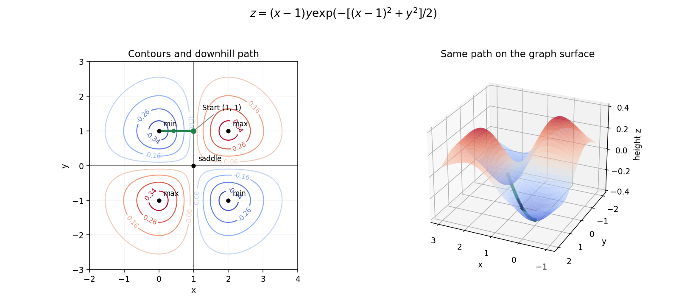

<h1 id="13/a/iii/solution">Solution</h1>

↑ **Parent:** [Iii](../iii.md)

The zero [level set](../../../../../../level-set.md) consists of the lines $x=1$ and $y=0$. The height is positive where $(x-1)y>0$ and negative where that product is negative. In each of the four resulting regions, closed nonzero [contours](../../../../../../complex-integration-contour.md) surround its extremum; levels closer to zero extend further from the extremum towards the zero-level axes and towards large distance. The height tends to zero at infinity. The figure marks the four extrema and central [saddle point](../../../../../../saddle-point.md), and includes the downhill path used below.

**[Figure 2](#13/a/iii/image-contours-stationary-points-and-the-steepest-downhill-path-on-the-gaussian-weighted-surface). Contours, stationary points and the steepest downhill path on the Gaussian-weighted surface**.

## ↑ Ancestors (14)

1. [Iii](../iii.md)
2. [A](../../a.md)
3. [13](../../../13.md)
4. [Paper 2](../../../../paper-2-split.md)
5. [2009](../../../../split.md)
6. [Past exam of the mathematics course of the year 1 of the natural sciences course of the University of Cambridge](../../../../../split.md)
7. [Mathematics course of the year 1 of the natural sciences course of the University of Cambridge](../../../../../../mathematics-course-of-the-year-1-of-the-natural-sciences-course-of-the-university-of-cambridge.md)
8. [Year 1 of the natural sciences course of the University of Cambridge](../../../../../../year-1-of-the-natural-sciences-course-of-the-university-of-cambridge.md)
9. [Year of the natural sciences course of the University of Cambridge](../../../../../../year-of-the-natural-sciences-course-of-the-university-of-cambridge.md)
10. [Natural sciences course of the University of Cambridge](../../../../../../natural-sciences-course-of-the-university-of-cambridge.md)
11. [Course of the University of Cambridge](../../../../../../course-of-the-university-of-cambridge.md)
12. [University of Cambridge](../../../../../../university-of-cambridge-split.md)
13. [List of universities](../../../../../../list-of-universities.md)
14. [Codex Wiki](../../../../../../split.md)
