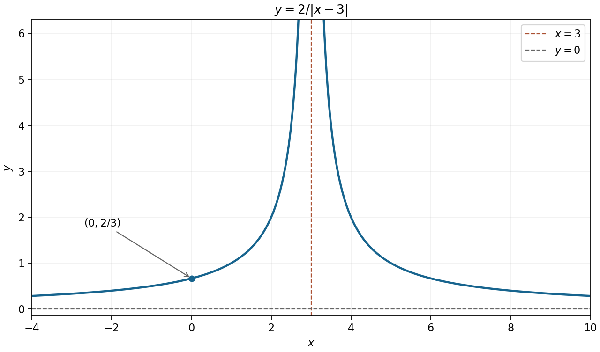

# Paper 1

↑ **Parent:** [2010](../2010.md)

[https://www.maths.cam.ac.uk/undergradnst/files/2010/PaperNST_IA_1.pdf](https://www.maths.cam.ac.uk/undergradnst/files/2010/PaperNST_IA_1.pdf)

**Table of contents**

- [1](#1)
  - [Solution](#1/solution)
- [2](#2)
  - [a](#2/a)
    - [Solution](#2/a/solution)
  - [b](#2/b)
    - [Solution](#2/b/solution)
- [3](#3)
  - [a](#3/a)
    - [Solution](#3/a/solution)
  - [b](#3/b)
    - [Solution](#3/b/solution)
- [4](#4)
  - [Solution](#4/solution)
- [5](#5)
  - [Solution](#5/solution)
- [6](#6)
  - [Solution](#6/solution)
- [7](#7)
  - [a](#7/a)
    - [Solution](#7/a/solution)
  - [b](#7/b)
    - [Solution](#7/b/solution)
- [8](#8)
  - [a](#8/a)
    - [Solution](#8/a/solution)
  - [b](#8/b)
    - [Solution](#8/b/solution)
- [9](#9)
  - [Solution](#9/solution)
- [10](#10)
  - [Solution](#10/solution)
- [11](#11)
  - [Solution](#11/solution)
  - [a](#11/a)
    - [Solution](#11/a/solution)
  - [b](#11/b)
    - [i](#11/b/i)
      - [Solution](#11/b/i/solution)
    - [ii](#11/b/ii)
      - [Solution](#11/b/ii/solution)
- [12](#12)
  - [a](#12/a)
    - [Solution](#12/a/solution)
  - [b](#12/b)
    - [Solution](#12/b/solution)
  - [c](#12/c)
    - [Solution](#12/c/solution)
  - [d](#12/d)
    - [Solution](#12/d/solution)
  - [e](#12/e)
    - [Solution](#12/e/solution)
  - [f](#12/f)
    - [Solution](#12/f/solution)
- [13](#13)
  - [a](#13/a)
    - [i](#13/a/i)
      - [Solution](#13/a/i/solution)
    - [ii](#13/a/ii)
      - [Solution](#13/a/ii/solution)
  - [b](#13/b)
    - [i](#13/b/i)
      - [Solution](#13/b/i/solution)
    - [ii](#13/b/ii)
      - [Solution](#13/b/ii/solution)
- [14](#14)
  - [a](#14/a)
    - [i](#14/a/i)
      - [Solution](#14/a/i/solution)
    - [ii](#14/a/ii)
      - [Solution](#14/a/ii/solution)
    - [iii](#14/a/iii)
      - [Solution](#14/a/iii/solution)
    - [iv](#14/a/iv)
      - [Solution](#14/a/iv/solution)
  - [b](#14/b)
    - [Solution](#14/b/solution)
- [15](#15)
  - [a](#15/a)
    - [Solution](#15/a/solution)
  - [b](#15/b)
    - [Solution](#15/b/solution)
- [16](#16)
  - [a](#16/a)
    - [Solution](#16/a/solution)
  - [b](#16/b)
    - [Solution](#16/b/solution)
  - [c](#16/c)
    - [Solution](#16/c/solution)
  - [d](#16/d)
    - [Solution](#16/d/solution)
- [17](#17)
  - [a](#17/a)
    - [Solution](#17/a/solution)
  - [b](#17/b)
    - [Solution](#17/b/solution)
  - [c](#17/c)
    - [Solution](#17/c/solution)
- [18](#18)
  - [a](#18/a)
    - [i](#18/a/i)
      - [Solution](#18/a/i/solution)
    - [ii](#18/a/ii)
      - [Solution](#18/a/ii/solution)
  - [b](#18/b)
    - [Solution](#18/b/solution)
- [19](#19)
  - [a](#19/a)
    - [Solution](#19/a/solution)
  - [b](#19/b)
    - [Solution](#19/b/solution)
  - [c](#19/c)
    - [Solution](#19/c/solution)
- [20](#20)
  - [a](#20/a)
    - [i](#20/a/i)
      - [Solution](#20/a/i/solution)
    - [ii](#20/a/ii)
      - [Solution](#20/a/ii/solution)
  - [b](#20/b)
    - [Solution](#20/b/solution)
  - [c](#20/c)
    - [i](#20/c/i)
      - [Solution](#20/c/i/solution)
    - [ii](#20/c/ii)
      - [Solution](#20/c/ii/solution)

## 1

↑ **Parent:** [Paper 1](paper-1.md)

<h3 id="1/solution">Solution</h3>

↑ **Parent:** [1](#1)

The known root gives a factor $x-1$ by the [factor theorem](../../polynomial.md#factor-theorem). [Polynomial division](../../polynomial.md#polynomial-division) leaves $2x^2-7x+6=(2x-3)(x-2)$, so

$$
2x^3-9x^2+13x-6=(x-1)(2x-3)(x-2).
$$

Consequently all the roots are

$$
\boxed{x=1,\quad x=\frac32,\quad x=2.}
$$

The three linear factors account for the full degree of the [polynomial](../../polynomial.md), so there are no further complex roots.

## 2

↑ **Parent:** [Paper 1](paper-1.md)

<h3 id="2/a">a</h3>

↑ **Parent:** [2](#2)

<h4 id="2/a/solution">Solution</h4>

↑ **Parent:** [A](#2/a)

Apply the [chain rule](../../calculus.md#chain-rule) to the exponential, differentiating its exponent $-x^2$:

$$
\boxed{\frac d{dx}e^{-x^2}=-2xe^{-x^2}.}
$$

<h3 id="2/b">b</h3>

↑ **Parent:** [2](#2)

<h4 id="2/b/solution">Solution</h4>

↑ **Parent:** [B](#2/b)

The [derivative](../../calculus.md#derivative) of the [hyperbolic sine](../../calculus.md#hyperbolic-sine) is the [hyperbolic cosine](../../calculus.md#hyperbolic-cosine). Hence the [chain rule](../../calculus.md#chain-rule) gives

$$
\boxed{\frac d{dx}\sinh^2x=2\sinh x\cosh x=\sinh2x.}
$$

## 3

↑ **Parent:** [Paper 1](paper-1.md)

<h3 id="3/a">a</h3>

↑ **Parent:** [3](#3)

<h4 id="3/a/solution">Solution</h4>

↑ **Parent:** [A](#3/a)

For $x>0$, use [integration by parts](../../calculus.md#integration-by-parts) with $u=\ln x$ and $dv=dx$. Then

$$
\boxed{\int\ln x\,dx=x\ln x-\int1\,dx=x\ln x-x+C.}
$$

Differentiating the answer checks cancellation of the extra constant term from $(x\ln x)'$.

<h3 id="3/b">b</h3>

↑ **Parent:** [3](#3)

<h4 id="3/b/solution">Solution</h4>

↑ **Parent:** [B](#3/b)

The [Gaussian function](../../calculus.md#gaussian-function) $e^{-x^2}$ is even and $\sin x$ is odd, so their product is an [odd function](../../calculus.md#odd-function). Moreover $|e^{-x^2}\sin x|\leq e^{-x^2}$, whose integral on the real [line](../../euclidean-geometry.md#straight-line) is finite. Thus the [improper integral](../../real-analysis.md#improper-integral) is absolutely convergent, not merely a symmetric principal value, and the contributions of its two half-lines cancel:

$$
\boxed{\int_{-\infty}^{\infty}e^{-x^2}\sin x\,dx=0.}
$$

## 4

↑ **Parent:** [Paper 1](paper-1.md)

<h3 id="4/solution">Solution</h3>

↑ **Parent:** [4](#4)

For the [parametric curve](../../topology.md#parametric-curve), $dx/dt=e^t\ne0$ and $dy/dt=\cos t$. Therefore $dy/dx=e^{-t}\cos t$. The condition $x=e^t=1$ gives $t=0$, so

$$
\boxed{\left.\frac{dy}{dx}\right|_{x=1}=1.}
$$

## 5

↑ **Parent:** [Paper 1](paper-1.md)

<h3 id="5/solution">Solution</h3>

↑ **Parent:** [5](#5)

Use [completing the square](../../polynomial.md#completing-the-square) in each coordinate:

$$
(x-3)^2-9+(y-1)^2-1+1=0,
\qquad (x-3)^2+(y-1)^2=9.
$$

Comparing with the standard [circle](../../topology.md#circle) equation gives

$$
\boxed{\text{centre }(3,1),\qquad\text{radius }3.}
$$

## 6

↑ **Parent:** [Paper 1](paper-1.md)

<h3 id="6/solution">Solution</h3>

↑ **Parent:** [6](#6)

Let the contact point have positive horizontal coordinate $x_0$. Equality of slopes between the [tangent line](../../calculus.md#tangent-line) and the logarithmic [curve](../../topology.md#curve) requires $k=1/x_0$. The point must also satisfy both equations, giving $\ln x_0=kx_0+1=2$. Hence

$$
\boxed{x_0=e^2,\qquad k=e^{-2}.}
$$

The contact point is $(e^2,2)$, and the resulting [line](../../euclidean-geometry.md#straight-line) $y=e^{-2}x+1$ has exactly the required [derivative](../../calculus.md#derivative) there.

## 7

↑ **Parent:** [Paper 1](paper-1.md)

<h3 id="7/a">a</h3>

↑ **Parent:** [7](#7)

<h4 id="7/a/solution">Solution</h4>

↑ **Parent:** [A](#7/a)

This [geometric series](../../sequence-and-series.md#geometric-series) has first term $1$ and ratio $0.999$, which lies strictly inside the unit [interval](../../real-analysis.md#interval-mathematics). Therefore

$$
\boxed{\sum_{n=0}^{\infty}(0.999)^n=\frac1{1-0.999}=1000.}
$$

The decimal is treated as the exact value $999/1000$.

<h3 id="7/b">b</h3>

↑ **Parent:** [7](#7)

<h4 id="7/b/solution">Solution</h4>

↑ **Parent:** [B](#7/b)

There are $N+1$ terms, namely $1,2,\ldots,N+1$. The [arithmetic series](../../arithmetic.md#arithmetic-series) formula gives

$$
\boxed{\sum_{n=0}^{N}(n+1)=\frac{(N+1)(N+2)}2,\qquad N\in\mathbb Z_{\geq0}.}
$$

Pairing the first and last terms gives pair sum $N+2$, explaining both factors.

## 8

↑ **Parent:** [Paper 1](paper-1.md)

<h3 id="8/a">a</h3>

↑ **Parent:** [8](#8)

<h4 id="8/a/solution">Solution</h4>

↑ **Parent:** [A](#8/a)

The [domain of a function](../../function.md#domain-of-a-function) excludes $x=3$. Both branches are positive, with a vertical [asymptote](../../topology.md#asymptote) at $x=3$ approached from both sides with value $+\infty$, and horizontal [asymptote](../../topology.md#asymptote) $y=0$ at either infinity. The graph is symmetric about $x=3$ because it depends only on $|x-3|$.

For $x<3$, the formula is $2/(3-x)$ and the [derivative](../../calculus.md#derivative) is positive; for $x>3$, it is $2/(x-3)$ and the [derivative](../../calculus.md#derivative) is negative. It passes through $(0,2/3)$ and has no zeros.

**[Figure 1](#8/a/image-the-two-positive-reciprocal-distance-branches-and-their-vertical-and-horizontal-asymptotes). The two positive reciprocal-distance branches and their vertical and horizontal asymptotes**.

<h3 id="8/b">b</h3>

↑ **Parent:** [8](#8)

<h4 id="8/b/solution">Solution</h4>

↑ **Parent:** [B](#8/b)

The [sine addition formula](../../geometry-and-topology.md#sine-addition-formula) gives $(\sin x+\cos x)/\sqrt2=\sin(x+\pi/4)$. On the requested [interval](../../real-analysis.md#interval-mathematics) the shifted angle runs from $0$ to $\pi/2$, so the graph rises from $(-\pi/4,0)$ through $(0,1/\sqrt2)$ to $(\pi/4,1)$.

Its [derivative](../../calculus.md#derivative) $\cos(x+\pi/4)$ is nonnegative and reaches zero only at the right endpoint. Its second [derivative](../../calculus.md#derivative) is $-\sin(x+\pi/4)\leq0$, so the rising arc is concave downward and ends with a horizontal tangent.

**[Figure 2](#8/b/image-a-rising-concave-down-quarter-sine-wave-on-the-specified-interval). A rising concave-down quarter sine wave on the specified interval**.

## 9

↑ **Parent:** [Paper 1](paper-1.md)

<h3 id="9/solution">Solution</h3>

↑ **Parent:** [9](#9)

Isolate the [square root](../../algebra.md#square-root): $\sqrt{2x^2+17}=3-x$. Its right side must be nonnegative, so retain the condition $x\leq3$ before squaring. Squaring then gives

$$
2x^2+17=(3-x)^2,\qquad x^2+6x+8=(x+2)(x+4)=0.
$$

Both candidates pass the original equation: $\sqrt{25}-2=3$ and $\sqrt{49}-4=3$. Thus

$$
\boxed{x=-2,\quad x=-4.}
$$

The substitution check excludes the possibility of extraneous roots introduced by squaring.

## 10

↑ **Parent:** [Paper 1](paper-1.md)

<h3 id="10/solution">Solution</h3>

↑ **Parent:** [10](#10)

Use $2\cos^2x=1+\cos2x$ to reduce the equation to $\sin2x=\cos2x$. Equivalently, $\sqrt2\sin(2x-\pi/4)=0$, so $x=\pi/8+k\pi/2$ for an integer $k$. Restricting to $[0,\pi]$ gives

$$
\boxed{x=\frac\pi8,\qquad x=\frac{5\pi}{8}.}
$$

## 11

↑ **Parent:** [Paper 1](paper-1.md)

<h3 id="11/solution">Solution</h3>

↑ **Parent:** [11](#11)

The first four terms form the cubic [Taylor polynomial](../../calculus.md#taylor-polynomial) about $x_0$:

$$
\boxed{f(x_0)+f'(x_0)(x-x_0)+\frac{f''(x_0)}{2!}(x-x_0)^2
+\frac{f^{(3)}(x_0)}{3!}(x-x_0)^3.}
$$

With a continuous fourth [derivative](../../calculus.md#derivative) nearby, [Taylor's theorem](../../calculus.md#taylor-s-theorem) gives a remainder $O((x-x_0)^4)$. Continuous [derivatives](../../calculus.md#derivative) through third order suffice for the weaker remainder $o((x-x_0)^3)$. These are local approximations; equality with an infinite [Taylor series](../../calculus.md#taylor-series) requires additional convergence information.

<h3 id="11/a">a</h3>

↑ **Parent:** [11](#11)

<h4 id="11/a/solution">Solution</h4>

↑ **Parent:** [A](#11/a)

For $f(x)=x^{1/4}$, the first two [derivatives](../../calculus.md#derivative) are $f'(x)=\tfrac14x^{-3/4}$ and $f''(x)=-\tfrac3{16}x^{-7/4}$. At $16$ they give

$$
f(16)=2,\qquad f'(16)=\frac1{32},\qquad f''(16)=-\frac3{2048}.
$$

Use the first three [Taylor expansion](../../calculus.md#taylor-expansion) terms with increment $17-16=1$:

$$
\boxed{17^{1/4}\approx2+\frac1{32}-\frac3{4096}=2.030517578125.}
$$

The positive third [derivative](../../calculus.md#derivative) shows that this quadratic approximation underestimates the true value. The [Taylor remainder](../../calculus.md#taylor-remainder) is at most $7/262144\approx2.67\times10^{-5}$, since $f^{(3)}(x)=(21/64)x^{-11/4}$ decreases on $[16,17]$ and the cubic remainder is $f^{(3)}(\xi)/6$.

<h3 id="11/b">b</h3>

↑ **Parent:** [11](#11)

<h4 id="11/b/i">i</h4>

↑ **Parent:** [B](#11/b)

<h5 id="11/b/i/solution">Solution</h5>

↑ **Parent:** [I](#11/b/i)

Multiply the [Maclaurin series](../../calculus.md#maclaurin-series) for the exponential and the [sine](../../geometry-and-topology.md#sine), keeping terms through degree three:

$$
e^x\sin x=\left(1+x+\frac{x^2}{2}+\frac{x^3}{6}+O(x^4)\right)
\left(x-\frac{x^3}{6}+O(x^5)\right).
$$

Only $x$, $x^2$, and $(1/2-1/6)x^3$ contribute at these orders, so

$$
\boxed{e^x\sin x=x+x^2+\frac{x^3}{3}+O(x^4).}
$$

<h4 id="11/b/ii">ii</h4>

↑ **Parent:** [B](#11/b)

<h5 id="11/b/ii/solution">Solution</h5>

↑ **Parent:** [Ii](#11/b/ii)

Put $v=x+x^2$ in the [logarithmic series](../../calculus.md#mercator-series) $\ln(1+v)=v-v^2/2+v^3/3+O(v^4)$. Since $v^2=x^2+2x^3+O(x^4)$ and $v^3=x^3+O(x^4)$,

$$
\ln(1+x+x^2)=x+x^2-\frac12(x^2+2x^3)+\frac13x^3+O(x^4).
$$

Therefore

$$
\boxed{\ln(1+x+x^2)=x+\frac{x^2}{2}-\frac{2x^3}{3}+O(x^4).}
$$

## 12

↑ **Parent:** [Paper 1](paper-1.md)

<h3 id="12/a">a</h3>

↑ **Parent:** [12](#12)

<h4 id="12/a/solution">Solution</h4>

↑ **Parent:** [A](#12/a)

Use independent choices with constant [probabilities](../../probability-theory.md#probability) $p$ and $q=1-p$. Completing the entire reverse circuit while the forward-moving object never moves requires the first $F$ choices all to be reverse moves. Thus

$$
\boxed{P=q^F=(1-p)^F.}
$$

Here and below, a zero-length product is interpreted as one, including at $p=0$ or $p=1$.

<h3 id="12/b">b</h3>

↑ **Parent:** [12](#12)

<h4 id="12/b/solution">Solution</h4>

↑ **Parent:** [B](#12/b)

After $j$ choices, let $C_j$ be the number of forward moves. The two unwrapped positions are $C_j$ and $F-(j-C_j)$, whose gap is $F-j$. It follows that the first subsequent meeting occurs exactly at step $F$, regardless of the order of the choices. Its [position](../../classical-mechanics.md#position) is the number of forward moves in that block.

That count has a [binomial distribution](../../discrete-probability-distribution.md#binomial-distribution) with parameters $F,p$. Therefore

$$
\boxed{p_n^{\rm meet}=\binom Fn p^nq^{F-n},\qquad 0\leq n\leq F.}
$$

The two endpoint labels $0$ and $F$ represent the same physical seat reached by different complete circuits; the unwrapped convention distinguishes their [probabilities](../../probability-theory.md#probability).

<h3 id="12/c">c</h3>

↑ **Parent:** [12](#12)

<h4 id="12/c/solution">Solution</h4>

↑ **Parent:** [C](#12/c)

The meeting [position](../../classical-mechanics.md#position) $N$ is the sum of $F$ independent [Bernoulli random variables](../../discrete-probability-distribution.md#bernoulli-distribution), each of [mean](../../expected-value.md) $p$ and [variance](../../variance.md) $pq$. [Linearity of expectation](../../expected-value.md#linearity-of-expectation) and [variance additivity for independent random variables](../../variance.md#variance-additivity-for-independent-random-variables) give

$$
\boxed{\mu=Fp,\qquad\sigma^2=Fpq.}
$$

These are the [mean](../../expected-value.md) and [variance](../../variance.md) of the unwrapped integer label specified in the question, rather than circular angular statistics.

<h3 id="12/d">d</h3>

↑ **Parent:** [12](#12)

<h4 id="12/d/solution">Solution</h4>

↑ **Parent:** [D](#12/d)

For the forward-moving object to have been waiting at the meeting [position](../../classical-mechanics.md#position), the last move must be a reverse move. The preceding $F-1$ choices must then contain exactly $n$ forward moves and $F-n-1$ reverse moves. Choosing their order gives

$$
\boxed{p_n^{\rm specialMeet}=\binom{F-1}{n}p^nq^{F-n},\qquad 0\leq n\leq F-1.}
$$

At $n=F$ the [probability](../../probability-theory.md#probability) is **zero**, since the reverse-moving object was already at that unwrapped [position](../../classical-mechanics.md#position) initially. At $n=0$ the displayed formula is $q^F$, consistent with the forward object waiting at its initial [position](../../classical-mechanics.md#position) throughout. Equivalently, use the binomial convention $\binom{F-1}{F}=0$ to include this endpoint in the same formula without a negative power of $q$.

<h3 id="12/e">e</h3>

↑ **Parent:** [12](#12)

<h4 id="12/e/solution">Solution</h4>

↑ **Parent:** [E](#12/e)

Let $N$ be the meeting label. If $N>n$, the forward-moving object has already crossed $n$ while the reverse-moving object has not yet reached it, so the forward object wins the race to $n$. If $N<n$, the reverse object passed $n$ first. If $N=n$, the required event is exactly the special meeting from part (d).

These disjoint possibilities give

$$
\boxed{P(\text{forward object reaches }n\text{ first})
=p_n^{\rm specialMeet}+\sum_{k=n+1}^{F}p_k^{\rm meet}.}
$$

This includes the endpoints: for $n=0$ the [probability](../../probability-theory.md#probability) is $1$, and for $n=F$ it is $0$, with the initial positions understood in the unwrapped convention.

**[Figure 3](#12/e/image-example-paths-in-a-race-between-fixed-success-and-failure-targets). Example paths in a race between fixed success and failure targets**.

<h3 id="12/f">f</h3>

↑ **Parent:** [12](#12)

<h4 id="12/f/solution">Solution</h4>

↑ **Parent:** [F](#12/f)

First take $1\leq n\leq F-1$. The forward object reaches $n$ at its $n$th move, while the reverse object reaches that label at its $(F-n)$th move. If the forward object wins after $k$ reverse moves, then $0\leq k\leq F-n-1$. The final choice is forward; among the preceding $n+k-1$ choices, exactly $k$ are reverse. By the [negative binomial stopping argument](../../discrete-probability-distribution.md#negative-binomial-stopping-argument), this case has [probability](../../probability-theory.md#probability) $\binom{n-1+k}{k}p^nq^k$.

Sum these mutually exclusive cases and equate the result to part (e), using parts (b) and (d). This proves the [success-failure stopping identity](../../discrete-probability-distribution.md#success-failure-stopping-identity) here:

$$
\sum_{k=0}^{F-n-1}\binom{n-1+k}{k}p^nq^k
=\binom{F-1}{n}p^nq^{F-n}
+\sum_{k=n+1}^{F}\binom Fk p^kq^{F-k}.
$$

The right side splits the same race into a special meeting at $n$ and all meetings beyond $n$; the left side splits it according to the number of reverse moves at the winning time.

At $n=F$, both sides are zero with an [empty sum](../../arithmetic.md#empty-sum) and $\binom{F-1}{F}=0$. At $n=0$, the event has [probability](../../probability-theory.md#probability) one; the right side equals $\sum_{k=0}^{F}\binom Fk p^kq^{F-k}=1$. The printed left side includes $\binom{-1}{0}$ and is outside the usual nonnegative-upper-index combinatorial definition. With the explicit generalized convention **$\binom{-1}{0}=1$**, its $k=0$ term is one and all $k\geq1$ terms vanish, so the identity also holds at that endpoint. Without this convention the displayed sum is undefined there; the zero-target race must instead be stated separately. All identities extend to $p=0,1$ by their [polynomial](../../polynomial.md) forms.

## 13

↑ **Parent:** [Paper 1](paper-1.md)

<h3 id="13/a">a</h3>

↑ **Parent:** [13](#13)

<h4 id="13/a/i">i</h4>

↑ **Parent:** [A](#13/a)

<h5 id="13/a/i/solution">Solution</h5>

↑ **Parent:** [I](#13/a/i)

Compute the [characteristic polynomial](../../linear-operator-theory.md#characteristic-polynomial) using $\det(\lambda I-M)$:

$$
\det(\lambda I-M)=\lambda^3-7\lambda^2+6
=(\lambda-1)(\lambda^2-6\lambda-6).
$$

Its three distinct real roots are $1$ and $3\pm\sqrt{15}$. For $\lambda=1$, the first row of $(M-I)v=0$ gives $z=3y$ and the second then gives $x=y$, so take $v_1=(1,1,3)^T$.

For either root of $\lambda^2-6\lambda-6=0$, take $z=1$ and solve the row equations to get $v=(\lambda-8,5-\lambda,1)^T$. Substitution makes the first two row residuals opposite multiples of the quadratic equation and the third zero. Thus a complete choice is

$$
\boxed{\begin{aligned}
\lambda_1&=1,&v_1&=(1,1,3)^T,\\
\lambda_-&=3-\sqrt{15},&v_-&=(-5-\sqrt{15},\ 2+\sqrt{15},\ 1)^T,\\
\lambda_+&=3+\sqrt{15},&v_+&=(-5+\sqrt{15},\ 2-\sqrt{15},\ 1)^T.
\end{aligned}}
$$

Every nonzero [scalar](../../vector-space.md#scalar) multiple is another valid [eigenvector](../../linear-operator-theory.md#eigenvector) in the corresponding one-dimensional [eigenspace](../../linear-operator-theory.md#eigenspace).

<h4 id="13/a/ii">ii</h4>

↑ **Parent:** [A](#13/a)

<h5 id="13/a/ii/solution">Solution</h5>

↑ **Parent:** [Ii](#13/a/ii)

For either sign, the [dot product](../../inner-product.md#dot-product) with $v_1$ is

$$
v_1\cdot v_\pm=(-5\pm\sqrt{15})+(2\mp\sqrt{15})+3=0.
$$

The remaining pair also satisfies

$$
v_+\cdot v_-=(25-15)+(4-15)+1=\boxed{0}.
$$

Hence the three [eigenvectors](../../linear-operator-theory.md#eigenvector) are mutually [orthogonal](../../inner-product.md#orthogonal-vectors). This also follows from the [spectral theorem for real symmetric matrices](../../linear-algebra.md#spectral-theorem-for-real-symmetric-matrices), since $M=M^T$ and its [eigenvalues](../../linear-operator-theory.md#eigenvalue) are distinct, but the displayed products verify the actual chosen [vectors](../../vector-space.md#vector) directly.

<h3 id="13/b">b</h3>

↑ **Parent:** [13](#13)

<h4 id="13/b/i">i</h4>

↑ **Parent:** [B](#13/b)

<h5 id="13/b/i/solution">Solution</h5>

↑ **Parent:** [I](#13/b/i)

Write the [linear system](../../linear-algebra.md#system-of-linear-equations) as $Ar=d$ with

$$
A=\begin{pmatrix}1&2&3\\3&4&5\\1&3&4\end{pmatrix},\qquad
r=\begin{pmatrix}x\\y\\z\end{pmatrix},\qquad
d=\begin{pmatrix}1\\2\\3\end{pmatrix}.
$$

Expansion along the first row gives $\det A=(16-15)-2(12-5)+3(9-4)=2$. Since **$\det A=2\ne0$**, $A$ is an [invertible matrix](../../linear-algebra.md#invertible-matrix), and $r=A^{-1}d$ is the unique solution for this right side.

<h4 id="13/b/ii">ii</h4>

↑ **Parent:** [B](#13/b)

<h5 id="13/b/ii/solution">Solution</h5>

↑ **Parent:** [Ii](#13/b/ii)

The [adjugate matrix](../../linear-algebra.md#adjugate-matrix) formula gives

$$
A^{-1}=\frac12\begin{pmatrix}1&1&-2\\-7&1&4\\5&-1&-2\end{pmatrix}.
$$

Multiplication by the right-side column yields

$$
r=A^{-1}d=\frac12\begin{pmatrix}1+2-6\\-7+2+12\\5-2-6\end{pmatrix},
\qquad\boxed{(x,y,z)=\left(-\frac32,\frac72,-\frac32\right).}
$$

Multiplying the inverse by $A$ checks the [identity matrix](../../vector-space.md#identity-matrix), and substitution of this solution into the three original rows gives $1,2,3$ respectively.

## 14

↑ **Parent:** [Paper 1](paper-1.md)

<h3 id="14/a">a</h3>

↑ **Parent:** [14](#14)

<h4 id="14/a/i">i</h4>

↑ **Parent:** [A](#14/a)

<h5 id="14/a/i/solution">Solution</h5>

↑ **Parent:** [I](#14/a/i)

Multiply by the [complex conjugate](../../complex-analysis.md#complex-conjugate) of the denominator:

$$
\frac{2+3i}{3+2i}=\frac{(2+3i)(3-2i)}{13}=\frac{12+5i}{13}.
$$

Thus

$$
\boxed{\Re z=\frac{12}{13},\qquad\Im z=\frac5{13}.}
$$

<h4 id="14/a/ii">ii</h4>

↑ **Parent:** [A](#14/a)

<h5 id="14/a/ii/solution">Solution</h5>

↑ **Parent:** [Ii](#14/a/ii)

The logarithm's argument is $\sqrt3/2+i/2=e^{i\pi/6}$, with [complex modulus](../../complex-analysis.md#complex-modulus) one. The principal [complex logarithm](../../analysis.md#complex-logarithm) is therefore $\ln1+i\pi/6=i\pi/6$, giving

$$
\boxed{\Re\operatorname{Log}z=0,\qquad\Im\operatorname{Log}z=\frac\pi6.}
$$

If $\ln z$ denotes all logarithm values rather than the principal branch, they are $i(\pi/6+2\pi k)$ for $k\in\mathbb Z$: the [real part](../../complex-analysis.md#real-part) remains zero and the [imaginary part](../../complex-analysis.md#imaginary-part) changes by integer multiples of $2\pi$. The principal value is the conventional single-valued answer.

<h4 id="14/a/iii">iii</h4>

↑ **Parent:** [A](#14/a)

<h5 id="14/a/iii/solution">Solution</h5>

↑ **Parent:** [Iii](#14/a/iii)

Integer powers of $i$ repeat with [period](../../mathematics.md#period-of-a-function) four. Thus $i^{-5}=i^{-4}i^{-1}=1/i=-i$, and

$$
\boxed{\Re z=0,\qquad\Im z=-1.}
$$

This negative integer power is single-valued and does not require a logarithm branch.

<h4 id="14/a/iv">iv</h4>

↑ **Parent:** [A](#14/a)

<h5 id="14/a/iv/solution">Solution</h5>

↑ **Parent:** [Iv](#14/a/iv)

The number being squared has [polar form of a complex number](../../complex-analysis.md#polar-form-of-a-complex-number) $e^{2\pi i/3}$. Squaring doubles its argument, giving $e^{4\pi i/3}=-1/2-i\sqrt3/2$. Hence

$$
\boxed{\Re z=-\frac12,\qquad\Im z=-\frac{\sqrt3}{2}.}
$$

<h3 id="14/b">b</h3>

↑ **Parent:** [14](#14)

<h4 id="14/b/solution">Solution</h4>

↑ **Parent:** [B](#14/b)

Rearrange to $z^4=1+i\sqrt3=2e^{i\pi/3}$. A fourth root has modulus $2^{1/4}$ and an argument one quarter of $\pi/3+2\pi k$. Therefore all four solutions are

$$
\boxed{z_k=2^{1/4}e^{i(\pi/12+k\pi/2)},\qquad k=0,1,2,3.}
$$

Their arguments differ by $\pi/2$, so they are distinct. Raising any of them to the fourth power returns $1+i\sqrt3$.

## 15

↑ **Parent:** [Paper 1](paper-1.md)

<h3 id="15/a">a</h3>

↑ **Parent:** [15](#15)

<h4 id="15/a/solution">Solution</h4>

↑ **Parent:** [A](#15/a)

Put $d=b\cdot x$ and $B=|b|^2$. Taking the [dot product](../../inner-product.md#dot-product) of the original equation with $b$ eliminates $b\times x$ and gives $d=a\cdot b-Bd$. Thus

$$
\boxed{b\cdot x=\frac{a\cdot b}{1+|b|^2}.}
$$

Next take its [cross product](../../vector-space.md#cross-product) with $b$. The term $d b$ disappears, and the [vector triple product identity](../../multivariable-calculus.md#vector-triple-product) gives

$$
b\times x=b\times a-b\times(b\times x)
=b\times a-bd+Bx.
$$

Insert this expression back into $x=a-db-b\times x$. The two longitudinal terms cancel, leaving $(1+B)x=a-b\times a$. Consequently

$$
\boxed{x=\frac{a-b\times a}{1+|b|^2}=\frac{a+a\times b}{1+|b|^2}.}
$$

The denominator is strictly positive for every real $b$, including $b=0$. Substitution using the same triple-product identity verifies the solution and establishes uniqueness. This is the [cross-product operator with a longitudinal rank-one term](../../vector-space.md#cross-product-operator-with-a-longitudinal-rank-one-term).

<h3 id="15/b">b</h3>

↑ **Parent:** [15](#15)

<h4 id="15/b/solution">Solution</h4>

↑ **Parent:** [B](#15/b)

Let $d=b\cdot x$. Taking a [dot product](../../inner-product.md#dot-product) with $b$ reduces the [vector](../../vector-space.md#vector) equation to $(1-b\cdot c)d=b\cdot a$. If $b\cdot c\ne1$, this determines a unique [scalar](../../vector-space.md#scalar) and hence a unique [vector](../../vector-space.md#vector):

$$
\boxed{x=a+\frac{b\cdot a}{1-b\cdot c}\,c.}
$$

Direct substitution verifies it, so necessity has also produced sufficiency. The formula includes $c=0$, when $x=a$.

If $b\cdot c=1$, the reduced [scalar](../../vector-space.md#scalar) equation becomes $0=b\cdot a$. When $b\cdot a\ne0$, **there is no solution**. When $b\cdot a=0$, **all solutions are $x=a+dc$ with arbitrary $d\in\mathbb R$**: their [dot product](../../inner-product.md#dot-product) with $b$ is indeed $d$. Since $b\cdot c=1$ forces $c\ne0$, this is an entire affine [line](../../euclidean-geometry.md#straight-line), not a single point. These alternatives are the [solvability of an affine rank-one vector equation](../../matrix-inverse.md#solvability-of-an-affine-rank-one-vector-equation).

## 16

↑ **Parent:** [Paper 1](paper-1.md)

<h3 id="16/a">a</h3>

↑ **Parent:** [16](#16)

<h4 id="16/a/solution">Solution</h4>

↑ **Parent:** [A](#16/a)

In the integral for $B(q,p)$, put $u=1-x$, so $dx=-du$ and the endpoints are interchanged. Then

$$
B(q,p)=\int_1^0(1-u)^{q-1}u^{p-1}(-du)
=\int_0^1u^{p-1}(1-u)^{q-1}du=\boxed{B(p,q)}.
$$

Thus exchanging the positive parameters leaves the [Euler beta function](../../complex-analysis.md#beta-function) unchanged. Positivity ensures convergence at both endpoints of this improper integral.

<h3 id="16/b">b</h3>

↑ **Parent:** [16](#16)

<h4 id="16/b/solution">Solution</h4>

↑ **Parent:** [B](#16/b)

The increasing substitution $x=\sin^2\theta$ maps $0\leq\theta\leq\pi/2$ onto $0\leq x\leq1$, with $dx=2\sin\theta\cos\theta\,d\theta$. Since [sine](../../geometry-and-topology.md#sine) and [cosine](../../geometry-and-topology.md#cosine) are nonnegative there, powers combine without a sign ambiguity:

$$
\boxed{B(p,q)=2\int_0^{\pi/2}\sin^{2p-1}\theta\cos^{2q-1}\theta\,d\theta.}
$$

This is the [trigonometric form of the beta function](../../complex-analysis.md#trigonometric-form-of-the-beta-function). The powers at the endpoints are integrable because $p,q>0$.

<h3 id="16/c">c</h3>

↑ **Parent:** [16](#16)

<h4 id="16/c/solution">Solution</h4>

↑ **Parent:** [C](#16/c)

Write $B(n,n)=\int_0^1[x(1-x)]^{n-1}dx$ and set $v=2x-1$. Since $x(1-x)=(1-v^2)/4$ and $dx=dv/2$,

$$
B(n,n)=2^{1-2n}\int_{-1}^{1}(1-v^2)^{n-1}dv
=2^{2-2n}\int_0^1(1-v^2)^{n-1}dv.
$$

In the last integral put $u=v^2$, giving $dv=du/(2\sqrt u)$. This yields $B(n,n)=2^{1-2n}B(1/2,n)$, and part (a) interchanges the arguments. Hence

$$
\boxed{B(n,n)=\frac{B(n,1/2)}{2^{2n-1}}.}
$$

The [equal-argument beta integral](../../complex-analysis.md#equal-argument-beta-integral) identity holds for every positive real $n$, not only positive integers.

<h3 id="16/d">d</h3>

↑ **Parent:** [16](#16)

<h4 id="16/d/solution">Solution</h4>

↑ **Parent:** [D](#16/d)

Multiply the two defining [Gamma integrals](../../complex-analysis.md#gamma-integral). For $p,q>0$ the nonnegative product integrand allows [Tonelli's theorem](../../measure-theory.md#tonelli-theorem):

$$
\Gamma(p)\Gamma(q)=\int_0^\infty\int_0^\infty x^{p-1}y^{q-1}e^{-(x+y)}dx\,dy.
$$

Use $r=x+y$, $u=x/(x+y)$, so $x=ru$, $y=r(1-u)$ and the positive quadrant becomes $r>0$, $0<u<1$. The [Jacobian determinant](../../multivariable-calculus.md#jacobian-determinant) has absolute value

$$
\left|\det\begin{pmatrix}u&r\\1-u&-r\end{pmatrix}\right|=r.
$$

After including this factor, the transformed integral separates:

$$
\left[\int_0^\infty r^{p+q-1}e^{-r}dr\right]
\left[\int_0^1u^{p-1}(1-u)^{q-1}du\right]
=\Gamma(p+q)B(p,q).
$$

This proves the [beta-gamma identity](../../complex-analysis.md#beta-gamma-identity),

$$
\boxed{\Gamma(p)\Gamma(q)=B(p,q)\Gamma(p+q).}
$$

All changes of variables are made inside the open positive domains; their boundaries do not contribute to the integrals.

## 17

↑ **Parent:** [Paper 1](paper-1.md)

<h3 id="17/a">a</h3>

↑ **Parent:** [17](#17)

<h4 id="17/a/solution">Solution</h4>

↑ **Parent:** [A](#17/a)

Use the [product substitution for a first-order equation](../../differential-equation.md#product-substitution-for-a-first-order-equation) $v=xy$. The [product rule](../../calculus.md#product-rule) gives $v'=xy'+y$, turning the equation into $v'=e^v$. Consequently $(e^{-v})'=-1$, so $e^{-v}=C-x$.

At $x=1$ the initial value gives $v=1$, hence $C=1+e^{-1}$. Recovering $y=v/x$ gives

$$
\boxed{y(x)=-\frac{\ln(1+e^{-1}-x)}{x},\qquad 0<x<1+e^{-1}.}
$$

This is the maximal real graph [interval](../../real-analysis.md#interval-mathematics) containing the initial point: the logarithm requires $x<1+e^{-1}$, and the numerator has a nonzero limit at zero, so this [particular solution](../../linear-ordinary-differential-equation.md#particular-solution) cannot extend through zero. Differentiating $xy=-\ln(C-x)$ verifies $xy'+y=1/(C-x)=e^{xy}$.

<h3 id="17/b">b</h3>

↑ **Parent:** [17](#17)

<h4 id="17/b/solution">Solution</h4>

↑ **Parent:** [B](#17/b)

Away from $x=-1$ the [separable differential equation](../../differential-equation.md#separable-differential-equation) gives

$$
\frac{dy}{y}=\frac{x^2}{1+x^3}dx,\qquad
\ln|y|=\frac13\ln|1+x^3|+C.
$$

On the [interval](../../real-analysis.md#interval-mathematics) containing $x=1$, one has $x>-1$, so the positive initial value selects $y=K(1+x^3)^{1/3}$. Substitution of $y(1)=2$ gives $K=2^{2/3}$. Thus

$$
\boxed{y(x)=2^{2/3}(1+x^3)^{1/3},\qquad x>-1.}
$$

The zero solution omitted by division by $y$ cannot satisfy the initial value. Although the selected solution tends to zero as $x\downarrow-1$, its [derivative](../../calculus.md#derivative) diverges there; it does not extend through that point as a classical [differentiable](../../analysis.md#differentiable-function) solution.

<h3 id="17/c">c</h3>

↑ **Parent:** [17](#17)

<h4 id="17/c/solution">Solution</h4>

↑ **Parent:** [C](#17/c)

**Homogeneous equation.** Its [characteristic equation](../../linear-ordinary-differential-equation.md#characteristic-equation-of-a-constant-coefficient-differential-equation) is $r^2-r=r(r-1)=0$. The two independent solutions are $1$ and $e^x$, so

$$
\boxed{y_{\mathrm{hom}}(x)=C_1+C_2e^x.}
$$

**Forced equation.** A [particular solution](../../linear-ordinary-differential-equation.md#particular-solution) is $-x^2/2-x$, since its second [derivative](../../calculus.md#derivative) minus its first [derivative](../../calculus.md#derivative) equals $x$. Thus $y=C_1+C_2e^x-x^2/2-x$ and $y'=C_2e^x-x-1$. The [derivative](../../calculus.md#derivative) condition at one gives $C_2e-2=2$, so $C_2=4/e$. The value condition then gives $C_1+4-1/2-1=1$, so $C_1=-3/2$. Hence

$$
\boxed{y(x)=4e^{x-1}-\frac{x^2}{2}-x-\frac32,\qquad x\in\mathbb R.}
$$

Both [initial conditions](../../differential-equation.md#initial-condition) and the forced equation follow directly on substitution.

## 18

↑ **Parent:** [Paper 1](paper-1.md)

<h3 id="18/a">a</h3>

↑ **Parent:** [18](#18)

<h4 id="18/a/i">i</h4>

↑ **Parent:** [A](#18/a)

<h5 id="18/a/i/solution">Solution</h5>

↑ **Parent:** [I](#18/a/i)

Put $s=b^at^ax$ and write $y'$ for [differentiation](../../calculus.md#differentiation) with respect to $s$. Work on a real branch where the powers are defined and [differentiable](../../analysis.md#differentiable-function); $b>0$, $t>0$ suffices for arbitrary real $a$, and the parameter choice below has $b>0$. At fixed $x$, $\partial s/\partial t=as/t$. The [product rule](../../calculus.md#product-rule) and [chain rule](../../calculus.md#chain-rule) therefore give

$$
\boxed{\frac{\partial u}{\partial t}=at^{a-1}[y(s)+s y'(s)].}
$$

<h4 id="18/a/ii">ii</h4>

↑ **Parent:** [A](#18/a)

<h5 id="18/a/ii/solution">Solution</h5>

↑ **Parent:** [Ii](#18/a/ii)

At fixed $t$, the argument is linear in $x$, with $\partial s/\partial x=b^at^a$. Each [differentiation](../../calculus.md#differentiation) therefore contributes this same constant factor, while the outside factor $t^a$ remains unchanged. Thus

$$
\boxed{\frac{\partial^3u}{\partial x^3}=t^a(b^at^a)^3y^{(3)}(s)=b^{3a}t^{4a}y^{(3)}(s).}
$$

Here $y^{(3)}$ denotes the third [derivative](../../calculus.md#derivative) of the single-variable profile, not a partial [derivative](../../calculus.md#derivative) of $u$.

<h3 id="18/b">b</h3>

↑ **Parent:** [18](#18)

<h4 id="18/b/solution">Solution</h4>

↑ **Parent:** [B](#18/b)

Differentiate the [Airy ordinary differential equation](../../linear-ordinary-differential-equation.md#airy-ordinary-differential-equation) $y''=sy$ to obtain $y^{(3)}=y+sy'$. Combining part (a)'s [derivatives](../../calculus.md#derivative) yields

$$
u_t+u_{xxx}=[at^{a-1}+b^{3a}t^{4a}][y(s)+sy'(s)].
$$

To make this vanish for an arbitrary Airy profile, the time powers must agree: $a-1=4a$, giving $a=-1/3$. Their common [coefficient](../../vector-space.md#coefficient) must then vanish, giving $-1/3+b^{-1}=0$, hence $b=3$. Therefore

$$
\boxed{a=-\frac13,\qquad b=3,\qquad
u(x,t)=t^{-1/3}y\left(\frac{x}{(3t)^{1/3}}\right).}
$$

For $t>0$ the two terms cancel exactly:

$$
u_t=-\frac13t^{-4/3}(y+sy'),\qquad
u_{xxx}=\frac13t^{-4/3}(y+sy').
$$

This is an [Airy similarity solution of the linear dispersive equation](../../integrable-systems.md#airy-similarity-solution-of-the-linear-dispersive-equation). The [Airy equation](../../integrable-systems.md#airy-equation) here is the linear partial [differential equation](../../differential-equation.md) $u_t+u_{xxx}=0$, the reduced equation specified in the question; it is distinct from the profile's [Airy ordinary differential equation](../../linear-ordinary-differential-equation.md#airy-ordinary-differential-equation). The construction works for every linear combination of its two independent profiles, including zero. No condition at $t=0$ is supplied, and this singular time is excluded. With real cube roots the final formula can also be used separately on $t<0$.

## 19

↑ **Parent:** [Paper 1](paper-1.md)

<h3 id="19/a">a</h3>

↑ **Parent:** [19](#19)

<h4 id="19/a/solution">Solution</h4>

↑ **Parent:** [A](#19/a)

If $P\,dx+Q\,dy=dF$ with continuous second [partial derivatives](../../multivariable-calculus.md#partial-derivative) of $F$, then $P=F_x$, $Q=F_y$. The [symmetry of second derivatives](../../multivariable-calculus.md#symmetry-of-second-derivatives) requires

$$
\boxed{P_y=Q_x.}
$$

This is a necessary condition for an [exact differential](../../differential-form.md#exact-differential). With continuously [differentiable](../../analysis.md#differentiable-function) [coefficients](../../vector-space.md#coefficient) it is also locally sufficient, and is globally sufficient on a simply connected open domain; a domain with holes can require additional global information.

<h3 id="19/b">b</h3>

↑ **Parent:** [19](#19)

<h4 id="19/b/solution">Solution</h4>

↑ **Parent:** [B](#19/b)

The [partial derivatives](../../multivariable-calculus.md#partial-derivative) are $f_x=e^{xy}(1+xy)$ and $f_y=x^2e^{xy}$. At $(1,1)$ they have values $2e$ and $e$. The first-order [Multivariate Taylor polynomial](../../calculus.md#multivariate-taylor-polynomial) therefore gives the change

$$
\boxed{\delta f=2e\,\delta x+e\,\delta y+O(\delta x^2+\delta y^2).}
$$

Thus the requested linear approximation is $e(2\delta x+\delta y)$; it is the change from $f(1,1)=e$, not the new [function](../../function.md) value itself.

<h3 id="19/c">c</h3>

↑ **Parent:** [19](#19)

<h4 id="19/c/solution">Solution</h4>

↑ **Parent:** [C](#19/c)

Seek a separated nonzero solution $u=X(x)Y(y)$. Division by $XY$ on intervals where the factors are nonzero gives $X''/X+Y''/Y=-25$. Write $X''+\lambda X=0$ and $Y''+(25-\lambda)Y=0$, with both factors zero at their endpoints $0,\pi$.

For $X$, a nonpositive $\lambda$ gives only the zero solution under the two endpoint conditions: linear [functions](../../function.md) vanish identically when $\lambda=0$, and the hyperbolic solutions do likewise for $\lambda<0$. For $\lambda>0$, the endpoints force $X=A\sin(mx)$ with positive integer $m$ and $\lambda=m^2$. Applying the same argument to $Y$ gives $Y=B\sin(ny)$ and $25-m^2=n^2$, with positive integer $n$.

The only positive integer pairs satisfying $m^2+n^2=25$ are $(3,4)$ and $(4,3)$. By [superposition](../../vector-space.md#superposition-principle),

$$
\boxed{u(x,y)=A\sin3x\sin4y+B\sin4x\sin3y,\qquad A,B\in\mathbb R.}
$$

To establish that this is the most general sufficiently regular solution, expand $u$ in the complete product [Fourier sine series](../../fourier-series.md#fourier-sine-series) on the square. Substitution, or [integration](../../integral.md) by parts against each [sine](../../geometry-and-topology.md#sine) mode, gives $(25-m^2-n^2)c_{mn}=0$ for every [coefficient](../../vector-space.md#coefficient). Hence only the two displayed modes remain; all boundary terms vanish because of the given zero values. This is the eigenvalue-$25$ case of the [Dirichlet eigensystem of a rectangle](../../partial-differential-equation.md#dirichlet-eigensystem-of-a-rectangle). The zero solution is included when $A=B=0$.

**[Figure 4](#19/c/image-the-two-independent-zero-boundary-modes-sharing-laplacian-eigenvalue-25-on-the-square). The two independent zero-boundary modes sharing Laplacian eigenvalue 25 on the square**.

## 20

↑ **Parent:** [Paper 1](paper-1.md)

<h3 id="20/a">a</h3>

↑ **Parent:** [20](#20)

<h4 id="20/a/i">i</h4>

↑ **Parent:** [A](#20/a)

<h5 id="20/a/i/solution">Solution</h5>

↑ **Parent:** [I](#20/a/i)

Let $a_n=2^n/n!$. The [ratio test](../../sequence-and-series.md#ratio-test) gives $a_{n+1}/a_n=2/(n+1)\to0<1$, so **the series converges absolutely**. In fact the [exponential series](../../calculus.md#exponential-series) identifies its value as

$$
\sum_{n=1}^{\infty}\frac{2^n}{n!}=e^2-1,
$$

with the $n=0$ term subtracted.

<h4 id="20/a/ii">ii</h4>

↑ **Parent:** [A](#20/a)

<h5 id="20/a/ii/solution">Solution</h5>

↑ **Parent:** [Ii](#20/a/ii)

Here $0<\ln2<1$, so $(\ln2)^{-n}$ grows exponentially rather than decaying. The positive terms $a_n=n^3/(\ln2)^n$ do not tend to zero; indeed they tend to $+\infty$. Therefore **the series diverges** by the necessary condition that the [terms of a convergent series tend to zero](../../sequence-and-series.md#terms-of-a-convergent-series-tend-to-zero).

The [ratio test](../../sequence-and-series.md#ratio-test) gives the same conclusion: $a_{n+1}/a_n=((n+1)/n)^3/\ln2\to1/\ln2>1$.

<h3 id="20/b">b</h3>

↑ **Parent:** [20](#20)

<h4 id="20/b/solution">Solution</h4>

↑ **Parent:** [B](#20/b)

For [absolute convergence](../../sequence-and-series.md#absolute-convergence), examine $\sum_{n\geq1}|x-3|^n/n$. When $0<|x-3|<1$, the ratio of successive terms tends to $|x-3|<1$, so the [ratio test](../../sequence-and-series.md#ratio-test) proves convergence; at $x=3$ every term is zero. For $|x-3|>1$, the terms do not tend to zero.

At either boundary $|x-3|=1$, the absolute-value series is the divergent [harmonic series](../../sequence-and-series.md#harmonic-series). Thus for real $x$ the complete answer is

$$
\boxed{|x-3|<1,\qquad 2<x<4.}
$$

The original series at $x=2$ is conditionally convergent by the alternating-series criterion, but it is not absolutely convergent and is correctly excluded here.

<h3 id="20/c">c</h3>

↑ **Parent:** [20](#20)

<h4 id="20/c/i">i</h4>

↑ **Parent:** [C](#20/c)

<h5 id="20/c/i/solution">Solution</h5>

↑ **Parent:** [I](#20/c/i)

The cosine-difference identity gives $\cos x-\cos3x=2\sin2x\sin x$. Hence

$$
\frac{\cos x-\cos3x}{x^2}
=4\frac{\sin2x}{2x}\frac{\sin x}{x}.
$$

Each [sine](../../geometry-and-topology.md#sine) ratio tends to one, so

$$
\boxed{\lim_{x\to0}\frac{\cos x-\cos3x}{x^2}=4.}
$$

Equivalently, the quadratic terms of the two [cosine](../../geometry-and-topology.md#cosine) expansions differ by $4x^2$.

<h4 id="20/c/ii">ii</h4>

↑ **Parent:** [C](#20/c)

<h5 id="20/c/ii/solution">Solution</h5>

↑ **Parent:** [Ii](#20/c/ii)

Near zero, $\cos x=1-x^2/2+O(x^4)$ and $\ln(1+v)=v+O(v^2)$, so $\ln\cos x=-x^2/2+O(x^4)$. Replacing $x$ by $3x$ similarly gives $\ln\cos3x=-9x^2/2+O(x^4)$. Therefore

$$
\boxed{\lim_{x\to0}\frac{\ln\cos x}{\ln\cos3x}=\frac19.}
$$

For all sufficiently small nonzero $x$, both cosines are positive and the denominator logarithm is nonzero, so this quotient and its two-sided real limit are well-defined.

## ↑ Ancestors (10)

1. [2010](../2010.md)
2. [Past exam of the mathematics course of the year 1 of the natural sciences course of the University of Cambridge](../../past-exam-of-the-mathematics-course-of-the-year-1-of-the-natural-sciences-course-of-the-university-of-cambridge.md)
3. [Mathematics course of the year 1 of the natural sciences course of the University of Cambridge](../../university-of-cambridge.md#mathematics-course-of-the-year-1-of-the-natural-sciences-course-of-the-university-of-cambridge)
4. [Year 1 of the natural sciences course of the University of Cambridge](../../university-of-cambridge.md#year-1-of-the-natural-sciences-course-of-the-university-of-cambridge)
5. [Year of the natural sciences course of the University of Cambridge](../../university-of-cambridge.md#year-of-the-natural-sciences-course-of-the-university-of-cambridge)
6. [Natural sciences course of the University of Cambridge](../../university-of-cambridge.md#natural-sciences-course-of-the-university-of-cambridge)
7. [Course of the University of Cambridge](../../university-of-cambridge.md#course-of-the-university-of-cambridge)
8. [University of Cambridge](../../university-of-cambridge.md)
9. [List of universities](../../README.md#list-of-universities)
10. [Codex Wiki](../../README.md)
