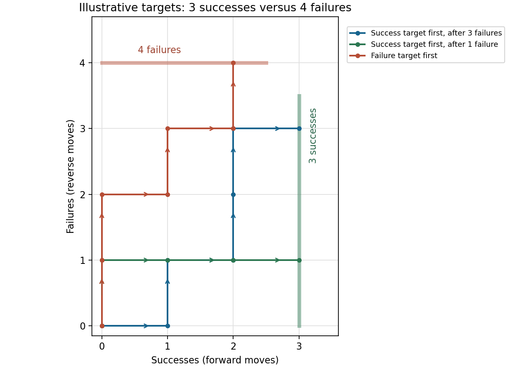

<h1 id="12/e/solution">Solution</h1>

↑ **Parent:** [E](../e.md)

Let $N$ be the meeting label. If $N>n$, the forward-moving object has already crossed $n$ while the reverse-moving object has not yet reached it, so the forward object wins the race to $n$. If $N<n$, the reverse object passed $n$ first. If $N=n$, the required event is exactly the special meeting from part (d).

These disjoint possibilities give

$$
\boxed{P(\text{forward object reaches }n\text{ first})
=p_n^{\rm specialMeet}+\sum_{k=n+1}^{F}p_k^{\rm meet}.}
$$

This includes the endpoints: for $n=0$ the [probability](../../../../../probability.md) is $1$, and for $n=F$ it is $0$, with the initial positions understood in the unwrapped convention.

**[Figure 3](#12/e/image-example-paths-in-a-race-between-fixed-success-and-failure-targets). Example paths in a race between fixed success and failure targets**.

## ↑ Ancestors (13)

1. [E](../e.md)
2. [12](../../12.md)
3. [Paper 1](../../../paper-1-split.md)
4. [2010](../../../split.md)
5. [Past exam of the mathematics course of the year 1 of the natural sciences course of the University of Cambridge](../../../../split.md)
6. [Mathematics course of the year 1 of the natural sciences course of the University of Cambridge](../../../../../mathematics-course-of-the-year-1-of-the-natural-sciences-course-of-the-university-of-cambridge.md)
7. [Year 1 of the natural sciences course of the University of Cambridge](../../../../../year-1-of-the-natural-sciences-course-of-the-university-of-cambridge.md)
8. [Year of the natural sciences course of the University of Cambridge](../../../../../year-of-the-natural-sciences-course-of-the-university-of-cambridge.md)
9. [Natural sciences course of the University of Cambridge](../../../../../natural-sciences-course-of-the-university-of-cambridge.md)
10. [Course of the University of Cambridge](../../../../../course-of-the-university-of-cambridge.md)
11. [University of Cambridge](../../../../../university-of-cambridge-split.md)
12. [List of universities](../../../../../list-of-universities.md)
13. [Codex Wiki](../../../../../split.md)
