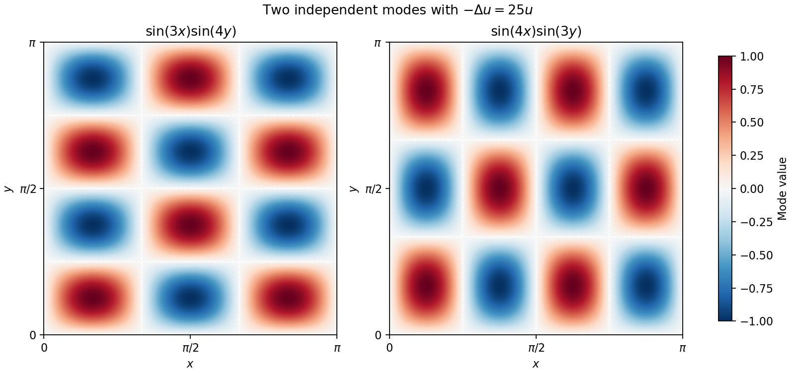

<h1 id="19/c/solution">Solution</h1>

↑ **Parent:** [C](../c.md)

Seek a separated nonzero solution $u=X(x)Y(y)$. Division by $XY$ on intervals where the factors are nonzero gives $X''/X+Y''/Y=-25$. Write $X''+\lambda X=0$ and $Y''+(25-\lambda)Y=0$, with both factors zero at their endpoints $0,\pi$.

For $X$, a nonpositive $\lambda$ gives only the zero solution under the two endpoint conditions: linear [functions](../../../../../function-split.md) vanish identically when $\lambda=0$, and the hyperbolic solutions do likewise for $\lambda<0$. For $\lambda>0$, the endpoints force $X=A\sin(mx)$ with positive integer $m$ and $\lambda=m^2$. Applying the same argument to $Y$ gives $Y=B\sin(ny)$ and $25-m^2=n^2$, with positive integer $n$.

The only positive integer pairs satisfying $m^2+n^2=25$ are $(3,4)$ and $(4,3)$. By [superposition](../../../../../superposition-principle.md),

$$
\boxed{u(x,y)=A\sin3x\sin4y+B\sin4x\sin3y,\qquad A,B\in\mathbb R.}
$$

To establish that this is the most general sufficiently regular solution, expand $u$ in the complete product [Fourier sine series](../../../../../fourier-sine-series.md) on the square. Substitution, or [integration](../../../../../integral-split.md) by parts against each [sine](../../../../../sine.md) mode, gives $(25-m^2-n^2)c_{mn}=0$ for every [coefficient](../../../../../coefficient.md). Hence only the two displayed modes remain; all boundary terms vanish because of the given zero values. This is the eigenvalue-$25$ case of the [Dirichlet eigensystem of a rectangle](../../../../../dirichlet-eigensystem-of-a-rectangle.md). The zero solution is included when $A=B=0$.

**[Figure 4](#19/c/image-the-two-independent-zero-boundary-modes-sharing-laplacian-eigenvalue-25-on-the-square). The two independent zero-boundary modes sharing Laplacian eigenvalue 25 on the square**.

## ↑ Ancestors (13)

1. [C](../c.md)
2. [19](../../19.md)
3. [Paper 1](../../../paper-1-split.md)
4. [2010](../../../split.md)
5. [Past exam of the mathematics course of the year 1 of the natural sciences course of the University of Cambridge](../../../../split.md)
6. [Mathematics course of the year 1 of the natural sciences course of the University of Cambridge](../../../../../mathematics-course-of-the-year-1-of-the-natural-sciences-course-of-the-university-of-cambridge.md)
7. [Year 1 of the natural sciences course of the University of Cambridge](../../../../../year-1-of-the-natural-sciences-course-of-the-university-of-cambridge.md)
8. [Year of the natural sciences course of the University of Cambridge](../../../../../year-of-the-natural-sciences-course-of-the-university-of-cambridge.md)
9. [Natural sciences course of the University of Cambridge](../../../../../natural-sciences-course-of-the-university-of-cambridge.md)
10. [Course of the University of Cambridge](../../../../../course-of-the-university-of-cambridge.md)
11. [University of Cambridge](../../../../../university-of-cambridge-split.md)
12. [List of universities](../../../../../list-of-universities.md)
13. [Codex Wiki](../../../../../split.md)
