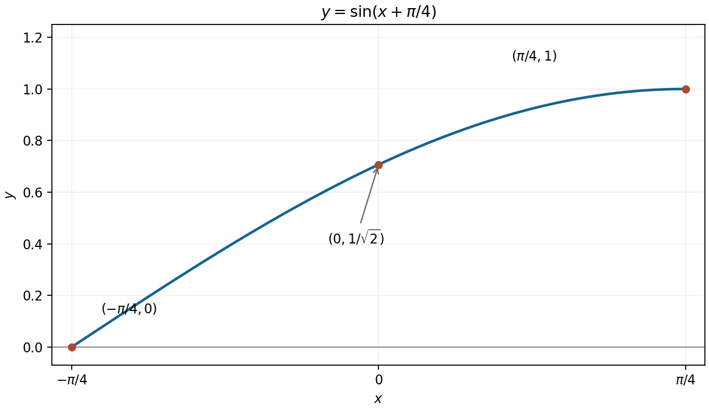

<h1 id="8/b/solution">Solution</h1>

↑ **Parent:** [B](../b.md)

The [sine addition formula](../../../../../sine-addition-formula.md) gives $(\sin x+\cos x)/\sqrt2=\sin(x+\pi/4)$. On the requested [interval](../../../../../interval-mathematics.md) the shifted angle runs from $0$ to $\pi/2$, so the graph rises from $(-\pi/4,0)$ through $(0,1/\sqrt2)$ to $(\pi/4,1)$.

Its [derivative](../../../../../derivative.md) $\cos(x+\pi/4)$ is nonnegative and reaches zero only at the right endpoint. Its second [derivative](../../../../../derivative.md) is $-\sin(x+\pi/4)\leq0$, so the rising arc is concave downward and ends with a horizontal tangent.

**[Figure 2](#8/b/image-a-rising-concave-down-quarter-sine-wave-on-the-specified-interval). A rising concave-down quarter sine wave on the specified interval**.

## ↑ Ancestors (13)

1. [B](../b.md)
2. [8](../../8.md)
3. [Paper 1](../../../paper-1-split.md)
4. [2010](../../../split.md)
5. [Past exam of the mathematics course of the year 1 of the natural sciences course of the University of Cambridge](../../../../split.md)
6. [Mathematics course of the year 1 of the natural sciences course of the University of Cambridge](../../../../../mathematics-course-of-the-year-1-of-the-natural-sciences-course-of-the-university-of-cambridge.md)
7. [Year 1 of the natural sciences course of the University of Cambridge](../../../../../year-1-of-the-natural-sciences-course-of-the-university-of-cambridge.md)
8. [Year of the natural sciences course of the University of Cambridge](../../../../../year-of-the-natural-sciences-course-of-the-university-of-cambridge.md)
9. [Natural sciences course of the University of Cambridge](../../../../../natural-sciences-course-of-the-university-of-cambridge.md)
10. [Course of the University of Cambridge](../../../../../course-of-the-university-of-cambridge.md)
11. [University of Cambridge](../../../../../university-of-cambridge-split.md)
12. [List of universities](../../../../../list-of-universities.md)
13. [Codex Wiki](../../../../../split.md)
