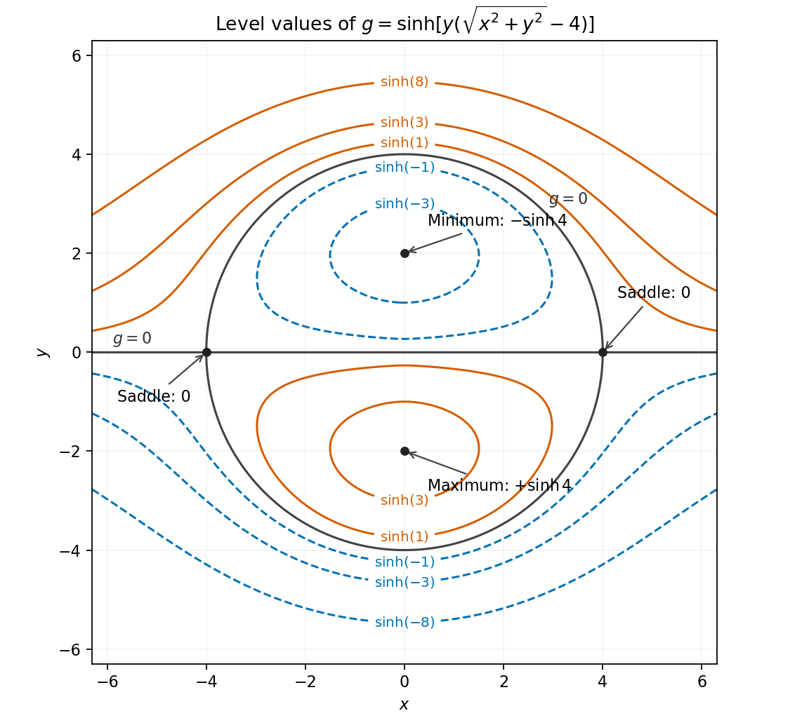

<h1 id="13/b/solution">Solution</h1>

↑ **Parent:** [B](../b.md)

Write $h(x,y)=y(r-4)$, where $r=\sqrt{x^2+y^2}$. Because this [hyperbolic function](../../../../../hyperbolic-function.md) has strictly positive [derivative](../../../../../derivative.md) $\cosh$, [stationary points under an increasing outer function](../../../../../stationary-points-under-an-increasing-outer-function.md) have the same positions and types for $g=\sinh h$ and $h$. For $r>0$,

$$
h_x=\frac{xy}{r},\qquad h_y=r+\frac{y^2}{r}-4.
$$

The first equation requires $x=0$ or $y=0$. If $y=0$, the second gives $|x|=4$. If $x=0$, it gives $2|y|=4$. These are all the nonzero [stationary points](../../../../../stationary-point.md). At the origin, $h=-4y+O(r^2)$, so its [gradient](../../../../../gradient.md) is $(0,-4)$; the origin is not stationary.

At $(0,2)$ the [Hessian matrix](../../../../../hessian-matrix.md) of $h$ is $\operatorname{diag}(1,2)$, and at $(0,-2)$ it is $\operatorname{diag}(-1,-2)$. At $(4,0)$ and $(-4,0)$ its [Hessian matrices](../../../../../hessian-matrix.md) are respectively $\begin{pmatrix}0&1\\1&0\end{pmatrix}$ and $\begin{pmatrix}0&-1\\-1&0\end{pmatrix}$. Therefore

$$
\boxed{\begin{array}{c|c|c}
(x,y)&g(x,y)&\text{type}\\\hline
(0,2)&-\sinh4&\text{strict local minimum}\\
(0,-2)&\sinh4&\text{strict local maximum}\\
(4,0),\ (-4,0)&0&\text{saddles}
\end{array}}
$$

The extrema are local: $g$ is unbounded above and below on the full [plane](../../../../../plane.md).

For the [level curve](../../../../../level-curve.md) geometry, a level $g=c$ is $y(r-4)=\operatorname{arsinh}c$. In particular, the zero [level curve](../../../../../level-curve.md) is the union of the entire $x$ axis and the [circle](../../../../../circle.md) $r=4$, crossing at the two [saddle points](../../../../../saddle-point.md). Inside the [circle](../../../../../circle.md), $g<0$ above the axis and $g>0$ below it; outside, these signs reverse. Levels between $-\sinh4$ and zero have closed loops around the upper minimum as well as unbounded lower-half-plane components. Reflection across the $x$ axis reverses the sign and gives the loops about the lower maximum. At the two extremal heights, the corresponding closed loop shrinks to its extremum. These features determine the sketch.

**[Figure 1](#13/b/image-level-curves-and-all-four-stationary-points-of-the-radial-hyperbolic-sine-function). Level curves and all four stationary points of the radial hyperbolic-sine function**.

## ↑ Ancestors (13)

1. [B](../b.md)
2. [13](../../13.md)
3. [Paper 2](../../../paper-2-split.md)
4. [2010](../../../split.md)
5. [Past exam of the mathematics course of the year 1 of the natural sciences course of the University of Cambridge](../../../../split.md)
6. [Mathematics course of the year 1 of the natural sciences course of the University of Cambridge](../../../../../mathematics-course-of-the-year-1-of-the-natural-sciences-course-of-the-university-of-cambridge.md)
7. [Year 1 of the natural sciences course of the University of Cambridge](../../../../../year-1-of-the-natural-sciences-course-of-the-university-of-cambridge.md)
8. [Year of the natural sciences course of the University of Cambridge](../../../../../year-of-the-natural-sciences-course-of-the-university-of-cambridge.md)
9. [Natural sciences course of the University of Cambridge](../../../../../natural-sciences-course-of-the-university-of-cambridge.md)
10. [Course of the University of Cambridge](../../../../../course-of-the-university-of-cambridge.md)
11. [University of Cambridge](../../../../../university-of-cambridge-split.md)
12. [List of universities](../../../../../list-of-universities.md)
13. [Codex Wiki](../../../../../split.md)
