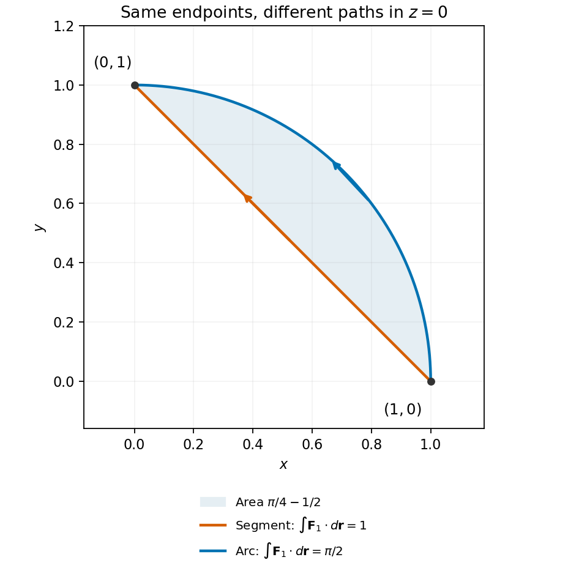

<h1 id="16/b/solution">Solution</h1>

↑ **Parent:** [B](../b.md)

The shorter circular arc lies in the $x$-$y$ [plane](../../../../../plane.md) and can be written $\mathbf r(\theta)=(\cos\theta,\sin\theta,0)$, $0\leq\theta\leq\pi/2$. The first field is $(-\sin\theta,\cos\theta,-\cos\theta)$, whose [dot product](../../../../../dot-product.md) with $\mathbf r'$ is one. Hence

$$
\boxed{\int_{\rm arc}\mathbf F_1\cdot d\mathbf r=\frac\pi2}.
$$

The second field is radial while the circular tangent is perpendicular to the radius, so $\boxed{\int_{\rm arc}\mathbf F_2\cdot d\mathbf r=0}$. Thus the first field gives different values, $1$ and $\pi/2$, along the two paths, whereas the conservative second field gives the same endpoint difference.

As a check using [Stokes theorem](../../../../../stokes-theorem.md), the arc followed by the reversed segment encloses [area](../../../../../surface-area.md) $\pi/4-1/2$ in the [plane](../../../../../plane.md). The constant [curl](../../../../../curl.md) has upward component two, giving circulation $2(\pi/4-1/2)=\pi/2-1$, exactly the difference above.

**[Figure 2](#16/b/image-straight-and-circular-paths-with-the-same-endpoints-enclosing-the-area-responsible-for-their-circulation-difference). Straight and circular paths with the same endpoints, enclosing the area responsible for their circulation difference**.

## ↑ Ancestors (13)

1. [B](../b.md)
2. [16](../../16.md)
3. [Paper 2](../../../paper-2-split.md)
4. [2010](../../../split.md)
5. [Past exam of the mathematics course of the year 1 of the natural sciences course of the University of Cambridge](../../../../split.md)
6. [Mathematics course of the year 1 of the natural sciences course of the University of Cambridge](../../../../../mathematics-course-of-the-year-1-of-the-natural-sciences-course-of-the-university-of-cambridge.md)
7. [Year 1 of the natural sciences course of the University of Cambridge](../../../../../year-1-of-the-natural-sciences-course-of-the-university-of-cambridge.md)
8. [Year of the natural sciences course of the University of Cambridge](../../../../../year-of-the-natural-sciences-course-of-the-university-of-cambridge.md)
9. [Natural sciences course of the University of Cambridge](../../../../../natural-sciences-course-of-the-university-of-cambridge.md)
10. [Course of the University of Cambridge](../../../../../course-of-the-university-of-cambridge.md)
11. [University of Cambridge](../../../../../university-of-cambridge-split.md)
12. [List of universities](../../../../../list-of-universities.md)
13. [Codex Wiki](../../../../../split.md)
