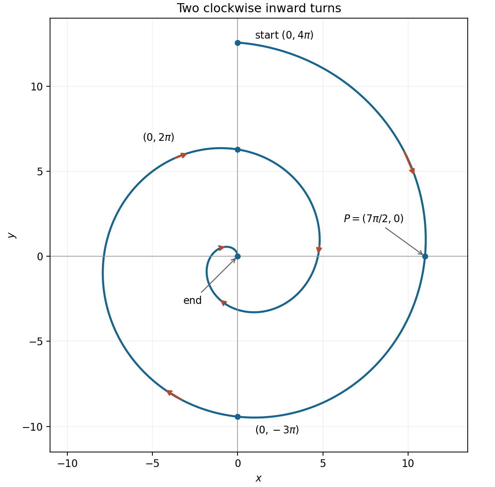
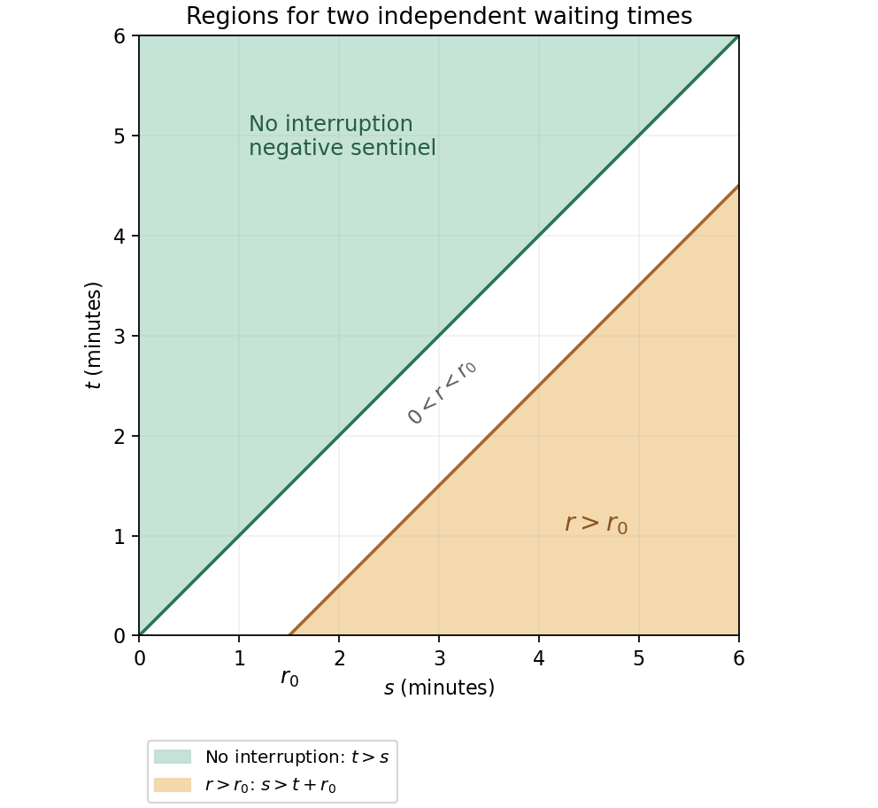
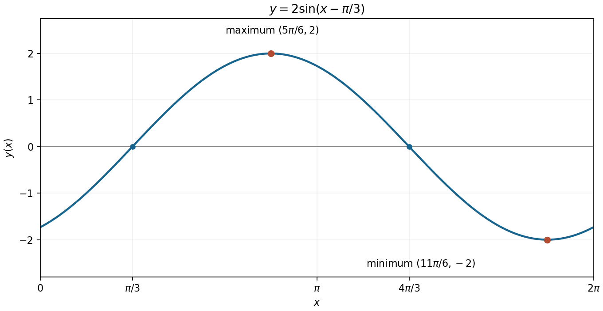
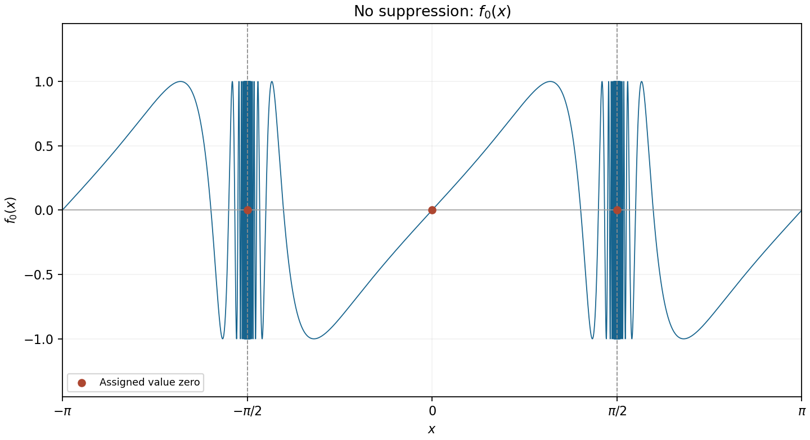

# Paper 1

↑ **Parent:** [2011](../2011.md)

[https://www.maths.cam.ac.uk/undergradnst/files/2011/PaperNST_IA_1.pdf](https://www.maths.cam.ac.uk/undergradnst/files/2011/PaperNST_IA_1.pdf)

**Table of contents**

- [1](#1)
  - [Solution](#1/solution)
- [2](#2)
  - [Solution](#2/solution)
- [3](#3)
  - [a](#3/a)
    - [Solution](#3/a/solution)
  - [b](#3/b)
    - [Solution](#3/b/solution)
- [4](#4)
  - [a](#4/a)
    - [Solution](#4/a/solution)
  - [b](#4/b)
    - [Solution](#4/b/solution)
- [5](#5)
  - [Solution](#5/solution)
- [6](#6)
  - [Solution](#6/solution)
- [7](#7)
  - [Solution](#7/solution)
- [8](#8)
  - [Solution](#8/solution)
- [9](#9)
  - [Solution](#9/solution)
- [10](#10)
  - [a](#10/a)
    - [Solution](#10/a/solution)
  - [b](#10/b)
    - [Solution](#10/b/solution)
- [11](#11)
  - [a](#11/a)
    - [Solution](#11/a/solution)
  - [b](#11/b)
    - [i](#11/b/i)
      - [Solution](#11/b/i/solution)
    - [ii](#11/b/ii)
      - [Solution](#11/b/ii/solution)
    - [iii](#11/b/iii)
      - [Solution](#11/b/iii/solution)
- [12](#12)
  - [a](#12/a)
    - [Solution](#12/a/solution)
  - [b](#12/b)
    - [Solution](#12/b/solution)
  - [c](#12/c)
    - [Solution](#12/c/solution)
  - [d](#12/d)
    - [Solution](#12/d/solution)
  - [e](#12/e)
    - [Solution](#12/e/solution)
  - [f](#12/f)
    - [Solution](#12/f/solution)
  - [g](#12/g)
    - [i](#12/g/i)
      - [Solution](#12/g/i/solution)
    - [ii](#12/g/ii)
      - [Solution](#12/g/ii/solution)
  - [h](#12/h)
    - [Solution](#12/h/solution)
- [13](#13)
  - [a](#13/a)
    - [i](#13/a/i)
      - [Solution](#13/a/i/solution)
    - [ii](#13/a/ii)
      - [Solution](#13/a/ii/solution)
    - [iii](#13/a/iii)
      - [Solution](#13/a/iii/solution)
    - [iv](#13/a/iv)
      - [Solution](#13/a/iv/solution)
  - [b](#13/b)
    - [i](#13/b/i)
      - [Solution](#13/b/i/solution)
    - [ii](#13/b/ii)
      - [Solution](#13/b/ii/solution)
- [14](#14)
  - [a](#14/a)
    - [Solution](#14/a/solution)
  - [b](#14/b)
    - [Solution](#14/b/solution)
  - [c](#14/c)
    - [Solution](#14/c/solution)
  - [d](#14/d)
    - [Solution](#14/d/solution)
  - [e](#14/e)
    - [Solution](#14/e/solution)
  - [f](#14/f)
    - [Solution](#14/f/solution)
  - [g](#14/g)
    - [Solution](#14/g/solution)
  - [h](#14/h)
    - [Solution](#14/h/solution)
- [15](#15)
  - [a](#15/a)
    - [Solution](#15/a/solution)
  - [b](#15/b)
    - [Solution](#15/b/solution)
  - [c](#15/c)
    - [Solution](#15/c/solution)
  - [d](#15/d)
    - [Solution](#15/d/solution)
- [16](#16)
  - [a](#16/a)
    - [Solution](#16/a/solution)
  - [b](#16/b)
    - [Solution](#16/b/solution)
  - [c](#16/c)
    - [Solution](#16/c/solution)
- [17](#17)
  - [a](#17/a)
    - [i](#17/a/i)
      - [Solution](#17/a/i/solution)
    - [ii](#17/a/ii)
      - [Solution](#17/a/ii/solution)
    - [iii](#17/a/iii)
      - [Solution](#17/a/iii/solution)
  - [b](#17/b)
    - [Solution](#17/b/solution)
- [18](#18)
  - [a](#18/a)
    - [Solution](#18/a/solution)
  - [b](#18/b)
    - [i](#18/b/i)
      - [Solution](#18/b/i/solution)
    - [ii](#18/b/ii)
      - [Solution](#18/b/ii/solution)
  - [c](#18/c)
    - [Solution](#18/c/solution)
  - [d](#18/d)
    - [Solution](#18/d/solution)
- [19](#19)
  - [a](#19/a)
    - [Solution](#19/a/solution)
  - [b](#19/b)
    - [Solution](#19/b/solution)
  - [c](#19/c)
    - [Solution](#19/c/solution)
  - [d](#19/d)
    - [Solution](#19/d/solution)
- [20](#20)
  - [a](#20/a)
    - [i](#20/a/i)
      - [Solution](#20/a/i/solution)
    - [ii](#20/a/ii)
      - [Solution](#20/a/ii/solution)
    - [iii](#20/a/iii)
      - [Solution](#20/a/iii/solution)
  - [b](#20/b)
    - [Solution](#20/b/solution)

## 1

↑ **Parent:** [Paper 1](paper-1.md)

<h3 id="1/solution">Solution</h3>

↑ **Parent:** [1](#1)

An [antiderivative](../../integral.md#antiderivative) of $\sin x$ is $-\cos x$. The [fundamental theorem of calculus](../../calculus.md#fundamental-theorem-of-calculus) gives

$$
\boxed{\int_0^{\pi/2}\sin x\,dx=[-\cos x]_0^{\pi/2}=1.}
$$

## 2

↑ **Parent:** [Paper 1](paper-1.md)

<h3 id="2/solution">Solution</h3>

↑ **Parent:** [2](#2)

Set $u=3-2x$, so $du=-2dx$. This [integration by substitution](../../integral.md#integration-by-substitution) gives

$$
\boxed{\int\frac{dx}{3-2x}=-\frac12\ln|3-2x|+C.}
$$

The [antiderivative](../../integral.md#antiderivative) is taken on either [interval](../../real-analysis.md#interval-mathematics) separated by $x=3/2$. Differentiating verifies the sign and factor $-1/2$.

## 3

↑ **Parent:** [Paper 1](paper-1.md)

<h3 id="3/a">a</h3>

↑ **Parent:** [3](#3)

<h4 id="3/a/solution">Solution</h4>

↑ **Parent:** [A](#3/a)

Differentiating the [hyperbolic cosine](../../calculus.md#hyperbolic-cosine) with the [chain rule](../../calculus.md#chain-rule) gives $g'(x)=3\cosh^2x\sinh x$. For real $x$, $\cosh x>0$, so the only zero of the [derivative](../../calculus.md#derivative) is $\sinh x=0$, namely $x=0$. Thus

$$
\boxed{x_1=0,\qquad g(x_1)=1.}
$$

Since $\cosh x\geq1$, this [stationary point](../../calculus-of-variations.md#stationary-point) is the [global minimum](../../analysis.md#global-minimum).

<h3 id="3/b">b</h3>

↑ **Parent:** [3](#3)

<h4 id="3/b/solution">Solution</h4>

↑ **Parent:** [B](#3/b)

For $x>0$, [logarithmic differentiation](../../calculus.md#logarithmic-differentiation) gives

$$
\ln f(x)=\frac{\ln x}{x},\qquad
\frac{f'(x)}{f(x)}=\frac{1-\ln x}{x^2}.
$$

Since $f(x)>0$, the [derivative](../../calculus.md#derivative) vanishes precisely when $\ln x=1$. Hence

$$
\boxed{x_0=e,\qquad f(x_0)=e^{1/e}.}
$$

The [derivative](../../calculus.md#derivative) is positive before $e$ and negative after $e$, so this is a [global maximum](../../function.md#global-maximum) on the given positive domain.

## 4

↑ **Parent:** [Paper 1](paper-1.md)

<h3 id="4/a">a</h3>

↑ **Parent:** [4](#4)

<h4 id="4/a/solution">Solution</h4>

↑ **Parent:** [A](#4/a)

The distance from the origin is $r=4\pi-t$. The direction angle, measured counterclockwise from the positive horizontal axis, is $\theta=\pi/2-t$ modulo $2\pi$. Thus the path is an [Archimedean spiral](../../algebraic-geometry.md#archimedean-spiral), turning clockwise through two complete revolutions as its [radius](../../topology.md#radius) decreases linearly from $4\pi$ to zero.

It starts at $(0,4\pi)$, reaches $(7\pi/2,0)$ at $t=\pi/2$, crosses $(0,-3\pi)$ at $t=\pi$, returns to the positive vertical axis at $(0,2\pi)$ when $t=2\pi$, and ends at the origin when $t=4\pi$. These crossings fix both the scale and direction of the sketch.

**[Figure 1](#4/a/image-two-clockwise-inward-turns-of-the-spiral-with-time-direction-arrows-and-selected-axis-crossings). Two clockwise inward turns of the spiral, with time-direction arrows and selected axis crossings**.

<h3 id="4/b">b</h3>

↑ **Parent:** [4](#4)

<h4 id="4/b/solution">Solution</h4>

↑ **Parent:** [B](#4/b)

At the stated point, the radial distance is $7\pi/2$, so $4\pi-t=7\pi/2$ and $t=\pi/2$. Differentiate the [parametric curve](../../topology.md#parametric-curve):

$$
\dot x=-\sin t+(4\pi-t)\cos t,\qquad
\dot y=-\cos t-(4\pi-t)\sin t.
$$

At $t=\pi/2$, these are $\dot x=-1$ and $\dot y=-7\pi/2$. Since $\dot x\ne0$, the [tangent line](../../calculus.md#tangent-line) has finite [slope](../../euclidean-geometry.md#slope)

$$
\boxed{\frac{dy}{dx}=\frac{\dot y}{\dot x}=\frac{7\pi}{2}.}
$$

## 5

↑ **Parent:** [Paper 1](paper-1.md)

<h3 id="5/solution">Solution</h3>

↑ **Parent:** [5](#5)

Let the [equilateral triangle](../../euclidean-geometry.md#equilateral-triangle) have side [length](../../physics.md#length) $a$. Its altitude is $H=\sqrt3a/2$, and its [incircle](../../euclidean-geometry.md#incircle-of-a-triangle) has [radius](../../topology.md#radius) $r=H/3=a/(2\sqrt3)$: the [centre](../../euclidean-geometry.md#center-geometry) lies on a median, one third of the altitude above the base. The [area](../../differential-geometry.md#surface-area) of the triangle is $aH/2=\sqrt3a^2/4$, while the [circle](../../topology.md#circle) has [area](../../differential-geometry.md#surface-area) $\pi r^2=\pi a^2/12$. Therefore

$$
\boxed{\frac{\mathcal A_{\rm circle}}{\mathcal A_{\rm triangle}}
=\frac{\pi}{3\sqrt3}=\frac{\pi\sqrt3}{9}\approx0.604600.}
$$

The side [length](../../physics.md#length) cancels, as required for a dimensionless ratio between similar configurations.

## 6

↑ **Parent:** [Paper 1](paper-1.md)

<h3 id="6/solution">Solution</h3>

↑ **Parent:** [6](#6)

Put $u=\sin\theta$ and move all terms to one side. The [polynomial](../../polynomial.md) factors as

$$
u^3-u^2-\frac u4+\frac14=(u-1)\left(u-\frac12\right)\left(u+\frac12\right).
$$

The root $u=1$ yields the already supplied $\theta=\pi/2$. In the stated [interval](../../real-analysis.md#interval-mathematics), $u=1/2$ gives $\pi/6,5\pi/6$, while $u=-1/2$ gives $-\pi/6,-5\pi/6$. Thus all the other solutions are

$$
\boxed{\theta=-\frac{5\pi}{6},\ -\frac\pi6,\ \frac\pi6,\ \frac{5\pi}{6}.}
$$

There are no endpoint solutions because $\sin(\pm\pi)=0$ is not one of the three roots.

## 7

↑ **Parent:** [Paper 1](paper-1.md)

<h3 id="7/solution">Solution</h3>

↑ **Parent:** [7](#7)

For negative real $x$, the angle $u=\pi e^x$ lies strictly between $0$ and $\pi$. On that [interval](../../real-analysis.md#interval-mathematics), $\sin u=1/\sqrt2$ has exactly the two solutions $u=\pi/4$ and $u=3\pi/4$. Dividing by $\pi$ and applying the [natural logarithm](../../calculus.md#natural-logarithm) yields

$$
\boxed{x=\ln\frac14=-\ln4,\qquad x=\ln\frac34.}
$$

Both values are negative, and the restriction $0<u<\pi$ excludes all further periodic [sine](../../geometry-and-topology.md#sine) branches.

## 8

↑ **Parent:** [Paper 1](paper-1.md)

<h3 id="8/solution">Solution</h3>

↑ **Parent:** [8](#8)

The integrand is a [continuous function](../../calculus.md#continuous-function), so the [fundamental theorem of calculus](../../calculus.md#fundamental-theorem-of-calculus) differentiates the upper limit directly:

$$
\boxed{\frac d{dx}\int_0^x e^{-y^2}\sin y\,dy=e^{-x^2}\sin x.}
$$

No explicit [antiderivative](../../integral.md#antiderivative) is needed.

## 9

↑ **Parent:** [Paper 1](paper-1.md)

<h3 id="9/solution">Solution</h3>

↑ **Parent:** [9](#9)

For a real-valued expression, $\ln x>0$ requires $x>1$. Applying the [chain rule](../../calculus.md#chain-rule) twice gives

$$
\boxed{\frac d{dx}\ln(\ln x)=\frac1{\ln x}\frac1x=\frac1{x\ln x},\qquad x>1.}
$$

## 10

↑ **Parent:** [Paper 1](paper-1.md)

<h3 id="10/a">a</h3>

↑ **Parent:** [10](#10)

<h4 id="10/a/solution">Solution</h4>

↑ **Parent:** [A](#10/a)

Change the summation index to $j=n+1$. Then $j$ runs from $-99$ to $100$. Each term $j^3$ for $1\leq j\leq99$ cancels its partner $(-j)^3$, and the zero term contributes nothing. The sole unpaired term is $100^3$, so

$$
\boxed{\sum_{n=-100}^{99}(n+1)^3=10^6.}
$$

<h3 id="10/b">b</h3>

↑ **Parent:** [10](#10)

<h4 id="10/b/solution">Solution</h4>

↑ **Parent:** [B](#10/b)

Since $(1/2)^{3k}=(1/8)^k$, this is a [geometric series](../../sequence-and-series.md#geometric-series) of first term $1$ and common ratio $1/8$. Its sum is

$$
\boxed{\frac1{1-1/8}=\frac87.}
$$

## 11

↑ **Parent:** [Paper 1](paper-1.md)

<h3 id="11/a">a</h3>

↑ **Parent:** [11](#11)

<h4 id="11/a/solution">Solution</h4>

↑ **Parent:** [A](#11/a)

The cubic [Taylor polynomial](../../calculus.md#taylor-polynomial) about $a$ is

$$
\boxed{f(a)+f'(a)(x-a)+\frac{f''(a)}{2!}(x-a)^2+\frac{f^{(3)}(a)}{3!}(x-a)^3.}
$$

If $f$ has a continuous fourth [derivative](../../calculus.md#derivative) near $a$, [Taylor's theorem](../../calculus.md#taylor-s-theorem) gives $f(x)$ equal to this [polynomial](../../polynomial.md) plus $O((x-a)^4)$. With continuous [derivatives](../../calculus.md#derivative) only through third order, the corresponding remainder is $o((x-a)^3)$. An equality with an infinite [Taylor series](../../calculus.md#taylor-series) would require additional convergence information, rather than just the existence of these four terms.

<h3 id="11/b">b</h3>

↑ **Parent:** [11](#11)

<h4 id="11/b/i">i</h4>

↑ **Parent:** [B](#11/b)

<h5 id="11/b/i/solution">Solution</h5>

↑ **Parent:** [I](#11/b/i)

Factor out $9$ and use the [binomial series](../../sequence-and-series.md#binomial-series) with exponent $-1/2$:

$$
(x^2+9)^{-1/2}=\frac13\left(1+\frac{x^2}{9}\right)^{-1/2}
=\frac13\left[1-\frac12\frac{x^2}{9}+O(x^4)\right].
$$

Thus the expansion through cubic order is

$$
\boxed{\frac1{\sqrt{x^2+9}}=\frac13-\frac{x^2}{54}+O(x^4).}
$$

The [coefficients](../../vector-space.md#coefficient) of $x$ and $x^3$ vanish because the [function](../../function.md) is an [even function](../../calculus.md#even-function). The underlying binomial expansion converges for $|x|<3$.

<h4 id="11/b/ii">ii</h4>

↑ **Parent:** [B](#11/b)

<h5 id="11/b/ii/solution">Solution</h5>

↑ **Parent:** [Ii](#11/b/ii)

Near zero the logarithm's argument is positive, so $\ln[(2+x)^3]=3\ln(2+x)=3\ln2+3\ln(1+x/2)$. Use the [Maclaurin series](../../calculus.md#maclaurin-series) of the [natural logarithm](../../calculus.md#natural-logarithm):

$$
\boxed{\ln[(2+x)^3]=3\ln2+\frac32x-\frac38x^2+\frac18x^3+O(x^4).}
$$

The local calculation uses $x>-2$ for the real logarithm; the [power series](../../sequence-and-series.md#power-series) converges for $|x|<2$.

<h4 id="11/b/iii">iii</h4>

↑ **Parent:** [B](#11/b)

<h5 id="11/b/iii/solution">Solution</h5>

↑ **Parent:** [Iii](#11/b/iii)

Use $\sin x=x-x^3/6+O(x^5)$ inside the [exponential series](../../calculus.md#exponential-series):

$$
e^{\sin x}=1+\left(x-\frac{x^3}{6}\right)+\frac{x^2}{2}
+\frac{x^3}{6}+O(x^4).
$$

The two cubic contributions cancel, leaving

$$
\boxed{e^{\sin x}=1+x+\frac{x^2}{2}+O(x^4).}
$$

Thus the [coefficient](../../vector-space.md#coefficient) of $x^3$ is zero, even though the [function](../../function.md) itself is not an [even function](../../calculus.md#even-function).

## 12

↑ **Parent:** [Paper 1](paper-1.md)

<h3 id="12/a">a</h3>

↑ **Parent:** [12](#12)

<h4 id="12/a/solution">Solution</h4>

↑ **Parent:** [A](#12/a)

Write $\bar s>0$ for the [mean](../../expected-value.md) in minutes. An [exponential distribution](../../continuous-probability-distribution.md#exponential-distribution) with that [mean](../../expected-value.md) has rate $1/\bar s$, so its [probability density function](../../continuous-probability-distribution.md#probability-density-function) is

$$
\boxed{f_S(s)=\begin{cases}\bar s^{-1}e^{-s/\bar s},&s\geq0,\\0,&s<0.\end{cases}}
$$

The density has units of inverse minutes, ensuring that its integral is a dimensionless [probability](../../probability-theory.md#probability).

<h3 id="12/b">b</h3>

↑ **Parent:** [12](#12)

<h4 id="12/b/solution">Solution</h4>

↑ **Parent:** [B](#12/b)

Take $s$ on the horizontal axis and $t$ on the vertical axis, both nonnegative. There is no interruption when the noise occurs after the scheduled ending, namely **$t>s$**. This is the part of the first quadrant above the diagonal $t=s$. Equality has [probability](../../probability-theory.md#probability) zero, so assigning the boundary either way does not affect the calculation.

The same original diagram below also marks the region used in part (e); its lower boundary offset is an illustrative positive choice of $r_0$.

**[Figure 2](#12/b/image-the-no-interruption-region-above-the-diagonal-and-the-region-of-positive-remaining-time-exceeding-a-chosen-threshold). The no-interruption region above the diagonal and the region of positive remaining time exceeding a chosen threshold**.

<h3 id="12/c">c</h3>

↑ **Parent:** [12](#12)

<h4 id="12/c/solution">Solution</h4>

↑ **Parent:** [C](#12/c)

For a small rectangle of side lengths $ds,dt$, [independence](../../random-variable.md#independent-random-variables) makes its [probability](../../probability-theory.md#probability) approximately $f_S(s)ds\,f_T(t)dt$. Thus the [joint probability density function](../../continuous-probability-distribution.md#joint-probability-density) is the product

$$
f_{S,T}(s,t)=\frac1{\bar s\bar t}e^{-s/\bar s-t/\bar t},\qquad s,t\geq0.
$$

Adding the [probabilities](../../probability-theory.md#probability) of disjoint small rectangles covering a [region of integration](../../integral.md#domain-of-integration), and taking their sizes to zero, gives the [double integral](../../integral.md#double-integral) of this product over that region. Without [independence](../../random-variable.md#independent-random-variables), the two [marginal distributions](../../probability-distribution.md#marginal-distribution) alone would not determine the [joint probability density function](../../continuous-probability-distribution.md#joint-probability-density).

<h3 id="12/d">d</h3>

↑ **Parent:** [12](#12)

<h4 id="12/d/solution">Solution</h4>

↑ **Parent:** [D](#12/d)

Integrate over the region $0\leq s<t$:

$$
P(T>S)=\int_0^\infty\frac{e^{-s/\bar s}}{\bar s}
\left[\int_s^\infty\frac{e^{-t/\bar t}}{\bar t}dt\right]ds
=\frac1{\bar s}\int_0^\infty e^{-s(1/\bar s+1/\bar t)}ds.
$$

Therefore

$$
\boxed{P(\text{no interruption})=\frac{\bar t}{\bar s+\bar t}.}
$$

This is also the two-clock case of [competing exponential clocks](../../continuous-probability-distribution.md#competing-exponential-clocks). A larger [mean](../../expected-value.md) time to noise increases this [probability](../../probability-theory.md#probability), while a larger [mean](../../expected-value.md) service [length](../../physics.md#length) decreases it.

<h3 id="12/e">e</h3>

↑ **Parent:** [12](#12)

<h4 id="12/e/solution">Solution</h4>

↑ **Parent:** [E](#12/e)

On interrupted outcomes, $r=S-T$; on the other outcomes the sentinel value is negative and cannot exceed $r_0>0$. Consequently

$$
\boxed{\{r>r_0\}=\{s>t+r_0,\quad t\geq0\}.}
$$

On the diagram in part (b), this is the first-quadrant region below $t=s-r_0$, starting at the horizontal intercept $s=r_0$. It lies strictly inside the interruption region $t<s$.

<h3 id="12/f">f</h3>

↑ **Parent:** [12](#12)

<h4 id="12/f/solution">Solution</h4>

↑ **Parent:** [F](#12/f)

Use the lower limit $s=t+r_0$ for the inner integral:

$$
P(r>r_0)=\int_0^\infty\frac{e^{-t/\bar t}}{\bar t}
\left[\int_{t+r_0}^\infty\frac{e^{-s/\bar s}}{\bar s}ds\right]dt
=\frac{e^{-r_0/\bar s}}{\bar t}\int_0^\infty e^{-t(1/\bar s+1/\bar t)}dt.
$$

Hence

$$
\boxed{P(r>r_0)=\frac{\bar s}{\bar s+\bar t}e^{-r_0/\bar s},\qquad r_0>0.}
$$

The prefactor is the [probability](../../probability-theory.md#probability) that interruption occurs; the remaining exponential is its conditional positive tail. This is the [positive difference of independent exponential waiting times](../../continuous-probability-distribution.md#positive-difference-of-independent-exponential-waiting-times). The exponent is dimensionless because both $r_0$ and $\bar s$ are measured in minutes.

<h3 id="12/g">g</h3>

↑ **Parent:** [12](#12)

<h4 id="12/g/i">i</h4>

↑ **Parent:** [G](#12/g)

<h5 id="12/g/i/solution">Solution</h5>

↑ **Parent:** [I](#12/g/i)

As $r_0\to+\infty$, the exponential factor tends to zero, so **$P(r>r_0)\to0$**. Requiring an arbitrarily large amount of remaining time must have vanishing [probability](../../probability-theory.md#probability) for this finite-mean distribution.

<h4 id="12/g/ii">ii</h4>

↑ **Parent:** [G](#12/g)

<h5 id="12/g/ii/solution">Solution</h5>

↑ **Parent:** [Ii](#12/g/ii)

When $\bar s=\bar t$, the prefactor is $1/2$. Therefore **$P(r>r_0)\to1/2$ as $r_0\downarrow0$**. The clocks then have identical independent continuous laws, so either is equally likely to finish first. A tie has [probability](../../probability-theory.md#probability) zero. The limit is the interruption [probability](../../probability-theory.md#probability), rather than one, because non-interrupted outcomes retain the negative sentinel value.

<h3 id="12/h">h</h3>

↑ **Parent:** [12](#12)

<h4 id="12/h/solution">Solution</h4>

↑ **Parent:** [H](#12/h)

The time already elapsed since the noise is $32$ minutes. Conditional on a particular noise time $T=t$ and on still being in progress, [memorylessness of the exponential distribution](../../continuous-probability-distribution.md#memorylessness-of-the-exponential-distribution) gives

$$
P(S-t-32>u\mid S>t+32)=e^{-u/\bar s},\qquad u\geq0.
$$

This law does not depend on $t$. Averaging over the [conditional distribution](../../probability-theory.md#conditional-distribution) of $T$ therefore leaves the same remaining-time law. Hence

$$
\boxed{\mathbb E[m]=\bar s\ \text{minutes}.}
$$

The elapsed $32$ minutes are not subtracted from the original [mean](../../expected-value.md); the exponential residual lifetime has the same [mean](../../expected-value.md) after any elapsed duration.

## 13

↑ **Parent:** [Paper 1](paper-1.md)

<h3 id="13/a">a</h3>

↑ **Parent:** [13](#13)

<h4 id="13/a/i">i</h4>

↑ **Parent:** [A](#13/a)

<h5 id="13/a/i/solution">Solution</h5>

↑ **Parent:** [I](#13/a/i)

For the two-by-two [matrix](../../vector-space.md#matrix), take the product of the diagonal entries minus the product of the off-diagonal entries:

$$
\boxed{\det A=5\cdot5-(-3)(-3)=16.}
$$

In particular, $A$ is an [invertible matrix](../../linear-algebra.md#invertible-matrix).

<h4 id="13/a/ii">ii</h4>

↑ **Parent:** [A](#13/a)

<h5 id="13/a/ii/solution">Solution</h5>

↑ **Parent:** [Ii](#13/a/ii)

Interchange the diagonal entries, negate the off-diagonal entries, and divide by the nonzero [determinant](../../multilinear-algebra.md#determinant). The [matrix inverse](../../matrix-inverse.md) is

$$
\boxed{A^{-1}=\frac1{16}\begin{pmatrix}5&3\\3&5\end{pmatrix}.}
$$

Multiplication by $A$ gives the [identity matrix](../../vector-space.md#identity-matrix), since each diagonal product sum is $25-9=16$ and each off-diagonal product sum is zero.

<h4 id="13/a/iii">iii</h4>

↑ **Parent:** [A](#13/a)

<h5 id="13/a/iii/solution">Solution</h5>

↑ **Parent:** [Iii](#13/a/iii)

The [characteristic polynomial](../../linear-operator-theory.md#characteristic-polynomial) is

$$
\det(A-\lambda I)=(5-\lambda)^2-9=(\lambda-2)(\lambda-8).
$$

For $\lambda=2$, the [eigenvector](../../linear-operator-theory.md#eigenvector) equation reduces to $x=y$; for $\lambda=8$, it reduces to $x=-y$. Choose the following [unit vectors](../../vector-space.md#unit-vector) consistently for the remaining parts:

$$
\boxed{\lambda_1=2,\quad x_1=\frac1{\sqrt2}\begin{pmatrix}1\\1\end{pmatrix};\qquad
\lambda_2=8,\quad x_2=\frac1{\sqrt2}\begin{pmatrix}1\\-1\end{pmatrix}.}
$$

Each [eigenspace](../../linear-operator-theory.md#eigenspace) consists of all [scalar](../../vector-space.md#scalar) multiples of its displayed [vector](../../vector-space.md#vector), including zero; an [eigenvector](../../linear-operator-theory.md#eigenvector) itself must be nonzero.

<h4 id="13/a/iv">iv</h4>

↑ **Parent:** [A](#13/a)

<h5 id="13/a/iv/solution">Solution</h5>

↑ **Parent:** [Iv](#13/a/iv)

The chosen [eigenvectors](../../linear-operator-theory.md#eigenvector) have [dot product](../../inner-product.md#dot-product)

$$
\boxed{x_1\cdot x_2=\frac{1-1}{2}=0.}
$$

They are therefore [orthogonal](../../inner-product.md#orthogonal-vectors), and their unit lengths make them an [orthonormal eigenbasis](../../linear-operator-theory.md#orthonormal-eigenbasis). This agrees with the [spectral theorem for real symmetric matrices](../../linear-algebra.md#spectral-theorem-for-real-symmetric-matrices), since $A$ is real symmetric and its two [eigenvalues](../../linear-operator-theory.md#eigenvalue) are distinct.

<h3 id="13/b">b</h3>

↑ **Parent:** [13](#13)

<h4 id="13/b/i">i</h4>

↑ **Parent:** [B](#13/b)

<h5 id="13/b/i/solution">Solution</h5>

↑ **Parent:** [I](#13/b/i)

Multiply the [quadratic form](../../quadratic-form.md) out directly:

$$
(x\ y)A\begin{pmatrix}x\\y\end{pmatrix}
=x(5x-3y)+y(-3x+5y)=5x^2-6xy+5y^2.
$$

Thus **$b=5$, $c=-6$ and $d=5$**. Both [eigenvalues](../../linear-operator-theory.md#eigenvalue) are positive, so this is a [positive-definite quadratic form](../../quadratic-form.md#positive-definite-quadratic-form); its positive unit [level set](../../topology.md#level-set) is an [ellipse](../../euclidean-geometry.md#ellipse). The next part exhibits its principal axes explicitly.

<h4 id="13/b/ii">ii</h4>

↑ **Parent:** [B](#13/b)

<h5 id="13/b/ii/solution">Solution</h5>

↑ **Parent:** [Ii](#13/b/ii)

Let $Q=(x_1\ x_2)$ for the normalized [eigenvectors](../../linear-operator-theory.md#eigenvector) already chosen. Then $Q^TQ=I$, $(x,y)^T=Q(x',y')^T$, and [orthogonal diagonalization](../../linear-algebra.md#orthogonal-diagonalization-of-a-real-symmetric-matrix) gives

$$
Q^TAQ=\begin{pmatrix}2&0\\0&8\end{pmatrix},\qquad
\boxed{2(x')^2+8(y')^2=1.}
$$

The [ellipse](../../euclidean-geometry.md#ellipse) has semi-axis lengths $1/\sqrt2$ and $1/\sqrt8$ along $x_1$ and $x_2$, respectively. Rescale $x''=\sqrt2x'$ and $y''=\sqrt8y'$ to obtain the [unit circle](../../complex-analysis.md#complex-unit-circle) $(x'')^2+(y'')^2=1$. Since $(x',y')^T=Q^T(x,y)^T$,

$$
\boxed{\begin{pmatrix}x''\\y''\end{pmatrix}
=B\begin{pmatrix}x\\y\end{pmatrix},\qquad
B=\begin{pmatrix}\sqrt2&0\\0&\sqrt8\end{pmatrix}Q^T
=\begin{pmatrix}1&1\\2&-2\end{pmatrix}.}
$$

The identity $B^TB=A$ checks the rescaling directly. Swapping or reversing [eigenvectors](../../linear-operator-theory.md#eigenvector) gives other valid coordinate matrices; the displayed one follows the explicit choices in part (a).

## 14

↑ **Parent:** [Paper 1](paper-1.md)

<h3 id="14/a">a</h3>

↑ **Parent:** [14](#14)

<h4 id="14/a/solution">Solution</h4>

↑ **Parent:** [A](#14/a)

In the real [Fourier series](../../fourier-series.md) convention for [period](../../mathematics.md#period-of-a-function) $2\pi$,

$$
\boxed{y(x)\sim\frac{a_0}{2}+\sum_{n=1}^{\infty}[a_n\cos(nx)+b_n\sin(nx)],}
$$

where the [Fourier coefficients](../../fourier-series.md#fourier-coefficient) are

$$
a_n=\frac1\pi\int_0^{2\pi}y(x)\cos(nx)dx\quad(n\geq0),\qquad
b_n=\frac1\pi\int_0^{2\pi}y(x)\sin(nx)dx\quad(n\geq1).
$$

These formulas apply to integrable periodic [functions](../../function.md). Writing equality at each point requires appropriate convergence hypotheses; the periodic solution sought below is [smooth](../../analysis.md#smooth-function), so its series causes no such difficulty.

<h3 id="14/b">b</h3>

↑ **Parent:** [14](#14)

<h4 id="14/b/solution">Solution</h4>

↑ **Parent:** [B](#14/b)

Differentiate the [Fourier series](../../fourier-series.md) term by term and collect [cosine](../../geometry-and-topology.md#cosine) and [sine](../../geometry-and-topology.md#sine) terms. Substitution into the equation gives

$$
\boxed{\frac{a_0}{2}+\sum_{n=1}^{\infty}
[(a_n+\sqrt3\,n b_n)\cos(nx)+(b_n-\sqrt3\,n a_n)\sin(nx)]
=4\sin x.}
$$

For a [smooth](../../analysis.md#smooth-function) periodic solution, [differentiation](../../calculus.md#differentiation) of the series is justified. Alternatively, multiply the [differential equation](../../differential-equation.md) by each trigonometric mode and integrate by parts; periodicity cancels the boundary terms and gives the same [coefficient](../../vector-space.md#coefficient) constraints without first differentiating an infinite sum.

<h3 id="14/c">c</h3>

↑ **Parent:** [14](#14)

<h4 id="14/c/solution">Solution</h4>

↑ **Parent:** [C](#14/c)

[Fourier orthogonality](../../fourier-series.md#fourier-orthogonality) isolates a [coefficient](../../vector-space.md#coefficient). Multiplication by $\sin(mx)$ and [integration](../../integral.md) over $[0,2\pi]$ annihilates the constant, all [cosine](../../geometry-and-topology.md#cosine) terms and all [sine](../../geometry-and-topology.md#sine) terms except the one with $n=m$, whose squared integral is $\pi$. Thus the corresponding [coefficients](../../vector-space.md#coefficient) on the two sides must agree for each positive integer $m$.

Multiplication by $\cos(mx)$ works in the same way, while [integration](../../integral.md) against the constant mode extracts $a_0$. This is the uniqueness of the [Fourier coefficients](../../fourier-series.md#fourier-coefficient); it does not follow from comparing a few point values of the series.

<h3 id="14/d">d</h3>

↑ **Parent:** [14](#14)

<h4 id="14/d/solution">Solution</h4>

↑ **Parent:** [D](#14/d)

The constant [coefficient](../../vector-space.md#coefficient) is $a_0=0$. For every $n\geq1$ the two mode equations are

$$
a_n+\sqrt3\,n b_n=0,\qquad b_n-\sqrt3\,n a_n=4\delta_{n1},
$$

where $\delta_{n1}$ is the [Kronecker delta](../../multilinear-algebra.md#kronecker-delta). The first equation gives $a_n=-\sqrt3\,n b_n$, so the second becomes $(1+3n^2)b_n=4\delta_{n1}$. Hence

$$
\boxed{a_0=0,\qquad a_1=-\sqrt3,\quad b_1=1,\qquad a_n=b_n=0\ (n\geq2).}
$$

No other modes survive. This is the single-frequency case of the [Fourier solution of a first-order equation with periodic forcing](../../fourier-series.md#fourier-solution-of-a-first-order-equation-with-periodic-forcing).

<h3 id="14/e">e</h3>

↑ **Parent:** [14](#14)

<h4 id="14/e/solution">Solution</h4>

↑ **Parent:** [E](#14/e)

Using the [sine addition formula](../../geometry-and-topology.md#sine-addition-formula), combine the surviving modes:

$$
\boxed{y(x)=\sin x-\sqrt3\cos x=2\sin(x-\pi/3).}
$$

It has [amplitude](../../wave.md#wave-amplitude) $2$ and a [phase](../../wave.md#phase-waves) delay $\pi/3$. The full [general solution](../../linear-ordinary-differential-equation.md#general-solution) would add $Ce^{-x/\sqrt3}$, but this exponential is periodic only for $C=0$, so the displayed periodic solution is unique.

<h3 id="14/f">f</h3>

↑ **Parent:** [14](#14)

<h4 id="14/f/solution">Solution</h4>

↑ **Parent:** [F](#14/f)

The [curve](../../topology.md#curve) starts at $y(0)=-\sqrt3$ and initially rises. It crosses zero at $x=\pi/3$ and $4\pi/3$, attains its maximum at **$(5\pi/6,2)$** and minimum at **$(11\pi/6,-2)$**, then returns to $y(2\pi)=-\sqrt3$. These follow either from the shifted [sine](../../geometry-and-topology.md#sine) form or from $y'=2\cos(x-\pi/3)$.

**[Figure 3](#14/f/image-the-unique-periodic-sinusoidal-response-with-its-maximum-minimum-and-zero-crossings). The unique periodic sinusoidal response, with its maximum, minimum and zero crossings**.

<h3 id="14/g">g</h3>

↑ **Parent:** [14](#14)

<h4 id="14/g/solution">Solution</h4>

↑ **Parent:** [G](#14/g)

In the convention with constant term $a_0/2$, [Parseval's identity](../../fourier-analysis.md#parseval-identity) is

$$
\int_0^{2\pi}y(x)^2dx=\pi\left[\frac{a_0^2}{2}+\sum_{n=1}^{\infty}(a_n^2+b_n^2)\right].
$$

Only the first harmonic contributes here, so

$$
\boxed{\int_0^{2\pi}y(x)^2dx=\pi[(-\sqrt3)^2+1^2]=4\pi.}
$$

<h3 id="14/h">h</h3>

↑ **Parent:** [14](#14)

<h4 id="14/h/solution">Solution</h4>

↑ **Parent:** [H](#14/h)

Square the two-term form and integrate directly:

$$
\int_0^{2\pi}(\sin x-\sqrt3\cos x)^2dx
=\int_0^{2\pi}\sin^2x\,dx+3\int_0^{2\pi}\cos^2x\,dx
-2\sqrt3\int_0^{2\pi}\sin x\cos x\,dx.
$$

The first two integrals are each $\pi$ before their prefactors, while the cross term is zero because its integrand is $\tfrac12\sin2x$. Thus the result is again **$4\pi$**, agreeing with [Parseval's identity](../../fourier-analysis.md#parseval-identity).

## 15

↑ **Parent:** [Paper 1](paper-1.md)

<h3 id="15/a">a</h3>

↑ **Parent:** [15](#15)

<h4 id="15/a/solution">Solution</h4>

↑ **Parent:** [A](#15/a)

The [vector triple product identity](../../multivariable-calculus.md#vector-triple-product) gives

$$
\boxed{a\times(b\times c)=(a\cdot c)b-(a\cdot b)c.}
$$

It is the requested [linear combination](../../vector-space.md#linear-combination) of $b$ and $c$. The notation $\wedge$ in this question denotes the three-dimensional [cross product](../../vector-space.md#cross-product).

<h3 id="15/b">b</h3>

↑ **Parent:** [15](#15)

<h4 id="15/b/solution">Solution</h4>

↑ **Parent:** [B](#15/b)

Expand the same double [cross product](../../vector-space.md#cross-product) in two ways. First expanding with $c\times d$ as the inner [cross product](../../vector-space.md#cross-product) gives

$$
(a\times b)\times(c\times d)
=[(a\times b)\cdot d]c-[(a\times b)\cdot c]d
=[a,b,d]c-[a,b,c]d.
$$

Alternatively, use $(a\times b)\times w=(a\cdot w)b-(b\cdot w)a$ with $w=c\times d$ to get

$$
(a\times b)\times(c\times d)=[a,c,d]b-[b,c,d]a.
$$

Equating these expressions and moving every term to one side proves

$$
[b,c,d]a-[a,c,d]b+[a,b,d]c-[a,b,c]d=0.
$$

This [four-vector scalar triple product identity](../../multilinear-algebra.md#four-vector-scalar-triple-product-identity) is valid without assuming that any three of the four [vectors](../../vector-space.md#vector) are independent.

<h3 id="15/c">c</h3>

↑ **Parent:** [15](#15)

<h4 id="15/c/solution">Solution</h4>

↑ **Parent:** [C](#15/c)

At an intersection, the two [position](../../classical-mechanics.md#position) [vectors](../../vector-space.md#vector) agree, so $a-b=tn-sm$. The [scalar triple product](../../multilinear-algebra.md#scalar-triple-product) with $m,n$ is therefore

$$
[a-b,m,n]=t[n,m,n]-s[m,m,n]=\boxed{0},
$$

since a [determinant](../../multilinear-algebra.md#determinant) with repeated columns vanishes. Geometrically the displacement of the two anchor points must lie in the same [plane](../../geometry-and-topology.md#plane) as the two [line](../../euclidean-geometry.md#straight-line) directions.

This is a necessary condition. If $m,n$ are not parallel, it is also sufficient, because their span is exactly the [plane](../../geometry-and-topology.md#plane) perpendicular to $m\times n$. For parallel directions the triple product vanishes automatically, even for distinct [lines](../../euclidean-geometry.md#straight-line), so the condition alone cannot guarantee intersection.

<h3 id="15/d">d</h3>

↑ **Parent:** [15](#15)

<h4 id="15/d/solution">Solution</h4>

↑ **Parent:** [D](#15/d)

Put $D=[a,m,n]\ne0$ and rewrite the intersection equation as $b=a+sm-tn$. Take [scalar triple products](../../multilinear-algebra.md#scalar-triple-product) with $a$ and $n$:

$$
[a,b,n]=[a,a+sm-tn,n]=sD.
$$

Taking the triple product with $a$ and $m$ instead gives

$$
[a,b,m]=[a,a+sm-tn,m]=-t[a,n,m]=tD.
$$

Thus the [intersection parameters from scalar triple products](../../multilinear-algebra.md#intersection-parameters-from-scalar-triple-products) are

$$
\boxed{s=\frac{[a,b,n]}{[a,m,n]},\qquad t=\frac{[a,b,m]}{[a,m,n]}.}
$$

The assumed nonzero denominator makes these expressions valid and guarantees nonparallel directions. The resulting point is $r=a+sm=b+tn$; these formulas are conditional on the intersection assumed in the question.

## 16

↑ **Parent:** [Paper 1](paper-1.md)

<h3 id="16/a">a</h3>

↑ **Parent:** [16](#16)

<h4 id="16/a/solution">Solution</h4>

↑ **Parent:** [A](#16/a)

Set $v=y'$ to reduce the [second-order linear differential equation](../../linear-ordinary-differential-equation.md#second-order-linear-differential-equation) to $xv'+v=0$. Equivalently, $(xv)'=0$, so $v=C_1/x$ on any [interval](../../real-analysis.md#interval-mathematics) excluding zero. The [derivative](../../calculus.md#derivative) condition at $x=1$ gives $C_1=2$.

Integrating on the positive [interval](../../real-analysis.md#interval-mathematics) containing the initial point yields $y=2\ln x+C_2$. The value $y(1)=-1$ then fixes $C_2=-1$, giving

$$
\boxed{y(x)=2\ln x-1,\qquad x>0.}
$$

Its [derivative](../../calculus.md#derivative) is $2/x$, and direct substitution verifies the equation. The selected solution diverges as $x\downarrow0$ and cannot extend through zero as a finite-valued [function](../../function.md).

<h3 id="16/b">b</h3>

↑ **Parent:** [16](#16)

<h4 id="16/b/solution">Solution</h4>

↑ **Parent:** [B](#16/b)

Construct the [scalar potential](../../classical-field-theory.md#scalar-potential) $F(x,y)=ye^{x^2}-x^2$. Its differential is

$$
dF=2x(ye^{x^2}-1)dx+e^{x^2}dy,
$$

which proves exactness directly. Multiplying the [differential equation](../../differential-equation.md) by $e^{x^2}$ shows that a solution satisfies $dF/dx=0$, so $ye^{x^2}-x^2=C$. The initial value at zero gives $C=-1$. Therefore

$$
\boxed{y(x)=(x^2-1)e^{-x^2},\qquad x\in\mathbb R.}
$$

The factor $e^{x^2}$ is also an [integrating factor](../../linear-ordinary-differential-equation.md#integrating-factor) for the associated first-order linear equation.

<h3 id="16/c">c</h3>

↑ **Parent:** [16](#16)

<h4 id="16/c/solution">Solution</h4>

↑ **Parent:** [C](#16/c)

The [complementary function](../../linear-ordinary-differential-equation.md#homogeneous-solution) is $C\cos2x+D\sin2x$. A [particular solution](../../linear-ordinary-differential-equation.md#particular-solution) is $(\sin x+\cos x)/3$, since applying $d^2/dx^2+4$ to either [sine](../../geometry-and-topology.md#sine) or [cosine](../../geometry-and-topology.md#cosine) multiplies it by $3$. Thus

$$
y=C\cos2x+D\sin2x+\frac13(\sin x+\cos x).
$$

At zero, $C+1/3=3$, giving $C=8/3$. At $x=\pi/4$, the [cosine](../../geometry-and-topology.md#cosine) term vanishes and the particular term is $\sqrt2/3$, so $D=-\sqrt2/3$. Consequently

$$
\boxed{y(x)=\frac{8\cos2x-\sqrt2\sin2x+\sin x+\cos x}{3}.}
$$

The two boundary conditions determine the two constants uniquely because their evaluation matrix on $\cos2x,\sin2x$ is the identity.

## 17

↑ **Parent:** [Paper 1](paper-1.md)

<h3 id="17/a">a</h3>

↑ **Parent:** [17](#17)

<h4 id="17/a/i">i</h4>

↑ **Parent:** [A](#17/a)

<h5 id="17/a/i/solution">Solution</h5>

↑ **Parent:** [I](#17/a/i)

The point has positive [real part](../../complex-analysis.md#real-part) and negative [imaginary part](../../complex-analysis.md#imaginary-part). Its [complex modulus](../../complex-analysis.md#complex-modulus) is $\sqrt{1+3}=2$, and its principal [complex argument](../../complex-analysis.md#argument-complex-analysis) is $-\pi/3$. Hence

$$
\boxed{|z|=2,\qquad\arg z=-\frac\pi3+2\pi k,\quad k\in\mathbb Z.}
$$

<h4 id="17/a/ii">ii</h4>

↑ **Parent:** [A](#17/a)

<h5 id="17/a/ii/solution">Solution</h5>

↑ **Parent:** [Ii](#17/a/ii)

Use [Euler's formula](../../complex-analysis.md#euler-s-formula) to evaluate the two exponentials: $e^{i\pi/2}=i$ and $\sqrt2e^{i\pi/4}=1+i$. Thus $z=1+2i$ lies in the first quadrant, giving

$$
\boxed{|z|=\sqrt5,\qquad\arg z=\arctan(2)+2\pi k,\quad k\in\mathbb Z.}
$$

Its principal argument is approximately $1.10715$ radians.

<h4 id="17/a/iii">iii</h4>

↑ **Parent:** [A](#17/a)

<h5 id="17/a/iii/solution">Solution</h5>

↑ **Parent:** [Iii](#17/a/iii)

Write $1+i=\sqrt2e^{i\pi/4}$ and multiply the phases:

$$
z=\sqrt2e^{i(\pi/4+\pi/6)}=\sqrt2e^{5\pi i/12}.
$$

Therefore

$$
\boxed{|z|=\sqrt2,\qquad\arg z=\frac{5\pi}{12}+2\pi k,\quad k\in\mathbb Z.}
$$

The displayed representative already lies in the principal argument [interval](../../real-analysis.md#interval-mathematics).

<h3 id="17/b">b</h3>

↑ **Parent:** [17](#17)

<h4 id="17/b/solution">Solution</h4>

↑ **Parent:** [B](#17/b)

Set $w=z^3$. Then $w^2+w+1=0$ gives $w=e^{2\pi i/3}$ or $e^{-2\pi i/3}$. Taking all three cube roots of each yields six distinct solutions.

Equivalently, multiply the original [polynomial](../../polynomial.md) by $z^3-1$ to obtain $z^9-1$. The original roots are exactly the ninth [roots of unity](../../algebra.md#root-of-unity) that are not cube [roots of unity](../../algebra.md#root-of-unity): a cube root would give $1+1+1=3$, not zero. Thus

$$
\boxed{z=e^{2\pi i k/9},\qquad k\in\{1,2,4,5,7,8\}.}
$$

All six have modulus one, and their distinct arguments show that no roots have been repeated or omitted from the degree-six [polynomial](../../polynomial.md).

## 18

↑ **Parent:** [Paper 1](paper-1.md)

<h3 id="18/a">a</h3>

↑ **Parent:** [18](#18)

<h4 id="18/a/solution">Solution</h4>

↑ **Parent:** [A](#18/a)

If the form is $dF$ for a [scalar](../../vector-space.md#scalar) [function](../../function.md) with continuous second [partial derivatives](../../multivariable-calculus.md#partial-derivative), then $p=F_x$ and $q=F_y$. Equality of the mixed [partial derivatives](../../multivariable-calculus.md#partial-derivative) therefore requires

$$
\boxed{\frac{\partial p}{\partial y}=\frac{\partial q}{\partial x}.}
$$

This is necessary for an [exact differential](../../differential-form.md#exact-differential). For continuously [differentiable](../../analysis.md#differentiable-function) [coefficients](../../vector-space.md#coefficient) on a simply connected open domain it is also sufficient; on a domain with holes, the equality alone need not give a single-valued global potential.

<h3 id="18/b">b</h3>

↑ **Parent:** [18](#18)

<h4 id="18/b/i">i</h4>

↑ **Parent:** [B](#18/b)

<h5 id="18/b/i/solution">Solution</h5>

↑ **Parent:** [I](#18/b/i)

For the printed [coefficients](../../vector-space.md#coefficient), $p=2\sin x\cosh y$ and $q=\sin^2x\sinh y$. Their cross [derivatives](../../calculus.md#derivative) are

$$
p_y=2\sin x\sinh y,\qquad q_x=2\sin x\cos x\sinh y.
$$

They are not equal as [functions](../../function.md); their difference is $2\sin x(1-\cos x)\sinh y$. Hence **the form is not exact**. Agreement on certain [lines](../../euclidean-geometry.md#straight-line) or isolated points is insufficient, because exactness requires the [derivative](../../calculus.md#derivative) identity throughout an open domain.

<h4 id="18/b/ii">ii</h4>

↑ **Parent:** [B](#18/b)

<h5 id="18/b/ii/solution">Solution</h5>

↑ **Parent:** [Ii](#18/b/ii)

Let $w=x+iy$. Then $y-ix=-iw$, and the complex trigonometric identity $\sin(-iw)=-i\sinh w$ gives

$$
\sinh(x+iy)dx-\sin(y-ix)dy
=\sinh w(dx+i\,dy)=d[\cosh(x+iy)].
$$

Thus **the form is exact**, with complex-valued [scalar potential](../../classical-field-theory.md#scalar-potential) $F(x,y)=\cosh(x+iy)$. Differentiating that potential with respect to the two real variables checks both [coefficients](../../vector-space.md#coefficient) individually.

<h3 id="18/c">c</h3>

↑ **Parent:** [18](#18)

<h4 id="18/c/solution">Solution</h4>

↑ **Parent:** [C](#18/c)

Away from zeros of $\sin x$, an [integrating factor for a differential one-form](../../linear-ordinary-differential-equation.md#integrating-factor-for-a-differential-one-form) is $\mu(x)=1/\sin x$. Multiplication converts the form to

$$
(\cot x+y)dx+xdy=d[\ln|\sin x|+xy].
$$

Therefore the implicit solution family is $xy+\ln|\sin x|=C$. On each graph [interval](../../real-analysis.md#interval-mathematics) between consecutive multiples of $\pi$, this becomes

$$
\boxed{y(x)=\frac{C-\ln|\sin x|}{x},\qquad k\pi<x<(k+1)\pi,\quad k\in\mathbb Z.}
$$

No such open [interval](../../real-analysis.md#interval-mathematics) contains zero. At $x=k\pi$, the undivided graph equation would read $\cos(k\pi)=0$, which is impossible for a finite [derivative](../../calculus.md#derivative); hence no [differentiable](../../analysis.md#differentiable-function) graph extends across one of these points.

If solutions are instead understood as arbitrary parametrized integral [curves](../../topology.md#curve) of the [differential form](../../differential-form.md), the vertical [lines](../../euclidean-geometry.md#straight-line) **$x=k\pi$** are additional solutions: along them $dx=0$ and $x\sin x\,dy=0$. They were lost on division by $\sin x$ and are not graphs $y(x)$ over an [interval](../../real-analysis.md#interval-mathematics).

<h3 id="18/d">d</h3>

↑ **Parent:** [18](#18)

<h4 id="18/d/solution">Solution</h4>

↑ **Parent:** [D](#18/d)

View $a=a(b,c)$ with $b=b(d,e)$ and $c=c(d,e)$. Hold $e$ fixed and apply the [multivariable chain rule](../../calculus.md#multivariable-chain-rule):

$$
 da=\left(\frac{\partial a}{\partial b}\right)_c db
 +\left(\frac{\partial a}{\partial c}\right)_b dc.
$$

Dividing the changes along the fixed-$e$ variation by $dd$ gives exactly the two terms in the question. Thus the simpler expression is

$$
\boxed{\left(\frac{\partial a}{\partial d}\right)_e.}
$$

The subscripts specify which coordinate is held fixed and must be retained.

## 19

↑ **Parent:** [Paper 1](paper-1.md)

<h3 id="19/a">a</h3>

↑ **Parent:** [19](#19)

<h4 id="19/a/solution">Solution</h4>

↑ **Parent:** [A](#19/a)

The [divergence](../../multivariable-calculus.md#divergence) is

$$
\nabla\cdot F=\partial_x(y^2)+\partial_y(e^{xz})+\partial_z(e^{xy})=0.
$$

For any closed piecewise [smooth](../../analysis.md#smooth-function) surface bounding a [volume](../../geometry-and-topology.md#volume), use the [divergence theorem](../../multivariable-calculus.md#divergence-theorem) with the outward orientation:

$$
\boxed{\int_SF\cdot dS=\int_V\nabla\cdot F\,dV=0.}
$$

Reversing the orientation still gives zero. The field is [smooth](../../analysis.md#smooth-function) everywhere, so there is no hidden singular source inside the surface.

<h3 id="19/b">b</h3>

↑ **Parent:** [19](#19)

<h4 id="19/b/solution">Solution</h4>

↑ **Parent:** [B](#19/b)

Choose the [plane](../../geometry-and-topology.md#plane) normal to be $+\widehat y$. Only the second field component contributes, and on $y=0$ it is $e^{-(x^2+z^2)}$. Thus the [surface integral](../../multivariable-calculus.md#surface-integral) factors into two [Gaussian integrals](../../integral.md#gaussian-integral):

$$
\boxed{\int_SF\cdot dS
=\int_{-\infty}^{\infty}\int_{-\infty}^{\infty}e^{-x^2-z^2}\,dx\,dz
=(\sqrt\pi)^2=\pi.}
$$

The original question does not specify an orientation; choosing $-\widehat y$ instead gives **$-\pi$**.

The printed first component $\sin y/y$ is undefined on the entire [integration](../../integral.md) [plane](../../geometry-and-topology.md#plane). Its removable continuous extension there is $1$, since $\lim_{y\to0}\sin y/y=1$. The stated [flux](../../mathematical-physics.md#flux) uses this natural extension; in fact the normal component alone is already well-defined and integrable on the [plane](../../geometry-and-topology.md#plane), so the first component does not affect either oriented value.

<h3 id="19/c">c</h3>

↑ **Parent:** [19](#19)

<h4 id="19/c/solution">Solution</h4>

↑ **Parent:** [C](#19/c)

Take the [sphere](../../euclidean-geometry.md#sphere)'s outward normal. Since $F=k(x,y,z)$ with constant $k$, its [divergence](../../multivariable-calculus.md#divergence) is $3k$. The [divergence theorem](../../multivariable-calculus.md#divergence-theorem) gives

$$
\boxed{\int_SF\cdot dS=3k\,\frac{4\pi r^3}{3}=4\pi kr^3.}
$$

The translated [centre](../../euclidean-geometry.md#center-geometry) does not enter the answer, because the [divergence](../../multivariable-calculus.md#divergence) is constant. Equivalently the constant field produced by translating coordinates has zero net [flux](../../mathematical-physics.md#flux) through a closed [sphere](../../euclidean-geometry.md#sphere). The inward orientation would negate the result.

<h3 id="19/d">d</h3>

↑ **Parent:** [19](#19)

<h4 id="19/d/solution">Solution</h4>

↑ **Parent:** [D](#19/d)

Choose the upward orientation of the paraboloid cap. Its boundary is the [circle](../../topology.md#circle) $x^2+y^2=4$ at $z=1$, oriented counterclockwise as viewed from above. By [Stokes theorem](../../multivariable-calculus.md#stokes-theorem),

$$
\int_S(\nabla\times A)\cdot dS=\oint_{\partial S}A\cdot dr.
$$

On the boundary, $dz=0$ and $A\cdot dr=y\,dx-3xy\,dy$. Parametrize by $x=2\cos\theta$, $y=2\sin\theta$, $0\leq\theta\leq2\pi$. Then

$$
\oint_{\partial S}A\cdot dr
=\int_0^{2\pi}[-4\sin^2\theta-24\cos^2\theta\sin\theta]d\theta
=\boxed{-4\pi}.
$$

The second term integrates to zero over a full [period](../../mathematics.md#period-of-a-function), while the first contributes $-4\pi$. Equivalently, replace the cap by the upward disk at $z=1$: there $(\nabla\times A)_z=-3y-1$, whose integral is $-4\pi$ by symmetry.

An orientation is not stated in the original question. The displayed result uses the upward normal, also the outward normal on the curved top of the enclosed cap; the opposite orientation gives **$4\pi$**.

## 20

↑ **Parent:** [Paper 1](paper-1.md)

<h3 id="20/a">a</h3>

↑ **Parent:** [20](#20)

<h4 id="20/a/i">i</h4>

↑ **Parent:** [A](#20/a)

<h5 id="20/a/i/solution">Solution</h5>

↑ **Parent:** [I](#20/a/i)

Set $a=\pi/2$ for this part. In the [interval](../../real-analysis.md#interval-mathematics) $(-\pi,\pi)$ the special points are $-a,0,a$. Elsewhere $f_0=\sin(\tan x)$ is a composition of [smooth](../../analysis.md#smooth-function) [functions](../../function.md).

At zero, $\tan x=x+O(x^3)$ and therefore $\sin(\tan x)=x+O(x^3)$. Its assigned value is zero, so the [function](../../function.md) is continuous and [differentiable](../../analysis.md#differentiable-function) there, with $f_0'(0)=1$.

At either tangent pole $\pm a$, the bounded [sine](../../geometry-and-topology.md#sine) oscillates without a limit. For an explicit check at $a$, let $x_j=\arctan(2\pi j+\pi/2)$ and $u_j=\arctan(2\pi j+3\pi/2)$. Both approach $a$ from below, but the [function](../../function.md) values are respectively $1$ and $-1$. Negating these sequences gives the same obstruction at $-a$. Assigning the value zero at the poles cannot repair either limit.

Thus **$f_0$ is discontinuous and nondifferentiable exactly at $x=\pm\pi/2$**, and is [smooth](../../analysis.md#smooth-function) elsewhere in the specified [interval](../../real-analysis.md#interval-mathematics).

**[Figure 4](#20/a/i/image-undamped-tangent-phase-oscillations-with-assigned-zero-values-at-both-poles-and-an-ordinary-differentiable-crossing-at-zero). Undamped tangent-phase oscillations with assigned zero values at both poles and an ordinary differentiable crossing at zero**.

<h4 id="20/a/ii">ii</h4>

↑ **Parent:** [A](#20/a)

<h5 id="20/a/ii/solution">Solution</h5>

↑ **Parent:** [Ii](#20/a/ii)

At $-a$, the prefactor $(x-a)/x$ tends to $2$, so the nonvanishing [amplitude](../../wave.md#wave-amplitude) leaves the oscillatory discontinuity intact. At zero, use $\sin(\tan x)=x+O(x^3)$ to obtain

$$
f_1(x)=\left(1-\frac ax\right)[x+O(x^3)]
=-a+x+O(x^2).
$$

The limit is $-a$, whereas the assigned value is zero. This is a [removable discontinuity](../../calculus.md#removable-discontinuity), not a continuous crossing.

At $a$, write $x=a+h$. The estimate

$$
|f_1(a+h)|\leq\frac{|h|}{|a+h|}\longrightarrow0
$$

proves [continuity](../../calculus.md#continuous-function) at the assigned zero. But its [difference quotient](../../calculus.md#difference-quotient) is

$$
\frac{f_1(a+h)-f_1(a)}h=\frac{\sin(\tan(a+h))}{a+h}.
$$

The sequences from part (i) make this approach $1/a$ and $-1/a$, so the [derivative](../../calculus.md#derivative) does not exist. This illustrates the distinct [continuity and differentiability thresholds for a damped oscillation](../../analysis.md#continuity-and-differentiability-thresholds-for-a-damped-oscillation).

Therefore **the discontinuities are $x=-\pi/2$ and $x=0$; the nondifferentiability points are $x=-\pi/2,0,\pi/2$**. The [function](../../function.md) is [smooth](../../analysis.md#smooth-function) elsewhere.

**[Figure 5](#20/a/ii/image-linear-suppression-of-the-positive-pole-oscillations-with-a-removable-discontinuity-at-zero). Linear suppression of the positive-pole oscillations, with a removable discontinuity at zero**.

<h4 id="20/a/iii">iii</h4>

↑ **Parent:** [A](#20/a)

<h5 id="20/a/iii/solution">Solution</h5>

↑ **Parent:** [Iii](#20/a/iii)

At $-a$, the squared prefactor tends to $4$, so the oscillatory discontinuity again remains. Near zero,

$$
f_2(x)=\left(1-\frac{2a}{x}+\frac{a^2}{x^2}\right)[x+O(x^3)]
=\frac{a^2}{x}-2a+O(x).
$$

It is unbounded near zero, despite its assigned zero value there, so it is neither continuous nor [differentiable](../../analysis.md#differentiable-function) at zero.

At $a$, put $x=a+h$. Then

$$
|f_2(a+h)|\leq\frac{h^2}{(a+h)^2},\qquad
\left|\frac{f_2(a+h)-f_2(a)}h\right|\leq\frac{|h|}{(a+h)^2}\longrightarrow0.
$$

Thus **$f_2$ is continuous and [differentiable](../../analysis.md#differentiable-function) at $x=\pi/2$, with $f_2'(\pi/2)=0$**. After translating the point to zero, the estimate shows how [quadratic damping restores differentiability at the origin](../../analysis.md#quadratic-damping-restores-differentiability-at-the-origin). The only discontinuities and nondifferentiability points are **$x=-\pi/2$ and $x=0$**; the [function](../../function.md) is [smooth](../../analysis.md#smooth-function) away from these two points and $\pi/2$. At $\pi/2$, its [derivative](../../calculus.md#derivative) exists but is not continuous.

Indeed, for $x\ne a$ near $a$, put $B(x)=(x-a)^2/x^2$. Then $f_2'=B'\sin(\tan x)+B\sec^2x\cos(\tan x)$. Here $B'\to0$ and $B\sec^2x\to1/a^2$, so the [derivative](../../calculus.md#derivative) retains oscillations. Existence of the [derivative](../../calculus.md#derivative) at a point does not require [continuity](../../calculus.md#continuous-function) of nearby [derivatives](../../calculus.md#derivative).

**[Figure 6](#20/a/iii/image-quadratic-suppression-giving-a-zero-derivative-at-the-positive-pole-and-an-unbounded-discontinuity-at-zero). Quadratic suppression giving a zero derivative at the positive pole, and an unbounded discontinuity at zero**.

<h3 id="20/b">b</h3>

↑ **Parent:** [20](#20)

<h4 id="20/b/solution">Solution</h4>

↑ **Parent:** [B](#20/b)

Let $u=x^{-5}$, which tends to zero as $|x|\to\infty$. Factor the denominator and use the [cosecant expansion near zero](../../geometry-and-topology.md#cosecant-expansion-near-zero):

$$
g(x)=x^2\frac{u}{\sin u},\qquad
\frac{u}{\sin u}=\left(1-\frac{u^2}{6}+\frac{u^4}{120}+O(u^6)\right)^{-1}
=1+\frac{u^2}{6}+\frac{7u^4}{360}+O(u^6).
$$

Substitution gives the first two nonzero terms and the requested omitted order:

$$
\boxed{g(x)=x^2+\frac1{6x^8}+O(x^{-18}),\qquad |x|\to\infty.}
$$

More precisely the next term is $7/(360x^{18})$, followed by $O(x^{-28})$. The outside factor $x^2$ is essential when converting the remainder order from powers of $u$ to powers of $x$.

## ↑ Ancestors (10)

1. [2011](../2011.md)
2. [Past exam of the mathematics course of the year 1 of the natural sciences course of the University of Cambridge](../../past-exam-of-the-mathematics-course-of-the-year-1-of-the-natural-sciences-course-of-the-university-of-cambridge.md)
3. [Mathematics course of the year 1 of the natural sciences course of the University of Cambridge](../../university-of-cambridge.md#mathematics-course-of-the-year-1-of-the-natural-sciences-course-of-the-university-of-cambridge)
4. [Year 1 of the natural sciences course of the University of Cambridge](../../university-of-cambridge.md#year-1-of-the-natural-sciences-course-of-the-university-of-cambridge)
5. [Year of the natural sciences course of the University of Cambridge](../../university-of-cambridge.md#year-of-the-natural-sciences-course-of-the-university-of-cambridge)
6. [Natural sciences course of the University of Cambridge](../../university-of-cambridge.md#natural-sciences-course-of-the-university-of-cambridge)
7. [Course of the University of Cambridge](../../university-of-cambridge.md#course-of-the-university-of-cambridge)
8. [University of Cambridge](../../university-of-cambridge.md)
9. [List of universities](../../README.md#list-of-universities)
10. [Codex Wiki](../../README.md)
