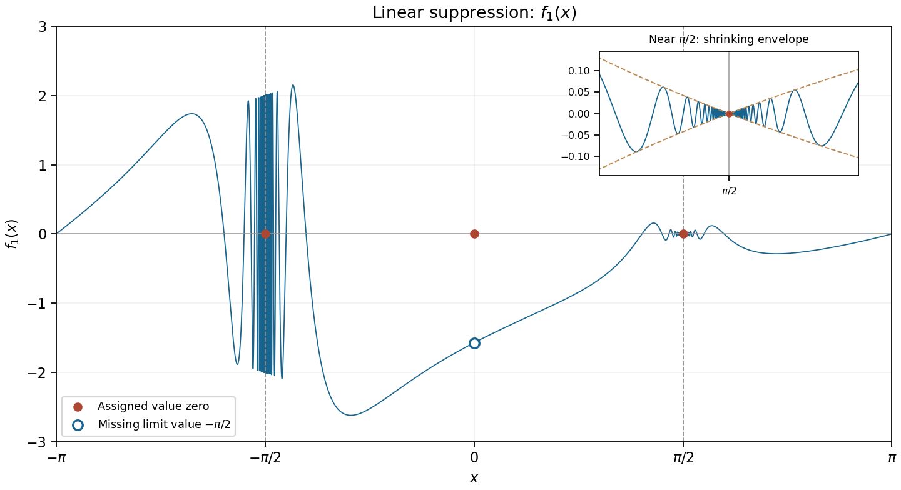

<h1 id="20/a/ii/solution">Solution</h1>

↑ **Parent:** [Ii](../ii.md)

At $-a$, the prefactor $(x-a)/x$ tends to $2$, so the nonvanishing [amplitude](../../../../../../wave-amplitude.md) leaves the oscillatory discontinuity intact. At zero, use $\sin(\tan x)=x+O(x^3)$ to obtain

$$
f_1(x)=\left(1-\frac ax\right)[x+O(x^3)]
=-a+x+O(x^2).
$$

The limit is $-a$, whereas the assigned value is zero. This is a [removable discontinuity](../../../../../../removable-discontinuity.md), not a continuous crossing.

At $a$, write $x=a+h$. The estimate

$$
|f_1(a+h)|\leq\frac{|h|}{|a+h|}\longrightarrow0
$$

proves [continuity](../../../../../../continuous-function.md) at the assigned zero. But its [difference quotient](../../../../../../difference-quotient.md) is

$$
\frac{f_1(a+h)-f_1(a)}h=\frac{\sin(\tan(a+h))}{a+h}.
$$

The sequences from part (i) make this approach $1/a$ and $-1/a$, so the [derivative](../../../../../../derivative.md) does not exist. This illustrates the distinct [continuity and differentiability thresholds for a damped oscillation](../../../../../../continuity-and-differentiability-thresholds-for-a-damped-oscillation.md).

Therefore **the discontinuities are $x=-\pi/2$ and $x=0$; the nondifferentiability points are $x=-\pi/2,0,\pi/2$**. The [function](../../../../../../function-split.md) is [smooth](../../../../../../smooth-function.md) elsewhere.

**[Figure 5](#20/a/ii/image-linear-suppression-of-the-positive-pole-oscillations-with-a-removable-discontinuity-at-zero). Linear suppression of the positive-pole oscillations, with a removable discontinuity at zero**.

## ↑ Ancestors (14)

1. [Ii](../ii.md)
2. [A](../../a.md)
3. [20](../../../20.md)
4. [Paper 1](../../../../paper-1-split.md)
5. [2011](../../../../split.md)
6. [Past exam of the mathematics course of the year 1 of the natural sciences course of the University of Cambridge](../../../../../split.md)
7. [Mathematics course of the year 1 of the natural sciences course of the University of Cambridge](../../../../../../mathematics-course-of-the-year-1-of-the-natural-sciences-course-of-the-university-of-cambridge.md)
8. [Year 1 of the natural sciences course of the University of Cambridge](../../../../../../year-1-of-the-natural-sciences-course-of-the-university-of-cambridge.md)
9. [Year of the natural sciences course of the University of Cambridge](../../../../../../year-of-the-natural-sciences-course-of-the-university-of-cambridge.md)
10. [Natural sciences course of the University of Cambridge](../../../../../../natural-sciences-course-of-the-university-of-cambridge.md)
11. [Course of the University of Cambridge](../../../../../../course-of-the-university-of-cambridge.md)
12. [University of Cambridge](../../../../../../university-of-cambridge-split.md)
13. [List of universities](../../../../../../list-of-universities.md)
14. [Codex Wiki](../../../../../../split.md)
