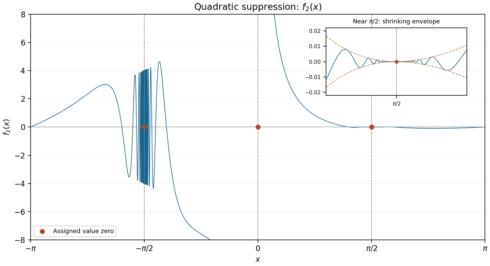

<h1 id="20/a/iii/solution">Solution</h1>

↑ **Parent:** [Iii](../iii.md)

At $-a$, the squared prefactor tends to $4$, so the oscillatory discontinuity again remains. Near zero,

$$
f_2(x)=\left(1-\frac{2a}{x}+\frac{a^2}{x^2}\right)[x+O(x^3)]
=\frac{a^2}{x}-2a+O(x).
$$

It is unbounded near zero, despite its assigned zero value there, so it is neither continuous nor [differentiable](../../../../../../differentiable-function.md) at zero.

At $a$, put $x=a+h$. Then

$$
|f_2(a+h)|\leq\frac{h^2}{(a+h)^2},\qquad
\left|\frac{f_2(a+h)-f_2(a)}h\right|\leq\frac{|h|}{(a+h)^2}\longrightarrow0.
$$

Thus **$f_2$ is continuous and [differentiable](../../../../../../differentiable-function.md) at $x=\pi/2$, with $f_2'(\pi/2)=0$**. After translating the point to zero, the estimate shows how [quadratic damping restores differentiability at the origin](../../../../../../quadratic-damping-restores-differentiability-at-the-origin.md). The only discontinuities and nondifferentiability points are **$x=-\pi/2$ and $x=0$**; the [function](../../../../../../function-split.md) is [smooth](../../../../../../smooth-function.md) away from these two points and $\pi/2$. At $\pi/2$, its [derivative](../../../../../../derivative.md) exists but is not continuous.

Indeed, for $x\ne a$ near $a$, put $B(x)=(x-a)^2/x^2$. Then $f_2'=B'\sin(\tan x)+B\sec^2x\cos(\tan x)$. Here $B'\to0$ and $B\sec^2x\to1/a^2$, so the [derivative](../../../../../../derivative.md) retains oscillations. Existence of the [derivative](../../../../../../derivative.md) at a point does not require [continuity](../../../../../../continuous-function.md) of nearby [derivatives](../../../../../../derivative.md).

**[Figure 6](#20/a/iii/image-quadratic-suppression-giving-a-zero-derivative-at-the-positive-pole-and-an-unbounded-discontinuity-at-zero). Quadratic suppression giving a zero derivative at the positive pole, and an unbounded discontinuity at zero**.

## ↑ Ancestors (14)

1. [Iii](../iii.md)
2. [A](../../a.md)
3. [20](../../../20.md)
4. [Paper 1](../../../../paper-1-split.md)
5. [2011](../../../../split.md)
6. [Past exam of the mathematics course of the year 1 of the natural sciences course of the University of Cambridge](../../../../../split.md)
7. [Mathematics course of the year 1 of the natural sciences course of the University of Cambridge](../../../../../../mathematics-course-of-the-year-1-of-the-natural-sciences-course-of-the-university-of-cambridge.md)
8. [Year 1 of the natural sciences course of the University of Cambridge](../../../../../../year-1-of-the-natural-sciences-course-of-the-university-of-cambridge.md)
9. [Year of the natural sciences course of the University of Cambridge](../../../../../../year-of-the-natural-sciences-course-of-the-university-of-cambridge.md)
10. [Natural sciences course of the University of Cambridge](../../../../../../natural-sciences-course-of-the-university-of-cambridge.md)
11. [Course of the University of Cambridge](../../../../../../course-of-the-university-of-cambridge.md)
12. [University of Cambridge](../../../../../../university-of-cambridge-split.md)
13. [List of universities](../../../../../../list-of-universities.md)
14. [Codex Wiki](../../../../../../split.md)
