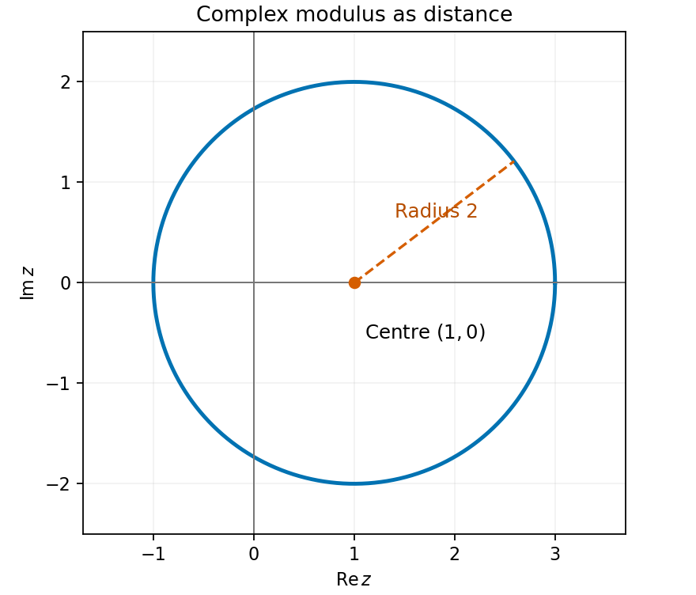
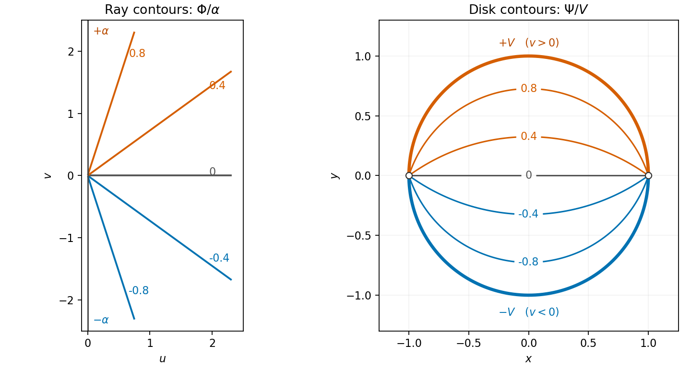

# Paper 2

↑ **Parent:** [2011](../2011.md)

[https://www.maths.cam.ac.uk/undergradnst/files/2011/PaperNST_IA_2.pdf](https://www.maths.cam.ac.uk/undergradnst/files/2011/PaperNST_IA_2.pdf)

**Table of contents**

- [1](#1)
  - [Solution](#1/solution)
- [2](#2)
  - [Solution](#2/solution)
- [3](#3)
  - [Solution](#3/solution)
- [4](#4)
  - [Solution](#4/solution)
- [5](#5)
  - [Solution](#5/solution)
- [6](#6)
  - [Solution](#6/solution)
- [7](#7)
  - [Solution](#7/solution)
- [8](#8)
  - [Solution](#8/solution)
- [9](#9)
  - [Solution](#9/solution)
- [10](#10)
  - [Solution](#10/solution)
- [11](#11)
  - [a](#11/a)
    - [i](#11/a/i)
      - [Solution](#11/a/i/solution)
    - [ii](#11/a/ii)
      - [Solution](#11/a/ii/solution)
    - [iii](#11/a/iii)
      - [Solution](#11/a/iii/solution)
  - [b](#11/b)
    - [i](#11/b/i)
      - [Solution](#11/b/i/solution)
    - [ii](#11/b/ii)
      - [Solution](#11/b/ii/solution)
- [12](#12)
  - [a](#12/a)
    - [Solution](#12/a/solution)
  - [b](#12/b)
    - [Solution](#12/b/solution)
  - [c](#12/c)
    - [Solution](#12/c/solution)
  - [d](#12/d)
    - [Solution](#12/d/solution)
- [13](#13)
  - [a](#13/a)
    - [Solution](#13/a/solution)
  - [b](#13/b)
    - [Solution](#13/b/solution)
  - [c](#13/c)
    - [Solution](#13/c/solution)
- [14](#14)
  - [a](#14/a)
    - [i](#14/a/i)
      - [Solution](#14/a/i/solution)
    - [ii](#14/a/ii)
      - [Solution](#14/a/ii/solution)
    - [iii](#14/a/iii)
      - [Solution](#14/a/iii/solution)
    - [iv](#14/a/iv)
      - [Solution](#14/a/iv/solution)
  - [b](#14/b)
    - [i](#14/b/i)
      - [Solution](#14/b/i/solution)
    - [ii](#14/b/ii)
      - [Solution](#14/b/ii/solution)
- [15](#15)
  - [a](#15/a)
    - [Solution](#15/a/solution)
  - [b](#15/b)
    - [Solution](#15/b/solution)
- [16](#16)
  - [a](#16/a)
    - [Solution](#16/a/solution)
  - [b](#16/b)
    - [Solution](#16/b/solution)
  - [c](#16/c)
    - [Solution](#16/c/solution)
- [17](#17)
  - [a](#17/a)
    - [Solution](#17/a/solution)
  - [b](#17/b)
    - [Solution](#17/b/solution)
- [18](#18)
  - [a](#18/a)
    - [Solution](#18/a/solution)
  - [b](#18/b)
    - [Solution](#18/b/solution)
  - [c](#18/c)
    - [Solution](#18/c/solution)
- [19](#19)
  - [a](#19/a)
    - [Solution](#19/a/solution)
  - [b](#19/b)
    - [Solution](#19/b/solution)
  - [c](#19/c)
    - [Solution](#19/c/solution)
- [20](#20)
  - [a](#20/a)
    - [Solution](#20/a/solution)
  - [b](#20/b)
    - [Solution](#20/b/solution)
  - [c](#20/c)
    - [Solution](#20/c/solution)

## 1

↑ **Parent:** [Paper 2](paper-2.md)

<h3 id="1/solution">Solution</h3>

↑ **Parent:** [1](#1)

Perpendicular [vectors](../../vector-space.md#vector) have zero [dot product](../../inner-product.md#dot-product). Here $\mathbf u\cdot\mathbf v=3\cdot4-2c$, so $12-2c=0$. Therefore

$$
\boxed{c=6}.
$$

## 2

↑ **Parent:** [Paper 2](paper-2.md)

<h3 id="2/solution">Solution</h3>

↑ **Parent:** [2](#2)

The numerator is the [derivative](../../calculus.md#derivative) of the denominator. Using the [chain rule](../../calculus.md#chain-rule) in reverse gives the [antiderivative](../../integral.md#antiderivative)

$$
\boxed{\ln|x^2+3x-2|+C}.
$$

The [absolute value](../../real-analysis.md#absolute-value) makes this real on every interval where the denominator is nonzero. The integration constant may be chosen independently on the intervals separated by $x=(-3\pm\sqrt{17})/2$.

## 3

↑ **Parent:** [Paper 2](paper-2.md)

<h3 id="3/solution">Solution</h3>

↑ **Parent:** [3](#3)

The [quotient rule](../../calculus.md#quotient-rule) simplifies the [derivative](../../calculus.md#derivative) to

$$
y'=\frac{7(x+1)(x+5)}{(x-1)^2(x+2)^2}.
$$

Its zeros are $-5$ and $-1$, both in the domain. Substitution gives the two [stationary points](../../calculus-of-variations.md#stationary-point)

$$
\boxed{(-5,25/9),\qquad(-1,9)}.
$$

The first is a [local maximum](../../analysis.md#local-maximum) and the second a [local minimum](../../analysis.md#local-minimum), since the numerator of $y'$ changes sign from positive to negative at $-5$ and from negative to positive at $-1$. The denominator of the original [rational function](../../isolated-singularity.md#rational-function) vanishes at

$$
\boxed{x=-2,\qquad x=1}.
$$

The numerator is nonzero at both values, so these discontinuities are poles, not removable holes.

## 4

↑ **Parent:** [Paper 2](paper-2.md)

<h3 id="4/solution">Solution</h3>

↑ **Parent:** [4](#4)

Direct [matrix multiplication](../../vector-space.md#matrix-multiplication) gives

$$
A^2=\begin{pmatrix}9&8\\16&17\end{pmatrix},\qquad
4A+5I=\begin{pmatrix}9&8\\16&17\end{pmatrix}.
$$

Subtracting verifies $\boxed{A^2-4A-5I=0}$. This is also the [Cayley-Hamilton theorem](../../cayley-hamilton-theorem.md) for the [characteristic polynomial](../../linear-operator-theory.md#characteristic-polynomial) $\lambda^2-4\lambda-5$.

## 5

↑ **Parent:** [Paper 2](paper-2.md)

<h3 id="5/solution">Solution</h3>

↑ **Parent:** [5](#5)

Rationalize with the [complex conjugate](../../complex-analysis.md#complex-conjugate) $4-3i$:

$$
\frac{5-2i}{4+3i}=\frac{(5-2i)(4-3i)}{4^2+3^2}
=\frac{14-23i}{25}.
$$

Thus the [real part](../../complex-analysis.md#real-part) and [imaginary part](../../complex-analysis.md#imaginary-part) are

$$
\boxed{\operatorname{Re}=\frac{14}{25},\qquad\operatorname{Im}=-\frac{23}{25}}.
$$

## 6

↑ **Parent:** [Paper 2](paper-2.md)

<h3 id="6/solution">Solution</h3>

↑ **Parent:** [6](#6)

For $f(x)=\sqrt x$, the first two [derivatives](../../calculus.md#derivative) at one are $f'(1)=1/2$ and $f''(1)=-1/4$. The [Taylor expansion](../../calculus.md#taylor-expansion) begins

$$
\boxed{\sqrt x=1+\frac12(x-1)-\frac18(x-1)^2+O((x-1)^3)}.
$$

All three displayed terms are nonzero terms of the expansion about one.

## 7

↑ **Parent:** [Paper 2](paper-2.md)

<h3 id="7/solution">Solution</h3>

↑ **Parent:** [7](#7)

This is a [separable differential equation](../../differential-equation.md#separable-differential-equation). Multiply by $e^{-y}$ and integrate:

$$
-e^{-y}=\frac12\ln(1+x^2)+C.
$$

The [initial condition](../../differential-equation.md#initial-condition) gives $C=-1$. Hence

$$
\boxed{y(x)=-\ln\left(1-\frac12\ln(1+x^2)\right)}.
$$

For a real solution the outer [logarithm](../../calculus.md#logarithm) requires a positive argument. The maximal interval containing the initial point is therefore $\boxed{|x|<\sqrt{e^2-1}}$. At either endpoint $y$ diverges, so the real solution cannot continue through it with a finite value.

## 8

↑ **Parent:** [Paper 2](paper-2.md)

<h3 id="8/solution">Solution</h3>

↑ **Parent:** [8](#8)

Write $z=x+iy$. The [complex modulus](../../complex-analysis.md#complex-modulus) condition is equivalent to $(x-1)^2+y^2=4$. Thus the locus is a **[circle](../../topology.md#circle) of radius two centred at $(1,0)$** in the [complex plane](../../complex-analysis.md#complex-plane). Its extreme points are $(-1,0)$, $(3,0)$, and $(1,\pm2)$.

**[Figure 1](#8/image-circle-in-the-complex-plane-with-centre-one-and-radius-two). Circle in the complex plane with centre one and radius two**.

## 9

↑ **Parent:** [Paper 2](paper-2.md)

<h3 id="9/solution">Solution</h3>

↑ **Parent:** [9](#9)

The [derivative](../../calculus.md#derivative) is $dy/dx=3x^2$, giving slope twelve at $x=2$. The point on the [curve](../../topology.md#curve) is $(2,9)$. The point-slope equation of the [tangent line](../../calculus.md#tangent-line) is consequently

$$
\boxed{y-9=12(x-2),\qquad y=12x-15}.
$$

## 10

↑ **Parent:** [Paper 2](paper-2.md)

<h3 id="10/solution">Solution</h3>

↑ **Parent:** [10](#10)

In [Cartesian coordinates](../../linear-algebra.md#cartesian-coordinate-system), the [divergence](../../multivariable-calculus.md#divergence) uses the matching coordinate for each component:

$$
\boxed{\nabla\cdot\mathbf F=\partial_xy+\partial_yz+\partial_zx=0}.
$$

Each of these three [partial derivatives](../../multivariable-calculus.md#partial-derivative) vanishes.

## 11

↑ **Parent:** [Paper 2](paper-2.md)

<h3 id="11/a">a</h3>

↑ **Parent:** [11](#11)

<h4 id="11/a/i">i</h4>

↑ **Parent:** [A](#11/a)

<h5 id="11/a/i/solution">Solution</h5>

↑ **Parent:** [I](#11/a/i)

The [gradient](../../multivariable-calculus.md#gradient) part contributes zero around a closed path by the [fundamental theorem for line integrals](../../multivariable-calculus.md#fundamental-theorem-for-line-integrals):

$$
\oint_{\Gamma_1}3\nabla\phi\cdot d\mathbf x=0.
$$

Along the parametrization, $x^2+z^2=1$, so the first two components of $\mathbf w$ vanish wherever the printed expression is defined. The remaining component gives $\mathbf w\cdot d\mathbf x=x\,dz=\cos^2\theta\,d\theta$. Thus

$$
\boxed{\oint_{\Gamma_1}(3\mathbf v+\mathbf w)\cdot d\mathbf x
=\int_0^{2\pi}\cos^2\theta\,d\theta=\pi}.
$$

**The printed field needs a qualification:** $\operatorname{arctanh}(x^2)$ is undefined at the isolated parameters where $x^2=1$, so $0\operatorname{arctanh}(1)$ cannot literally be evaluated. The result above is the [improper line integral](../../multivariable-calculus.md#improper-line-integral), or equivalently the [integral](../../integral.md) of the continuous extension of the restricted field along the [curve](../../topology.md#curve). That restricted field tends to $(0,0,\cos\theta)$ at each omitted parameter. No extension of the full field to a neighbourhood is being assumed.

<h4 id="11/a/ii">ii</h4>

↑ **Parent:** [A](#11/a)

<h5 id="11/a/ii/solution">Solution</h5>

↑ **Parent:** [Ii](#11/a/ii)

The [curl of a gradient](../../multivariable-calculus.md#curl-of-a-gradient) vanishes because the mixed second [partial derivatives](../../multivariable-calculus.md#partial-derivative) of the smooth [function](../../function.md) $\phi$ agree. Therefore $\nabla\times\mathbf v=\nabla\times\nabla\phi=0$ everywhere, and

$$
\boxed{\int_{\Gamma_2}(\nabla\times\mathbf v)\cdot d\mathbf x=0}.
$$

Unlike part (i), this integrand does not involve the problematic auxiliary field.

<h4 id="11/a/iii">iii</h4>

↑ **Parent:** [A](#11/a)

<h5 id="11/a/iii/solution">Solution</h5>

↑ **Parent:** [Iii](#11/a/iii)

Where $\mathbf A=|\mathbf v|^2\mathbf w$ is twice continuously differentiable, the identity [divergence of a curl is zero](../../multivariable-calculus.md#divergence-of-a-curl-is-zero) gives $\nabla\cdot(\nabla\times\mathbf A)=0$. All regular portions of the parameter interval lie in this region, hence

$$
\boxed{\int_{\Gamma_2}\nabla\cdot[\nabla\times(|\mathbf v|^2\mathbf w)]\,ds=0}
$$

as an [improper line integral](../../multivariable-calculus.md#improper-line-integral). Besides the $\operatorname{arctanh}(x^2)$ endpoint problem from (i), the [curve](../../topology.md#curve) touches $y=1$ at $\theta=\pi/2$, where the printed real $\arcsin y$ expression has no smooth open neighbourhood. The identity applies on the intervening open segments, and its zero value has a unique continuous extension along the [curve](../../topology.md#curve). A literal classical integrand at every parameter is not supplied by the printed field.

<h3 id="11/b">b</h3>

↑ **Parent:** [11](#11)

<h4 id="11/b/i">i</h4>

↑ **Parent:** [B](#11/b)

<h5 id="11/b/i/solution">Solution</h5>

↑ **Parent:** [I](#11/b/i)

Writing $r^2=x^2+y^2+z^2$, the [gradient](../../multivariable-calculus.md#gradient) is $\mathbf v=2e^{r^2}(x,y,z)$. Its [divergence](../../multivariable-calculus.md#divergence), equivalently the [Laplacian](../../multivariable-calculus.md#laplacian) of $\phi$, is

$$
\nabla\cdot\mathbf v=(6+4r^2)e^{r^2}.
$$

On the unit [sphere](../../euclidean-geometry.md#sphere) this [scalar](../../vector-space.md#scalar) is the constant $10e$. The lower [hemisphere](../../euclidean-geometry.md#hemisphere) has [surface area](../../differential-geometry.md#surface-area) $2\pi$, so

$$
\boxed{\int_S(\nabla\cdot\mathbf v)\,dS=20\pi e}.
$$

This is a [scalar](../../vector-space.md#scalar) [surface integral](../../multivariable-calculus.md#surface-integral) of the divergence, not the electric- or vector-field flux [integral](../../integral.md). There is no normal component to insert.

<h4 id="11/b/ii">ii</h4>

↑ **Parent:** [B](#11/b)

<h5 id="11/b/ii/solution">Solution</h5>

↑ **Parent:** [Ii](#11/b/ii)

The [scalar](../../vector-space.md#scalar) integrand still equals $10e$ throughout the unit [sphere](../../euclidean-geometry.md#sphere), and the upper [hemisphere](../../euclidean-geometry.md#hemisphere) has the same [surface area](../../differential-geometry.md#surface-area) $2\pi$. Excluding its equator changes no [area](../../differential-geometry.md#surface-area). Therefore

$$
\boxed{\int_{S'}(\nabla\cdot\mathbf v)\,dS=20\pi e}.
$$

There is no sign reversal between hemispheres because this [scalar](../../vector-space.md#scalar) [surface integral](../../multivariable-calculus.md#surface-integral) has no choice of normal orientation.

## 12

↑ **Parent:** [Paper 2](paper-2.md)

<h3 id="12/a">a</h3>

↑ **Parent:** [12](#12)

<h4 id="12/a/solution">Solution</h4>

↑ **Parent:** [A](#12/a)

Using the physics convention for [spherical coordinates](../../multivariable-calculus.md#spherical-coordinate-system), the [polar angle](../../multivariable-calculus.md#polar-angle) $\theta$ is measured from positive $z$ and the [azimuth](../../astrophysics.md#azimuth) $\phi$ from positive $x$ toward positive $y$. The [Cartesian coordinates](../../linear-algebra.md#cartesian-coordinate-system) are

$$
\boxed{x=r\sin\theta\cos\phi,\qquad y=r\sin\theta\sin\phi,\qquad z=r\cos\theta}.
$$

<h3 id="12/b">b</h3>

↑ **Parent:** [12](#12)

<h4 id="12/b/solution">Solution</h4>

↑ **Parent:** [B](#12/b)

Hold $r$ fixed and differentiate the position [vector](../../vector-space.md#vector) $\mathbf X(\theta,\phi)$. Its coordinate tangent [vectors](../../vector-space.md#vector) are

$$
\mathbf X_\theta=r(\cos\theta\cos\phi,\cos\theta\sin\phi,-\sin\theta),\qquad
\mathbf X_\phi=r(-\sin\theta\sin\phi,\sin\theta\cos\phi,0).
$$

Their [dot product](../../inner-product.md#dot-product) is zero, and their squared [Euclidean norms](../../normed-vector-space.md#euclidean-norm) are $r^2$ and $r^2\sin^2\theta$. To first order, the displacement is $\delta\mathbf X=\mathbf X_\theta\delta\theta+\mathbf X_\phi\delta\phi+O((|\delta\theta|+|\delta\phi|)^2)$. Squaring gives

$$
\boxed{\delta s^2\simeq r^2(\delta\theta^2+\sin^2\theta\,\delta\phi^2)}.
$$

This is the [line element on a sphere](../../riemannian-metric.md#line-element-on-a-sphere). The chord distance and the short surface [arc length](../../riemannian-geometry.md#arc-length) agree to the order retained here.

<h3 id="12/c">c</h3>

↑ **Parent:** [12](#12)

<h4 id="12/c/solution">Solution</h4>

↑ **Parent:** [C](#12/c)

A [plane](../../geometry-and-topology.md#plane) through the origin has equation $lx+my+nz=0$ for some nonzero normal $(l,m,n)$. Dividing that normal by its [Euclidean norm](../../normed-vector-space.md#euclidean-norm) makes $l^2+m^2+n^2=1$ without changing the [plane](../../geometry-and-topology.md#plane). Substitute the [spherical coordinates](../../multivariable-calculus.md#spherical-coordinate-system) from (a) and cancel the nonzero radius:

$$
\boxed{l\sin\theta\cos\phi+m\sin\theta\sin\phi+n\cos\theta=0,\qquad
l^2+m^2+n^2=1}.
$$

Its intersection with the [sphere](../../euclidean-geometry.md#sphere) is the desired [great circle](../../euclidean-geometry.md#great-circle); changing the sign of all three coefficients describes the same [circle](../../topology.md#circle).

<h3 id="12/d">d</h3>

↑ **Parent:** [12](#12)

<h4 id="12/d/solution">Solution</h4>

↑ **Parent:** [D](#12/d)

At the first endpoint, the [Cartesian coordinates](../../linear-algebra.md#cartesian-coordinate-system) are $(r,0,0)$, so its [great circle](../../euclidean-geometry.md#great-circle) must have $l=0$. At the second endpoint, the [plane](../../geometry-and-topology.md#plane) condition gives $m\sin\theta_0\sin\phi_0+n\cos\theta_0=0$. Since $\cos\theta_0>0$, an equivalent regular [plane](../../geometry-and-topology.md#plane) equation is

$$
\boxed{\cos\theta_0\sin\theta\sin\phi-\sin\theta_0\sin\phi_0\cos\theta=0}.
$$

Where $\cos\theta\ne0$, divide by $\cos\theta_0\cos\theta$ to obtain

$$
\boxed{\tan\theta\sin\phi=\tan\theta_0\sin\phi_0}.
$$

The regular implicit equation includes the equatorial first endpoint; the tangent form is undefined there and must be read by a limit. The shorter connecting arc of this [great circle](../../euclidean-geometry.md#great-circle) is the shortest path. The endpoints are not antipodal, so this shorter arc is unique. For example, the central angle is $\delta=\arccos(\sin\theta_0\cos\phi_0)$, giving [spherical distance](../../geometry-and-topology.md#great-circle-distance) $r\delta$.

## 13

↑ **Parent:** [Paper 2](paper-2.md)

<h3 id="13/a">a</h3>

↑ **Parent:** [13](#13)

<h4 id="13/a/solution">Solution</h4>

↑ **Parent:** [A](#13/a)

For $x>0$, the exponential definitions of the [hyperbolic functions](../../calculus.md#hyperbolic-function) give $\cosh x-\sinh x=e^{-x}>0$ and $\sinh x>0$. Taking reciprocals of these positive quantities proves $1/\cosh x<1/\sinh x$. Also $\cosh x>1$ for $x>0$, so division by the positive $\sinh x$ gives $1/\sinh x<\cosh x/\sinh x$. Combining,

$$
\boxed{\frac1{\cosh x}<\frac1{\sinh x}<\coth x\qquad(x>0)}.
$$

<h3 id="13/b">b</h3>

↑ **Parent:** [13](#13)

<h4 id="13/b/solution">Solution</h4>

↑ **Parent:** [B](#13/b)

The specified [unit vector](../../vector-space.md#unit-vector) is $\mathbf u=(\cos(\pi/3),\sin(\pi/3))=(1/2,\sqrt3/2)$; the positive $y$ component selects that direction. The [gradient](../../multivariable-calculus.md#gradient) is $\nabla f=e^{xy}(y,x)$, giving $(0,-2)$ at the point. The [directional derivative](../../multivariable-calculus.md#directional-derivative) is therefore

$$
\boxed{D_{\mathbf u}f=\nabla f\cdot\mathbf u=-\sqrt3}.
$$

<h3 id="13/c">c</h3>

↑ **Parent:** [13](#13)

<h4 id="13/c/solution">Solution</h4>

↑ **Parent:** [C](#13/c)

Since $f>0$, a level $f=c$ can occur only for $c>0$. Taking its [natural logarithm](../../calculus.md#natural-logarithm) gives $xy=\ln c$. Thus $c>1$ produces rectangular [hyperbolas](../../euclidean-geometry.md#hyperbola) in the first and third quadrants, $0<c<1$ produces them in the second and fourth quadrants, and $c=1$ consists of both coordinate axes.

The [gradient](../../multivariable-calculus.md#gradient) $e^{xy}(y,x)$ vanishes only at $(0,0)$, where $f=1$. The [Hessian matrix](../../multivariable-calculus.md#hessian-matrix) there is $\begin{pmatrix}0&1\\1&0\end{pmatrix}$, with negative [determinant](../../multilinear-algebra.md#determinant). Equivalently, $f(x,x)>1$ while $f(x,-x)<1$ for nonzero small $x$. Hence the only [stationary point](../../calculus-of-variations.md#stationary-point) is a **[saddle point](../../analysis.md#saddle-point) at $(0,0,1)$** on the graph; its location in the contour [plane](../../geometry-and-topology.md#plane) is the origin.

**[Figure 2](#13/c/image-contours-of-the-exponential-of-xy-showing-the-unique-saddle-at-the-origin). Contours of the exponential of xy, showing the unique saddle at the origin**.

## 14

↑ **Parent:** [Paper 2](paper-2.md)

<h3 id="14/a">a</h3>

↑ **Parent:** [14](#14)

<h4 id="14/a/i">i</h4>

↑ **Parent:** [A](#14/a)

<h5 id="14/a/i/solution">Solution</h5>

↑ **Parent:** [I](#14/a/i)

Expand the [determinant](../../multilinear-algebra.md#determinant) along the first row:

$$
\det A=(-2)(-12)-2(-6)+(-3)(-3)=24+12+9.
$$

Thus $\boxed{\det A=45}$. The signs in the middle cofactor account for its positive contribution.

<h4 id="14/a/ii">ii</h4>

↑ **Parent:** [A](#14/a)

<h5 id="14/a/ii/solution">Solution</h5>

↑ **Parent:** [Ii](#14/a/ii)

The [characteristic polynomial](../../linear-operator-theory.md#characteristic-polynomial), using the convention $\det(\lambda I-A)$, is

$$
p(\lambda)=\lambda^3+\lambda^2-21\lambda-45
=(\lambda-5)(\lambda+3)^2.
$$

Its zeros give the [eigenvalues](../../linear-operator-theory.md#eigenvalue), including [algebraic multiplicity](../../linear-operator-theory.md#algebraic-multiplicity):

$$
\boxed{5,\qquad-3,\qquad-3}.
$$

Their product is $45$ and their sum is $-1$, agreeing with the [determinant](../../multilinear-algebra.md#determinant) and [trace](../../linear-algebra.md#matrix-trace) of the [matrix](../../vector-space.md#matrix).

<h4 id="14/a/iii">iii</h4>

↑ **Parent:** [A](#14/a)

<h5 id="14/a/iii/solution">Solution</h5>

↑ **Parent:** [Iii](#14/a/iii)

For $\lambda=5$, the [eigenvalue equation](../../linear-operator-theory.md#eigenvalue-equation) reduces to a one-dimensional [eigenspace](../../linear-operator-theory.md#eigenspace) spanned by $(1,2,-1)$. For $\lambda=-3$, the rows of $A+3I$ are multiples of $(1,2,-3)$, so its [eigenspace](../../linear-operator-theory.md#eigenspace) is the [plane](../../geometry-and-topology.md#plane) $x+2y-3z=0$. One possible set of three independent [eigenvectors](../../linear-operator-theory.md#eigenvector) is

$$
\boxed{\mathbf e_1=(1,2,-1)\quad(\lambda=5),\qquad
\mathbf e_2=(-2,1,0),\quad\mathbf e_3=(3,0,1)\quad(\lambda=-3)}.
$$

Every [eigenvector](../../linear-operator-theory.md#eigenvector) for $-3$ is a nonzero [linear combination](../../vector-space.md#linear-combination) of the last two. Their two-dimensional [eigenspace](../../linear-operator-theory.md#eigenspace) shows that the repeated root is not defective: the [matrix](../../vector-space.md#matrix) is [diagonalizable](../../linear-operator-theory.md#diagonalizable-matrix).

<h4 id="14/a/iv">iv</h4>

↑ **Parent:** [A](#14/a)

<h5 id="14/a/iv/solution">Solution</h5>

↑ **Parent:** [Iv](#14/a/iv)

For the particular [eigenvectors](../../linear-operator-theory.md#eigenvector) chosen in (iii), the [dot products](../../inner-product.md#dot-product) are

$$
\mathbf e_1\cdot\mathbf e_2=0,\qquad
\mathbf e_1\cdot\mathbf e_3=2,\qquad
\mathbf e_2\cdot\mathbf e_3=-6.
$$

Thus **only $\mathbf e_1$ and $\mathbf e_2$ are [orthogonal](../../inner-product.md#orthogonal-vectors)** for this choice. The [matrix](../../vector-space.md#matrix) is not symmetric, so distinct [eigenvalues](../../linear-operator-theory.md#eigenvalue) alone do not imply [orthogonality](../../inner-product.md#orthogonal-vectors). Another basis within the repeated [eigenspace](../../linear-operator-theory.md#eigenspace) may change which chosen [vectors](../../vector-space.md#vector) are perpendicular; the dot products above specify the convention completely.

<h3 id="14/b">b</h3>

↑ **Parent:** [14](#14)

<h4 id="14/b/i">i</h4>

↑ **Parent:** [B](#14/b)

<h5 id="14/b/i/solution">Solution</h5>

↑ **Parent:** [I](#14/b/i)

The [transpose](../../vector-space.md#transpose) reverses product order, so $(CB)^{\mathsf T}=B^{\mathsf T}C^{\mathsf T}$. If $B$ is an [orthogonal matrix](../../linear-algebra.md#orthogonal-matrix), then $B^{-1}=B^{\mathsf T}$ and the given identity becomes

$$
B^{\mathsf T}(C^{\mathsf T}+C)=0.
$$

Multiply on the left by $B$ to obtain $C^{\mathsf T}+C=0$. Therefore **$C$ is antisymmetric**, so it is an [antisymmetric matrix](../../linear-algebra.md#skew-symmetric-matrix), namely $\boxed{C^{\mathsf T}=-C}$.

<h4 id="14/b/ii">ii</h4>

↑ **Parent:** [B](#14/b)

<h5 id="14/b/ii/solution">Solution</h5>

↑ **Parent:** [Ii](#14/b/ii)

Take [determinants](../../multilinear-algebra.md#determinant) of $(CB)^{\mathsf T}=-B^{-1}C$. In order three, multiplication of a [matrix](../../vector-space.md#matrix) by minus one changes its [determinant](../../multilinear-algebra.md#determinant)'s sign. Hence

$$
\det C\,\det B=-\frac{\det C}{\det B}.
$$

The assumption $\det(B^{\mathsf T})\ne0$ is the same as $\det B\ne0$, so multiplication by $\det B$ gives

$$
\bigl((\det B)^2+1\bigr)\det C=0.
$$

Since the [matrices](../../vector-space.md#matrix) are real, the first factor is strictly positive. Thus $\boxed{\det C=0}$, proving that $C$ is a [singular matrix](../../linear-algebra.md#singular-matrix). This is [singularity forced by an odd-dimensional transpose-inverse identity](../../linear-algebra.md#singularity-forced-by-an-odd-dimensional-transpose-inverse-identity); no [orthogonality](../../inner-product.md#orthogonal-vectors) of $B$ was used.

## 15

↑ **Parent:** [Paper 2](paper-2.md)

<h3 id="15/a">a</h3>

↑ **Parent:** [15](#15)

<h4 id="15/a/solution">Solution</h4>

↑ **Parent:** [A](#15/a)

First solve for the [velocity](../../classical-mechanics.md#velocity) components. The [integrating factor](../../linear-ordinary-differential-equation.md#integrating-factor) $e^{\gamma t}$ gives

$$
\dot x=V_{0x}e^{-\gamma t},\qquad
\dot z=\left(V_{0z}+\frac g\gamma\right)e^{-\gamma t}-\frac g\gamma.
$$

Integrating once more and imposing the initial position gives

$$
\boxed{x(t)=\frac{V_{0x}}\gamma(1-e^{-\gamma t}),\qquad
z(t)=\frac{V_{0z}+g/\gamma}\gamma(1-e^{-\gamma t})-\frac g\gamma t}.
$$

These formulas describe [projectile motion with linear drag](../../fluid-mechanics.md#projectile-motion-with-linear-drag). Differentiation checks both second-order [differential equations](../../differential-equation.md) and both initial velocities. At large positive [time](../../classical-mechanics.md#time-in-physics), the horizontal [velocity](../../classical-mechanics.md#velocity) tends to zero and the vertical [velocity](../../classical-mechanics.md#velocity) tends to the terminal value $-g/\gamma$.

<h3 id="15/b">b</h3>

↑ **Parent:** [15](#15)

<h4 id="15/b/solution">Solution</h4>

↑ **Parent:** [B](#15/b)

If $V_{0x}\ne0$, the first formula in (a) gives $e^{-\gamma t}=1-\gamma x/V_{0x}$ and

$$
t=-\frac1\gamma\ln\left(1-\frac{\gamma x}{V_{0x}}\right).
$$

Substitute this and $1-e^{-\gamma t}=\gamma x/V_{0x}$ into $z(t)$:

$$
\boxed{z(x)=\left(\frac{V_{0z}}{V_{0x}}+\frac{g}{\gamma V_{0x}}\right)x
+\frac{g}{\gamma^2}\ln\left(1-\frac{\gamma x}{V_{0x}}\right)}.
$$

For finite physical times $t\geq0$, the domain is $0\leq\gamma x/V_{0x}<1$, valid for either sign of $V_{0x}$. If $V_{0x}=0$, the trajectory is vertical, $x(t)=0$, and in general no single-valued graph $z(x)$ describes it. As a consistency check, the logarithmic expansion at fixed $x$ cancels the apparent $1/\gamma$ terms and gives $z\to(V_{0z}/V_{0x})x-gx^2/(2V_{0x}^2)$ as $\gamma\to0$, the drag-free [parabola](../../euclidean-geometry.md#parabola).

## 16

↑ **Parent:** [Paper 2](paper-2.md)

<h3 id="16/a">a</h3>

↑ **Parent:** [16](#16)

<h4 id="16/a/solution">Solution</h4>

↑ **Parent:** [A](#16/a)

Use the [integration by substitution](../../integral.md#integration-by-substitution) $x=\sin\theta$, with $-\pi/6\leq\theta\leq\pi/6$. On this interval $\cos\theta>0$, so it cancels the positive denominator [square root](../../algebra.md#square-root). The transformed [integral](../../integral.md) is

$$
\frac12\int_{-\pi/6}^{\pi/6}\sqrt{1-\frac49\sin^2\theta}\,d\theta.
$$

Its integrand is even. Therefore the answer in the PDF's modulus-amplitude convention for the [elliptic integral of the second kind](../../complex-analysis.md#elliptic-integral-of-the-second-kind) is

$$
\boxed{E\left(\frac23,\frac\pi6\right)}.
$$

The modulus is $2/3$, not the squared parameter $4/9$.

<h3 id="16/b">b</h3>

↑ **Parent:** [16](#16)

<h4 id="16/b/solution">Solution</h4>

↑ **Parent:** [B](#16/b)

Differentiating the parametrization gives $dx=a\cos\theta\,d\theta$ and $dy=-b\sin\theta\,d\theta$. Thus the [arc length](../../riemannian-geometry.md#arc-length) element is

$$
ds=\sqrt{a^2\cos^2\theta+b^2\sin^2\theta}\,d\theta
=a\sqrt{1-e^2\sin^2\theta}\,d\theta.
$$

All four quadrants give the same contribution. Consequently the [ellipse](../../euclidean-geometry.md#ellipse) perimeter is

$$
\boxed{L=a\int_0^{2\pi}\sqrt{1-e^2\sin^2\theta}\,d\theta
=4aE(e,\pi/2)}.
$$

The final factor is the [complete elliptic integral of the second kind](../../complex-analysis.md#complete-elliptic-integral-of-the-second-kind), evaluated at the [eccentricity of a conic](../../euclidean-geometry.md#eccentricity-of-a-conic) $e$.

<h3 id="16/c">c</h3>

↑ **Parent:** [16](#16)

<h4 id="16/c/solution">Solution</h4>

↑ **Parent:** [C](#16/c)

For small $e$, the [binomial series](../../sequence-and-series.md#binomial-series) gives the uniform expansion $\sqrt{1-e^2\sin^2\theta}=1-(e^2/2)\sin^2\theta+O(e^4)$. Since $\int_0^{2\pi}\sin^2\theta\,d\theta=\pi$, integration yields

$$
\boxed{L=2\pi a\left(1-\frac{e^2}{4}\right)+O(ae^4)
=\frac{\pi(3a^2+b^2)}{2a}+O\left(\frac{(a^2-b^2)^2}{a^3}\right)}.
$$

Also $b=a\sqrt{1-e^2}=a(1-e^2/2+O(e^4))$, so the familiar symmetric approximation $\boxed{L=\pi(a+b)+O(ae^4)}$ is equivalent to this order. This is the first correction in the [ellipse perimeter expansion near a circle](../../euclidean-geometry.md#ellipse-perimeter-expansion-near-a-circle); the two approximate formulas need not agree at order $e^4$.

## 17

↑ **Parent:** [Paper 2](paper-2.md)

<h3 id="17/a">a</h3>

↑ **Parent:** [17](#17)

<h4 id="17/a/solution">Solution</h4>

↑ **Parent:** [A](#17/a)

Temporarily label the individual pieces. A random placement is a uniform [injection](../../algebra.md#injective-function) of thirty-two distinct pieces into sixty-four squares, giving ${}_{64}P_{32}$ equally likely outcomes. For a colour-matching placement, the black pieces have ${}_{32}P_{16}$ available [injections](../../algebra.md#injective-function), and independently the white pieces have the same number within their disjoint set of squares. Therefore

$$
\boxed{P=\frac{({}_{32}P_{16})^2}{{}_{64}P_{32}}
=\frac{(32!)^3}{(16!)^2\,64!}}.
$$

Here ${}_nP_r=n!/(n-r)!$. Treating same-colour pieces as indistinguishable gives the same [probability](../../probability-theory.md#probability), because the common within-colour labeling factors cancel. The two colour choices in the favourable count occupy disjoint square sets; no independence assumption about unrestricted placements is required.

<h3 id="17/b">b</h3>

↑ **Parent:** [17](#17)

<h4 id="17/b/solution">Solution</h4>

↑ **Parent:** [B](#17/b)

The lazy choice weights are $1/w$ and $1/(3w)$, in ratio three to one. Normalizing gives $\boxed{l=3/4}$. Let $Q$ denote selection of the first question and let $q=P(\text{Lazy}\mid Q)$. Its conditional [expected value](../../expected-value.md), divided by $m$, is

$$
\frac13q+(1-q)=\frac37,
$$

so $q=6/7$. If the overall lazy fraction is $p$, the [law of total probability](../../probability-space.md#law-of-total-probability) gives $P(Q)=(3/4)p+(1/2)(1-p)=(p+2)/4$. [Bayes' theorem](../../probability-theory.md#bayes-theorem) then gives

$$
\frac67=q=\frac{(3/4)p}{(p+2)/4}=\frac{3p}{p+2}.
$$

Solving $6(p+2)=21p$ yields $\boxed{p=4/5}$. The observed mean is conditioned on the chosen question, so it cannot be equated directly to the unconditional mean over all students.

## 18

↑ **Parent:** [Paper 2](paper-2.md)

<h3 id="18/a">a</h3>

↑ **Parent:** [18](#18)

<h4 id="18/a/solution">Solution</h4>

↑ **Parent:** [A](#18/a)

The integrand separates into a radial and an angular factor, so

$$
\int_0^{\pi/2}\int_0^R r^2\cos\theta\sin\theta\,dr\,d\theta
=\left[\frac{r^3}{3}\right]_0^R
\left[\frac{\sin^2\theta}{2}\right]_0^{\pi/2}
=\boxed{\frac{R^3}{6}}.
$$

The differential printed in the PDF is already $dr\,d\theta$. No further polar Jacobian is to be inserted into this given iterated [integral](../../integral.md).

<h3 id="18/b">b</h3>

↑ **Parent:** [18](#18)

<h4 id="18/b/solution">Solution</h4>

↑ **Parent:** [B](#18/b)

The intersections satisfy $6x-x^2=2x+3$, or $(x-1)(x-3)=0$, so the bounded region has $1\leq x\leq3$. Over that interval the [parabola](../../euclidean-geometry.md#parabola) is above the line, and their height difference is $(x-1)(3-x)$. Thus its [area](../../differential-geometry.md#surface-area) is

$$
\boxed{A=\int_1^3(4x-x^2-3)\,dx
=\left[2x^2-\frac{x^3}{3}-3x\right]_1^3=\frac43}.
$$

Using upper minus lower ensures a positive geometric [area](../../differential-geometry.md#surface-area).

<h3 id="18/c">c</h3>

↑ **Parent:** [18](#18)

<h4 id="18/c/solution">Solution</h4>

↑ **Parent:** [C](#18/c)

The projection onto the $x$-$y$ [plane](../../geometry-and-topology.md#plane) is the [disk](../../topology.md#disk-mathematics) $x^2+y^2\leq4$. In [polar coordinates](../../multivariable-calculus.md#polar-coordinates), the height is $4-r^2$ and the [polar area element](../../multivariable-calculus.md#polar-area-element) is $r\,dr\,d\theta$. The [volume](../../geometry-and-topology.md#volume) is therefore

$$
\boxed{\mathcal V=\int_0^{2\pi}\int_0^2(4-r^2)r\,dr\,d\theta
=2\pi\left[2r^2-\frac{r^4}{4}\right]_0^2=8\pi}.
$$

The radial factor here is required because this [integral](../../integral.md) is being constructed from the geometric [volume](../../geometry-and-topology.md#volume), unlike the already specified [integral](../../integral.md) in (a).

## 19

↑ **Parent:** [Paper 2](paper-2.md)

<h3 id="19/a">a</h3>

↑ **Parent:** [19](#19)

<h4 id="19/a/solution">Solution</h4>

↑ **Parent:** [A](#19/a)

Put $c=2\alpha/\pi$. In the [right half-plane](../../complex-analysis.md#right-half-plane),

$$
\Phi_u=-\frac{cv}{u^2+v^2},\quad
\Phi_v=\frac{cu}{u^2+v^2},\quad
\Phi_{uu}=\frac{2cuv}{(u^2+v^2)^2},\quad
\Phi_{vv}=-\frac{2cuv}{(u^2+v^2)^2}.
$$

The last two cancel, so $\boxed{\Phi_{uu}+\Phi_{vv}=0}$. The possible singular point $(0,0)$ lies outside the open domain $u>0$.

For $\alpha\ne0$, a [level curve](../../topology.md#level-curve) of value $\Phi_0$ has $v/u=\tan(\pi\Phi_0/(2\alpha))$. These are rays from the origin, restricted to the [right half-plane](../../complex-analysis.md#right-half-plane). For positive $\alpha$, the values increase with angle from $-\alpha$ on the lower [boundary](../../topology.md#boundary-of-a-set) to $+\alpha$ on the upper [boundary](../../topology.md#boundary-of-a-set). If $\alpha=0$, the [function](../../function.md) is identically zero. The left panel of the figure in (c) shows these ray-shaped [level curves](../../topology.md#level-curve).

<h3 id="19/b">b</h3>

↑ **Parent:** [19](#19)

<h4 id="19/b/solution">Solution</h4>

↑ **Parent:** [B](#19/b)

Let $D=(1-x)^2+y^2$. Direct [partial differentiation](../../multivariable-calculus.md#partial-derivative), away from $(1,0)$, gives

$$
u_x=v_y=\frac{2((1-x)^2-y^2)}{D^2},\qquad
u_y=-v_x=-\frac{4(1-x)y}{D^2}.
$$

These are the [Cauchy-Riemann equations](../../analysis.md#cauchy-riemann-equations). Equivalently, with $z=x+iy$, the analytic mapping is $u+iv=(1+z)/(1-z)$, the inverse [Cayley transform between the half-plane and disk](../../complex-analysis.md#cayley-transform-between-the-half-plane-and-disk).

The supplied harmonicity result can also be checked by the [multivariable chain rule](../../calculus.md#multivariable-chain-rule). The [Cauchy-Riemann equations](../../analysis.md#cauchy-riemann-equations) imply $\Delta u=\Delta v=0$, $\nabla u\cdot\nabla v=0$, and $|\nabla u|^2=|\nabla v|^2$. Hence

$$
\Delta\Psi=(u_x^2+u_y^2)(\Phi_{uu}+\Phi_{vv})=0.
$$

This is [conformal invariance of harmonicity](../../riemann-surfaces.md#conformal-invariance-of-harmonicity) for the given mapping.

<h3 id="19/c">c</h3>

↑ **Parent:** [19](#19)

<h4 id="19/c/solution">Solution</h4>

↑ **Parent:** [C](#19/c)

Simplify the real component to $u=(1-x^2-y^2)/D$. Thus $u=0$ is the unit [circle](../../topology.md#circle) with $(1,0)$ excluded from the mapping's domain. Its upper semicircle has $v>0$ and its lower semicircle has $v<0$; the point $(-1,0)$ maps to $u=v=0$. Inside the [disk](../../topology.md#disk-mathematics), $u>0$, so the principal arctangent is unambiguous. Setting $\alpha=V$ gives

$$
\boxed{\Psi(x,y)=\frac{2V}{\pi}\arctan\frac{2y}{1-x^2-y^2},\qquad x^2+y^2<1}.
$$

The [Laplace equation](../../partial-differential-equation.md#laplace-equation) follows from (b). Approaching an open upper [boundary](../../topology.md#boundary-of-a-set) arc makes the ratio tend to $+\infty$, giving $+V$; the lower arc gives $-V$. This solution is $V(2F-1)$ in terms of the [harmonic measure of a semicircle in a disk](../../analysis.md#harmonic-measure-of-a-semicircle-in-a-disk) $F$.

The [boundary](../../topology.md#boundary-of-a-set) data jump at $(\pm1,0)$, so no path-independent continuous [boundary](../../topology.md#boundary-of-a-set) value can be imposed at those two junctions. The displayed bounded [harmonic function](../../partial-differential-equation.md#harmonic-function) is the solution with the specified limits on the open arcs; those endpoint discontinuities are part of the idealized [capacitor](../../electromagnetism.md#capacitor) geometry.

**[Figure 3](#19/c/image-harmonic-ray-contours-in-the-right-half-plane-and-the-potential-in-a-disk-with-opposite-semicircle-boundary-values). Harmonic ray contours in the right half-plane and the potential in a disk with opposite semicircle boundary values**.

## 20

↑ **Parent:** [Paper 2](paper-2.md)

<h3 id="20/a">a</h3>

↑ **Parent:** [20](#20)

<h4 id="20/a/solution">Solution</h4>

↑ **Parent:** [A](#20/a)

Apply the [Leibniz rule](../../calculus.md#leibniz-rule) to the $n$th [derivative](../../calculus.md#derivative) in [Rodrigues' formula](../../orthogonal-polynomial.md#rodrigues-formula). If $j$ [derivatives](../../calculus.md#derivative) fall on $e^{-x}$ and $n-j$ on $x^n$, the corresponding term is $\binom nj(-1)^je^{-x}(n!/j!)x^j$. Cancelling the prefactor gives

$$
\boxed{L_n(x)=\sum_{j=0}^n(-1)^j\binom nj\frac{x^j}{j!}}.
$$

The leading coefficient $(-1)^n/n!$ is nonzero, so this is a [polynomial](../../polynomial.md) of degree exactly $n$. In particular, the requested coefficients in $L_{10}$ are

$$
\boxed{[x^{10}]L_{10}=\frac1{10!},\qquad [x^9]L_{10}=-\frac{10!}{(9!)^2}}.
$$

These are the ordinary [Laguerre polynomials](../../linear-operator-theory.md#laguerre-polynomial), with normalization $L_n(0)=1$.

<h3 id="20/b">b</h3>

↑ **Parent:** [20](#20)

<h4 id="20/b/solution">Solution</h4>

↑ **Parent:** [B](#20/b)

Differentiating $v=x^ne^{-x}$ gives $xv'=(n-x)v$. Applying the [Leibniz rule](../../calculus.md#leibniz-rule) $n+1$ times to this identity gives

$$
xv^{(n+2)}+(n+1)v^{(n+1)}=(n-x)v^{(n+1)}-(n+1)v^{(n)}.
$$

Only two terms survive on each side because the multiplying factors are linear. Rearranging yields $xv^{(n+2)}+(x+1)v^{(n+1)}+(n+1)v^{(n)}=0$. Since $v^{(n)}=n!e^{-x}L_n$, the next two [derivatives](../../calculus.md#derivative) are $n!e^{-x}(L_n'-L_n)$ and $n!e^{-x}(L_n''-2L_n'+L_n)$. Substituting and cancelling $n!e^{-x}$ gives

$$
\boxed{xL_n''+(1-x)L_n'+nL_n=0}.
$$

This is [deriving the Laguerre equation from Rodrigues' formula](../../linear-operator-theory.md#deriving-the-laguerre-equation-from-rodrigues-formula), exhibiting $L_n$ as an [eigenfunction](../../linear-operator-theory.md#eigenfunction) of the [Laguerre differential operator on polynomials](../../linear-operator-theory.md#laguerre-differential-operator-on-polynomials).

<h3 id="20/c">c</h3>

↑ **Parent:** [20](#20)

<h4 id="20/c/solution">Solution</h4>

↑ **Parent:** [C](#20/c)

Multiply the two displayed equations by $e^{-x}$ and subtract the one with indices reversed. The product terms combine into the [Lagrange identity for a Sturm-Liouville operator](../../sturm-liouville-theory.md#lagrange-identity-for-a-sturm-liouville-operator):

$$
\frac{d}{dx}\left[xe^{-x}(L_mL_n'-L_nL_m')\right]
+(n-m)e^{-x}L_mL_n=0.
$$

Integrating from zero to infinity gives

$$
\left[xe^{-x}(L_mL_n'-L_nL_m')\right]_0^\infty
+(n-m)\int_0^\infty e^{-x}L_mL_n\,dx=0.
$$

All factors $L_j,L_j'$ are [polynomials](../../polynomial.md). The endpoint term at zero vanishes because of the factor $x$, and the one at infinity vanishes because the [exponential function](../../calculus.md#exponential-function) dominates every [polynomial](../../polynomial.md). Therefore, if $m\ne n$,

$$
\boxed{\int_0^\infty e^{-x}L_m(x)L_n(x)\,dx=0}.
$$

The [integral](../../integral.md) is absolutely convergent. This is [orthogonality](../../inner-product.md#orthogonal-vectors) in the [weighted inner product](../../inner-product.md#weighted-inner-product) with weight $e^{-x}$; the [boundary](../../topology.md#boundary-of-a-set) cancellation is the self-adjoint mechanism behind the [Laguerre differential operator on polynomials](../../linear-operator-theory.md#laguerre-differential-operator-on-polynomials).

## ↑ Ancestors (10)

1. [2011](../2011.md)
2. [Past exam of the mathematics course of the year 1 of the natural sciences course of the University of Cambridge](../../past-exam-of-the-mathematics-course-of-the-year-1-of-the-natural-sciences-course-of-the-university-of-cambridge.md)
3. [Mathematics course of the year 1 of the natural sciences course of the University of Cambridge](../../university-of-cambridge.md#mathematics-course-of-the-year-1-of-the-natural-sciences-course-of-the-university-of-cambridge)
4. [Year 1 of the natural sciences course of the University of Cambridge](../../university-of-cambridge.md#year-1-of-the-natural-sciences-course-of-the-university-of-cambridge)
5. [Year of the natural sciences course of the University of Cambridge](../../university-of-cambridge.md#year-of-the-natural-sciences-course-of-the-university-of-cambridge)
6. [Natural sciences course of the University of Cambridge](../../university-of-cambridge.md#natural-sciences-course-of-the-university-of-cambridge)
7. [Course of the University of Cambridge](../../university-of-cambridge.md#course-of-the-university-of-cambridge)
8. [University of Cambridge](../../university-of-cambridge.md)
9. [List of universities](../../README.md#list-of-universities)
10. [Codex Wiki](../../README.md)
