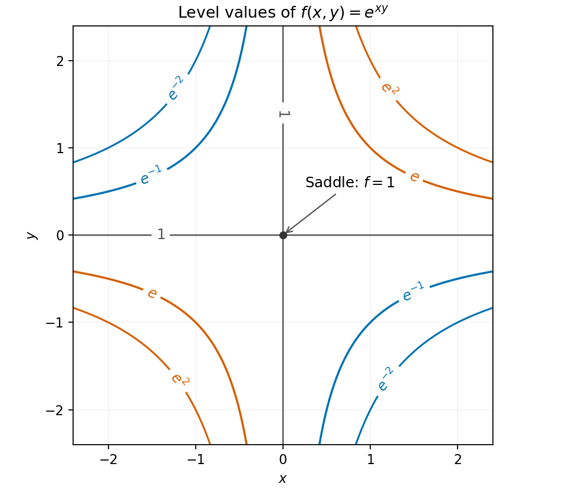

<h1 id="13/c/solution">Solution</h1>

↑ **Parent:** [C](../c.md)

Since $f>0$, a level $f=c$ can occur only for $c>0$. Taking its [natural logarithm](../../../../../natural-logarithm.md) gives $xy=\ln c$. Thus $c>1$ produces rectangular [hyperbolas](../../../../../hyperbola.md) in the first and third quadrants, $0<c<1$ produces them in the second and fourth quadrants, and $c=1$ consists of both coordinate axes.

The [gradient](../../../../../gradient.md) $e^{xy}(y,x)$ vanishes only at $(0,0)$, where $f=1$. The [Hessian matrix](../../../../../hessian-matrix.md) there is $\begin{pmatrix}0&1\\1&0\end{pmatrix}$, with negative [determinant](../../../../../determinant.md). Equivalently, $f(x,x)>1$ while $f(x,-x)<1$ for nonzero small $x$. Hence the only [stationary point](../../../../../stationary-point.md) is a **[saddle point](../../../../../saddle-point.md) at $(0,0,1)$** on the graph; its location in the contour [plane](../../../../../plane.md) is the origin.

**[Figure 2](#13/c/image-contours-of-the-exponential-of-xy-showing-the-unique-saddle-at-the-origin). Contours of the exponential of xy, showing the unique saddle at the origin**.

## ↑ Ancestors (13)

1. [C](../c.md)
2. [13](../../13.md)
3. [Paper 2](../../../paper-2-split.md)
4. [2011](../../../split.md)
5. [Past exam of the mathematics course of the year 1 of the natural sciences course of the University of Cambridge](../../../../split.md)
6. [Mathematics course of the year 1 of the natural sciences course of the University of Cambridge](../../../../../mathematics-course-of-the-year-1-of-the-natural-sciences-course-of-the-university-of-cambridge.md)
7. [Year 1 of the natural sciences course of the University of Cambridge](../../../../../year-1-of-the-natural-sciences-course-of-the-university-of-cambridge.md)
8. [Year of the natural sciences course of the University of Cambridge](../../../../../year-of-the-natural-sciences-course-of-the-university-of-cambridge.md)
9. [Natural sciences course of the University of Cambridge](../../../../../natural-sciences-course-of-the-university-of-cambridge.md)
10. [Course of the University of Cambridge](../../../../../course-of-the-university-of-cambridge.md)
11. [University of Cambridge](../../../../../university-of-cambridge-split.md)
12. [List of universities](../../../../../list-of-universities.md)
13. [Codex Wiki](../../../../../split.md)
