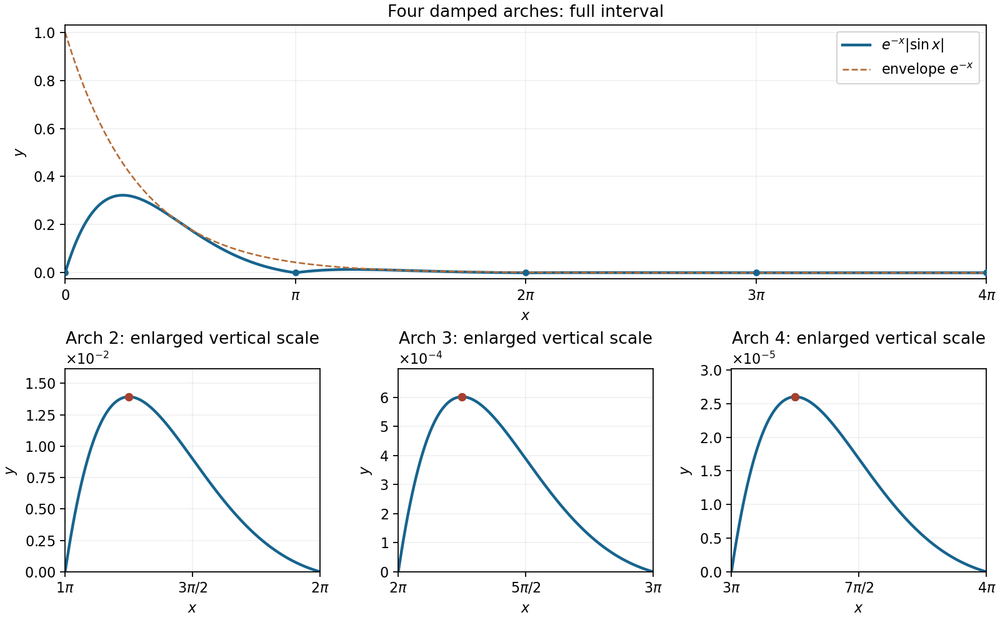
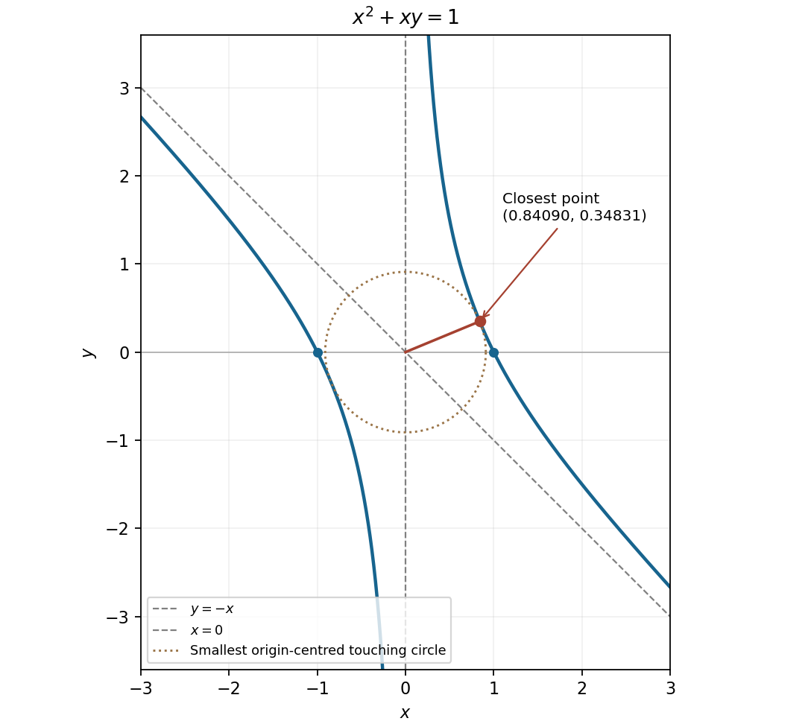

# Paper 1

↑ **Parent:** [2012](../2012.md)

[https://www.maths.cam.ac.uk/undergradnst/files/2012/PaperNST_IA_1.pdf](https://www.maths.cam.ac.uk/undergradnst/files/2012/PaperNST_IA_1.pdf)

**Table of contents**

- [1](#1)
  - [Solution](#1/solution)
- [2](#2)
  - [Solution](#2/solution)
- [3](#3)
  - [Solution](#3/solution)
- [4](#4)
  - [a](#4/a)
    - [Solution](#4/a/solution)
  - [b](#4/b)
    - [Solution](#4/b/solution)
- [5](#5)
  - [Solution](#5/solution)
- [6](#6)
  - [Solution](#6/solution)
- [7](#7)
  - [Solution](#7/solution)
- [8](#8)
  - [a](#8/a)
    - [Solution](#8/a/solution)
  - [b](#8/b)
    - [Solution](#8/b/solution)
- [9](#9)
  - [a](#9/a)
    - [Solution](#9/a/solution)
  - [b](#9/b)
    - [Solution](#9/b/solution)
- [10](#10)
  - [Solution](#10/solution)
- [11](#11)
  - [a](#11/a)
    - [Solution](#11/a/solution)
  - [b](#11/b)
    - [Solution](#11/b/solution)
  - [c](#11/c)
    - [Solution](#11/c/solution)
  - [d](#11/d)
    - [Solution](#11/d/solution)
- [12](#12)
  - [a](#12/a)
    - [i](#12/a/i)
      - [Solution](#12/a/i/solution)
    - [ii](#12/a/ii)
      - [Solution](#12/a/ii/solution)
    - [iii](#12/a/iii)
      - [Solution](#12/a/iii/solution)
  - [b](#12/b)
    - [Solution](#12/b/solution)
  - [c](#12/c)
    - [Solution](#12/c/solution)
  - [d](#12/d)
    - [Solution](#12/d/solution)
- [13](#13)
  - [a](#13/a)
    - [Solution](#13/a/solution)
  - [b](#13/b)
    - [Solution](#13/b/solution)
  - [c](#13/c)
    - [Solution](#13/c/solution)
- [14](#14)
  - [a](#14/a)
    - [Solution](#14/a/solution)
  - [b](#14/b)
    - [Solution](#14/b/solution)
  - [c](#14/c)
    - [Solution](#14/c/solution)
  - [d](#14/d)
    - [Solution](#14/d/solution)
  - [e](#14/e)
    - [Solution](#14/e/solution)
- [15](#15)
  - [a](#15/a)
    - [Solution](#15/a/solution)
  - [b](#15/b)
    - [Solution](#15/b/solution)
  - [c](#15/c)
    - [Solution](#15/c/solution)
- [16](#16)
  - [a](#16/a)
    - [Solution](#16/a/solution)
  - [b](#16/b)
    - [Solution](#16/b/solution)
  - [c](#16/c)
    - [Solution](#16/c/solution)
- [17](#17)
  - [a](#17/a)
    - [Solution](#17/a/solution)
  - [b](#17/b)
    - [Solution](#17/b/solution)
- [18](#18)
  - [a](#18/a)
    - [i](#18/a/i)
      - [Solution](#18/a/i/solution)
    - [ii](#18/a/ii)
      - [Solution](#18/a/ii/solution)
    - [iii](#18/a/iii)
      - [Solution](#18/a/iii/solution)
    - [iv](#18/a/iv)
      - [Solution](#18/a/iv/solution)
  - [b](#18/b)
    - [i](#18/b/i)
      - [Solution](#18/b/i/solution)
    - [ii](#18/b/ii)
      - [Solution](#18/b/ii/solution)
  - [c](#18/c)
    - [i](#18/c/i)
      - [Solution](#18/c/i/solution)
    - [ii](#18/c/ii)
      - [Solution](#18/c/ii/solution)
    - [iii](#18/c/iii)
      - [Solution](#18/c/iii/solution)
- [19](#19)
  - [a](#19/a)
    - [i](#19/a/i)
      - [Solution](#19/a/i/solution)
    - [ii](#19/a/ii)
      - [Solution](#19/a/ii/solution)
    - [iii](#19/a/iii)
      - [Solution](#19/a/iii/solution)
    - [iv](#19/a/iv)
      - [Solution](#19/a/iv/solution)
    - [v](#19/a/v)
      - [Solution](#19/a/v/solution)
  - [b](#19/b)
    - [i](#19/b/i)
      - [Solution](#19/b/i/solution)
    - [ii](#19/b/ii)
      - [Solution](#19/b/ii/solution)
- [20](#20)
  - [a](#20/a)
    - [Solution](#20/a/solution)
  - [b](#20/b)
    - [i](#20/b/i)
      - [Solution](#20/b/i/solution)
    - [ii](#20/b/ii)
      - [Solution](#20/b/ii/solution)

## 1

↑ **Parent:** [Paper 1](paper-1.md)

<h3 id="1/solution">Solution</h3>

↑ **Parent:** [1](#1)

Use [completing the square](../../polynomial.md#completing-the-square) after taking out the leading [coefficient](../../vector-space.md#coefficient):

$$
3(x^2-4x)+11=3[(x-2)^2-4]+11
=\boxed{3(x-2)^2-1.}
$$

Thus $a=3$, $b=-2$ and $c=-1$. Since a real square is nonnegative, the [global minimum](../../analysis.md#global-minimum) is **$-1$, attained at $x=2$**.

## 2

↑ **Parent:** [Paper 1](paper-1.md)

<h3 id="2/solution">Solution</h3>

↑ **Parent:** [2](#2)

The [derivative](../../calculus.md#derivative) of the [parabola](../../euclidean-geometry.md#parabola) is $dy/dx=2+2x$, giving [tangent line](../../calculus.md#tangent-line) slope $4$ at $(1,3)$. A [normal line to a plane curve](../../calculus.md#normal-line-to-a-plane-curve) has the negative reciprocal slope, since its direction is [orthogonal](../../inner-product.md#orthogonal-vectors) to a [tangent vector](../../tangent-vector.md). Hence

$$
\boxed{y-3=-\frac14(x-1),\qquad x+4y=13.}
$$

The point $(1,3)$ satisfies the equation, and the product of the two slopes is $-1$.

## 3

↑ **Parent:** [Paper 1](paper-1.md)

<h3 id="3/solution">Solution</h3>

↑ **Parent:** [3](#3)

By the [polynomial remainder theorem](../../polynomial.md#polynomial-remainder-theorem), the first [polynomial remainder](../../polynomial.md#remainder-of-polynomial-division) is $f(1)=23-2p$. Equating it to $9$ gives **$p=7$**.

For the separate [polynomial long division](../../polynomial.md#polynomial-long-division), successively cancel the leading powers of the dividend. Subtracting $x^2(x-1)$ leaves $2x^2+2x+1$; subtracting $2x(x-1)$ leaves $4x+1$; subtracting $4(x-1)$ leaves $5$. Thus

$$
x^3+x^2+2x+1=(x-1)(x^2+2x+4)+5,
\qquad\boxed{\text{quotient }x^2+2x+4,\quad\text{remainder }5.}
$$

The [polynomial remainder](../../polynomial.md#remainder-of-polynomial-division) also equals the dividend evaluated at $x=1$.

## 4

↑ **Parent:** [Paper 1](paper-1.md)

<h3 id="4/a">a</h3>

↑ **Parent:** [4](#4)

<h4 id="4/a/solution">Solution</h4>

↑ **Parent:** [A](#4/a)

Apply the [product rule](../../calculus.md#product-rule) and the [chain rule](../../calculus.md#chain-rule) to the [exponential function](../../calculus.md#exponential-function):

$$
\boxed{\frac d{dx}(xe^{-2x})=e^{-2x}-2xe^{-2x}=(1-2x)e^{-2x}.}
$$

<h3 id="4/b">b</h3>

↑ **Parent:** [4](#4)

<h4 id="4/b/solution">Solution</h4>

↑ **Parent:** [B](#4/b)

On the real [domain of a function](../../function.md#domain-of-a-function) $x>0$, the [quotient rule](../../calculus.md#quotient-rule) gives

$$
\boxed{\frac d{dx}\left(\frac{\ln x}{x}\right)
=\frac{x(1/x)-\ln x}{x^2}=\frac{1-\ln x}{x^2}.}
$$

## 5

↑ **Parent:** [Paper 1](paper-1.md)

<h3 id="5/solution">Solution</h3>

↑ **Parent:** [5](#5)

Use [integration by parts](../../calculus.md#integration-by-parts) twice. First,

$$
I=[-x^2\cos x]_0^\pi+2\int_0^\pi x\cos x\,dx
=\pi^2+2\big([x\sin x]_0^\pi-\int_0^\pi\sin x\,dx\big).
$$

The bracket containing $x\sin x$ vanishes, while the last [definite integral](../../integral.md#definite-integral) is $2$. Therefore

$$
\boxed{I=\pi^2-4.}
$$

## 6

↑ **Parent:** [Paper 1](paper-1.md)

<h3 id="6/solution">Solution</h3>

↑ **Parent:** [6](#6)

A repeated linear factor requires both reciprocal powers. Write the [partial fraction decomposition](../../isolated-singularity.md#partial-fraction-decomposition) as

$$
\frac{A}{x-1}+\frac{B}{(x-1)^2}+\frac{C}{x+2}.
$$

Multiplication by the common denominator gives $4x^2-x=A(x-1)(x+2)+B(x+2)+C(x-1)^2$. Setting $x=1$ gives $B=1$, and setting $x=-2$ gives $C=2$. Comparing the coefficients of $x^2$ then gives $A=2$. Thus

$$
\boxed{\frac{4x^2-x}{(x-1)^2(x+2)}
=\frac2{x-1}+\frac1{(x-1)^2}+\frac2{x+2},\qquad x\ne1,-2.}
$$

## 7

↑ **Parent:** [Paper 1](paper-1.md)

<h3 id="7/solution">Solution</h3>

↑ **Parent:** [7](#7)

For a nonzero solution, the [separable differential equation](../../differential-equation.md#separable-differential-equation) gives $dy/y=3x^2dx$. Integrating yields $\ln|y|=x^3+C$, hence $y=Ke^{x^3}$. The [initial condition](../../differential-equation.md#initial-condition) fixes $K=3/e$, so

$$
\boxed{y(x)=3e^{x^3-1},\qquad x\in\mathbb R.}
$$

The zero solution omitted by division by $y$ cannot satisfy the given [initial condition](../../differential-equation.md#initial-condition). Differentiating the displayed solution verifies $y'=3x^2y$.

## 8

↑ **Parent:** [Paper 1](paper-1.md)

<h3 id="8/a">a</h3>

↑ **Parent:** [8](#8)

<h4 id="8/a/solution">Solution</h4>

↑ **Parent:** [A](#8/a)

This [geometric series](../../sequence-and-series.md#geometric-series) has first term $2^{-4}=1/16$ and common ratio $1/2$, whose [absolute value](../../real-analysis.md#absolute-value) is less than one. Consequently

$$
\boxed{\sum_{n=4}^\infty2^{-n}=\frac{1/16}{1-1/2}=\frac18.}
$$

<h3 id="8/b">b</h3>

↑ **Parent:** [8](#8)

<h4 id="8/b/solution">Solution</h4>

↑ **Parent:** [B](#8/b)

The [binomial theorem](../../binomial-coefficient.md#binomial-theorem) assigns [binomial coefficient](../../binomial-coefficient.md) $\binom93$ to $x^3$. Since $\binom93=9\cdot8\cdot7/(3\cdot2\cdot1)=84$, the requested term is **$84x^3$**.

## 9

↑ **Parent:** [Paper 1](paper-1.md)

<h3 id="9/a">a</h3>

↑ **Parent:** [9](#9)

<h4 id="9/a/solution">Solution</h4>

↑ **Parent:** [A](#9/a)

The [domain of a function](../../function.md#domain-of-a-function) is $\mathbb R\setminus\{0\}$, because the denominator vanishes at zero. Near zero, $e^x-1\sim x$, so $x=0$ is a vertical [asymptote](../../topology.md#asymptote), approached with value $-\infty$ from the left and $+\infty$ from the right. The horizontal [asymptotes](../../topology.md#asymptote) are $y=-1$ as $x\to-\infty$ and $y=0$ as $x\to+\infty$.

Moreover,

$$
f'(x)=-\frac{e^x}{(e^x-1)^2}<0.
$$

Both branches define a strictly decreasing [monotone function](../../calculus.md#monotonic-function): the left branch lies below $-1$, and the right branch is positive. There are no zeros or vertical-axis intercept.

**[Figure 1](#9/a/image-the-decreasing-reciprocal-exponential-branches-with-their-three-asymptotes). The decreasing reciprocal-exponential branches with their three asymptotes**.

<h3 id="9/b">b</h3>

↑ **Parent:** [9](#9)

<h4 id="9/b/solution">Solution</h4>

↑ **Parent:** [B](#9/b)

The [absolute value](../../real-analysis.md#absolute-value) in the original PDF reflects every negative [sine](../../geometry-and-topology.md#sine) arch upward. The graph is nonnegative, with zeros at $x=k\pi$ for $k=0,1,2,3,4$, and it lies below the decaying envelope $e^{-x}$. On the $k$th arch, [differentiation](../../calculus.md#differentiation) gives a factor proportional to $\cos x-\sin x$. Thus its unique [local maximum](../../analysis.md#local-maximum) is

$$
x_k=\frac\pi4+k\pi,\qquad
f(x_k)=\frac{e^{-(\pi/4+k\pi)}}{\sqrt2},\qquad k=0,1,2,3.
$$

Successive maximum heights have ratio $e^{-\pi}$. At each interior zero the one-sided slopes have opposite signs, producing a corner. The smaller panels below magnify the later arches so that all four remain visible.

**[Figure 2](#9/b/image-four-positive-exponentially-damped-sine-arches-with-separate-linear-scale-enlargements-of-the-later-arches). Four positive exponentially damped sine arches, with separate linear-scale enlargements of the later arches**.

## 10

↑ **Parent:** [Paper 1](paper-1.md)

<h3 id="10/solution">Solution</h3>

↑ **Parent:** [10](#10)

A cross-section perpendicular to the [rotation](../../riemannian-geometry.md#rotation-mathematics) axis is a [disk](../../topology.md#disk-mathematics) of [radius](../../topology.md#radius) $\sin x$. [Disc integration](../../differential-geometry.md#disc-integration) therefore gives

$$
V=\pi\int_0^\pi\sin^2x\,dx
=\frac\pi2\int_0^\pi(1-\cos2x)\,dx
=\boxed{\frac{\pi^2}{2}}.
$$

The result is in cubic coordinate units; the full [rotation](../../riemannian-geometry.md#rotation-mathematics) is already accounted for by the disk [area](../../differential-geometry.md#surface-area).

## 11

↑ **Parent:** [Paper 1](paper-1.md)

<h3 id="11/a">a</h3>

↑ **Parent:** [11](#11)

<h4 id="11/a/solution">Solution</h4>

↑ **Parent:** [A](#11/a)

Collecting the coefficients gives the [coefficient matrix](../../linear-algebra.md#coefficient-matrix)

$$
\boxed{A=\begin{pmatrix}a&0&2\\0&b+1&c-1\\0&c+1&b-1\end{pmatrix},\qquad
A\begin{pmatrix}x\\y\\z\end{pmatrix}=\begin{pmatrix}0\\0\\0\end{pmatrix}.}
$$

A square [homogeneous linear system](../../linear-algebra.md#homogeneous-linear-system) has a nonzero solution precisely when its [matrix](../../vector-space.md#matrix) is a [singular matrix](../../linear-algebra.md#singular-matrix). Expanding the [determinant](../../multilinear-algebra.md#determinant) down the first column,

$$
\det A=a[(b+1)(b-1)-(c-1)(c+1)]=a(b^2-c^2).
$$

Hence the necessary and sufficient condition is **$a=0$ or $b=c$ or $b=-c$**. A zero [determinant](../../multilinear-algebra.md#determinant) gives a nontrivial [kernel of a linear map](../../kernel-of-a-linear-map.md); otherwise multiplication by the [matrix inverse](../../matrix-inverse.md) would force the zero solution.

<h3 id="11/b">b</h3>

↑ **Parent:** [11](#11)

<h4 id="11/b/solution">Solution</h4>

↑ **Parent:** [B](#11/b)

With $a=1$, $b=2$, $c=2$, substitute into the matrix equations. The equations reduce to $x+2z=0$ and $3y+z=0$, with the latter repeated. Taking $z=3t$ gives the complete [null space](../../kernel-of-a-linear-map.md)

$$
\boxed{(x,y,z)=t(-6,-1,3),\qquad t\in\mathbb R.}
$$

The two independent rows impose two constraints on three unknowns, leaving exactly one free parameter. This also includes the zero solution at $t=0$.

<h3 id="11/c">c</h3>

↑ **Parent:** [11](#11)

<h4 id="11/c/solution">Solution</h4>

↑ **Parent:** [C](#11/c)

Use [orthogonality to the image of a matrix](../../vector-space.md#orthogonality-to-the-image-of-a-matrix). For $n=(1,2,1)^T$, the condition is $n^TA=0$, since $n^TAr$ must vanish for every nonzero input. Direct multiplication gives

$$
n^TA=(a,\ 2b+c+3,\ b+2c-1).
$$

Each coefficient must vanish; choosing the three coordinate [basis vectors](../../vector-space.md#basis-vector) as inputs already proves necessity. Solve $2b+c=-3$, $b+2c=1$ to obtain

$$
\boxed{a=0,\qquad b=-\frac73,\qquad c=\frac53.}
$$

These values make every output have zero [dot product](../../inner-product.md#dot-product) with $n$, including any zero output. Here [orthogonality](../../inner-product.md#orthogonal-vectors) is understood in this algebraic sense; no direction is assigned to the zero [vector](../../vector-space.md#vector).

<h3 id="11/d">d</h3>

↑ **Parent:** [11](#11)

<h4 id="11/d/solution">Solution</h4>

↑ **Parent:** [D](#11/d)

For $n=(1,-1,1)^T$, [orthogonality to the image of a matrix](../../vector-space.md#orthogonality-to-the-image-of-a-matrix) would require

$$
n^TA=(a,\ c-b,\ b-c+2)=0.
$$

The second component forces $c=b$, but then the third component is $2$. Equivalently, the last two required zero components always sum to $2$. Therefore **there are no such values of $a,b,c$**.

## 12

↑ **Parent:** [Paper 1](paper-1.md)

<h3 id="12/a">a</h3>

↑ **Parent:** [12](#12)

<h4 id="12/a/i">i</h4>

↑ **Parent:** [A](#12/a)

<h5 id="12/a/i/solution">Solution</h5>

↑ **Parent:** [I](#12/a/i)

Multiply numerator and denominator by the [complex conjugate](../../complex-analysis.md#complex-conjugate) of the denominator:

$$
\frac{2+i}{-1+i}=\frac{(2+i)(-1-i)}2=\frac{-1-3i}{2}.
$$

Squaring gives $(-1-3i)^2/4=(-8+6i)/4$. Thus the [real part](../../complex-analysis.md#real-part) and [imaginary part](../../complex-analysis.md#imaginary-part) are

$$
\boxed{\Re z=-2,\qquad\Im z=\frac32.}
$$

<h4 id="12/a/ii">ii</h4>

↑ **Parent:** [A](#12/a)

<h5 id="12/a/ii/solution">Solution</h5>

↑ **Parent:** [Ii](#12/a/ii)

In [polar form of a complex number](../../complex-analysis.md#polar-form-of-a-complex-number), $1+i=\sqrt2\,e^{i\pi/4}$. By [De Moivre's theorem](../../analysis.md#de-moivre-s-theorem),

$$
(1+i)^{10}=2^5e^{5\pi i/2}=32i,
\qquad\boxed{\Re z=0,\qquad\Im z=32.}
$$

<h4 id="12/a/iii">iii</h4>

↑ **Parent:** [A](#12/a)

<h5 id="12/a/iii/solution">Solution</h5>

↑ **Parent:** [Iii](#12/a/iii)

The [complex sine function](../../calculus.md#complex-sine-function) identity $\sin(u+iv)=\sin u\cosh v+i\cos u\sinh v$ follows from the exponential definition of [sine](../../geometry-and-topology.md#sine). With $u=\pi/2$, its imaginary term vanishes, while

$$
\cosh(\ln2)=\frac{e^{\ln2}+e^{-\ln2}}2=\frac{2+1/2}{2}=\frac54.
$$

Consequently **the [real part](../../complex-analysis.md#real-part) is $5/4$ and the [imaginary part](../../complex-analysis.md#imaginary-part) is $0$**.

<h3 id="12/b">b</h3>

↑ **Parent:** [12](#12)

<h4 id="12/b/solution">Solution</h4>

↑ **Parent:** [B](#12/b)

Write a [square root](../../algebra.md#square-root) as $u+iv$, with $u,v$ real. Equating the [real part](../../complex-analysis.md#real-part) and [imaginary part](../../complex-analysis.md#imaginary-part) of its square gives $u^2-v^2=-1$ and $2uv=1$. Taking [complex modulus](../../complex-analysis.md#complex-modulus) also gives $u^2+v^2=\sqrt2$. Therefore

$$
u^2=\frac{\sqrt2-1}{2},\qquad v^2=\frac{\sqrt2+1}{2}.
$$

Since $uv>0$, the signs agree. The two roots are

$$
\boxed{\pm\left(\sqrt{\frac{\sqrt2-1}{2}}+i\sqrt{\frac{\sqrt2+1}{2}}\right).}
$$

The $\pm$ changes both signs together, rather than independently.

<h3 id="12/c">c</h3>

↑ **Parent:** [12](#12)

<h4 id="12/c/solution">Solution</h4>

↑ **Parent:** [C](#12/c)

Set $z=e^{i\theta}$, so $2i\sin\theta=z-z^{-1}$. The [binomial theorem](../../binomial-coefficient.md#binomial-theorem) gives

$$
(2i\sin\theta)^5
=(z^5-z^{-5})-5(z^3-z^{-3})+10(z-z^{-1}).
$$

Use $z^k-z^{-k}=2i\sin(k\theta)$ and $(2i)^5=32i$ to obtain

$$
\boxed{\sin^5\theta=\frac{10\sin\theta-5\sin3\theta+\sin5\theta}{16}.}
$$

This is a finite [Fourier sine series](../../fourier-series.md#fourier-sine-series), with only odd harmonics.

<h3 id="12/d">d</h3>

↑ **Parent:** [12](#12)

<h4 id="12/d/solution">Solution</h4>

↑ **Parent:** [D](#12/d)

Using the exponential definition of [hyperbolic cosine](../../calculus.md#hyperbolic-cosine), multiply $e^z+e^{-z}=-2$ by the nonzero quantity $e^z$. This yields $(e^z+1)^2=0$, hence $e^z=-1$.

If $z=x+iy$, its [complex modulus](../../complex-analysis.md#complex-modulus) requires $e^x=1$, so $x=0$; its phase then requires $y=(2k+1)\pi$. Thus all complex solutions are

$$
\boxed{z=(2k+1)\pi i,\qquad k\in\mathbb Z.}
$$

There are no real solutions, since real $\cosh x\geq1$.

## 13

↑ **Parent:** [Paper 1](paper-1.md)

<h3 id="13/a">a</h3>

↑ **Parent:** [13](#13)

<h4 id="13/a/solution">Solution</h4>

↑ **Parent:** [A](#13/a)

Work on an [interval](../../real-analysis.md#interval-mathematics) with $x\ne0$. The [homogeneous first-order differential equation](../../differential-equation.md#homogeneous-first-order-differential-equation) becomes a [separable differential equation](../../differential-equation.md#separable-differential-equation) under $v=y/x$: substituting $y=xv$ gives $v+xv'=v^2+v$, hence $xv'=v^2$.

For $v\ne0$, [integration](../../integral.md) gives $-1/v=\ln|x|+C$. Renaming the arbitrary constant produces

$$
\boxed{y(x)=\frac{x}{C-\ln|x|},\qquad\text{or}\qquad y(x)\equiv0.}
$$

For the nonzero family the denominator must remain nonzero, so take any connected [interval](../../real-analysis.md#interval-mathematics) avoiding both $x=0$ and $|x|=e^C$. The zero solution must be restored after division by $v^2$; by the [Picard-Lindelöf theorem](../../differential-equation.md#picard-lindelof-theorem) away from $x=0$, a solution cannot switch between zero and a nonzero branch there.

<h3 id="13/b">b</h3>

↑ **Parent:** [13](#13)

<h4 id="13/b/solution">Solution</h4>

↑ **Parent:** [B](#13/b)

Let $M=x+y$ and $N=x$. Their cross [partial derivatives](../../multivariable-calculus.md#partial-derivative) agree: $M_y=N_x=1$. More directly, construct the [scalar](../../vector-space.md#scalar) [function](../../function.md)

$$
F(x,y)=\frac{x^2}{2}+xy,\qquad dF=(x+y)\,dx+x\,dy.
$$

This exhibits the expression as an [exact differential](../../differential-form.md#exact-differential). Along a solution of the [differential equation](../../differential-equation.md),

$$
\frac d{dx}F(x,y(x))=x+y+xy'=0.
$$

Thus the [general solution](../../linear-ordinary-differential-equation.md#general-solution) is

$$
\boxed{\frac{x^2}{2}+xy=C,\qquad y=\frac Cx-\frac x2\quad(x\ne0).}
$$

For $C=0$, the graph $y=-x/2$ also extends smoothly through $x=0$ and satisfies the original, undivided equation there. Nonzero $C$ cannot extend through zero as a finite-valued [differentiable](../../analysis.md#differentiable-function) solution. The extra vertical component $x=0$ of the implicit zero-level equation is not a graph $y(x)$ on an [interval](../../real-analysis.md#interval-mathematics) and is not an additional solution of this [ordinary differential equation](../../differential-equation.md#ordinary-differential-equation).

<h3 id="13/c">c</h3>

↑ **Parent:** [13](#13)

<h4 id="13/c/solution">Solution</h4>

↑ **Parent:** [C](#13/c)

The [integrating factor](../../linear-ordinary-differential-equation.md#integrating-factor) is $e^{kx}$, giving $(e^{kx}y)'=ae^{kx}\sin(mx)$. The required [antiderivative](../../integral.md#antiderivative) is

$$
\int e^{kx}\sin(mx)\,dx
=\frac{e^{kx}}{k^2+m^2}[k\sin(mx)-m\cos(mx)].
$$

After dividing by $e^{kx}$, the [general solution](../../linear-ordinary-differential-equation.md#general-solution) is the oscillatory term plus $Ce^{-kx}$. The [initial condition](../../differential-equation.md#initial-condition) fixes $C=1+am/(k^2+m^2)$, so

$$
\boxed{y(x)=\left(1+\frac{am}{k^2+m^2}\right)e^{-kx}
+\frac{a[k\sin(mx)-m\cos(mx)]}{k^2+m^2}.}
$$

The real, nonzero parameters ensure $k^2+m^2>0$; direct substitution verifies both the equation and $y(0)=1$.

## 14

↑ **Parent:** [Paper 1](paper-1.md)

<h3 id="14/a">a</h3>

↑ **Parent:** [14](#14)

<h4 id="14/a/solution">Solution</h4>

↑ **Parent:** [A](#14/a)

The [vector triple product identity](../../multivariable-calculus.md#vector-triple-product) is

$$
\boxed{a\times(b\times c)=b(a\cdot c)-c(a\cdot b).}
$$

Thus the expression lies in the [linear span](../../vector-space.md#linear-span) of $b$ and $c$, with respective [scalar](../../vector-space.md#scalar) coefficients $a\cdot c$ and $-a\cdot b$. The order and the minus sign matter because the [cross product](../../vector-space.md#cross-product) is not an [associative operation](../../algebraic-operation.md#associative-property).

<h3 id="14/b">b</h3>

↑ **Parent:** [14](#14)

<h4 id="14/b/solution">Solution</h4>

↑ **Parent:** [B](#14/b)

The nonzero [vectors](../../vector-space.md#vector) $b,c$ are [normal vectors](../../differential-geometry.md#normal-vector) to the two [planes](../../geometry-and-topology.md#plane). If $b\times c=0$, then $c=qb$ for some nonzero real $q$. Their equations are therefore $r\cdot b=\lambda$ and $q(r\cdot b)=\mu$.

When $\mu=q\lambda$, the [planes](../../geometry-and-topology.md#plane) coincide and their intersection is an entire [plane](../../geometry-and-topology.md#plane). Otherwise they are distinct parallel planes and have no intersection. Neither case has exactly a [line](../../euclidean-geometry.md#straight-line) as its intersection. Hence **$b\times c\ne0$ is necessary** for intersection in a [line](../../euclidean-geometry.md#straight-line). It means that the two [normal vectors](../../differential-geometry.md#normal-vector) are not parallel; in that case it is also sufficient.

<h3 id="14/c">c</h3>

↑ **Parent:** [14](#14)

<h4 id="14/c/solution">Solution</h4>

↑ **Parent:** [C](#14/c)

Apply the [vector triple product identity](../../multivariable-calculus.md#vector-triple-product) and the two [plane](../../geometry-and-topology.md#plane) constraints:

$$
\boxed{r\times(b\times c)=b(r\cdot c)-c(r\cdot b)=\mu b-\lambda c.}
$$

Put $d=b\times c\ne0$. If $a$ is one intersection point, subtraction gives $(r-a)\times d=0$, so $r-a$ is parallel to $d$. Conversely, adding any multiple of $d$ preserves both [plane](../../geometry-and-topology.md#plane) constraints because $d$ is [orthogonal](../../inner-product.md#orthogonal-vectors) to both [normal vectors](../../differential-geometry.md#normal-vector). The whole intersection is therefore

$$
\boxed{r=a+t(b\times c),\quad t\in\mathbb R,\qquad a\cdot b=\lambda,\quad a\cdot c=\mu.}
$$

Such an $a$ exists: choose $a=\alpha b+\beta c$ and solve the two-by-two [linear system](../../linear-algebra.md#system-of-linear-equations) with [determinant](../../multilinear-algebra.md#determinant) $|b|^2|c|^2-(b\cdot c)^2=|b\times c|^2>0$. This also proves sufficiency rather than assuming a nonempty intersection.

<h3 id="14/d">d</h3>

↑ **Parent:** [14](#14)

<h4 id="14/d/solution">Solution</h4>

↑ **Parent:** [D](#14/d)

The squared [Euclidean distance](../../topological-analysis.md#euclidean-distance) along the [line](../../euclidean-geometry.md#straight-line) is

$$
|a+td|^2=|a|^2+2t(a\cdot d)+t^2|d|^2,\qquad d=b\times c.
$$

Its minimum occurs at $t=0$ exactly when its [derivative](../../calculus.md#derivative) there vanishes, so **$a\cdot(b\times c)=0$**. Since $b,c$ are independent, their [linear span](../../vector-space.md#linear-span) is the two-dimensional [orthogonal complement](../../hilbert-space.md#orthogonal-complement) of $b\times c$. Consequently

$$
\boxed{a=\alpha b+\beta c}
$$

for unique real $\alpha,\beta$. This is the [closest point on the intersection of two planes](../../topological-analysis.md#closest-point-on-the-intersection-of-two-planes); the positive quadratic coefficient $|d|^2$ proves that the stationary distance is a strict [global minimum](../../analysis.md#global-minimum).

<h3 id="14/e">e</h3>

↑ **Parent:** [14](#14)

<h4 id="14/e/solution">Solution</h4>

↑ **Parent:** [E](#14/e)

With $b\cdot c=0$, substitute $a=\alpha b+\beta c$ into the [plane](../../geometry-and-topology.md#plane) constraints. They become $\alpha|b|^2=\lambda$ and $\beta|c|^2=\mu$, giving

$$
\boxed{\alpha=\frac{\lambda}{|b|^2},\qquad\beta=\frac{\mu}{|c|^2}.}
$$

The [Pythagorean theorem](../../euclidean-geometry.md#pythagorean-theorem) for the two [orthogonal](../../inner-product.md#orthogonal-vectors) terms in $a$ then gives the closest distance

$$
\boxed{d_{\min}=|a|=\sqrt{\frac{\lambda^2}{|b|^2}+\frac{\mu^2}{|c|^2}}.}
$$

Zero values of either [scalar](../../vector-space.md#scalar) are allowed, including zero distance if both planes contain the origin.

## 15

↑ **Parent:** [Paper 1](paper-1.md)

<h3 id="15/a">a</h3>

↑ **Parent:** [15](#15)

<h4 id="15/a/solution">Solution</h4>

↑ **Parent:** [A](#15/a)

Convert the [cardioid](../../multivariable-calculus.md#cardioid) from [polar coordinates](../../multivariable-calculus.md#polar-coordinates) to [Cartesian coordinates](../../linear-algebra.md#cartesian-coordinate-system):

$$
x=(1+\cos\theta)\cos\theta,\qquad y=(1+\cos\theta)\sin\theta.
$$

The [curve](../../topology.md#curve) is symmetric about the horizontal axis. It has a [cusp](../../algebraic-geometry.md#cusp-algebraic-geometry) at the origin at $\theta=\pi$, passes through $(0,\pm1)$, and reaches $(2,0)$ on the right. Its leftmost horizontal coordinate is $-1/4$, since $x=(\cos\theta+1/2)^2-1/4$.

For the largest $y$, differentiate the parametrization:

$$
\frac{dy}{d\theta}=\cos\theta+\cos2\theta
=(2\cos\theta-1)(\cos\theta+1).
$$

The candidates have $\cos\theta=1/2$ or $-1$. The positive maximum occurs at $\theta=\pi/3$, where $r=3/2$. Comparing with the negative extremum and the zero [cusp](../../algebraic-geometry.md#cusp-algebraic-geometry) value proves

$$
\boxed{(x_M,y_M)=\left(\frac34,\frac{3\sqrt3}{4}\right).}
$$

**[Figure 3](#15/a/image-the-cardioid-with-its-cusp-axis-crossings-and-point-of-greatest-vertical-coordinate). The cardioid with its cusp, axis crossings and point of greatest vertical coordinate**.

<h3 id="15/b">b</h3>

↑ **Parent:** [15](#15)

<h4 id="15/b/solution">Solution</h4>

↑ **Parent:** [B](#15/b)

Each radial segment from $0$ to $1+\cos\theta$ lies inside the [cardioid](../../multivariable-calculus.md#cardioid). Integrating the [polar area element](../../multivariable-calculus.md#polar-area-element) gives

$$
\mathcal A=\int_0^{2\pi}\int_0^{1+\cos\theta}r\,dr\,d\theta
=\frac12\int_0^{2\pi}(1+2\cos\theta+\cos^2\theta)\,d\theta.
$$

The three integrals are respectively $2\pi$, $0$ and $\pi$. Thus

$$
\boxed{\mathcal A=\frac{3\pi}{2}}
$$

in square coordinate units, agreeing with the scale-one case of the [area and perimeter of a cardioid](../../multivariable-calculus.md#area-and-perimeter-of-a-cardioid).

<h3 id="15/c">c</h3>

↑ **Parent:** [15](#15)

<h4 id="15/c/solution">Solution</h4>

↑ **Parent:** [C](#15/c)

Differentiate $x=r\cos\theta$, $y=r\sin\theta$:

$$
dx=\cos\theta\,dr-r\sin\theta\,d\theta,\qquad
dy=\sin\theta\,dr+r\cos\theta\,d\theta.
$$

Squaring and adding cancels the mixed terms and uses $\cos^2\theta+\sin^2\theta=1$, giving

$$
\boxed{dx^2+dy^2=dr^2+r^2d\theta^2.}
$$

For this [cardioid](../../multivariable-calculus.md#cardioid), the [polar arc length](../../riemannian-geometry.md#polar-arc-length) integrand is

$$
\sqrt{\sin^2\theta+(1+\cos\theta)^2}
=\sqrt{2+2\cos\theta}=2|\cos(\theta/2)|.
$$

The [cosine](../../geometry-and-topology.md#cosine) inside the [absolute value](../../real-analysis.md#absolute-value) changes sign at $\theta=\pi$. Therefore the perimeter is

$$
\ell=2\int_0^\pi\cos(\theta/2)\,d\theta
-2\int_\pi^{2\pi}\cos(\theta/2)\,d\theta
=\boxed{8}
$$

in coordinate [length](../../physics.md#length) units. The isolated [cusp](../../algebraic-geometry.md#cusp-algebraic-geometry) does not obstruct this piecewise [smooth](../../analysis.md#smooth-function) [arc length](../../riemannian-geometry.md#arc-length) integral.

## 16

↑ **Parent:** [Paper 1](paper-1.md)

<h3 id="16/a">a</h3>

↑ **Parent:** [16](#16)

<h4 id="16/a/solution">Solution</h4>

↑ **Parent:** [A](#16/a)

A [directional derivative](../../multivariable-calculus.md#directional-derivative) measures change per unit distance, so first normalize the direction: $\widehat v=(4,3)/5$. The [gradient](../../multivariable-calculus.md#gradient) is

$$
\nabla f=-\frac{2(x,y)}{(1+x^2+y^2)^2},\qquad
\nabla f(1,0)=(-1/2,0).
$$

Taking the [dot product](../../inner-product.md#dot-product) with the [unit vector](../../vector-space.md#unit-vector),

$$
\boxed{D_{\widehat v}f(1,0)=(-1/2,0)\cdot(4/5,3/5)=-\frac25.}
$$

Using the unnormalized [vector](../../vector-space.md#vector) would instead give $-2$, the change per unit parameter along $(1,0)+tv$; it is not the rate per unit distance requested here.

<h3 id="16/b">b</h3>

↑ **Parent:** [16](#16)

<h4 id="16/b/solution">Solution</h4>

↑ **Parent:** [B](#16/b)

The [product rule](../../calculus.md#product-rule) gives the two [partial derivatives](../../multivariable-calculus.md#partial-derivative)

$$
g_x=x(2-x^2+y^2)e^{-(x^2+y^2)/2},\qquad
g_y=-y(2+x^2-y^2)e^{-(x^2+y^2)/2}.
$$

They both vanish at the origin. The [exponential function](../../calculus.md#exponential-function) is never zero, so any further [stationary point](../../calculus-of-variations.md#stationary-point) must satisfy $x=0$ or $x^2-y^2=2$, and $y=0$ or $y^2-x^2=2$. Having both coordinates nonzero would require both opposite differences to be $2$, which is impossible. If $y=0$, the nonzero choices are $x=\pm\sqrt2$; if $x=0$, they are $y=\pm\sqrt2$. Hence the full list is

$$
\boxed{(0,0),\quad(\pm\sqrt2,0),\quad(0,\pm\sqrt2).}
$$

<h3 id="16/c">c</h3>

↑ **Parent:** [16](#16)

<h4 id="16/c/solution">Solution</h4>

↑ **Parent:** [C](#16/c)

At the origin the [Hessian matrix](../../multivariable-calculus.md#hessian-matrix) is

$$
H_g(0,0)=\begin{pmatrix}2&0\\0&-2\end{pmatrix},\qquad\det H_g(0,0)=-4<0.
$$

Thus the [second-derivative test](../../multivariable-calculus.md#second-derivative-test) gives a **[saddle point](../../analysis.md#saddle-point)**. Its opposite signs can also be checked without a test formula: $g(x,0)=x^2e^{-x^2/2}>0$ for $x\ne0$, whereas $g(0,y)=-y^2e^{-y^2/2}<0$ for $y\ne0$. Both types of values occur arbitrarily close to the zero value at the origin, excluding either a [local maximum](../../analysis.md#local-maximum) or a [local minimum](../../analysis.md#local-minimum).

## 17

↑ **Parent:** [Paper 1](paper-1.md)

<h3 id="17/a">a</h3>

↑ **Parent:** [17](#17)

<h4 id="17/a/solution">Solution</h4>

↑ **Parent:** [A](#17/a)

Assume $L>0$. For any nonzero integer $k$,

$$
\int_{-L}^{L}\cos(k\pi x/L)\,dx
=\frac{L}{k\pi}[\sin(k\pi x/L)]_{-L}^{L}=0.
$$

For $m\ne n$, the product-to-sum identity expresses the integrand as one half the sum of cosines with nonzero frequencies $m-n$ and $m+n$, so the integral is zero. For $m=n>0$, use $\cos^2u=(1+\cos2u)/2$ to get $L$. Finally, for $m=n=0$ the integrand is one. The complete [Fourier orthogonality](../../fourier-series.md#fourier-orthogonality) formula is

$$
\boxed{\int_{-L}^{L}\cos\frac{m\pi x}{L}\cos\frac{n\pi x}{L}\,dx
=\begin{cases}2L,&m=n=0,\\L,&m=n\geq1,\\0,&m\ne n.\end{cases}}
$$

The constant mode has twice the squared norm of a positive-frequency [cosine](../../geometry-and-topology.md#cosine) mode.

<h3 id="17/b">b</h3>

↑ **Parent:** [17](#17)

<h4 id="17/b/solution">Solution</h4>

↑ **Parent:** [B](#17/b)

For period $2$, use the [Fourier series](../../fourier-series.md) convention

$$
f(x)\sim\frac{a_0}{2}+\sum_{n=1}^{\infty}[a_n\cos(n\pi x)+b_n\sin(n\pi x)].
$$

The [Fourier coefficients](../../fourier-series.md#fourier-coefficient) have prefactor $1$ on $[-1,1]$. First, $a_0=\int_{-1}^{1}e^x dx=2\sinh1$. For $q=n\pi$ the useful [antiderivatives](../../integral.md#antiderivative) are

$$
\int e^x\cos(qx)dx=\frac{e^x[\cos(qx)+q\sin(qx)]}{1+q^2},\qquad
\int e^x\sin(qx)dx=\frac{e^x[\sin(qx)-q\cos(qx)]}{1+q^2}.
$$

At the endpoints $\sin(n\pi)=0$ and $\cos(n\pi)=(-1)^n$, so

$$
a_n=\frac{2(-1)^n\sinh1}{1+n^2\pi^2},\qquad
b_n=-\frac{2n\pi(-1)^n\sinh1}{1+n^2\pi^2}.
$$

Consequently, on $-1<x<1$,

$$
\boxed{e^x=\sinh1+2\sinh1\sum_{n=1}^{\infty}
\frac{(-1)^n[\cos(n\pi x)-n\pi\sin(n\pi x)]}{1+n^2\pi^2}.}
$$

The [Dirichlet-Jordan convergence theorem](../../fourier-series.md#dirichlet-jordan-convergence-theorem) justifies equality at every point of [continuity](../../calculus.md#continuous-function) of the periodic extension. At odd integers the extension has a [jump discontinuity](../../calculus.md#jump-discontinuity) between $e$ and $e^{-1}$, so the series converges to their average $\cosh1$, regardless of any assigned endpoint value. This is the $\kappa=L=1$ case of the [Fourier series of a periodically extended exponential](../../fourier-series.md#fourier-series-of-a-periodically-extended-exponential).

## 18

↑ **Parent:** [Paper 1](paper-1.md)

<h3 id="18/a">a</h3>

↑ **Parent:** [18](#18)

<h4 id="18/a/i">i</h4>

↑ **Parent:** [A](#18/a)

<h5 id="18/a/i/solution">Solution</h5>

↑ **Parent:** [I](#18/a/i)

Under independent daily tosses, attending every lecture is the intersection of $24$ [independent events](../../probability-theory.md#independent-events) of [probability](../../probability-theory.md#probability) $3/4$. Hence

$$
\boxed{P(N=24)=\left(\frac34\right)^{24}\approx0.00100339.}
$$

<h4 id="18/a/ii">ii</h4>

↑ **Parent:** [A](#18/a)

<h5 id="18/a/ii/solution">Solution</h5>

↑ **Parent:** [Ii](#18/a/ii)

Attending none requires a tail on every independent toss. Thus

$$
\boxed{P(N=0)=\left(\frac14\right)^{24}=2^{-48}\approx3.55271\times10^{-15}.}
$$

<h4 id="18/a/iii">iii</h4>

↑ **Parent:** [A](#18/a)

<h5 id="18/a/iii/solution">Solution</h5>

↑ **Parent:** [Iii](#18/a/iii)

Write the count as a sum of $24$ [Bernoulli random variables](../../discrete-probability-distribution.md#bernoulli-distribution), one for each attendance indicator. Each [indicator random variable](../../expected-value.md#indicator-random-variable) has [expected value](../../expected-value.md) $3/4$, so [linearity of expectation](../../expected-value.md#linearity-of-expectation) gives

$$
\boxed{\mathbb E[N]=24\cdot\frac34=18\ \text{lectures}.}
$$

Equivalently, $N$ has a [binomial distribution](../../discrete-probability-distribution.md#binomial-distribution) with parameters $24$ and $3/4$.

<h4 id="18/a/iv">iv</h4>

↑ **Parent:** [A](#18/a)

<h5 id="18/a/iv/solution">Solution</h5>

↑ **Parent:** [Iv](#18/a/iv)

[Independence](../../random-variable.md#independent-random-variables) makes the [variances](../../variance.md) of the attendance indicators additive. The [binomial distribution](../../discrete-probability-distribution.md#binomial-distribution) therefore gives $\operatorname{Var}(N)=np(1-p)=24(3/4)(1/4)=9/2$. Its positive [square root](../../algebra.md#square-root) is the [standard deviation](../../variance.md#standard-deviation):

$$
\boxed{\sigma_N=\frac3{\sqrt2}\approx2.12132\ \text{lectures}.}
$$

<h3 id="18/b">b</h3>

↑ **Parent:** [18](#18)

<h4 id="18/b/i">i</h4>

↑ **Parent:** [B](#18/b)

<h5 id="18/b/i/solution">Solution</h5>

↑ **Parent:** [I](#18/b/i)

Interpreting $f$ as the [probability density function](../../continuous-probability-distribution.md#probability-density-function) of the [random variable](../../random-variable.md), for $\alpha\leq\beta$ one has

$$
\boxed{P(\alpha\leq X\leq\beta)=\int_\alpha^\beta f(x)\,dx.}
$$

A single point has zero [probability](../../probability-theory.md#probability), so including or excluding either endpoint does not change this result.

<h4 id="18/b/ii">ii</h4>

↑ **Parent:** [B](#18/b)

<h5 id="18/b/ii/solution">Solution</h5>

↑ **Parent:** [Ii](#18/b/ii)

When the relevant [moments](../../expected-value.md#moment) are finite, the [mean](../../expected-value.md) and [variance](../../variance.md) are

$$
\boxed{\mu=\mathbb E[X]=\int_{-\infty}^{\infty}x f(x)\,dx,\qquad
\sigma^2=\mathbb E[(X-\mu)^2]=\int_{-\infty}^{\infty}(x-\mu)^2f(x)\,dx.}
$$

Equivalently, $\sigma^2=\int x^2f(x)\,dx-\mu^2$. The [mean](../../expected-value.md) requires an integrable absolute first [moment](../../expected-value.md#moment); finite second [moment](../../expected-value.md#moment) guarantees both quantities are finite.

<h3 id="18/c">c</h3>

↑ **Parent:** [18](#18)

<h4 id="18/c/i">i</h4>

↑ **Parent:** [C](#18/c)

<h5 id="18/c/i/solution">Solution</h5>

↑ **Parent:** [I](#18/c/i)

Normalize the [probability density function](../../continuous-probability-distribution.md#probability-density-function) on its nonnegative support:

$$
1=A\int_0^\infty xe^{-\lambda x}\,dx=\frac A{\lambda^2}.
$$

The integral follows from one [integration by parts](../../calculus.md#integration-by-parts), with the boundary term zero since $\lambda>0$. Hence **$A=\lambda^2$**. This is a [gamma distribution](../../continuous-probability-distribution.md#gamma-distribution) of shape $2$ and rate $\lambda$.

<h4 id="18/c/ii">ii</h4>

↑ **Parent:** [C](#18/c)

<h5 id="18/c/ii/solution">Solution</h5>

↑ **Parent:** [Ii](#18/c/ii)

Repeated [integration by parts](../../calculus.md#integration-by-parts) gives, for every nonnegative integer $j$,

$$
\int_0^\infty x^j e^{-\lambda x}dx=\frac{j!}{\lambda^{j+1}}.
$$

With $A=\lambda^2$, the first two [moments](../../expected-value.md#moment) are $\mathbb E[X]=\lambda^2(2!/\lambda^3)=2/\lambda$ and $\mathbb E[X^2]=\lambda^2(3!/\lambda^4)=6/\lambda^2$. Subtracting the square of the [mean](../../expected-value.md) gives

$$
\boxed{\mu=\frac2\lambda,\qquad\sigma^2=\frac2{\lambda^2},\qquad\sigma=\frac{\sqrt2}{\lambda}.}
$$

If $X$ carries units, $\lambda$ has inverse units of $X$, so the [mean](../../expected-value.md) and [standard deviation](../../variance.md#standard-deviation) have the units of $X$ and the [variance](../../variance.md) has their square.

<h4 id="18/c/iii">iii</h4>

↑ **Parent:** [C](#18/c)

<h5 id="18/c/iii/solution">Solution</h5>

↑ **Parent:** [Iii](#18/c/iii)

For $t\geq0$, evaluate the [survival function](../../survival-analysis.md#survival-function) directly:

$$
P(X>t)=\lambda^2\int_t^\infty xe^{-\lambda x}dx
=(1+\lambda t)e^{-\lambda t}.
$$

At $t=\mu+2\sigma=(2+2\sqrt2)/\lambda$, this becomes

$$
\boxed{P(X>\mu+2\sigma)=(3+2\sqrt2)e^{-2(1+\sqrt2)}\approx0.04662.}
$$

The parameter $\lambda$ cancels because the threshold scales with the distribution. Also $\mu-2\sigma<0$ lies outside the support, so in this particular case the two-sided event $|X-\mu|>2\sigma$ has the same [probability](../../probability-theory.md#probability) as the stated upper-tail event.

## 19

↑ **Parent:** [Paper 1](paper-1.md)

<h3 id="19/a">a</h3>

↑ **Parent:** [19](#19)

<h4 id="19/a/i">i</h4>

↑ **Parent:** [A](#19/a)

<h5 id="19/a/i/solution">Solution</h5>

↑ **Parent:** [I](#19/a/i)

**[Continuity](../../calculus.md#continuous-function).** The [function](../../function.md) is [continuous](../../calculus.md#continuous-function) at $x_0$ when $\lim_{x\to x_0}f(x)=f(x_0)$. Equivalently, for every $\varepsilon>0$ there exists $\delta>0$ such that $|x-x_0|<\delta$ within the [domain of a function](../../function.md#domain-of-a-function) implies $|f(x)-f(x_0)|<\varepsilon$; this is the [epsilon-delta definition of continuity](../../calculus.md#epsilon-delta-definition-of-continuity).

**[Differentiability](../../analysis.md#differentiability).** At an interior point $x_0$, the [difference quotient](../../calculus.md#difference-quotient) must have a finite two-sided [limit of a function](../../calculus.md#limit-of-a-function):

$$
f'(x_0)=\lim_{h\to0}\frac{f(x_0+h)-f(x_0)}h.
$$

This defines [differentiability](../../analysis.md#differentiability) and the [derivative](../../calculus.md#derivative). At an endpoint one may instead state a one-sided definition relative to the [interval](../../real-analysis.md#interval-mathematics). [Differentiability implies continuity](../../analysis.md#differentiability-implies-continuity), because the increment is $h$ times a quotient with finite limit, but [continuity](../../calculus.md#continuous-function) alone does not guarantee [differentiability](../../analysis.md#differentiability).

<h4 id="19/a/ii">ii</h4>

↑ **Parent:** [A](#19/a)

<h5 id="19/a/ii/solution">Solution</h5>

↑ **Parent:** [Ii](#19/a/ii)

As $x\to0$ through nonzero values, $1/x^2\to+\infty$ and $e^{-1/x^2}\to0=f(0)$. Thus $f$ is [continuous](../../calculus.md#continuous-function) at zero.

For the [derivative](../../calculus.md#derivative) at zero use its definition, rather than substituting into a formula obtained away from zero:

$$
f'(0)=\lim_{h\to0}\frac{e^{-1/h^2}}h=0.
$$

Indeed, putting $t=1/|h|$ makes the [absolute value](../../real-analysis.md#absolute-value) $te^{-t^2}$, which tends to zero since [Gaussian decay dominates every power](../../calculus.md#gaussian-decay-dominates-every-power). Therefore **$f$ is [continuous](../../calculus.md#continuous-function) and [differentiable](../../analysis.md#differentiable-function) at zero, with $f'(0)=0$**. Away from zero, the [chain rule](../../calculus.md#chain-rule) gives $f'(x)=2x^{-3}e^{-1/x^2}$.

<h4 id="19/a/iii">iii</h4>

↑ **Parent:** [A](#19/a)

<h5 id="19/a/iii/solution">Solution</h5>

↑ **Parent:** [Iii](#19/a/iii)

For $x\ne0$, induction gives

$$
f^{(n)}(x)=P_n(1/x)e^{-1/x^2},\qquad
P_0(t)=1,\qquad P_{n+1}(t)=2t^3P_n(t)-t^2P_n'(t),
$$

where each $P_n$ is a [polynomial](../../polynomial.md). This recurrence follows from the [product rule](../../calculus.md#product-rule) and $d(1/x)/dx=-1/x^2$. Since [Gaussian decay dominates every power](../../calculus.md#gaussian-decay-dominates-every-power),

$$
\boxed{\lim_{x\to0}f^{(n)}(x)=0\quad\text{for every integer }n\geq0.}
$$

These limits also describe the [derivatives](../../calculus.md#derivative) of the extension at zero. If $f^{(n)}(0)=0$, its next [difference quotient](../../calculus.md#difference-quotient) is $P_n(1/h)e^{-1/h^2}/h$, which again tends to zero. Induction proves existence and [continuity](../../calculus.md#continuous-function) of every [derivative](../../calculus.md#derivative), all zero there. This is a [flat function](../../analysis.md#flat-function), covered more generally by [polynomial multiples of a Gaussian flat function](../../analysis.md#polynomial-multiples-of-a-gaussian-flat-function).

<h4 id="19/a/iv">iv</h4>

↑ **Parent:** [A](#19/a)

<h5 id="19/a/iv/solution">Solution</h5>

↑ **Parent:** [Iv](#19/a/iv)

Insert $u=-1/x^2$ into the [exponential series](../../calculus.md#exponential-series) $e^u=\sum_{n=0}^\infty u^n/n!$. For every fixed $x\ne0$, this gives the expansion with [absolute convergence](../../sequence-and-series.md#absolute-convergence)

$$
\boxed{f(x)=\sum_{n=0}^\infty\frac{(-1)^n}{n!\,x^{2n}},\qquad a_n=\frac{(-1)^n}{n!}.}
$$

This is a [Laurent series](../../analysis.md#laurent-series) in inverse powers of $x$, as requested. It is not a [Maclaurin series](../../calculus.md#maclaurin-series) about zero: that series has every coefficient zero and cannot equal $f$ on a punctured neighborhood of zero. There is no contradiction, since the inverse-power expansion does not apply at $x=0$.

<h4 id="19/a/v">v</h4>

↑ **Parent:** [A](#19/a)

<h5 id="19/a/v/solution">Solution</h5>

↑ **Parent:** [V](#19/a/v)

The [flat function](../../analysis.md#flat-function) $f$ is an [even function](../../calculus.md#even-function), has its unique zero and [global minimum](../../analysis.md#global-minimum) at the origin, and approaches the horizontal [asymptote](../../topology.md#asymptote) $1$ as $x\to\pm\infty$. It decreases for negative $x$ and increases for positive $x$, meeting the origin with a horizontal [tangent line](../../calculus.md#tangent-line).

Its [derivative](../../calculus.md#derivative) is an [odd function](../../calculus.md#odd-function): $f'(x)=2x^{-3}e^{-1/x^2}$ off zero, with $f'(0)=0$. It is negative to the left and positive to the right, tends to zero both at the origin and at infinity, and has one negative trough and one positive crest. Indeed $f''(x)=2e^{-1/x^2}(2-3x^2)/x^6$ away from zero, so the change in slope of $f'$ occurs once on each side. The exact crest and trough coordinates are not needed for the sketch.

**[Figure 4](#19/a/v/image-an-even-smooth-flat-function-and-its-odd-derivative-both-meeting-zero-with-all-derivatives-zero). An even smooth flat function and its odd derivative, both meeting zero with all derivatives zero**.

<h3 id="19/b">b</h3>

↑ **Parent:** [19](#19)

<h4 id="19/b/i">i</h4>

↑ **Parent:** [B](#19/b)

<h5 id="19/b/i/solution">Solution</h5>

↑ **Parent:** [I](#19/b/i)

A constant [sequence](../../sequence-and-series.md#sequence) must satisfy the [fixed point](../../function.md#fixed-point) equation $y_*=\sqrt{2+y_*}$. The [square root](../../algebra.md#square-root) forces $y_*\geq0$. Squaring gives $(y_*-2)(y_*+1)=0$, so the negative algebraic root is inadmissible. Hence

$$
\boxed{y_*=2.}
$$

Starting at $y_0=2$ produces the constant [sequence](../../sequence-and-series.md#sequence) $2,2,\ldots$.

<h4 id="19/b/ii">ii</h4>

↑ **Parent:** [B](#19/b)

<h5 id="19/b/ii/solution">Solution</h5>

↑ **Parent:** [Ii](#19/b/ii)

The [cobweb plot](../../dynamical-systems.md#cobweb-plot) uses the [curve](../../topology.md#curve) $v=\sqrt{2+u}$ and the diagonal $v=u$. From a point on the diagonal, a vertical step to the [curve](../../topology.md#curve) computes the next iterate; a horizontal step returns its value to the diagonal.

For $0\leq u<2$, $(2+u)-u^2=(2-u)(1+u)>0$, so $u<\sqrt{2+u}<2$. Thus a start below $2$ gives a strictly increasing [sequence](../../sequence-and-series.md#sequence) bounded above by $2$. For $u>2$ the [inequalities](../../arithmetic.md#inequality-mathematics) reverse to $2<\sqrt{2+u}<u$, giving a strictly decreasing [sequence](../../sequence-and-series.md#sequence) bounded below by $2$. Both types of staircase approach the same intersection.

The [bounded monotone sequence theorem](../../sequence-and-series.md#bounded-monotone-sequence-theorem) proves existence of a limit, and [continuity](../../calculus.md#continuous-function) then makes it a nonnegative [fixed point](../../function.md#fixed-point). Part (i) gives

$$
\boxed{\lim_{n\to\infty}y_n=2\quad\text{for every }y_0\geq0.}
$$

This proves the [global convergence of a square-root iteration](../../dynamical-systems.md#global-convergence-of-a-square-root-iteration); the graph below illustrates both cases without relying on a finite numerical sample as proof.

**[Figure 5](#19/b/ii/image-iteration-staircases-approaching-the-positive-fixed-point-from-below-and-from-above). Iteration staircases approaching the positive fixed point from below and from above**.

## 20

↑ **Parent:** [Paper 1](paper-1.md)

<h3 id="20/a">a</h3>

↑ **Parent:** [20](#20)

<h4 id="20/a/solution">Solution</h4>

↑ **Parent:** [A](#20/a)

Take positive dimensions measured in metres. The [volume](../../geometry-and-topology.md#volume) is $V=lwh$ and the external [surface area](../../differential-geometry.md#surface-area) constraint is $S=lw+2lh+2wh=12$. There is one base and four walls, with no lid. The [Lagrange multiplier](../../mathematical-optimization.md#lagrange-multiplier) equations for $V-\lambda(S-12)$ are

$$
wh=\lambda(w+2h),\qquad lh=\lambda(l+2h),\qquad lw=2\lambda(l+w).
$$

The first equation implies $\lambda>0$. Multiply the first by $l$ and the second by $w$ and subtract; this gives $2\lambda h(l-w)=0$, hence $l=w=s$. The last equation gives $\lambda=s/4$. Substituting into the first yields $sh=(s/4)(s+2h)$ and therefore $s=2h$.

The constraint now reads $s^2+4sh=3s^2=12$. Thus

$$
\boxed{l=w=2\ \mathrm m,\qquad h=1\ \mathrm m,\qquad V_{\max}=4\ \mathrm{m^3}.}
$$

For a global check, apply the [arithmetic-geometric mean inequality](../../mathematical-optimization.md#arithmetic-geometric-mean-inequality) to $lw$, $2lh$ and $2wh$, whose sum is $12$. Their product is $4V^2\leq4^3=64$, so no feasible box has $V>4$. Equality holds exactly at the dimensions found above. This is the [maximum-volume open rectangular box at fixed surface area](../../mathematical-optimization.md#maximum-volume-open-rectangular-box-at-fixed-surface-area).

<h3 id="20/b">b</h3>

↑ **Parent:** [20](#20)

<h4 id="20/b/i">i</h4>

↑ **Parent:** [B](#20/b)

<h5 id="20/b/i/solution">Solution</h5>

↑ **Parent:** [I](#20/b/i)

The [curve](../../topology.md#curve) has $x\ne0$ and can be written $y=1/x-x$. It is a [hyperbola](../../euclidean-geometry.md#hyperbola) with vertical [asymptote](../../topology.md#asymptote) $x=0$ and oblique [asymptote](../../topology.md#asymptote) $y=-x$, crossing the horizontal axis at $(\pm1,0)$. It is symmetric under $(x,y)\mapsto(-x,-y)$.

On each branch $dy/dx=-1/x^2-1<0$. For $x>0$, the branch descends from $+\infty$ as $x\downarrow0$, passes through $(1,0)$, and approaches $y=-x$ from above as $x\to+\infty$. The negative branch follows by the central symmetry.

**[Figure 6](#20/b/i/image-the-two-hyperbola-branches-and-their-asymptotes-with-the-nearest-point-on-the-positive-horizontal-branch-marked). The two hyperbola branches and their asymptotes, with the nearest point on the positive-horizontal branch marked**.

<h4 id="20/b/ii">ii</h4>

↑ **Parent:** [B](#20/b)

<h5 id="20/b/ii/solution">Solution</h5>

↑ **Parent:** [Ii](#20/b/ii)

Minimize the squared distance $F=x^2+y^2$, which has the same minimizers as the distance. The [Lagrange multiplier](../../mathematical-optimization.md#lagrange-multiplier) equations for the constraint $G=x^2+xy-1=0$ are

$$
2x=\lambda(2x+y),\qquad 2y=\lambda x,\qquad x^2+xy=1.
$$

The constraint [gradient](../../multivariable-calculus.md#gradient) cannot vanish on this branch, since its second component is $x>0$. Eliminate $\lambda=2y/x$ to obtain $x^2=2xy+y^2$. Put $t=y/x$; then $t^2+2t-1=0$, so $t=-1\pm\sqrt2$. But the constraint says $x^2(1+t)=1$, requiring $1+t>0$ and selecting $t=\sqrt2-1$. It follows that

$$
\boxed{(x,y)=\left(2^{-1/4},(\sqrt2-1)2^{-1/4}\right),\qquad
 d_{\min}=\sqrt{2(\sqrt2-1)}.}
$$

To prove a [global minimum](../../analysis.md#global-minimum) on the whole $x>0$ branch, substitute $y=1/x-x$ into $F$:

$$
F=2x^2+x^{-2}-2\geq2\sqrt2-2.
$$

The [arithmetic-geometric mean inequality](../../mathematical-optimization.md#arithmetic-geometric-mean-inequality) proves this bound, with equality only when $2x^2=x^{-2}$, namely $x=2^{-1/4}$. Thus the [stationary point](../../calculus-of-variations.md#stationary-point) is the unique closest point on the required branch. Numerically it is approximately $(0.840896,0.348311)$ and its distance is $0.910180$ in coordinate units.

## ↑ Ancestors (10)

1. [2012](../2012.md)
2. [Past exam of the mathematics course of the year 1 of the natural sciences course of the University of Cambridge](../../past-exam-of-the-mathematics-course-of-the-year-1-of-the-natural-sciences-course-of-the-university-of-cambridge.md)
3. [Mathematics course of the year 1 of the natural sciences course of the University of Cambridge](../../university-of-cambridge.md#mathematics-course-of-the-year-1-of-the-natural-sciences-course-of-the-university-of-cambridge)
4. [Year 1 of the natural sciences course of the University of Cambridge](../../university-of-cambridge.md#year-1-of-the-natural-sciences-course-of-the-university-of-cambridge)
5. [Year of the natural sciences course of the University of Cambridge](../../university-of-cambridge.md#year-of-the-natural-sciences-course-of-the-university-of-cambridge)
6. [Natural sciences course of the University of Cambridge](../../university-of-cambridge.md#natural-sciences-course-of-the-university-of-cambridge)
7. [Course of the University of Cambridge](../../university-of-cambridge.md#course-of-the-university-of-cambridge)
8. [University of Cambridge](../../university-of-cambridge.md)
9. [List of universities](../../README.md#list-of-universities)
10. [Codex Wiki](../../README.md)
