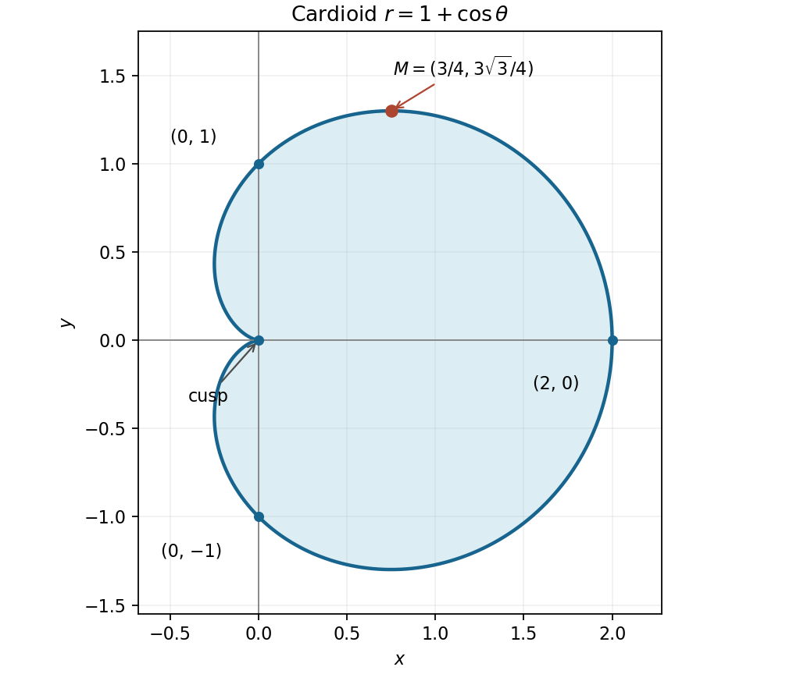

<h1 id="15/a/solution">Solution</h1>

↑ **Parent:** [A](../a.md)

Convert the [cardioid](../../../../../cardioid.md) from [polar coordinates](../../../../../polar-coordinates.md) to [Cartesian coordinates](../../../../../cartesian-coordinate-system.md):

$$
x=(1+\cos\theta)\cos\theta,\qquad y=(1+\cos\theta)\sin\theta.
$$

The [curve](../../../../../curve.md) is symmetric about the horizontal axis. It has a [cusp](../../../../../cusp-algebraic-geometry.md) at the origin at $\theta=\pi$, passes through $(0,\pm1)$, and reaches $(2,0)$ on the right. Its leftmost horizontal coordinate is $-1/4$, since $x=(\cos\theta+1/2)^2-1/4$.

For the largest $y$, differentiate the parametrization:

$$
\frac{dy}{d\theta}=\cos\theta+\cos2\theta
=(2\cos\theta-1)(\cos\theta+1).
$$

The candidates have $\cos\theta=1/2$ or $-1$. The positive maximum occurs at $\theta=\pi/3$, where $r=3/2$. Comparing with the negative extremum and the zero [cusp](../../../../../cusp-algebraic-geometry.md) value proves

$$
\boxed{(x_M,y_M)=\left(\frac34,\frac{3\sqrt3}{4}\right).}
$$

**[Figure 3](#15/a/image-the-cardioid-with-its-cusp-axis-crossings-and-point-of-greatest-vertical-coordinate). The cardioid with its cusp, axis crossings and point of greatest vertical coordinate**.

## ↑ Ancestors (13)

1. [A](../a.md)
2. [15](../../15.md)
3. [Paper 1](../../../paper-1-split.md)
4. [2012](../../../split.md)
5. [Past exam of the mathematics course of the year 1 of the natural sciences course of the University of Cambridge](../../../../split.md)
6. [Mathematics course of the year 1 of the natural sciences course of the University of Cambridge](../../../../../mathematics-course-of-the-year-1-of-the-natural-sciences-course-of-the-university-of-cambridge.md)
7. [Year 1 of the natural sciences course of the University of Cambridge](../../../../../year-1-of-the-natural-sciences-course-of-the-university-of-cambridge.md)
8. [Year of the natural sciences course of the University of Cambridge](../../../../../year-of-the-natural-sciences-course-of-the-university-of-cambridge.md)
9. [Natural sciences course of the University of Cambridge](../../../../../natural-sciences-course-of-the-university-of-cambridge.md)
10. [Course of the University of Cambridge](../../../../../course-of-the-university-of-cambridge.md)
11. [University of Cambridge](../../../../../university-of-cambridge-split.md)
12. [List of universities](../../../../../list-of-universities.md)
13. [Codex Wiki](../../../../../split.md)
