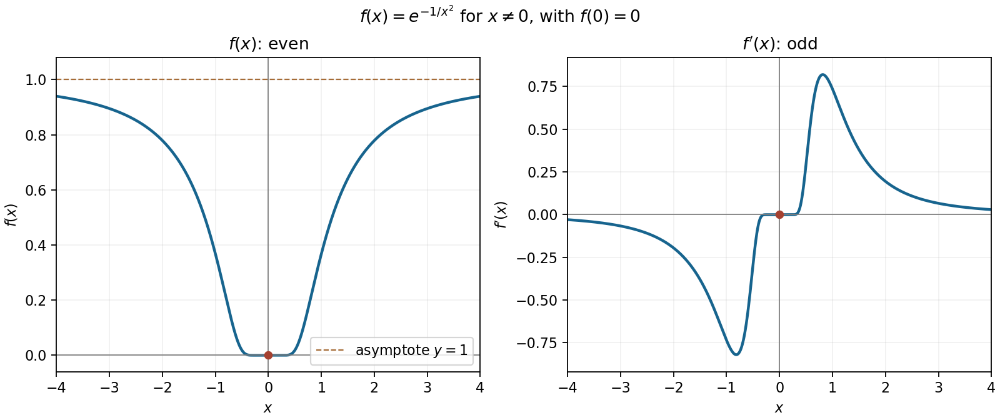

<h1 id="19/a/v/solution">Solution</h1>

↑ **Parent:** [V](../v.md)

The [flat function](../../../../../../flat-function.md) $f$ is an [even function](../../../../../../even-function.md), has its unique zero and [global minimum](../../../../../../global-minimum.md) at the origin, and approaches the horizontal [asymptote](../../../../../../asymptote.md) $1$ as $x\to\pm\infty$. It decreases for negative $x$ and increases for positive $x$, meeting the origin with a horizontal [tangent line](../../../../../../tangent-line.md).

Its [derivative](../../../../../../derivative.md) is an [odd function](../../../../../../odd-function.md): $f'(x)=2x^{-3}e^{-1/x^2}$ off zero, with $f'(0)=0$. It is negative to the left and positive to the right, tends to zero both at the origin and at infinity, and has one negative trough and one positive crest. Indeed $f''(x)=2e^{-1/x^2}(2-3x^2)/x^6$ away from zero, so the change in slope of $f'$ occurs once on each side. The exact crest and trough coordinates are not needed for the sketch.

**[Figure 4](#19/a/v/image-an-even-smooth-flat-function-and-its-odd-derivative-both-meeting-zero-with-all-derivatives-zero). An even smooth flat function and its odd derivative, both meeting zero with all derivatives zero**.

## ↑ Ancestors (14)

1. [V](../v.md)
2. [A](../../a.md)
3. [19](../../../19.md)
4. [Paper 1](../../../../paper-1-split.md)
5. [2012](../../../../split.md)
6. [Past exam of the mathematics course of the year 1 of the natural sciences course of the University of Cambridge](../../../../../split.md)
7. [Mathematics course of the year 1 of the natural sciences course of the University of Cambridge](../../../../../../mathematics-course-of-the-year-1-of-the-natural-sciences-course-of-the-university-of-cambridge.md)
8. [Year 1 of the natural sciences course of the University of Cambridge](../../../../../../year-1-of-the-natural-sciences-course-of-the-university-of-cambridge.md)
9. [Year of the natural sciences course of the University of Cambridge](../../../../../../year-of-the-natural-sciences-course-of-the-university-of-cambridge.md)
10. [Natural sciences course of the University of Cambridge](../../../../../../natural-sciences-course-of-the-university-of-cambridge.md)
11. [Course of the University of Cambridge](../../../../../../course-of-the-university-of-cambridge.md)
12. [University of Cambridge](../../../../../../university-of-cambridge-split.md)
13. [List of universities](../../../../../../list-of-universities.md)
14. [Codex Wiki](../../../../../../split.md)
