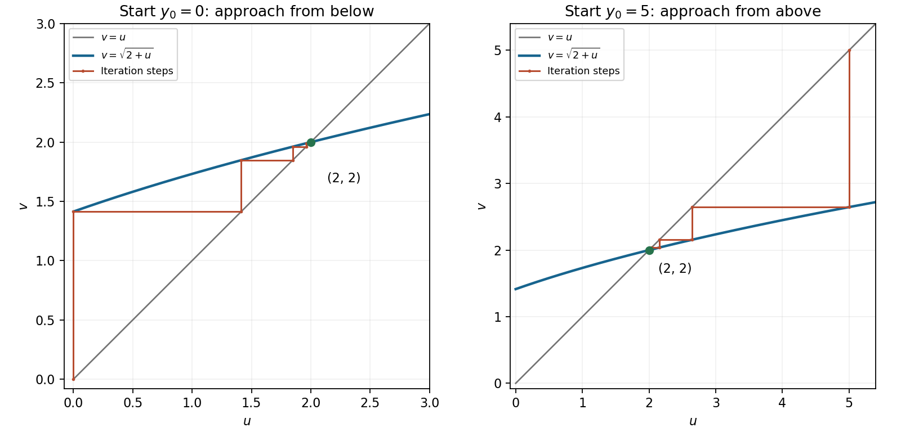

<h1 id="19/b/ii/solution">Solution</h1>

↑ **Parent:** [Ii](../ii.md)

The [cobweb plot](../../../../../../cobweb-plot.md) uses the [curve](../../../../../../curve.md) $v=\sqrt{2+u}$ and the diagonal $v=u$. From a point on the diagonal, a vertical step to the [curve](../../../../../../curve.md) computes the next iterate; a horizontal step returns its value to the diagonal.

For $0\leq u<2$, $(2+u)-u^2=(2-u)(1+u)>0$, so $u<\sqrt{2+u}<2$. Thus a start below $2$ gives a strictly increasing [sequence](../../../../../../sequence.md) bounded above by $2$. For $u>2$ the [inequalities](../../../../../../inequality-mathematics.md) reverse to $2<\sqrt{2+u}<u$, giving a strictly decreasing [sequence](../../../../../../sequence.md) bounded below by $2$. Both types of staircase approach the same intersection.

The [bounded monotone sequence theorem](../../../../../../bounded-monotone-sequence-theorem.md) proves existence of a limit, and [continuity](../../../../../../continuous-function.md) then makes it a nonnegative [fixed point](../../../../../../fixed-point.md). Part (i) gives

$$
\boxed{\lim_{n\to\infty}y_n=2\quad\text{for every }y_0\geq0.}
$$

This proves the [global convergence of a square-root iteration](../../../../../../global-convergence-of-a-square-root-iteration.md); the graph below illustrates both cases without relying on a finite numerical sample as proof.

**[Figure 5](#19/b/ii/image-iteration-staircases-approaching-the-positive-fixed-point-from-below-and-from-above). Iteration staircases approaching the positive fixed point from below and from above**.

## ↑ Ancestors (14)

1. [Ii](../ii.md)
2. [B](../../b.md)
3. [19](../../../19.md)
4. [Paper 1](../../../../paper-1-split.md)
5. [2012](../../../../split.md)
6. [Past exam of the mathematics course of the year 1 of the natural sciences course of the University of Cambridge](../../../../../split.md)
7. [Mathematics course of the year 1 of the natural sciences course of the University of Cambridge](../../../../../../mathematics-course-of-the-year-1-of-the-natural-sciences-course-of-the-university-of-cambridge.md)
8. [Year 1 of the natural sciences course of the University of Cambridge](../../../../../../year-1-of-the-natural-sciences-course-of-the-university-of-cambridge.md)
9. [Year of the natural sciences course of the University of Cambridge](../../../../../../year-of-the-natural-sciences-course-of-the-university-of-cambridge.md)
10. [Natural sciences course of the University of Cambridge](../../../../../../natural-sciences-course-of-the-university-of-cambridge.md)
11. [Course of the University of Cambridge](../../../../../../course-of-the-university-of-cambridge.md)
12. [University of Cambridge](../../../../../../university-of-cambridge-split.md)
13. [List of universities](../../../../../../list-of-universities.md)
14. [Codex Wiki](../../../../../../split.md)
