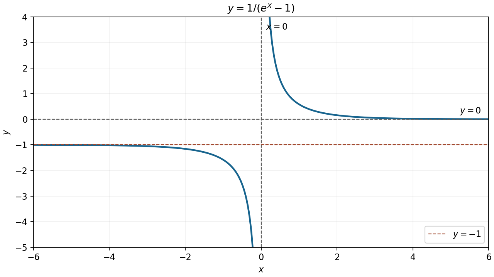

<h1 id="9/a/solution">Solution</h1>

↑ **Parent:** [A](../a.md)

The [domain of a function](../../../../../domain-of-a-function.md) is $\mathbb R\setminus\{0\}$, because the denominator vanishes at zero. Near zero, $e^x-1\sim x$, so $x=0$ is a vertical [asymptote](../../../../../asymptote.md), approached with value $-\infty$ from the left and $+\infty$ from the right. The horizontal [asymptotes](../../../../../asymptote.md) are $y=-1$ as $x\to-\infty$ and $y=0$ as $x\to+\infty$.

Moreover,

$$
f'(x)=-\frac{e^x}{(e^x-1)^2}<0.
$$

Both branches define a strictly decreasing [monotone function](../../../../../monotonic-function.md): the left branch lies below $-1$, and the right branch is positive. There are no zeros or vertical-axis intercept.

**[Figure 1](#9/a/image-the-decreasing-reciprocal-exponential-branches-with-their-three-asymptotes). The decreasing reciprocal-exponential branches with their three asymptotes**.

## ↑ Ancestors (13)

1. [A](../a.md)
2. [9](../../9.md)
3. [Paper 1](../../../paper-1-split.md)
4. [2012](../../../split.md)
5. [Past exam of the mathematics course of the year 1 of the natural sciences course of the University of Cambridge](../../../../split.md)
6. [Mathematics course of the year 1 of the natural sciences course of the University of Cambridge](../../../../../mathematics-course-of-the-year-1-of-the-natural-sciences-course-of-the-university-of-cambridge.md)
7. [Year 1 of the natural sciences course of the University of Cambridge](../../../../../year-1-of-the-natural-sciences-course-of-the-university-of-cambridge.md)
8. [Year of the natural sciences course of the University of Cambridge](../../../../../year-of-the-natural-sciences-course-of-the-university-of-cambridge.md)
9. [Natural sciences course of the University of Cambridge](../../../../../natural-sciences-course-of-the-university-of-cambridge.md)
10. [Course of the University of Cambridge](../../../../../course-of-the-university-of-cambridge.md)
11. [University of Cambridge](../../../../../university-of-cambridge-split.md)
12. [List of universities](../../../../../list-of-universities.md)
13. [Codex Wiki](../../../../../split.md)
