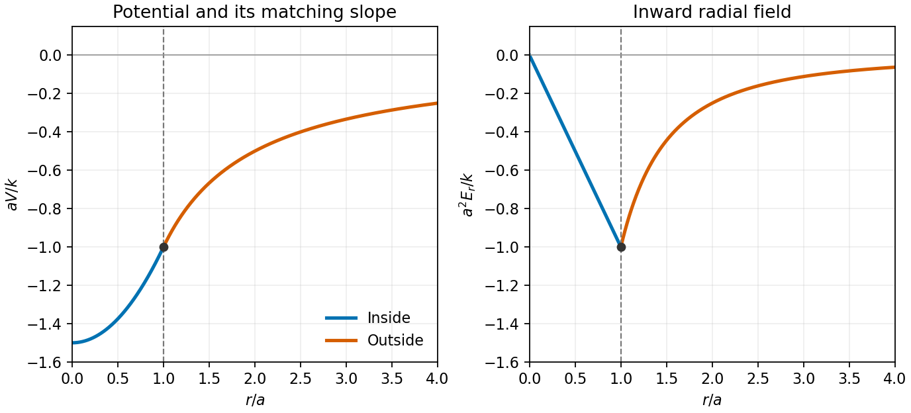

# Paper 2

↑ **Parent:** [2012](../2012.md)

[https://www.maths.cam.ac.uk/undergradnst/files/2012/PaperNST_IA_2.pdf](https://www.maths.cam.ac.uk/undergradnst/files/2012/PaperNST_IA_2.pdf)

**Table of contents**

- [1](#1)
  - [Solution](#1/solution)
- [2](#2)
  - [Solution](#2/solution)
- [3](#3)
  - [Solution](#3/solution)
- [4](#4)
  - [Solution](#4/solution)
- [5](#5)
  - [Solution](#5/solution)
- [6](#6)
  - [Solution](#6/solution)
- [7](#7)
  - [Solution](#7/solution)
- [8](#8)
  - [Solution](#8/solution)
- [9](#9)
  - [Solution](#9/solution)
- [10](#10)
  - [Solution](#10/solution)
- [11](#11)
  - [a](#11/a)
    - [Solution](#11/a/solution)
  - [b](#11/b)
    - [Solution](#11/b/solution)
  - [c](#11/c)
    - [Solution](#11/c/solution)
  - [d](#11/d)
    - [Solution](#11/d/solution)
  - [e](#11/e)
    - [Solution](#11/e/solution)
  - [f](#11/f)
    - [Solution](#11/f/solution)
  - [g](#11/g)
    - [Solution](#11/g/solution)
- [12](#12)
  - [a](#12/a)
    - [Solution](#12/a/solution)
  - [b](#12/b)
    - [Solution](#12/b/solution)
  - [c](#12/c)
    - [Solution](#12/c/solution)
  - [d](#12/d)
    - [Solution](#12/d/solution)
- [13](#13)
  - [a](#13/a)
    - [Solution](#13/a/solution)
  - [b](#13/b)
    - [Solution](#13/b/solution)
  - [c](#13/c)
    - [Solution](#13/c/solution)
- [14](#14)
  - [a](#14/a)
    - [i](#14/a/i)
      - [Solution](#14/a/i/solution)
    - [ii](#14/a/ii)
      - [Solution](#14/a/ii/solution)
    - [iii](#14/a/iii)
      - [Solution](#14/a/iii/solution)
  - [b](#14/b)
    - [Solution](#14/b/solution)
- [15](#15)
  - [a](#15/a)
    - [Solution](#15/a/solution)
  - [b](#15/b)
    - [Solution](#15/b/solution)
  - [c](#15/c)
    - [Solution](#15/c/solution)
- [16](#16)
  - [a](#16/a)
    - [Solution](#16/a/solution)
  - [b](#16/b)
    - [Solution](#16/b/solution)
  - [c](#16/c)
    - [Solution](#16/c/solution)
- [17](#17)
  - [a](#17/a)
    - [Solution](#17/a/solution)
  - [b](#17/b)
    - [Solution](#17/b/solution)
  - [c](#17/c)
    - [Solution](#17/c/solution)
- [18](#18)
  - [a](#18/a)
    - [Solution](#18/a/solution)
  - [b](#18/b)
    - [Solution](#18/b/solution)
  - [c](#18/c)
    - [Solution](#18/c/solution)
  - [d](#18/d)
    - [Solution](#18/d/solution)
- [19](#19)
  - [a](#19/a)
    - [Solution](#19/a/solution)
  - [b](#19/b)
    - [Solution](#19/b/solution)
- [20](#20)
  - [a](#20/a)
    - [Solution](#20/a/solution)
  - [b](#20/b)
    - [Solution](#20/b/solution)
  - [c](#20/c)
    - [Solution](#20/c/solution)

## 1

↑ **Parent:** [Paper 2](paper-2.md)

<h3 id="1/solution">Solution</h3>

↑ **Parent:** [1](#1)

Expanding the [cross product](../../vector-space.md#cross-product) gives $\mathbf u\times\mathbf v=(bc,-ac,a)$. Comparing its three components in order from the last to the first gives $a=2$, $ac=6$, and $bc=3$. Therefore

$$
\boxed{a=2,\qquad b=1,\qquad c=3}.
$$

The nonzero value of $a$ permits division to find $c$, and the resulting nonzero $c$ determines $b$.

## 2

↑ **Parent:** [Paper 2](paper-2.md)

<h3 id="2/solution">Solution</h3>

↑ **Parent:** [2](#2)

The [chain rule](../../calculus.md#chain-rule) identifies an [antiderivative](../../integral.md#antiderivative) directly:

$$
\frac{d}{dx}e^{\sin(x^2)}=2x\cos(x^2)e^{\sin(x^2)}.
$$

The upper limit in the PDF is $\sqrt{\pi/2}$. By the [fundamental theorem of calculus](../../calculus.md#fundamental-theorem-of-calculus), the required [integral](../../integral.md) is

$$
\boxed{\frac12\left[e^{\sin(x^2)}\right]_0^{\sqrt{\pi/2}}=\frac{e-1}{2}}.
$$

## 3

↑ **Parent:** [Paper 2](paper-2.md)

<h3 id="3/solution">Solution</h3>

↑ **Parent:** [3](#3)

The [determinant](../../multilinear-algebra.md#determinant) is $2\cdot4-3\cdot1=5\ne0$, so the [matrix inverse](../../matrix-inverse.md) exists. Using the two-by-two [adjugate matrix](../../linear-algebra.md#adjugate-matrix) formula gives

$$
\boxed{A^{-1}=\frac15\begin{pmatrix}4&-1\\-3&2\end{pmatrix}}.
$$

Multiplication on either side gives the [identity matrix](../../vector-space.md#identity-matrix), which also checks the signs of the off-diagonal entries.

## 4

↑ **Parent:** [Paper 2](paper-2.md)

<h3 id="4/solution">Solution</h3>

↑ **Parent:** [4](#4)

Multiply by the [complex conjugate](../../complex-analysis.md#complex-conjugate) of the denominator:

$$
\frac{2+3i}{4-5i}=\frac{(2+3i)(4+5i)}{4^2+5^2}
=\frac{-7+22i}{41}.
$$

Thus the [real part](../../complex-analysis.md#real-part) and [imaginary part](../../complex-analysis.md#imaginary-part) are respectively

$$
\boxed{-\frac7{41},\qquad\frac{22}{41}}.
$$

## 5

↑ **Parent:** [Paper 2](paper-2.md)

<h3 id="5/solution">Solution</h3>

↑ **Parent:** [5](#5)

Near $x=2$, use $f(x)=2\ln x$, so $f'(2)=1$ and $f''(2)=-1/2$. The [Taylor series](../../calculus.md#taylor-series) therefore begins

$$
\boxed{\ln(x^2)=\ln4+(x-2)-\frac14(x-2)^2+O((x-2)^3)}.
$$

The constant term is one of the requested three terms. The local expression $2\ln x$ is legitimate because this neighbourhood has $x>0$.

## 6

↑ **Parent:** [Paper 2](paper-2.md)

<h3 id="6/solution">Solution</h3>

↑ **Parent:** [6](#6)

The [partial derivatives](../../multivariable-calculus.md#partial-derivative) are $f_{xx}=4f$ and $f_t=\omega f$. Since the [exponential function](../../calculus.md#exponential-function) never vanishes, substituting into the [partial differential equation](../../partial-differential-equation.md) gives $4=6\omega$. Hence

$$
\boxed{\omega=\frac23}.
$$

## 7

↑ **Parent:** [Paper 2](paper-2.md)

<h3 id="7/solution">Solution</h3>

↑ **Parent:** [7](#7)

The implication means that $A\subseteq B$, so $A\cap B=A$. By the definition of [conditional probability](../../probability-theory.md#conditional-probability),

$$
\boxed{P(A\mid B)=\frac{P(A\cap B)}{P(B)}
=\frac{1/3}{1/2}=\frac23}.
$$

This implication gives $P(B\mid A)=1$; it does not make the two [events](../../probability-space.md#event) independent.

## 8

↑ **Parent:** [Paper 2](paper-2.md)

<h3 id="8/solution">Solution</h3>

↑ **Parent:** [8](#8)

In [Cartesian coordinates](../../linear-algebra.md#cartesian-coordinate-system), calculate the [divergence](../../multivariable-calculus.md#divergence) by differentiating each component with respect to its matching coordinate:

$$
\boxed{\nabla\cdot\mathbf F=2x+x+6z=3x+6z}.
$$

For the [curl](../../multivariable-calculus.md#curl), take the alternating cross-derivatives:

$$
\boxed{\nabla\times\mathbf F
=(\partial_yF_z-\partial_zF_y,\partial_zF_x-\partial_xF_z,
\partial_xF_y-\partial_yF_x)=(0,2x,3y)}.
$$

## 9

↑ **Parent:** [Paper 2](paper-2.md)

<h3 id="9/solution">Solution</h3>

↑ **Parent:** [9](#9)

Parametrize the directed segment by $\mathbf r(t)=(t,t,0)$, $0\leq t\leq1$. Its tangent is $(1,1,0)$, while the restricted [vector field](../../multivariable-calculus.md#vector-field) is $(t^3,t^3,0)$. The [line integral](../../multivariable-calculus.md#line-integral) is therefore

$$
\boxed{\int_0^1\mathbf G(\mathbf r(t))\cdot\mathbf r'(t)\,dt
=\int_0^12t^3\,dt=\frac12}.
$$

Alternatively, $\mathbf G=\nabla(x^2y^2/2)$, so the [fundamental theorem for line integrals](../../multivariable-calculus.md#fundamental-theorem-for-line-integrals) gives the same endpoint difference.

## 10

↑ **Parent:** [Paper 2](paper-2.md)

<h3 id="10/solution">Solution</h3>

↑ **Parent:** [10](#10)

The [derivative](../../calculus.md#derivative) is $f'(x)=2x\cos(x^2-2)$. Thus a [stationary point](../../calculus-of-variations.md#stationary-point) occurs either at $x=0$ or where $x^2-2=\pi/2+k\pi$. Since $-2\leq x^2-2<2$ on the specified open interval, the only allowed cosine zeros are $-\pi/2$ and $\pi/2$. The five stationary abscissae are

$$
\boxed{x=0,\qquad x=\pm\sqrt{2-\frac\pi2},\qquad
x=\pm\sqrt{2+\frac\pi2}}.
$$

Their ordinates are $-\sin2$, $-1$, and $1$, respectively. For completeness, $f''=2\cos(x^2-2)-4x^2\sin(x^2-2)$ shows that the inner pair are [local minima](../../analysis.md#local-minimum) and the outer pair are [local maxima](../../analysis.md#local-maximum); $x=0$ is also a [local maximum](../../analysis.md#local-maximum) because $2\cos2<0$.

## 11

↑ **Parent:** [Paper 2](paper-2.md)

<h3 id="11/a">a</h3>

↑ **Parent:** [11](#11)

<h4 id="11/a/solution">Solution</h4>

↑ **Parent:** [A](#11/a)

Solving $(A-4I)\mathbf v=0$ gives $v_2=0$ and $v_1=v_3$. A convenient normalized [eigenvector](../../linear-operator-theory.md#eigenvector) is

$$
\boxed{\mathbf e_1=\frac1{\sqrt2}(1,0,1),\qquad A\mathbf e_1=4\mathbf e_1}.
$$

The displayed nonzero [vector](../../vector-space.md#vector) proves that four is an [eigenvalue](../../linear-operator-theory.md#eigenvalue). Every nonzero multiple represents the same eigendirection.

<h3 id="11/b">b</h3>

↑ **Parent:** [11](#11)

<h4 id="11/b/solution">Solution</h4>

↑ **Parent:** [B](#11/b)

A [vector](../../vector-space.md#vector) perpendicular to $\mathbf e_1$ has the form $\mathbf v=(s,t,-s)$. Direct [matrix multiplication](../../vector-space.md#matrix-multiplication) gives

$$
A\mathbf v=(-2s,-2t,2s)=-2\mathbf v.
$$

Thus every **nonzero** such [vector](../../vector-space.md#vector) is an [eigenvector](../../linear-operator-theory.md#eigenvector) with $\boxed{\lambda=-2}$. The zero [vector](../../vector-space.md#vector) must be excluded from the literal claim about “any” perpendicular [vector](../../vector-space.md#vector), since an [eigenvector](../../linear-operator-theory.md#eigenvector) is nonzero. The [eigenspace](../../linear-operator-theory.md#eigenspace) is two-dimensional. Equivalently, $A=-2I+6\mathbf e_1\mathbf e_1^{\mathsf T}$ exhibits the [spectrum of a scalar matrix plus a rank-one projector](../../linear-algebra.md#spectrum-of-a-scalar-matrix-plus-a-rank-one-projector).

<h3 id="11/c">c</h3>

↑ **Parent:** [11](#11)

<h4 id="11/c/solution">Solution</h4>

↑ **Parent:** [C](#11/c)

Choose two perpendicular unit directions in the $-2$ [eigenspace](../../linear-operator-theory.md#eigenspace):

$$
\boxed{\mathbf e_1=\frac{(1,0,1)}{\sqrt2},\qquad
\mathbf e_2=\frac{(1,0,-1)}{\sqrt2},\qquad
\mathbf e_3=(0,1,0)}.
$$

Their pairwise [dot products](../../inner-product.md#dot-product) vanish and their [Euclidean norms](../../normed-vector-space.md#euclidean-norm) are one. They form an [orthonormal basis](../../inner-product.md#orthonormal-basis) of [eigenvectors](../../linear-operator-theory.md#eigenvector), with [eigenvalues](../../linear-operator-theory.md#eigenvalue) $4,-2,-2$, as guaranteed for a real [symmetric matrix](../../linear-algebra.md#symmetric-matrix) by the [spectral theorem for real symmetric matrices](../../linear-algebra.md#spectral-theorem-for-real-symmetric-matrices).

<h3 id="11/d">d</h3>

↑ **Parent:** [11](#11)

<h4 id="11/d/solution">Solution</h4>

↑ **Parent:** [D](#11/d)

The [trace](../../linear-algebra.md#matrix-trace) is the sum of the [eigenvalues](../../linear-operator-theory.md#eigenvalue), counting multiplicity, while the [determinant](../../multilinear-algebra.md#determinant) is their product:

$$
\boxed{\operatorname{tr}A=1-2+1=0=4-2-2,\qquad
\det A=16=4(-2)(-2)}.
$$

A direct expansion along the middle row checks the latter: $(-2)(1-9)=16$.

<h3 id="11/e">e</h3>

↑ **Parent:** [11](#11)

<h4 id="11/e/solution">Solution</h4>

↑ **Parent:** [E](#11/e)

Using the ordered [orthonormal basis](../../inner-product.md#orthonormal-basis) chosen in (c), the column [matrix](../../vector-space.md#matrix) is

$$
\boxed{B=\begin{pmatrix}
1/\sqrt2&1/\sqrt2&0\\
0&0&1\\
1/\sqrt2&-1/\sqrt2&0
\end{pmatrix}}.
$$

Other signs or another [orthonormal](../../inner-product.md#orthonormal-set) choice within the repeated [eigenspace](../../linear-operator-theory.md#eigenspace) are equally valid, provided the same choice is retained in the remaining parts.

<h3 id="11/f">f</h3>

↑ **Parent:** [11](#11)

<h4 id="11/f/solution">Solution</h4>

↑ **Parent:** [F](#11/f)

The $(i,j)$ entry of $B^{\mathsf T}B$ is $\mathbf e_i\cdot\mathbf e_j=\delta_{ij}$. Hence $B$ is an [orthogonal matrix](../../linear-algebra.md#orthogonal-matrix), whose [matrix inverse](../../matrix-inverse.md) equals its [transpose](../../vector-space.md#transpose):

$$
\boxed{B^{-1}=B^{\mathsf T}=\begin{pmatrix}
1/\sqrt2&0&1/\sqrt2\\
1/\sqrt2&0&-1/\sqrt2\\
0&1&0
\end{pmatrix}}.
$$

This obtains the inverse without unnecessary cofactor calculations.

<h3 id="11/g">g</h3>

↑ **Parent:** [11](#11)

<h4 id="11/g/solution">Solution</h4>

↑ **Parent:** [G](#11/g)

The [eigenvector](../../linear-operator-theory.md#eigenvector) equations give $AB=B\operatorname{diag}(4,-2,-2)$. Multiplying on the left by $B^{-1}$ therefore gives

$$
\boxed{B^{-1}AB=\begin{pmatrix}4&0&0\\0&-2&0\\0&0&-2\end{pmatrix}}.
$$

This is an [orthogonal diagonalization](../../linear-algebra.md#orthogonal-diagonalization-of-a-real-symmetric-matrix): the [linear map](../../vector-space.md#linear-map) acts independently by multiplication by its [eigenvalues](../../linear-operator-theory.md#eigenvalue) in the new [orthonormal basis](../../inner-product.md#orthonormal-basis). The repeated [eigenvalue](../../linear-operator-theory.md#eigenvalue) explains the freedom to rotate the last two basis directions.

## 12

↑ **Parent:** [Paper 2](paper-2.md)

<h3 id="12/a">a</h3>

↑ **Parent:** [12](#12)

<h4 id="12/a/solution">Solution</h4>

↑ **Parent:** [A](#12/a)

Apply the [fundamental theorem of calculus](../../calculus.md#fundamental-theorem-of-calculus) separately to the upper and lower limits. No evaluation of the [integral](../../integral.md) is needed:

$$
\boxed{\frac{\partial I_{n,k}}{\partial x}=\cos^kx(1-\sin^3x)^n,\qquad
\frac{\partial I_{n,k}}{\partial y}=-\cos^ky(1-\sin^3y)^n}.
$$

The first result has no $y$ dependence and the second no $x$ dependence, so the mixed [partial derivative](../../multivariable-calculus.md#partial-derivative) is

$$
\boxed{\frac{\partial^2I_{n,k}}{\partial x\partial y}=0}.
$$

<h3 id="12/b">b</h3>

↑ **Parent:** [12](#12)

<h4 id="12/b/solution">Solution</h4>

↑ **Parent:** [B](#12/b)

Set $s=\sin u$, so $ds=\cos u\,du$, and write $J_n=I_{n,1}(\pi/2,0)$. The [integration by substitution](../../integral.md#integration-by-substitution) gives $J_n=\int_0^1(1-s^3)^n\,ds$. For $n>0$, [integration by parts](../../calculus.md#integration-by-parts) yields

$$
J_n=[s(1-s^3)^n]_0^1+3n\int_0^1s^3(1-s^3)^{n-1}\,ds.
$$

Both endpoint terms vanish. Use $s^3=1-(1-s^3)$ inside the remaining [integral](../../integral.md):

$$
J_n=3n(J_{n-1}-J_n).
$$

Consequently

$$
\boxed{I_{n,1}(\pi/2,0)=\frac{3n}{3n+1}I_{n-1,1}(\pi/2,0),\qquad
f(n)=\frac{3n}{3n+1}}.
$$

This is the $p=3$ instance of the [power-complement integral recurrence](../../complex-analysis.md#power-complement-integral-recurrence), with initial value $J_0=1$.

<h3 id="12/c">c</h3>

↑ **Parent:** [12](#12)

<h4 id="12/c/solution">Solution</h4>

↑ **Parent:** [C](#12/c)

Apply the [power-complement integral recurrence](../../complex-analysis.md#power-complement-integral-recurrence) three times, starting from $I_{0,1}(\pi/2,0)=1$:

$$
\boxed{I_{3,1}(\pi/2,0)=\frac9{10}\frac67\frac34=\frac{81}{140}}.
$$

Each factor corresponds to reducing $n$ by one; the final unreduced [integral](../../integral.md) is just $\int_0^{\pi/2}\cos u\,du=1$.

<h3 id="12/d">d</h3>

↑ **Parent:** [12](#12)

<h4 id="12/d/solution">Solution</h4>

↑ **Parent:** [D](#12/d)

Subtract the integrands first, using $\cos u-\cos^3u=\cos u\sin^2u$. Then set $s=\sin u$:

$$
I_{n,1}(\pi/2,0)-I_{n,3}(\pi/2,0)
=\int_0^1s^2(1-s^3)^n\,ds.
$$

The further [integration by substitution](../../integral.md#integration-by-substitution) $w=s^3$ makes $dw=3s^2ds$, so

$$
\boxed{I_{n,1}(\pi/2,0)-I_{n,3}(\pi/2,0)
=\frac13\int_0^1(1-w)^n\,dw=\frac1{3(n+1)}}.
$$

This also holds at $n=0$.

## 13

↑ **Parent:** [Paper 2](paper-2.md)

<h3 id="13/a">a</h3>

↑ **Parent:** [13](#13)

<h4 id="13/a/solution">Solution</h4>

↑ **Parent:** [A](#13/a)

The [characteristic equation](../../linear-ordinary-differential-equation.md#characteristic-equation-of-a-constant-coefficient-differential-equation) is $r^2+r-2=(r-1)(r+2)=0$, giving $y=Ae^x+Be^{-2x}$. The [initial conditions](../../differential-equation.md#initial-condition) give $A+B=1$ and $A-2B=-1$. Solving yields $A=1/3$, $B=2/3$, hence

$$
\boxed{y(x)=\frac13e^x+\frac23e^{-2x}}.
$$

The two distinct characteristic roots supply all solutions of this second-order [linear ordinary differential equation](../../linear-ordinary-differential-equation.md).

<h3 id="13/b">b</h3>

↑ **Parent:** [13](#13)

<h4 id="13/b/solution">Solution</h4>

↑ **Parent:** [B](#13/b)

The [characteristic equation](../../linear-ordinary-differential-equation.md#characteristic-equation-of-a-constant-coefficient-differential-equation) has the repeated root $r=-3$. Its [homogeneous solution](../../linear-ordinary-differential-equation.md#homogeneous-solution) is therefore $(C_1+C_2x)e^{-3x}$. For a [particular solution](../../linear-ordinary-differential-equation.md#particular-solution), try $y_p=Ax+B$. Substitution gives $9Ax+6A+9B=3x+1$, so $A=1/3$ and $B=-1/9$. Thus the [general solution](../../linear-ordinary-differential-equation.md#general-solution) is

$$
\boxed{y(x)=(C_1+C_2x)e^{-3x}+\frac x3-\frac19}.
$$

The extra factor $x$ in the second homogeneous term is required by the repeated root.

<h3 id="13/c">c</h3>

↑ **Parent:** [13](#13)

<h4 id="13/c/solution">Solution</h4>

↑ **Parent:** [C](#13/c)

The [characteristic equation](../../linear-ordinary-differential-equation.md#characteristic-equation-of-a-constant-coefficient-differential-equation) factors as $(r+1)(r+2)=0$, giving $y_h=C_1e^{-x}+C_2e^{-2x}$. The [superposition principle](../../vector-space.md#superposition-principle) lets us find [particular solutions](../../linear-ordinary-differential-equation.md#particular-solution) for the two forcing terms separately. A trial $Ax+B$ gives $2A=1$ and $3A+2B=0$, so it is $x/2-3/4$. A trial $Ce^{3x}$ gives $(9+9+2)C=1$, so $C=1/20$. Therefore

$$
\boxed{y(x)=C_1e^{-x}+C_2e^{-2x}+\frac x2-\frac34+\frac1{20}e^{3x}}.
$$

## 14

↑ **Parent:** [Paper 2](paper-2.md)

<h3 id="14/a">a</h3>

↑ **Parent:** [14](#14)

<h4 id="14/a/i">i</h4>

↑ **Parent:** [A](#14/a)

<h5 id="14/a/i/solution">Solution</h5>

↑ **Parent:** [I](#14/a/i)

Use outward [normal vectors](../../differential-geometry.md#normal-vector) to the two faces. The [cross products](../../vector-space.md#cross-product)

$$
\mathbf n_1=\overrightarrow{OP}\times\overrightarrow{OR}=(1,-2,2),\qquad
\mathbf n_2=\overrightarrow{OR}\times\overrightarrow{OQ}=(-2,1,-1)
$$

point away from the opposite vertices, since $\mathbf n_1\cdot\overrightarrow{OQ}=-3$ and $\mathbf n_2\cdot\overrightarrow{OP}=-3$. Their [Euclidean norms](../../normed-vector-space.md#euclidean-norm) are $3$ and $\sqrt6$, and their [dot product](../../inner-product.md#dot-product) is $-6$. The [interior dihedral angle of a convex polyhedron](../../euclidean-geometry.md#interior-dihedral-angle-of-a-convex-polyhedron) is supplementary to the outward-normal angle, so

$$
\boxed{\cos\theta=-\frac{\mathbf n_1\cdot\mathbf n_2}{|\mathbf n_1||\mathbf n_2|}
=\frac2{\sqrt6}=\sqrt{\frac23}}.
$$

This also equals the cosine of the acute angle between the unoriented face planes. The outward-normal angle itself has cosine $-\sqrt{2/3}$; keeping that distinction avoids a sign ambiguity.

<h4 id="14/a/ii">ii</h4>

↑ **Parent:** [A](#14/a)

<h5 id="14/a/ii/solution">Solution</h5>

↑ **Parent:** [Ii](#14/a/ii)

For the triangular face, take the [cross product](../../vector-space.md#cross-product) of two edges and divide by two:

$$
\frac12\overrightarrow{PQ}\times\overrightarrow{PR}
=\frac12(-1,1,0)\times(-2,0,1)=\frac12(1,1,2).
$$

The origin lies on the opposite side from this normal, since $(1,1,2)\cdot\overrightarrow{PO}=-3$. Thus this is already the outward [vector area](../../differential-geometry.md#vector-area), with

$$
\boxed{A=\frac{\sqrt6}{2},\qquad\hat{\mathbf n}=\frac{(1,1,2)}{\sqrt6},\qquad
A\hat{\mathbf n}=\left(\frac12,\frac12,1\right)}.
$$

The [vector areas of a closed polyhedron sum to zero](../../differential-geometry.md#vector-areas-of-a-closed-polyhedron-sum-to-zero), so the sum for the remaining three faces is

$$
\boxed{\left(-\frac12,-\frac12,-1\right)}.
$$

**[Figure 1](#14/a/ii/image-tetrahedron-with-its-highlighted-face-pqr-and-outward-unit-normal). Tetrahedron with its highlighted face PQR and outward unit normal**.

Their individual outward [vector areas](../../differential-geometry.md#vector-area) are $(0,0,-3/2)$, $(1/2,-1,1)$, and $(-1,1/2,-1/2)$, which directly check that sum.

<h4 id="14/a/iii">iii</h4>

↑ **Parent:** [A](#14/a)

<h5 id="14/a/iii/solution">Solution</h5>

↑ **Parent:** [Iii](#14/a/iii)

The normal from (ii) gives the [plane](../../geometry-and-topology.md#plane) equation $x+y+2z=3$. The [distance from a point to a plane](../../geometry-and-topology.md#distance-from-a-point-to-a-plane) is the absolute value of the normalized plane equation at that point. At the origin this gives

$$
\boxed{d=\frac3{\sqrt{1^2+1^2+2^2}}=\frac3{\sqrt6}=\frac{\sqrt6}{2}}.
$$

For a geometric check, the perpendicular foot is $H=(1/2,1/2,1)$, parallel to the normal and satisfying the plane equation. Its [Euclidean norm](../../normed-vector-space.md#euclidean-norm) is the same distance.

<h3 id="14/b">b</h3>

↑ **Parent:** [14](#14)

<h4 id="14/b/solution">Solution</h4>

↑ **Parent:** [B](#14/b)

The [volume](../../geometry-and-topology.md#volume) of a [parallelepiped](../../euclidean-geometry.md#parallelepiped) is the absolute [scalar triple product](../../multilinear-algebra.md#scalar-triple-product) of its three edge [vectors](../../vector-space.md#vector). Since $\overrightarrow{OP}\times\overrightarrow{OQ}=(0,0,3)$,

$$
\boxed{\mathcal V=\left|\bigl(\overrightarrow{OP}\times\overrightarrow{OQ}\bigr)
\cdot\overrightarrow{OR}\right|=3}.
$$

The factor $1/6$ appropriate to a [tetrahedron](../../euclidean-geometry.md#tetrahedron) must not be applied to this parallelepiped.

## 15

↑ **Parent:** [Paper 2](paper-2.md)

<h3 id="15/a">a</h3>

↑ **Parent:** [15](#15)

<h4 id="15/a/solution">Solution</h4>

↑ **Parent:** [A](#15/a)

Inside the [sphere](../../euclidean-geometry.md#sphere), the [electric field](../../electric-field.md) has the form $\mathbf E=\nabla[-kr^2/(2a^3)]$, including at the origin. Thus it is a [conservative vector field](../../multivariable-calculus.md#conservative-vector-field). Outside, use the [gradient of a radial function](../../multivariable-calculus.md#gradient-of-a-radial-function) to obtain

$$
\mathbf E=k\nabla\frac1r=-\frac{k\mathbf r}{r^3}.
$$

This is also an explicit [potential of a conservative vector field](../../multivariable-calculus.md#potential-of-a-conservative-vector-field), single-valued throughout the exterior region. Equivalently, the [curl](../../multivariable-calculus.md#curl) vanishes in both regions: for a radial coefficient $h(r)$, $\nabla\times(h\mathbf r)=\nabla h\times\mathbf r+h\nabla\times\mathbf r=0$ because $\nabla h$ is radial. The interior formula avoids any apparent $1/r$ issue at the origin. The vector-field potentials here have the opposite sign from the [electric potential](../../electric-field.md#electric-potential) convention used in (b).

<h3 id="15/b">b</h3>

↑ **Parent:** [15](#15)

<h4 id="15/b/solution">Solution</h4>

↑ **Parent:** [B](#15/b)

For a radial [electric potential](../../electric-field.md#electric-potential), $\mathbf E=-V'(r)\mathbf r/r$. Comparing radial coefficients gives

$$
V'_{\rm in}(r)=\frac{kr}{a^3},\qquad V'_{\rm out}(r)=\frac{k}{r^2}.
$$

Integrating these one-variable [derivatives](../../calculus.md#derivative) gives the general local expressions

$$
\boxed{V_{\rm in}(r)=\frac{kr^2}{2a^3}+C_{\rm in},\qquad
V_{\rm out}(r)=-\frac kr+C_{\rm out}}.
$$

The two constants are initially independent because these integrations were performed in separate radial regions.

<h3 id="15/c">c</h3>

↑ **Parent:** [15](#15)

<h4 id="15/c/solution">Solution</h4>

↑ **Parent:** [C](#15/c)

The condition at infinity gives $C_{\rm out}=0$. Matching the [electric potential](../../electric-field.md#electric-potential) at $r=a$ gives

$$
\frac{k}{2a}+C_{\rm in}=-\frac ka,
\qquad C_{\rm in}=-\frac{3k}{2a}.
$$

Consequently

$$
\boxed{V(r)=\begin{cases}
\dfrac{k}{2a^3}(r^2-3a^2),&0\leq r<a,\\
-\dfrac kr,&r\geq a.
\end{cases}}
$$

This [function](../../function.md) is finite and differentiable at the origin. At the joining radius, both $V$ and $V'$ match, giving $V(a)=-k/a$ and $V'(a)=k/a^2$. Thus the [electric field](../../electric-field.md) is continuous there as well as being conservative on each side. This is the [potential of a uniform spherical source](../../geometry-and-topology.md#potential-of-a-uniform-spherical-source), with source coefficient $3k/a^3$.

**[Figure 2](#15/c/image-continuous-radial-potential-and-inward-electric-field-normalized-at-the-sphere-boundary). Continuous radial potential and inward electric field, normalized at the sphere boundary**.

## 16

↑ **Parent:** [Paper 2](paper-2.md)

<h3 id="16/a">a</h3>

↑ **Parent:** [16](#16)

<h4 id="16/a/solution">Solution</h4>

↑ **Parent:** [A](#16/a)

The [multivariable chain rule](../../calculus.md#multivariable-chain-rule) gives

$$
\frac{dF}{dt}=(3x^2yz+y)(-3\sin t)+(x^3z+x)(3\cos t)+(x^3y+1)2.
$$

Substituting the three parametrizing functions also writes the complete [derivative](../../calculus.md#derivative) as

$$
\frac{dF}{dt}=162\cos^3t\sin t
+162t(\cos^4t-3\cos^2t\sin^2t)+9\cos2t+2.
$$

At $t=\pi/2$, the point is $(0,3,\pi)$, its velocity is $(-3,0,2)$, and $\nabla F=(3,0,1)$. Hence

$$
\boxed{\left.\frac{dF}{dt}\right|_{t=\pi/2}=\nabla F\cdot\mathbf r'=-9+2=-7}.
$$

<h3 id="16/b">b</h3>

↑ **Parent:** [16](#16)

<h4 id="16/b/solution">Solution</h4>

↑ **Parent:** [B](#16/b)

Write the [differential one-form](../../differential-form.md#one-form) as $M\,dx+N\,dy$. An [exact differential form](../../differential-form.md#exact-differential-form) must satisfy equality of mixed [partial derivatives](../../multivariable-calculus.md#partial-derivative), $M_y=N_x$. Here

$$
M_y=x-2y,\qquad N_x=x-ay.
$$

Equality at every $(x,y)$ holds precisely when $\boxed{a=2}$. Since these [polynomials](../../polynomial.md) are smooth on the simply connected [plane](../../geometry-and-topology.md#plane), the closed-form condition is also sufficient for exactness; the explicit [potential of a conservative vector field](../../multivariable-calculus.md#potential-of-a-conservative-vector-field) constructed in (c) verifies that sufficiency directly.

<h3 id="16/c">c</h3>

↑ **Parent:** [16](#16)

<h4 id="16/c/solution">Solution</h4>

↑ **Parent:** [C](#16/c)

With $a=2$, integrate the $dx$ coefficient with respect to $x$:

$$
\Phi(x,y)=\frac{x^3}{3}+\frac{x^2y}{2}-xy^2+g(y).
$$

Its other [partial derivative](../../multivariable-calculus.md#partial-derivative) is $\Phi_y=x^2/2-2xy+g'(y)$. Matching the $dy$ coefficient gives $g'=0$. Therefore the [differential equation](../../differential-equation.md) is $d\Phi=0$, and its implicit [general solution](../../linear-ordinary-differential-equation.md#general-solution) is

$$
\boxed{\frac{x^3}{3}+\frac{x^2y}{2}-xy^2=C}.
$$

These are [level curves](../../topology.md#level-curve) of the [potential of a conservative vector field](../../multivariable-calculus.md#potential-of-a-conservative-vector-field). Where $N\ne0$, they give the usual graph solution $dy/dx=-M/N$. At $N=0$, the implicit description retains possible vertical tangents instead of dividing by zero.

## 17

↑ **Parent:** [Paper 2](paper-2.md)

<h3 id="17/a">a</h3>

↑ **Parent:** [17](#17)

<h4 id="17/a/solution">Solution</h4>

↑ **Parent:** [A](#17/a)

A cubic version of [Taylor's theorem](../../calculus.md#taylor-s-theorem) requires the corresponding higher differentiability, rather than only one [derivative](../../calculus.md#derivative). For example, if $f$ has four continuous [derivatives](../../calculus.md#derivative) on the interval between $a$ and $x$, then

$$
f(x)=f(a)+f'(a)(x-a)+\frac{f''(a)}{2!}(x-a)^2
+\frac{f^{(3)}(a)}{3!}(x-a)^3+R_3(x),
$$

where the Lagrange form of the [Taylor remainder](../../calculus.md#taylor-remainder) is

$$
\boxed{R_3(x)=\frac{f^{(4)}(\xi)}{4!}(x-a)^4}
$$

for some $\xi$ strictly between $a$ and $x$ when they differ. At $x=a$, the remainder is zero. These hypotheses apply to both functions used below.

<h3 id="17/b">b</h3>

↑ **Parent:** [17](#17)

<h4 id="17/b/solution">Solution</h4>

↑ **Parent:** [B](#17/b)

The required [derivatives](../../calculus.md#derivative) are $f'(x)=1/(2\sqrt x)$, $f''(x)=-1/(4x^{3/2})$, $f^{(3)}(x)=3/(8x^{5/2})$, and $f^{(4)}(x)=-15/(16x^{7/2})$. The four-term [Taylor polynomial](../../calculus.md#taylor-polynomial) about one, evaluated at two, is

$$
\boxed{\sqrt2\approx1+\frac12-\frac18+\frac1{16}=\frac{23}{16}}.
$$

The [Taylor remainder](../../calculus.md#taylor-remainder) is $R_3(2)=-5/(128\xi^{7/2})$ for some $1<\xi<2$. Thus

$$
\boxed{\left|\sqrt2-\frac{23}{16}\right|\leq\frac5{128}}.
$$

Its negative sign also shows that this approximation is an overestimate. Bounding the fourth [derivative](../../calculus.md#derivative) throughout the interval establishes the requested error estimate without using a decimal value of $\sqrt2$.

<h3 id="17/c">c</h3>

↑ **Parent:** [17](#17)

<h4 id="17/c/solution">Solution</h4>

↑ **Parent:** [C](#17/c)

Factor $1+e^x=2e^{x/2}\cosh(x/2)$. This gives

$$
\ln(1+e^x)=\ln2+\frac x2+\ln\cosh\frac x2.
$$

The last [function](../../function.md) is even. Its [Taylor series](../../calculus.md#taylor-series) begins $\ln\cosh(x/2)=x^2/8+O(x^4)$, since $\cosh(x/2)=1+x^2/8+O(x^4)$ and $\ln(1+w)=w+O(w^2)$. Therefore

$$
\boxed{\ln(1+e^x)=\ln2+\frac x2+\frac{x^2}{8}+0x^3+O(x^4)}.
$$

In particular, the cubic coefficient is zero; the identity explains its cancellation before any lengthy differentiation.

## 18

↑ **Parent:** [Paper 2](paper-2.md)

<h3 id="18/a">a</h3>

↑ **Parent:** [18](#18)

<h4 id="18/a/solution">Solution</h4>

↑ **Parent:** [A](#18/a)

There are eighteen equally likely first choices. Counting the relevant subsets gives

$$
\boxed{P(A)=\frac{13}{18},\qquad P(B)=\frac{10}{18}=\frac59,\qquad
P(A\cap B)=\frac8{18}=\frac49}.
$$

For [conditional probabilities](../../probability-theory.md#conditional-probability), restrict the denominator to the conditioning subset:

$$
\boxed{P(A\mid B)=\frac8{10}=\frac45,\qquad P(B\mid A)=\frac8{13}}.
$$

The five counts come from the same finite [sample space](../../probability-space.md#sample-space), so no independence assumption is involved.

<h3 id="18/b">b</h3>

↑ **Parent:** [18](#18)

<h4 id="18/b/solution">Solution</h4>

↑ **Parent:** [B](#18/b)

Insert the values from (a) into [Bayes' theorem](../../probability-theory.md#bayes-theorem):

$$
\frac{P(A\mid B)P(B)}{P(A)}
=\frac{(4/5)(5/9)}{13/18}=\frac8{13}=P(B\mid A).
$$

Thus the identity is **satisfied**. Equivalently, both $P(A\mid B)P(B)$ and $P(B\mid A)P(A)$ equal the joint [probability](../../probability-theory.md#probability) $4/9$.

<h3 id="18/c">c</h3>

↑ **Parent:** [18](#18)

<h4 id="18/c/solution">Solution</h4>

↑ **Parent:** [C](#18/c)

Condition on whether the first selection was a red apple. Its [probability](../../probability-theory.md#probability) is $3/18$. If it was, two red apples remain among seventeen fruits; otherwise three remain. The [law of total probability](../../probability-space.md#law-of-total-probability) gives

$$
\boxed{P(\text{second is red apple})
=\frac3{18}\frac2{17}+\frac{15}{18}\frac3{17}=\frac16}.
$$

The same result follows from [exchangeability](../../probability-distribution.md#exchangeable-random-variables): before either selection is observed, each ordered draw position has the original red-apple fraction $3/18$, despite dependence between the draws.

<h3 id="18/d">d</h3>

↑ **Parent:** [18](#18)

<h4 id="18/d/solution">Solution</h4>

↑ **Parent:** [D](#18/d)

Let $C$ denote a green pear on the first draw and $D$ a red apple on the second. The two categories are disjoint, so after $C$ there are still three red apples among seventeen remaining fruits. Thus $P(C\cap D)=(8/18)(3/17)$. Using $P(D)=1/6$ from (c), [conditional probability](../../probability-theory.md#conditional-probability) gives

$$
\boxed{P(C\mid D)=\frac{(8/18)(3/17)}{1/6}=\frac8{17}}.
$$

Equivalently, conditioning on the second fruit being one particular category removes a red apple and leaves the other seventeen fruits symmetrically eligible for the first position.

## 19

↑ **Parent:** [Paper 2](paper-2.md)

<h3 id="19/a">a</h3>

↑ **Parent:** [19](#19)

<h4 id="19/a/solution">Solution</h4>

↑ **Parent:** [A](#19/a)

The [Leibniz integral rule](../../analysis.md#leibniz-integral-rule) accounts for both the moving upper endpoint and the integrand's dependence on $a$:

$$
\boxed{I'(a)=f(a,a)+\int_0^a\frac{\partial f}{\partial a}(x,a)\,dx}.
$$

For the specified integrand this gives $I'(a)=e^{-a^2}-\int_0^ax e^{-ax}\,dx$. When $a\ne0$, [integration by parts](../../calculus.md#integration-by-parts) gives

$$
\int_0^ax e^{-ax}\,dx=-e^{-a^2}+\frac{1-e^{-a^2}}{a^2},
$$

so

$$
\boxed{I'(a)=2e^{-a^2}-\frac{1-e^{-a^2}}{a^2}\quad(a\ne0)}.
$$

For the requested independent check, direct integration gives $I(a)=(1-e^{-a^2})/a$ at $a\ne0$. Its [derivative](../../calculus.md#derivative) is $[2a^2e^{-a^2}-(1-e^{-a^2})]/a^2$, agreeing with the result above. At zero the apparent singularity is removable: $I(a)=a-a^3/2+O(a^5)$, so $\boxed{I(0)=0,\ I'(0)=1}$.

<h3 id="19/b">b</h3>

↑ **Parent:** [19](#19)

<h4 id="19/b/solution">Solution</h4>

↑ **Parent:** [B](#19/b)

For $0<x<1$,

$$
\frac{x^b-1}{\ln x}=\int_0^b x^s\,ds.
$$

In particular its [absolute value](../../real-analysis.md#absolute-value) is bounded by $|b|x^{\min(b,0)}$, proving convergence when $b>-1$; the apparent endpoint singularity at one is removable, with value $b$. On any compact parameter interval with lower bound $b_0>-1$, the differentiated integrand is $x^b$, dominated by $x^{b_0}$. The [dominated convergence theorem](../../measure-theory.md#dominated-convergence-theorem) therefore justifies [differentiation under the integral sign](../../analysis.md#differentiation-under-the-integral-sign):

$$
\boxed{J'(b)=\int_0^1x^b\,dx=\frac1{b+1}}.
$$

Hence $J(b)=\ln(b+1)+C$. Since the integrand is identically zero at $b=0$, $J(0)=0$ fixes $C=0$. Thus

$$
\boxed{J(b)=\ln(b+1),\qquad b>-1}.
$$

This proves the [logarithmic integral representation of the natural logarithm](../../calculus.md#logarithmic-integral-representation-of-the-natural-logarithm), including its parameter range.

## 20

↑ **Parent:** [Paper 2](paper-2.md)

<h3 id="20/a">a</h3>

↑ **Parent:** [20](#20)

<h4 id="20/a/solution">Solution</h4>

↑ **Parent:** [A](#20/a)

Write the kernel as $K(s,t)=(4\pi t)^{-1/2}e^{-s^2/(4t)}$, with $t>0$. Its [partial derivatives](../../multivariable-calculus.md#partial-derivative) are

$$
K_t=\left(-\frac1{2t}+\frac{s^2}{4t^2}\right)K,
\qquad K_{ss}=\left(-\frac1{2t}+\frac{s^2}{4t^2}\right)K.
$$

Thus the [heat kernel](../../diffusion-equation.md#heat-kernel) itself satisfies $K_t=K_{ss}$. The proposed [convolution](../../fourier-analysis.md#convolution) consequently gives

$$
u_t(x,t)=\int_{\mathbb R}\varphi(\xi)K_t(x-\xi,t)\,d\xi
=\int_{\mathbb R}\varphi(\xi)K_{ss}(x-\xi,t)\,d\xi
=u_{xx}(x,t).
$$

This verifies the [heat equation](../../diffusion-equation.md#heat-equation). The parameter is positive time; the real integral formula is not defined at negative time.

The passage of [derivatives](../../calculus.md#derivative) through the [integral](../../integral.md) needs justification. A sufficient condition is the Gaussian-weighted absolute integrability in [heat-kernel convergence for Gaussian-integrable initial data](../../diffusion-equation.md#heat-kernel-convergence-for-gaussian-integrable-initial-data); it holds, in particular, for data of [polynomial growth](../../analysis.md#polynomial-growth). On compact positive-time intervals strictly below an integrable later time, the differentiated kernels have an integrable Gaussian bound, so [differentiation under the integral sign](../../analysis.md#differentiation-under-the-integral-sign) applies.

Even if the PDF's assumed convergence is read as ordinary conditional convergence, one can justify the same calculation. Choose a later time $T>t$ and let $H(\xi)$ be a primitive of $\varphi(\xi)e^{-\xi^2/(4T)}$. Convergence at spatial point zero and time $T$ makes $H$ bounded on both tails. Put $q(x,\xi,t)=K(x-\xi,t)e^{\xi^2/(4T)}$. This [function](../../function.md), its spatial and time [derivatives](../../calculus.md#derivative), and their $\xi$-derivatives decay as Gaussians when $t<T$. [Integration by parts](../../calculus.md#integration-by-parts) rewrites the [convolution](../../fourier-analysis.md#convolution) as $-\int Hq_\xi\,d\xi$, with vanishing endpoint terms. Boundedness of $H$ now permits differentiation under this absolutely convergent [integral](../../integral.md); since $q_t=q_{xx}$, the same equation follows. Thus one need not silently equate conditional and absolute convergence.

<h3 id="20/b">b</h3>

↑ **Parent:** [20](#20)

<h4 id="20/b/solution">Solution</h4>

↑ **Parent:** [B](#20/b)

The indicated [integration by substitution](../../integral.md#integration-by-substitution) gives

$$
u(x,t)=\frac1{\sqrt\pi}\int_{\mathbb R}
\varphi(x+2\sqrt t\,\eta)e^{-\eta^2}\,d\eta.
$$

Pointwise, the argument of $\varphi$ tends to $x$. Since the [Gaussian integral](../../integral.md#gaussian-integral) is $\int e^{-\eta^2}d\eta=\sqrt\pi$, the expected limit is $\varphi(x)$. To justify it for unbounded data, use the [approximate identity](../../fourier-analysis.md#approximate-identity) property rather than assuming a uniform bound on $\varphi$.

In the original variable, normalization gives

$$
u(x,t)-\varphi(x)=\int_{\mathbb R}K(x-\xi,t)\bigl(\varphi(\xi)-\varphi(x)\bigr)\,d\xi.
$$

For $|\xi-x|<\delta$, [continuity](../../calculus.md#continuous-function) makes the difference smaller than any prescribed $\varepsilon$ if $\delta$ is small enough, and the kernel mass is at most one. On the complement the Gaussian mass tends to zero; the data-weighted tail tends to zero by [heat-kernel convergence for Gaussian-integrable initial data](../../diffusion-equation.md#heat-kernel-convergence-for-gaussian-integrable-initial-data). This proves

$$
\boxed{\lim_{t\downarrow0}u(x,t)=\varphi(x)}.
$$

For [heat-kernel convergence from a conditionally convergent Gaussian integral](../../diffusion-equation.md#heat-kernel-convergence-from-a-conditionally-convergent-gaussian-integral), the same tail conclusion follows using the bounded primitive of $(\varphi(\xi)-\varphi(x))e^{-\xi^2/(4T)}$. The factor $q=K(x-\xi,t)e^{\xi^2/(4T)}$ has its maximum at $\xi=xT/(T-t)$, approaching $x$. For sufficiently small $t$, it is monotone on each of the two tails outside $|\xi-x|<\delta$, and its values at the tail endpoints tend to zero exponentially. [Integration by parts](../../calculus.md#integration-by-parts) bounds each tail by a constant times its endpoint value, proving the same limit without an absolute-convergence assumption. The approach $t\downarrow0$ is from positive time.

<h3 id="20/c">c</h3>

↑ **Parent:** [20](#20)

<h4 id="20/c/solution">Solution</h4>

↑ **Parent:** [C](#20/c)

Insert the linear initial profile into the transformed [integral](../../integral.md) from (b):

$$
u(x,t)=\frac a{\sqrt\pi}\int_{\mathbb R}
(x+2\sqrt t\,\eta)e^{-\eta^2}\,d\eta.
$$

The constant part integrates to $ax$. The other part is an absolutely integrable [odd function](../../calculus.md#odd-function), so its [integral](../../integral.md) vanishes. Hence

$$
\boxed{u(x,t)=ax\qquad(t\geq0)}.
$$

As a direct check, $u_t=u_{xx}=0$ and $u(x,0)=ax$. Thus a linear [temperature](../../temperature.md) profile is stationary on the whole line. More generally, every [affine function](../../vector-space.md#affine-function) is preserved by this [heat-kernel solution](../../diffusion-equation.md#heat-kernel-solution).

## ↑ Ancestors (10)

1. [2012](../2012.md)
2. [Past exam of the mathematics course of the year 1 of the natural sciences course of the University of Cambridge](../../past-exam-of-the-mathematics-course-of-the-year-1-of-the-natural-sciences-course-of-the-university-of-cambridge.md)
3. [Mathematics course of the year 1 of the natural sciences course of the University of Cambridge](../../university-of-cambridge.md#mathematics-course-of-the-year-1-of-the-natural-sciences-course-of-the-university-of-cambridge)
4. [Year 1 of the natural sciences course of the University of Cambridge](../../university-of-cambridge.md#year-1-of-the-natural-sciences-course-of-the-university-of-cambridge)
5. [Year of the natural sciences course of the University of Cambridge](../../university-of-cambridge.md#year-of-the-natural-sciences-course-of-the-university-of-cambridge)
6. [Natural sciences course of the University of Cambridge](../../university-of-cambridge.md#natural-sciences-course-of-the-university-of-cambridge)
7. [Course of the University of Cambridge](../../university-of-cambridge.md#course-of-the-university-of-cambridge)
8. [University of Cambridge](../../university-of-cambridge.md)
9. [List of universities](../../README.md#list-of-universities)
10. [Codex Wiki](../../README.md)
