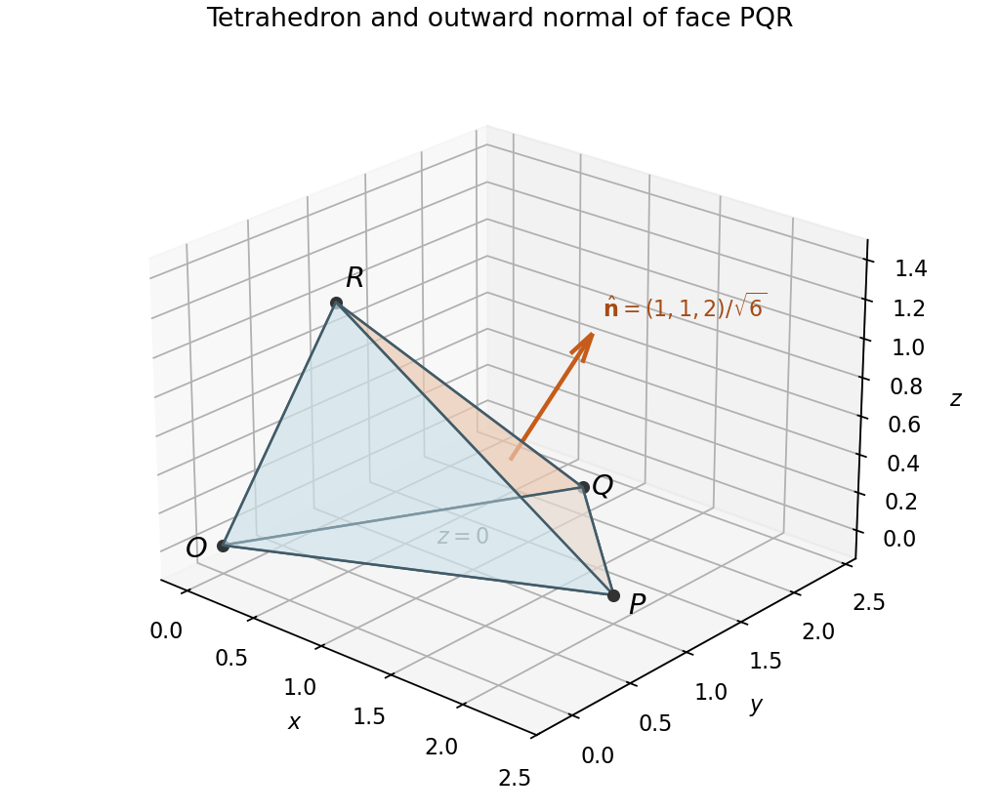

<h1 id="14/a/ii/solution">Solution</h1>

↑ **Parent:** [Ii](../ii.md)

For the triangular face, take the [cross product](../../../../../../cross-product.md) of two edges and divide by two:

$$
\frac12\overrightarrow{PQ}\times\overrightarrow{PR}
=\frac12(-1,1,0)\times(-2,0,1)=\frac12(1,1,2).
$$

The origin lies on the opposite side from this normal, since $(1,1,2)\cdot\overrightarrow{PO}=-3$. Thus this is already the outward [vector area](../../../../../../vector-area.md), with

$$
\boxed{A=\frac{\sqrt6}{2},\qquad\hat{\mathbf n}=\frac{(1,1,2)}{\sqrt6},\qquad
A\hat{\mathbf n}=\left(\frac12,\frac12,1\right)}.
$$

The [vector areas of a closed polyhedron sum to zero](../../../../../../vector-areas-of-a-closed-polyhedron-sum-to-zero.md), so the sum for the remaining three faces is

$$
\boxed{\left(-\frac12,-\frac12,-1\right)}.
$$

**[Figure 1](#14/a/ii/image-tetrahedron-with-its-highlighted-face-pqr-and-outward-unit-normal). Tetrahedron with its highlighted face PQR and outward unit normal**.

Their individual outward [vector areas](../../../../../../vector-area.md) are $(0,0,-3/2)$, $(1/2,-1,1)$, and $(-1,1/2,-1/2)$, which directly check that sum.

## ↑ Ancestors (14)

1. [Ii](../ii.md)
2. [A](../../a.md)
3. [14](../../../14.md)
4. [Paper 2](../../../../paper-2-split.md)
5. [2012](../../../../split.md)
6. [Past exam of the mathematics course of the year 1 of the natural sciences course of the University of Cambridge](../../../../../split.md)
7. [Mathematics course of the year 1 of the natural sciences course of the University of Cambridge](../../../../../../mathematics-course-of-the-year-1-of-the-natural-sciences-course-of-the-university-of-cambridge.md)
8. [Year 1 of the natural sciences course of the University of Cambridge](../../../../../../year-1-of-the-natural-sciences-course-of-the-university-of-cambridge.md)
9. [Year of the natural sciences course of the University of Cambridge](../../../../../../year-of-the-natural-sciences-course-of-the-university-of-cambridge.md)
10. [Natural sciences course of the University of Cambridge](../../../../../../natural-sciences-course-of-the-university-of-cambridge.md)
11. [Course of the University of Cambridge](../../../../../../course-of-the-university-of-cambridge.md)
12. [University of Cambridge](../../../../../../university-of-cambridge-split.md)
13. [List of universities](../../../../../../list-of-universities.md)
14. [Codex Wiki](../../../../../../split.md)
