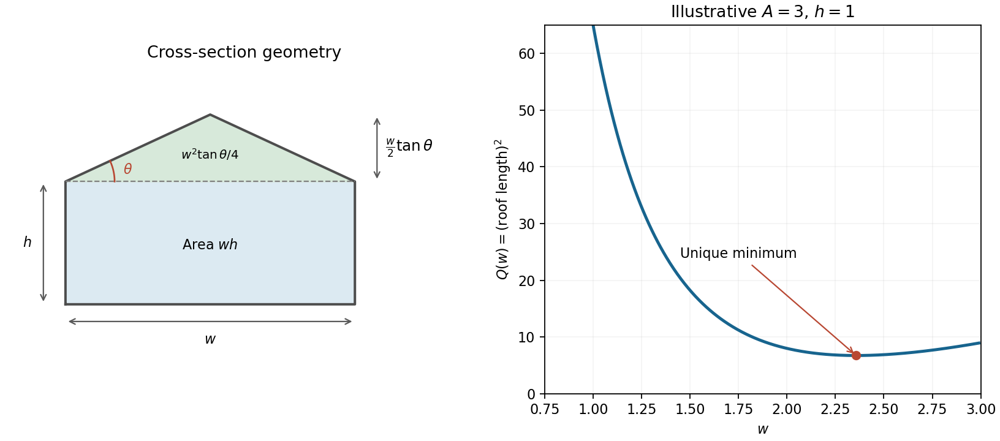

# Paper 1

↑ **Parent:** [2013](../2013.md)

[https://www.maths.cam.ac.uk/undergradnst/files/2013/PaperNST_IA_1.pdf](https://www.maths.cam.ac.uk/undergradnst/files/2013/PaperNST_IA_1.pdf)

**Table of contents**

- [1](#1)
  - [a](#1/a)
    - [Solution](#1/a/solution)
  - [b](#1/b)
    - [Solution](#1/b/solution)
- [2](#2)
  - [a](#2/a)
    - [Solution](#2/a/solution)
  - [b](#2/b)
    - [Solution](#2/b/solution)
- [3](#3)
  - [a](#3/a)
    - [Solution](#3/a/solution)
  - [b](#3/b)
    - [Solution](#3/b/solution)
- [4](#4)
  - [Solution](#4/solution)
- [5](#5)
  - [a](#5/a)
    - [Solution](#5/a/solution)
  - [b](#5/b)
    - [Solution](#5/b/solution)
- [6](#6)
  - [a](#6/a)
    - [Solution](#6/a/solution)
  - [b](#6/b)
    - [Solution](#6/b/solution)
- [7](#7)
  - [a](#7/a)
    - [Solution](#7/a/solution)
  - [b](#7/b)
    - [Solution](#7/b/solution)
- [8](#8)
  - [a](#8/a)
    - [Solution](#8/a/solution)
  - [b](#8/b)
    - [Solution](#8/b/solution)
- [9](#9)
  - [a](#9/a)
    - [Solution](#9/a/solution)
  - [b](#9/b)
    - [Solution](#9/b/solution)
- [10](#10)
  - [a](#10/a)
    - [Solution](#10/a/solution)
  - [b](#10/b)
    - [Solution](#10/b/solution)
- [11](#11)
  - [a](#11/a)
    - [Solution](#11/a/solution)
    - [i](#11/a/i)
      - [Solution](#11/a/i/solution)
    - [ii](#11/a/ii)
      - [Solution](#11/a/ii/solution)
  - [b](#11/b)
    - [Solution](#11/b/solution)
- [12](#12)
  - [a](#12/a)
    - [Solution](#12/a/solution)
  - [b](#12/b)
    - [Solution](#12/b/solution)
  - [c](#12/c)
    - [Solution](#12/c/solution)
  - [d](#12/d)
    - [Solution](#12/d/solution)
- [13](#13)
  - [a](#13/a)
    - [Solution](#13/a/solution)
  - [b](#13/b)
    - [Solution](#13/b/solution)
  - [c](#13/c)
    - [Solution](#13/c/solution)
- [14](#14)
  - [a](#14/a)
    - [Solution](#14/a/solution)
  - [b](#14/b)
    - [Solution](#14/b/solution)
  - [c](#14/c)
    - [Solution](#14/c/solution)
  - [d](#14/d)
    - [Solution](#14/d/solution)
- [15](#15)
  - [a](#15/a)
    - [Solution](#15/a/solution)
  - [b](#15/b)
    - [Solution](#15/b/solution)
  - [c](#15/c)
    - [i](#15/c/i)
      - [Solution](#15/c/i/solution)
    - [ii](#15/c/ii)
      - [Solution](#15/c/ii/solution)
- [16](#16)
  - [a](#16/a)
    - [Solution](#16/a/solution)
  - [b](#16/b)
    - [i](#16/b/i)
      - [Solution](#16/b/i/solution)
    - [ii](#16/b/ii)
      - [Solution](#16/b/ii/solution)
- [17](#17)
  - [a](#17/a)
    - [Solution](#17/a/solution)
  - [b](#17/b)
    - [Solution](#17/b/solution)
- [18](#18)
  - [a](#18/a)
    - [Solution](#18/a/solution)
  - [b](#18/b)
    - [Solution](#18/b/solution)
    - [i](#18/b/i)
      - [Solution](#18/b/i/solution)
    - [ii](#18/b/ii)
      - [Solution](#18/b/ii/solution)
    - [iii](#18/b/iii)
      - [Solution](#18/b/iii/solution)
- [19](#19)
  - [a](#19/a)
    - [Solution](#19/a/solution)
  - [b](#19/b)
    - [Solution](#19/b/solution)
  - [c](#19/c)
    - [Solution](#19/c/solution)
  - [d](#19/d)
    - [Solution](#19/d/solution)
- [20](#20)
  - [a](#20/a)
    - [Solution](#20/a/solution)
  - [b](#20/b)
    - [Solution](#20/b/solution)

## 1

↑ **Parent:** [Paper 1](paper-1.md)

<h3 id="1/a">a</h3>

↑ **Parent:** [1](#1)

<h4 id="1/a/solution">Solution</h4>

↑ **Parent:** [A](#1/a)

Use [implicit differentiation](../../multivariable-calculus.md#implicit-differentiation), treating $y$ as a [function](../../function.md) of $x$:

$$
\boxed{4x+6y\frac{dy}{dx}=0.}
$$

Where $y\ne0$, this is $\boxed{dy/dx=-2x/(3y)}$. At the two points where $y=0$, the [ellipse](../../euclidean-geometry.md#ellipse) has vertical [tangent lines](../../calculus.md#tangent-line) rather than a finite slope.

<h3 id="1/b">b</h3>

↑ **Parent:** [1](#1)

<h4 id="1/b/solution">Solution</h4>

↑ **Parent:** [B](#1/b)

The defining equation gives $y^2=2-(2/3)x^2\leq2$. Equality is attainable at $x=0$, with the positive branch giving

$$
\boxed{y_{\max}=\sqrt2\quad\text{at }(0,\sqrt2).}
$$

## 2

↑ **Parent:** [Paper 1](paper-1.md)

<h3 id="2/a">a</h3>

↑ **Parent:** [2](#2)

<h4 id="2/a/solution">Solution</h4>

↑ **Parent:** [A](#2/a)

At an intersection, $x^2=(x-1)^2=x^2-2x+1$, so $x=1/2$. Substitution into either [parabola](../../euclidean-geometry.md#parabola) gives

$$
\boxed{(x,y)=\left(\frac12,\frac14\right).}
$$

The resulting linear equation for $x$ has only one solution, so this is the unique intersection.

<h3 id="2/b">b</h3>

↑ **Parent:** [2](#2)

<h4 id="2/b/solution">Solution</h4>

↑ **Parent:** [B](#2/b)

The two [derivatives](../../calculus.md#derivative) are $2x$ and $2(x-1)$. At the intersection their slopes are $1$ and $-1$, so their direction [vectors](../../vector-space.md#vector) $(1,1)$ and $(1,-1)$ have zero [dot product](../../inner-product.md#dot-product). Thus the [tangent lines](../../calculus.md#tangent-line) are perpendicular and their angle is

$$
\boxed{\frac\pi2\ \text{radians}=90^\circ.}
$$

## 3

↑ **Parent:** [Paper 1](paper-1.md)

<h3 id="3/a">a</h3>

↑ **Parent:** [3](#3)

<h4 id="3/a/solution">Solution</h4>

↑ **Parent:** [A](#3/a)

Multiply the [separable differential equation](../../differential-equation.md#separable-differential-equation) by $e^y$: $e^y y'=e^x$. The left side is $(e^y)'$, hence $e^y=e^x+C$. Therefore

$$
\boxed{y(x)=\ln(e^x+C),\qquad e^x+C>0.}
$$

The real [general solution](../../linear-ordinary-differential-equation.md#general-solution) is taken on any connected interval where the logarithm's argument is positive.

<h3 id="3/b">b</h3>

↑ **Parent:** [3](#3)

<h4 id="3/b/solution">Solution</h4>

↑ **Parent:** [B](#3/b)

The [initial condition](../../differential-equation.md#initial-condition) gives $e^{y(0)}=2=1+C$, so $C=1$. Consequently

$$
\boxed{y(x)=\ln(1+e^x),\qquad x\in\mathbb R.}
$$

Its logarithm has positive argument for every real $x$.

## 4

↑ **Parent:** [Paper 1](paper-1.md)

<h3 id="4/solution">Solution</h3>

↑ **Parent:** [4](#4)

At $x=3$, the point on the [parabola](../../euclidean-geometry.md#parabola) is $(3,8)$ and the [tangent line](../../calculus.md#tangent-line) has slope $f'(3)=6$. The [normal line to a plane curve](../../calculus.md#normal-line-to-a-plane-curve) therefore has slope $-1/6$. Its equation is

$$
y-8=-\frac16(x-3),\qquad y=-\frac x6+\frac{17}{2}.
$$

Thus the requested results are

$$
\boxed{\text{gradient }-\frac16,\qquad\text{vertical-axis intercept }(0,17/2).}
$$

## 5

↑ **Parent:** [Paper 1](paper-1.md)

<h3 id="5/a">a</h3>

↑ **Parent:** [5](#5)

<h4 id="5/a/solution">Solution</h4>

↑ **Parent:** [A](#5/a)

The [tangent](../../geometry-and-topology.md#tangent) has poles at $\pi/2$ and $3\pi/2$, so these are vertical [asymptotes](../../topology.md#asymptote) of $x\tan x$. The zeros on the given interval are $0,\pi,2\pi$. Near zero, $x\tan x=x^2+O(x^4)$, so the graph starts with a horizontal [tangent line](../../calculus.md#tangent-line).

Each of its three branches is increasing. Indeed

$$
f'(x)=\frac{x+\sin x\cos x}{\cos^2x},
$$

and the numerator starts at zero with [derivative](../../calculus.md#derivative) $2\cos^2x\geq0$, so it is positive for $x>0$. The first branch rises from zero to $+\infty$, the middle branch rises from $-\infty$ through $(\pi,0)$ to $+\infty$, and the last rises from $-\infty$ to $(2\pi,0)$.

**[Figure 1](#5/a/image-the-three-increasing-tangent-product-branches-and-their-intersections-with-the-right-half-of-the-circle). The three increasing tangent-product branches and their intersections with the right half of the circle**.

<h3 id="5/b">b</h3>

↑ **Parent:** [5](#5)

<h4 id="5/b/solution">Solution</h4>

↑ **Parent:** [B](#5/b)

Substitution into the [circle](../../topology.md#circle) gives $x^2\sec^2x=25$, or $x=5|\cos x|$ since $x\geq0$. Necessarily $x\leq5$, and each admissible $x$ fixes a unique $y=x\tan x$.

On $[0,\pi/2)$, $x-5\cos x$ is strictly increasing from a negative value to a positive value, giving one root. On $(\pi/2,3\pi/2)$, the equation is $x+5\cos x=0$. This [function](../../function.md) is strictly convex, positive at the two interval ends and negative at $\pi$, giving exactly two roots.

There are none on the remaining possible interval $3\pi/2<x\leq5$. Put $\delta=x-3\pi/2>0$; then $\cos x=\sin\delta\leq\delta$, so

$$
x-5\cos x\geq\frac{3\pi}{2}-4\delta
\geq\frac{15\pi}{2}-20>0.
$$

Hence the number of simultaneous real solutions is **$3$**, as marked in the preceding graph.

## 6

↑ **Parent:** [Paper 1](paper-1.md)

<h3 id="6/a">a</h3>

↑ **Parent:** [6](#6)

<h4 id="6/a/solution">Solution</h4>

↑ **Parent:** [A](#6/a)

For real powers work on $x>0$. Apply [integration by parts](../../calculus.md#integration-by-parts) with $u=\ln x$ and $dv=x^m dx$, so $v=x^{m+1}/(m+1)$ when $m\ne-1$. Then

$$
\boxed{\int x^m\ln x\,dx
=\frac{x^{m+1}\ln x}{m+1}-\frac{x^{m+1}}{(m+1)^2}+C.}
$$

<h3 id="6/b">b</h3>

↑ **Parent:** [6](#6)

<h4 id="6/b/solution">Solution</h4>

↑ **Parent:** [B](#6/b)

For $m=-1$, set $u=\ln x$, $du=dx/x$. This [integration by substitution](../../integral.md#integration-by-substitution) gives

$$
\boxed{\int\frac{\ln x}{x}\,dx=\frac12(\ln x)^2+C,\qquad x>0.}
$$

This case is treated separately because the denominator $m+1$ in part (a) vanishes.

## 7

↑ **Parent:** [Paper 1](paper-1.md)

<h3 id="7/a">a</h3>

↑ **Parent:** [7](#7)

<h4 id="7/a/solution">Solution</h4>

↑ **Parent:** [A](#7/a)

Write the [partial fraction decomposition](../../isolated-singularity.md#partial-fraction-decomposition) as $A/(x-3)+B/(x+7)$. After multiplying through, $7x+29=A(x+7)+B(x-3)$. Setting $x=3$ gives $A=5$, and setting $x=-7$ gives $B=2$, so

$$
\boxed{\frac{7x+29}{(x-3)(x+7)}=\frac5{x-3}+\frac2{x+7},\qquad x\ne3,-7.}
$$

<h3 id="7/b">b</h3>

↑ **Parent:** [7](#7)

<h4 id="7/b/solution">Solution</h4>

↑ **Parent:** [B](#7/b)

Use [completing the square](../../polynomial.md#completing-the-square) by adding and subtracting $3^2$:

$$
\boxed{x^2-6x+14=(x-3)^2+5.}
$$

## 8

↑ **Parent:** [Paper 1](paper-1.md)

<h3 id="8/a">a</h3>

↑ **Parent:** [8](#8)

<h4 id="8/a/solution">Solution</h4>

↑ **Parent:** [A](#8/a)

For $a>0$, write $a^x=e^{x\ln a}$ and apply the [chain rule](../../calculus.md#chain-rule):

$$
\boxed{\frac d{dx}a^x=(\ln a)a^x.}
$$

This also covers $a=1$, for which both sides are zero.

<h3 id="8/b">b</h3>

↑ **Parent:** [8](#8)

<h4 id="8/b/solution">Solution</h4>

↑ **Parent:** [B](#8/b)

Differentiate the outer [sine](../../geometry-and-topology.md#sine), then the inner [cosine](../../geometry-and-topology.md#cosine). The [chain rule](../../calculus.md#chain-rule) gives

$$
\boxed{\frac d{dx}\sin(\cos x)=-\sin x\cos(\cos x).}
$$

## 9

↑ **Parent:** [Paper 1](paper-1.md)

<h3 id="9/a">a</h3>

↑ **Parent:** [9](#9)

<h4 id="9/a/solution">Solution</h4>

↑ **Parent:** [A](#9/a)

Let $b_0=b(0)$ in centimetres and take $t$ in seconds. The constant rate gives $b(t)=b_0+4t$. By the [Pythagorean theorem](../../euclidean-geometry.md#pythagorean-theorem), the diagonal length is

$$
\boxed{d(t)=\sqrt{100+(b_0+4t)^2}\ \mathrm{cm},}
$$

for times when the side length is nonnegative. No initial value of $b$ is specified, so it must remain as a parameter. Choosing the time origin when $b=0$ gives the special convention $d(t)=\sqrt{100+16t^2}\,\mathrm{cm}$.

<h3 id="9/b">b</h3>

↑ **Parent:** [9](#9)

<h4 id="9/b/solution">Solution</h4>

↑ **Parent:** [B](#9/b)

Differentiate before substituting the instantaneous side length. The [related rates](../../calculus.md#related-rates) equation is

$$
2d\dot d=2b\dot b,\qquad \dot d=\frac b{\sqrt{a^2+b^2}}\dot b.
$$

At the stated dimensions and rate,

$$
\boxed{\dot d=\frac{30}{\sqrt{10^2+30^2}}\,4
=\frac{12}{\sqrt{10}}\ \mathrm{cm\,s^{-1}}
\approx3.795\ \mathrm{cm\,s^{-1}}.}
$$

The diagonal grows more slowly than the changing side, since $b/d<1$.

## 10

↑ **Parent:** [Paper 1](paper-1.md)

<h3 id="10/a">a</h3>

↑ **Parent:** [10](#10)

<h4 id="10/a/solution">Solution</h4>

↑ **Parent:** [A](#10/a)

The [parabola](../../euclidean-geometry.md#parabola) opens upward, with its minimum at $(0,-1)$ and zeros at $x=\pm1$. The quartic graph is symmetric about the vertical axis, has its flat maximum at $(0,1)$, and also has zeros at $\pm1$.

Their intersections solve $x^4+x^2-2=(x^2-1)(x^2+2)=0$, so the only real intersections are $(-1,0)$ and $(1,0)$. Between them, $1-x^4$ is the upper curve and $x^2-1$ the lower curve.

**[Figure 2](#10/a/image-the-parabola-the-inverted-quartic-and-the-finite-region-between-their-intersections). The parabola, the inverted quartic, and the finite region between their intersections**.

<h3 id="10/b">b</h3>

↑ **Parent:** [10](#10)

<h4 id="10/b/solution">Solution</h4>

↑ **Parent:** [B](#10/b)

Subtract the lower curve from the upper curve on the intersection interval. The [definite integral](../../integral.md#definite-integral) is

$$
\mathcal A=\int_{-1}^1[(1-x^4)-(x^2-1)]dx
=2\int_0^1(2-x^2-x^4)dx
=\boxed{\frac{44}{15}}.
$$

The result is in square coordinate units.

## 11

↑ **Parent:** [Paper 1](paper-1.md)

<h3 id="11/a">a</h3>

↑ **Parent:** [11](#11)

<h4 id="11/a/solution">Solution</h4>

↑ **Parent:** [A](#11/a)

Collect the coefficients of the three unknowns in rows. The [linear system](../../linear-algebra.md#system-of-linear-equations) has [matrix](../../vector-space.md#matrix) form

$$
\boxed{A\mathbf x=\mathbf b,\qquad
A=\begin{pmatrix}1&2&3\\1&-2&1\\2&1&-1\end{pmatrix},\quad
\mathbf x=\begin{pmatrix}x\\y\\z\end{pmatrix},\quad
\mathbf b=\begin{pmatrix}14\\0\\1\end{pmatrix}.}
$$

The next two parts solve this same system by the two requested methods.

<h4 id="11/a/i">i</h4>

↑ **Parent:** [A](#11/a)

<h5 id="11/a/i/solution">Solution</h5>

↑ **Parent:** [I](#11/a/i)

Use [Gaussian elimination](../../numerical-linear-algebra.md#gaussian-elimination) on the [augmented matrix](../../linear-algebra.md#augmented-matrix). First take $R_2\leftarrow R_2-R_1$ and $R_3\leftarrow R_3-2R_1$, then $R_3\leftarrow4R_3-3R_2$:

$$
\left(\begin{array}{ccc|c}1&2&3&14\\1&-2&1&0\\2&1&-1&1\end{array}\right)
\longrightarrow
\left(\begin{array}{ccc|c}1&2&3&14\\0&-4&-2&-14\\0&-3&-7&-27\end{array}\right)
\longrightarrow
\left(\begin{array}{ccc|c}1&2&3&14\\0&-4&-2&-14\\0&0&-22&-66\end{array}\right).
$$

By [back substitution](../../linear-algebra.md#back-substitution), the last row gives $z=3$, the second gives $-4y-6=-14$ and hence $y=2$, and the first gives $x+4+9=14$. Thus

$$
\boxed{(x,y,z)=(1,2,3).}
$$

The right-hand side has been transformed in every row operation, preserving the solution set.

<h4 id="11/a/ii">ii</h4>

↑ **Parent:** [A](#11/a)

<h5 id="11/a/ii/solution">Solution</h5>

↑ **Parent:** [Ii](#11/a/ii)

Choose [Cramer's rule](../../multilinear-algebra.md#cramer-s-rule), the permitted alternative to finding an inverse. The [determinant](../../multilinear-algebra.md#determinant) is

$$
\Delta=1(2-1)-2(-1-2)+3(1+4)=22\ne0.
$$

Replacing each column by the right-hand side gives

$$
\Delta_x=\det\begin{pmatrix}14&2&3\\0&-2&1\\1&1&-1\end{pmatrix}
=14+2+6=22,
$$

$$
\Delta_y=\det\begin{pmatrix}1&14&3\\1&0&1\\2&1&-1\end{pmatrix}
=-1+42+3=44,
$$

$$
\Delta_z=\det\begin{pmatrix}1&2&14\\1&-2&0\\2&1&1\end{pmatrix}
=-2-2+70=66.
$$

Consequently

$$
\boxed{x=\Delta_x/\Delta=1,\quad y=\Delta_y/\Delta=2,\quad z=\Delta_z/\Delta=3.}
$$

The nonzero [determinant](../../multilinear-algebra.md#determinant) also proves uniqueness.

<h3 id="11/b">b</h3>

↑ **Parent:** [11](#11)

<h4 id="11/b/solution">Solution</h4>

↑ **Parent:** [B](#11/b)

The square roots simplify to the [absolute values](../../real-analysis.md#absolute-value) $|a-b|$ and $|a+b|$. Put $s=\sin(\pi\sqrt{a^2+b^2})$. A nontrivial solution of the homogeneous [linear system](../../linear-algebra.md#system-of-linear-equations) exists exactly when its [coefficient matrix](../../linear-algebra.md#coefficient-matrix) is singular:

$$
0=\det\begin{pmatrix}|a-b|&s\\|a+b|&s\end{pmatrix}
=s(|a-b|-|a+b|).
$$

The second factor vanishes precisely when $(a-b)^2=(a+b)^2$, or $ab=0$, giving both coordinate axes. The first factor vanishes when $\sqrt{a^2+b^2}$ is a nonnegative integer. Hence the complete [locus](../../euclidean-geometry.md#locus-mathematics) is

$$
\boxed{\{a=0\}\ \cup\ \{b=0\}\ \cup\
\bigcup_{n=1}^{\infty}\{a^2+b^2=n^2\}.}
$$

These are the two axes together with concentric [circles](../../topology.md#circle) of positive integer radii. The zero-radius case is the origin, already included on the axes; at that point both equations vanish and any nonzero pair $(x,y)$ works.

**[Figure 3](#11/b/image-the-parameter-locus-consists-of-both-axes-and-circles-with-integer-radii). The parameter locus consists of both axes and circles with integer radii**.

## 12

↑ **Parent:** [Paper 1](paper-1.md)

<h3 id="12/a">a</h3>

↑ **Parent:** [12](#12)

<h4 id="12/a/solution">Solution</h4>

↑ **Parent:** [A](#12/a)

The original PDF asks for cube roots of $8$. Their [complex modulus](../../complex-analysis.md#complex-modulus) is $2$, and their arguments are $2k\pi/3$, $k=0,1,2$. Converting to Cartesian form gives

$$
\boxed{2,\qquad -1+i\sqrt3,\qquad -1-i\sqrt3.}
$$

Cubing any one gives the positive real number $8$.

<h3 id="12/b">b</h3>

↑ **Parent:** [12](#12)

<h4 id="12/b/solution">Solution</h4>

↑ **Parent:** [B](#12/b)

The quadratic [polynomial](../../polynomial.md) factors as

$$
z^2-(3+i)z+(2+i)=(z-1)(z-2-i),
$$

because the two roots sum to $3+i$ and multiply to $2+i$. Therefore

$$
\boxed{z=1,\qquad z=2+i.}
$$

<h3 id="12/c">c</h3>

↑ **Parent:** [12](#12)

<h4 id="12/c/solution">Solution</h4>

↑ **Parent:** [C](#12/c)

Real coefficients imply that the conjugate $-i$ is also a [polynomial root](../../polynomial.md#root-of-a-polynomial). Write the remaining root as $r$. Then

$$
p(z)=2(z-2)(z-r)(z^2+1).
$$

The coefficient of $z$ in this product is $-2(2+r)$. That coefficient is zero in the specified [polynomial](../../polynomial.md), so $r=-2$. Hence the two other roots are

$$
\boxed{-i,\qquad -2.}
$$

As a check, the full [polynomial](../../polynomial.md) is $2(z^2-4)(z^2+1)=2z^4-6z^2-8$, corresponding to $a=0$, $b=-6$ and $c=-8$.

<h3 id="12/d">d</h3>

↑ **Parent:** [12](#12)

<h4 id="12/d/solution">Solution</h4>

↑ **Parent:** [D](#12/d)

Rewrite the complex [position](../../classical-mechanics.md#position) as $z(t)=2+3i/(t-i)$. Differentiating gives the complex [velocity](../../classical-mechanics.md#velocity) and [acceleration](../../classical-mechanics.md#acceleration)

$$
\dot z=-\frac{3i}{(t-i)^2},\qquad
\ddot z=\frac{6i}{(t-i)^3}.
$$

For real $t$, $|t-i|=\sqrt{t^2+1}$. Their requested magnitudes are therefore

$$
\boxed{|\dot z|=\frac3{t^2+1},\qquad
|\ddot z|=\frac6{(t^2+1)^{3/2}}.}
$$

There is no pole for real time. The magnitude is the Euclidean length of the two Cartesian components, not the modulus of either component separately.

## 13

↑ **Parent:** [Paper 1](paper-1.md)

<h3 id="13/a">a</h3>

↑ **Parent:** [13](#13)

<h4 id="13/a/solution">Solution</h4>

↑ **Parent:** [A](#13/a)

For the first-order [linear ordinary differential equation](../../linear-ordinary-differential-equation.md), an [integrating factor](../../linear-ordinary-differential-equation.md#integrating-factor) is

$$
I(x)=\exp\int\frac{4x}{1+x^2}dx=(1+x^2)^2.
$$

Multiplication converts the left side to a [derivative](../../calculus.md#derivative):

$$
\frac d{dx}\big[(1+x^2)^2y\big]=\frac1{1+x^2}.
$$

Integrating gives $(1+x^2)^2y=\arctan x+C$. The initial value fixes $C=1$, so

$$
\boxed{y(x)=\frac{1+\arctan x}{(1+x^2)^2},\qquad x\in\mathbb R.}
$$

<h3 id="13/b">b</h3>

↑ **Parent:** [13](#13)

<h4 id="13/b/solution">Solution</h4>

↑ **Parent:** [B](#13/b)

On a branch with $y\ne0$, the given [derivative](../../calculus.md#derivative) is nonzero wherever the original equation is defined, so use [inverse-function linearization of a first-order equation](../../differential-equation.md#inverse-function-linearization-of-a-first-order-equation) and regard $x$ as a [function](../../function.md) of $y$:

$$
\frac{dx}{dy}=\frac{x+y+2}{y},\qquad
\frac{dx}{dy}-\frac xy=1+\frac2y.
$$

The [integrating factor](../../linear-ordinary-differential-equation.md#integrating-factor) $1/y$ gives

$$
\frac d{dy}\left(\frac xy\right)=\frac1y+\frac2{y^2},
\qquad \frac xy=\ln|y|-\frac2y+C.
$$

Thus the nonzero solutions are given implicitly by

$$
\boxed{x+2=y(\ln|y|+C),\qquad y\ne0.}
$$

Each branch must also retain **$x+y+2\ne0$**; at those excluded points the original right-hand side is undefined and the inverse graph cannot represent a regular $y(x)$. Differentiating the implicit equation gives $y'=1/(\ln|y|+C+1)$, equal to the required quotient wherever these restrictions hold.

The additional solution **$y=0$**, on any interval avoiding $x=-2$, was lost when dividing by $y$ and must be included. It is not defined through the point $(x,y)=(-2,0)$ in the original equation.

<h3 id="13/c">c</h3>

↑ **Parent:** [13](#13)

<h4 id="13/c/solution">Solution</h4>

↑ **Parent:** [C](#13/c)

For $y\ne0$, the [Bernoulli differential equation](../../differential-equation.md#bernoulli-differential-equation) becomes linear under $u=1/y$. Multiplying the equation by $-y^{-2}$ gives

$$
u'-\frac2xu=x^2\cos x.
$$

On an interval with $x\ne0$, the [integrating factor](../../linear-ordinary-differential-equation.md#integrating-factor) is $x^{-2}$, hence

$$
\frac d{dx}\left(\frac u{x^2}\right)=\cos x,
\qquad u=x^2(C+\sin x).
$$

Therefore the complete set of solution branches is

$$
\boxed{y=0\quad\text{or}\quad
 y(x)=\frac1{x^2(C+\sin x)}.}
$$

The original equation requires $x\ne0$; each nonzero branch additionally requires $C+\sin x\ne0$. The zero solution is restored explicitly because the reciprocal substitution excludes it.

## 14

↑ **Parent:** [Paper 1](paper-1.md)

<h3 id="14/a">a</h3>

↑ **Parent:** [14](#14)

<h4 id="14/a/solution">Solution</h4>

↑ **Parent:** [A](#14/a)

If either [vector](../../vector-space.md#vector) is zero, both sides vanish. Otherwise let $\theta$ be the angle between them. The magnitudes of the [cross product](../../vector-space.md#cross-product) and [dot product](../../inner-product.md#dot-product) are described by

$$
|\mathbf a\times\mathbf b|=|\mathbf a|\,|\mathbf b|\sin\theta,
\qquad \mathbf a\cdot\mathbf b=|\mathbf a|\,|\mathbf b|\cos\theta.
$$

Squaring and using $\sin^2\theta=1-\cos^2\theta$ proves [Lagrange's identity](../../multivariable-calculus.md#lagrange-identity-for-the-cross-product):

$$
\boxed{|\mathbf a\times\mathbf b|^2
=|\mathbf a|^2|\mathbf b|^2-(\mathbf a\cdot\mathbf b)^2.}
$$

<h3 id="14/b">b</h3>

↑ **Parent:** [14](#14)

<h4 id="14/b/solution">Solution</h4>

↑ **Parent:** [B](#14/b)

Assume the two line-defining points are distinct. Put $\mathbf u=\mathbf r_1-\mathbf r_0$ and $\mathbf v=\mathbf r_2-\mathbf r_0$. The [triangle](../../euclidean-geometry.md#triangle) formed by the three points has area $|\mathbf u\times\mathbf v|/2$. The same area is half the base length $|\mathbf r_2-\mathbf r_1|$ times the perpendicular height $D$ from the third point to the line. Hence the [distance from a point to a line in three dimensions](../../topological-analysis.md#distance-from-a-point-to-a-line-in-three-dimensions) is

$$
\boxed{D=\frac{|(\mathbf r_1-\mathbf r_0)\times(\mathbf r_2-\mathbf r_0)|}
{|\mathbf r_1-\mathbf r_2|}.}
$$

This remains valid when the nearest point lies outside the segment, since the base line is infinite. If all three points are collinear, the numerator and distance are both zero.

<h3 id="14/c">c</h3>

↑ **Parent:** [14](#14)

<h4 id="14/c/solution">Solution</h4>

↑ **Parent:** [C](#14/c)

Use $(0,1,1)$ as an anchor. Two directions in the required [plane](../../geometry-and-topology.md#plane) are

$$
\mathbf u=(2,0,2),\qquad \mathbf v=(4,1,0).
$$

Their [cross product](../../vector-space.md#cross-product) is $(-2,8,2)$, so a [normal vector](../../differential-geometry.md#normal-vector) is $\mathbf n=(-1,4,1)$. The [Cartesian equation of a plane](../../geometry-and-topology.md#cartesian-equation-of-a-plane) is

$$
\mathbf n\cdot[(x,y,z)-(0,1,1)]=0,
\qquad \boxed{-x+4y+z=5.}
$$

Direct substitution verifies all three given points. The independent direction [vectors](../../vector-space.md#vector) ensure the [plane](../../geometry-and-topology.md#plane) is uniquely determined.

<h3 id="14/d">d</h3>

↑ **Parent:** [14](#14)

<h4 id="14/d/solution">Solution</h4>

↑ **Parent:** [D](#14/d)

The axis intercepts of the [plane](../../geometry-and-topology.md#plane) are

$$
P=(-5,0,0),\qquad Q=(0,5/4,0),\qquad R=(0,0,5).
$$

Use two edge [vectors](../../vector-space.md#vector) from $P$:

$$
(Q-P)\times(R-P)
=(5,5/4,0)\times(5,0,5)=(25/4,-25,-25/4).
$$

The [triangle](../../euclidean-geometry.md#triangle) area is half this [cross product](../../vector-space.md#cross-product) magnitude:

$$
\boxed{\mathcal A=\frac12\frac{25}{4}\sqrt{1+16+1}
=\frac{75\sqrt2}{8}.}
$$

## 15

↑ **Parent:** [Paper 1](paper-1.md)

<h3 id="15/a">a</h3>

↑ **Parent:** [15](#15)

<h4 id="15/a/solution">Solution</h4>

↑ **Parent:** [A](#15/a)

In [cylindrical coordinates](../../multivariable-calculus.md#cylindrical-coordinate-system), $x=r\cos\theta$ and $y=r\sin\theta$, so $x^2+y^2=r^2$. Thus the circular [elliptic paraboloid](../../euclidean-geometry.md#elliptic-paraboloid) has equation

$$
\boxed{az=r^2,\quad\text{or}\quad z=r^2/a.}
$$

At height $h\geq0$, the rim [radius](../../topology.md#radius) is $\sqrt{ah}$.

<h3 id="15/b">b</h3>

↑ **Parent:** [15](#15)

<h4 id="15/b/solution">Solution</h4>

↑ **Parent:** [B](#15/b)

For $h>0$, parametrize the curved surface by $(r\cos\theta,r\sin\theta,r^2/a)$, with $0\leq r\leq\sqrt{ah}$ and $0\leq\theta\leq2\pi$. The magnitude of the [cross product](../../vector-space.md#cross-product) of its coordinate tangents gives the [area element of a surface](../../differential-geometry.md#area-element-of-a-surface):

$$
dS=r\sqrt{1+\frac{4r^2}{a^2}}\,dr\,d\theta.
$$

Integrating gives

$$
\begin{aligned}
S&=2\pi\int_0^{\sqrt{ah}}r\sqrt{1+4r^2/a^2}\,dr\\
&=\frac{\pi a^2}{6}\left[(1+4r^2/a^2)^{3/2}\right]_0^{\sqrt{ah}}\\
&=\boxed{\frac{\pi a^2}{6}\left[\left(1+\frac{4h}{a}\right)^{3/2}-1\right].}
\end{aligned}
$$

This is the curved [surface area](../../differential-geometry.md#surface-area), not the area of a lid across the horizontal opening. The expression tends to zero at $h=0$ and has dimensions of area. The [volume and centroid of a parabolic cup](../../euclidean-geometry.md#volume-and-centroid-of-a-parabolic-cup) use the same geometry.

<h3 id="15/c">c</h3>

↑ **Parent:** [15](#15)

<h4 id="15/c/i">i</h4>

↑ **Parent:** [C](#15/c)

<h5 id="15/c/i/solution">Solution</h5>

↑ **Parent:** [I](#15/c/i)

The liquid occupies $0\leq z\leq h$ and $0\leq r\leq\sqrt{az}$. A horizontal slice is a disk of area $\pi az$. Integrating these areas gives

$$
\boxed{V=\int_0^h\pi az\,dz=\frac{\pi ah^2}{2}.}
$$

Equivalently, the [triple integral](../../integral.md#triple-integral) is $\int_0^{2\pi}\int_0^h\int_0^{\sqrt{az}}r\,dr\,dz\,d\theta$, including the cylindrical [Jacobian determinant](../../multivariable-calculus.md#jacobian-determinant) factor $r$.

<h4 id="15/c/ii">ii</h4>

↑ **Parent:** [C](#15/c)

<h5 id="15/c/ii/solution">Solution</h5>

↑ **Parent:** [Ii](#15/c/ii)

For positive constant [mass density](../../fluid-mechanics.md#density) $\rho_0$, reflection symmetry makes the horizontal coordinates of the [centre of mass](../../classical-mechanics.md#center-of-mass) zero. The total mass and the vertical first moment are

$$
M=\rho_0\frac{\pi ah^2}{2},\qquad
\int z\rho_0\,dV=\rho_0\int_0^h z(\pi az)dz
=\frac{\rho_0\pi ah^3}{3}.
$$

Their ratio gives

$$
\boxed{(\bar x,\bar y,\bar z)=(0,0,2h/3).}
$$

This is the [centre](../../euclidean-geometry.md#center-geometry) of the liquid [volume](../../geometry-and-topology.md#volume), rather than of the curved wall. The density cancels because it is uniform; the larger disks near the top place the [centre](../../euclidean-geometry.md#center-geometry) above half-height.

## 16

↑ **Parent:** [Paper 1](paper-1.md)

<h3 id="16/a">a</h3>

↑ **Parent:** [16](#16)

<h4 id="16/a/solution">Solution</h4>

↑ **Parent:** [A](#16/a)

The [gradient](../../multivariable-calculus.md#gradient) factors as

$$
f_x=y(3x^2+y^2-1),\qquad f_y=x(x^2+3y^2-1).
$$

If a coordinate is zero, the solutions are $(0,0)$, $(\pm1,0)$ and $(0,\pm1)$. With both coordinates nonzero, subtracting the two bracket equations gives $x^2=y^2$, hence $x^2=y^2=1/4$. These give four more [stationary points](../../calculus-of-variations.md#stationary-point).

The [Hessian matrix](../../multivariable-calculus.md#hessian-matrix) has equal diagonal entries $6xy$ and off-diagonal entry $3(x^2+y^2)-1$. At the origin its [eigenvalues](../../linear-operator-theory.md#eigenvalue) are $\pm1$, and at the four nonzero axis points they are $\pm2$, so all five are saddles. At the two same-sign interior points the [eigenvalues](../../linear-operator-theory.md#eigenvalue) are $1,2$, while at the opposite-sign points they are $-1,-2$. Therefore

$$
\boxed{\begin{array}{c|c|c}
\text{points}&\text{type}&f\\\hline
(0,0),(\pm1,0),(0,\pm1)&\text{saddles}&0\\
(1/2,1/2),(-1/2,-1/2)&\text{local minima}&-1/8\\
(1/2,-1/2),(-1/2,1/2)&\text{local maxima}&1/8.
\end{array}}
$$

The extrema are not global, since the quartic takes arbitrarily large positive and negative values along suitable rays.

For the contour sketch, the zero level is exactly the two axes together with the unit [circle](../../topology.md#circle). Inside the [circle](../../topology.md#circle), $f$ is negative in the first and third quadrants and positive in the other two; outside, those signs reverse. Small negative levels contain closed loops around the two minima as well as unbounded branches in the second and fourth quadrants. Small positive levels similarly contain two loops around the maxima and unbounded branches in the first and third quadrants. The closed loops shrink to the extrema at levels $\mp1/8$, and disappear beyond those levels. This is the unit-scale [quartic surface with axes and a circle as its zero set](../../analysis.md#quartic-surface-with-axes-and-a-circle-as-its-zero-set).

**[Figure 4](#16/a/image-the-quartic-s-nine-stationary-points-and-its-zero-set-of-axes-and-a-unit-circle). The quartic's nine stationary points and its zero set of axes and a unit circle**.

<h3 id="16/b">b</h3>

↑ **Parent:** [16](#16)

<h4 id="16/b/i">i</h4>

↑ **Parent:** [B](#16/b)

<h5 id="16/b/i/solution">Solution</h5>

↑ **Parent:** [I](#16/b/i)

For a classical solution take $F,G$ twice differentiable, so that the second [derivatives](../../calculus.md#derivative) exist. Direct use of the [chain rule](../../calculus.md#chain-rule) gives

$$
y_{tt}=25(F''+G''),\qquad y_{xx}=4(F''+G''),
$$

with the two profile arguments as specified. Thus $4y_{tt}=25y_{xx}$.

To prove generality, introduce [characteristic coordinates](../../partial-differential-equation.md#characteristic-coordinate) $\xi=2x+5t$, $\eta=2x-5t$, whose Jacobian [determinant](../../multilinear-algebra.md#determinant) is $-20\ne0$. For $y=U(\xi,\eta)$ the differential operator is

$$
4\partial_t^2-25\partial_x^2=-400\partial_\xi\partial_\eta.
$$

The equation becomes $U_{\xi\eta}=0$. Integrating once in each variable yields

$$
\boxed{U(\xi,\eta)=F(\xi)+G(\eta).}
$$

This is the [countertravelling decomposition of the one-dimensional wave equation](../../wave-equation.md#countertravelling-decomposition-of-the-one-dimensional-wave-equation), with [wave speed](../../wave-equation.md#wave-speed) $5/2$. Once differentiability alone is not sufficient for a classical second-order equation; the displayed argument uses the required second [derivatives](../../calculus.md#derivative).

<h4 id="16/b/ii">ii</h4>

↑ **Parent:** [B](#16/b)

<h5 id="16/b/ii/solution">Solution</h5>

↑ **Parent:** [Ii](#16/b/ii)

Choose $F(s)=G(s)=\tfrac12\sin s$. The two travelling profiles then add by the [sine](../../geometry-and-topology.md#sine) addition identity:

$$
\boxed{y(x,t)=\frac12\sin(2x+5t)+\frac12\sin(2x-5t)
=\sin2x\cos5t.}
$$

This is a [standing wave](../../mathematical-physics.md#standing-wave). At $x=0$ and $x=\pi$ it vanishes for all $t$. At $t=0$ its displacement is $\sin2x$, and its time [derivative](../../calculus.md#derivative) $-5\sin2x\sin5t$ is zero. Also $y_{tt}=-25y$ and $y_{xx}=-4y$, directly checking the original equation.

## 17

↑ **Parent:** [Paper 1](paper-1.md)

<h3 id="17/a">a</h3>

↑ **Parent:** [17](#17)

<h4 id="17/a/solution">Solution</h4>

↑ **Parent:** [A](#17/a)

With the standard real normalization, the [Fourier series](../../fourier-series.md) of a period-$2L$ [function](../../function.md) is

$$
f(x)\sim\frac{a_0}{2}+\sum_{n=1}^{\infty}\left[a_n\cos\frac{n\pi x}{L}+b_n\sin\frac{n\pi x}{L}\right],
$$

where

$$
\boxed{a_n=\frac1L\int_{-L}^Lf(x)\cos\frac{n\pi x}{L}\,dx\quad(n\geq0),\qquad
b_n=\frac1L\int_{-L}^Lf(x)\sin\frac{n\pi x}{L}\,dx\quad(n\geq1).}
$$

For the [partial sum](../../sequence-and-series.md#partial-sum) $S_N$, [Fourier orthogonality](../../fourier-series.md#fourier-orthogonality) eliminates all cross terms. The constant term contributes $2L(a_0/2)^2$, while every squared [sine](../../geometry-and-topology.md#sine) or [cosine](../../geometry-and-topology.md#cosine) integrates to $L$, giving

$$
\int_{-L}^LS_N(x)^2dx=L\frac{a_0^2}{2}+L\sum_{n=1}^N(a_n^2+b_n^2).
$$

For a square-integrable [function](../../function.md), completeness of the trigonometric [orthogonal basis](../../inner-product.md#orthogonal-basis) in the [Hilbert space](../../hilbert-space.md) $L^2[-L,L]$ makes $S_N\to f$ in norm. Passing to the limit proves [Parseval's identity](../../fourier-analysis.md#parseval-identity):

$$
\boxed{\int_{-L}^Lf(x)^2dx=L\left[\frac{a_0^2}{2}
+\sum_{n=1}^{\infty}(a_n^2+b_n^2)\right].}
$$

Square integrability is the needed hypothesis here; periodicity alone is not an integrability or convergence condition.

<h3 id="17/b">b</h3>

↑ **Parent:** [17](#17)

<h4 id="17/b/solution">Solution</h4>

↑ **Parent:** [B](#17/b)

Over one period, the graph rises linearly from the limiting point $(-\pi,0)$ to $(0,\pi)$, then drops to zero and stays there up to $\pi$. Repeat this pattern every $2\pi$. The given open endpoints do not fix values at the jumps, but changing individual point values does not change any [Fourier coefficient](../../fourier-series.md#fourier-coefficient).

Only the negative half-interval contributes. The constant coefficient is

$$
a_0=\frac1\pi\int_{-\pi}^0(x+\pi)dx=\frac\pi2.
$$

For $n\geq1$, [integration by parts](../../calculus.md#integration-by-parts) gives

$$
a_n=\frac1\pi\left[\frac{(x+\pi)\sin nx}{n}+\frac{\cos nx}{n^2}\right]_{-\pi}^0
=\frac{1-(-1)^n}{\pi n^2},
$$

and

$$
b_n=\frac1\pi\left[-\frac{(x+\pi)\cos nx}{n}+\frac{\sin nx}{n^2}\right]_{-\pi}^0
=-\frac1n.
$$

Consequently the requested [Fourier series](../../fourier-series.md) is

$$
\boxed{\frac\pi4+\sum_{n=1}^{\infty}
\left[\frac{1-(-1)^n}{\pi n^2}\cos nx-\frac1n\sin nx\right].}
$$

It equals the given [function](../../function.md) on each open [continuity](../../calculus.md#continuous-function) interval. By the [Dirichlet-Jordan convergence theorem](../../fourier-series.md#dirichlet-jordan-convergence-theorem), at $x=2k\pi$ it takes the jump midpoint $\pi/2$, while at $x=(2k+1)\pi$ it takes zero because the periodic one-sided limits agree there.

**[Figure 5](#17/b/image-one-period-of-the-ramp-and-zero-function-with-the-fourier-series-value-at-its-jump). One period of the ramp-and-zero function, with the Fourier-series value at its jump**.

## 18

↑ **Parent:** [Paper 1](paper-1.md)

<h3 id="18/a">a</h3>

↑ **Parent:** [18](#18)

<h4 id="18/a/solution">Solution</h4>

↑ **Parent:** [A](#18/a)

All size-six subsets are equally likely under uniform [sampling without replacement](../../statistical-inference.md#sampling-without-replacement). There are $\binom{12}{6}$ subsets in total, and $\binom63\binom63$ contain the required three members from each group. Thus the [hypergeometric distribution](../../discrete-probability-distribution.md#hypergeometric-distribution) gives

$$
\boxed{P=\frac{\binom63^2}{\binom{12}{6}}
=\frac{400}{924}=\frac{100}{231}\approx0.4329.}
$$

<h3 id="18/b">b</h3>

↑ **Parent:** [18](#18)

<h4 id="18/b/solution">Solution</h4>

↑ **Parent:** [B](#18/b)

Let $A,B,C$ denote the mutually exclusive supplier events and $D$ the defective-bulb event. Their [probabilities](../../probability-theory.md#probability) and conditional defect rates are

$$
\begin{array}{c|ccc}
 &A&B&C\\\hline
\mathbb P(\text{supplier})&1/5&2/5&2/5\\
\mathbb P(D\mid\text{supplier})&\alpha&\alpha/2&\alpha/4.
\end{array}
$$

These supplier events partition the possible bulbs. The following calculations use the [law of total probability](../../probability-space.md#law-of-total-probability) and [Bayes' theorem](../../probability-theory.md#bayes-theorem) with that partition.

<h4 id="18/b/i">i</h4>

↑ **Parent:** [B](#18/b)

<h5 id="18/b/i/solution">Solution</h5>

↑ **Parent:** [I](#18/b/i)

The [law of total probability](../../probability-space.md#law-of-total-probability) gives

$$
\mathbb P(D)=\frac15\alpha+\frac25\frac\alpha2+\frac25\frac\alpha4=\frac\alpha2.
$$

For $\alpha>0$, [Bayes' theorem](../../probability-theory.md#bayes-theorem) therefore yields

$$
\boxed{\mathbb P(A\mid D)=\frac{\alpha/5}{\alpha/2}=\frac25.}
$$

At the allowed endpoint $\alpha=0$, no bulb is defective: $\mathbb P(D)=0$. This [conditional probability](../../probability-theory.md#conditional-probability) is then **undefined**, rather than $2/5$. The value $2/5$ is its limit as $\alpha\to0^+$, but does not define conditioning on the impossible event within the stated discrete model.

<h4 id="18/b/ii">ii</h4>

↑ **Parent:** [B](#18/b)

<h5 id="18/b/ii/solution">Solution</h5>

↑ **Parent:** [Ii](#18/b/ii)

The non-defective event is the complement $D^c$. Using the total defective [probability](../../probability-theory.md#probability) found above,

$$
\boxed{\mathbb P(D^c)=1-\frac\alpha2.}
$$

This formula is valid throughout $0\leq\alpha\leq1$, and its value is at least $1/2$.

<h4 id="18/b/iii">iii</h4>

↑ **Parent:** [B](#18/b)

<h5 id="18/b/iii/solution">Solution</h5>

↑ **Parent:** [Iii](#18/b/iii)

The joint [probability](../../probability-theory.md#probability) of supplier $C$ and a non-defective bulb is $\mathbb P(C\cap D^c)=(2/5)(1-\alpha/4)$. Normalize by the positive non-defective [probability](../../probability-theory.md#probability):

$$
\boxed{\mathbb P(C\mid D^c)
=\frac{(2/5)(1-\alpha/4)}{1-\alpha/2}
=\frac{4-\alpha}{5(2-\alpha)}.}
$$

This is defined even at $\alpha=0$, where it reduces to the original supplier fraction $2/5$. At $\alpha=1$ it is $3/5$.

## 19

↑ **Parent:** [Paper 1](paper-1.md)

<h3 id="19/a">a</h3>

↑ **Parent:** [19](#19)

<h4 id="19/a/solution">Solution</h4>

↑ **Parent:** [A](#19/a)

The [Big O notation](../../real-analysis.md#big-o-notation) means that there exist constants $C>0$ and $\delta>0$ such that

$$
\boxed{|f(x)|\leq C|x|^2\quad\text{whenever}\quad0<|x|<\delta}
$$

within the domain of $f$. Thus $f(x)/x^2$ stays bounded in a punctured neighbourhood of zero. It need not have a limit: $f(x)=x^2\sin(1/x)$ is one example. The statement imposes no condition on a separately assigned value $f(0)$.

<h3 id="19/b">b</h3>

↑ **Parent:** [19](#19)

<h4 id="19/b/solution">Solution</h4>

↑ **Parent:** [B](#19/b)

Use the [Maclaurin series](../../calculus.md#maclaurin-series) on the positive side:

$$
f(x)=\frac{x^2}{2}+O(x^4),\qquad
g(x)=\frac{x^3}{6}+O(x^5),\qquad
h(x)=\sqrt{x}\,[1+O(x)].
$$

In the last expression the original square root covers $e^x-1$, whose leading term is $x>0$. Hence $g/f\to0$ and $f/h\to0$. All three are positive for sufficiently small positive $x$, so

$$
\boxed{g(x)<f(x)<h(x)\quad\text{for sufficiently small }x>0.}
$$

Thus $h$ is greatest and $g$ least in the stated limit.

<h3 id="19/c">c</h3>

↑ **Parent:** [19](#19)

<h4 id="19/c/solution">Solution</h4>

↑ **Parent:** [C](#19/c)

Apply the [ratio test](../../sequence-and-series.md#ratio-test) to the infinite series whose [partial sums](../../sequence-and-series.md#partial-sum) are $S_N$. Assuming the terms are eventually nonzero and the limit exists, let

$$
\ell=\lim_{k\to\infty}\left|\frac{u_{k+1}}{u_k}\right|.
$$

If **$\ell<1$**, the series has [absolute convergence](../../sequence-and-series.md#absolute-convergence), by eventual comparison with a decaying [geometric series](../../sequence-and-series.md#geometric-series). If **$\ell>1$**, including an infinite limit, the terms fail to tend to zero and the series diverges. If **$\ell=1$**, the test is inconclusive: both $\sum1/k$ and $\sum1/k^2$ have that ratio limit, but only the second converges. A finite [partial sum](../../sequence-and-series.md#partial-sum) itself requires no convergence test; the issue is the limit as $N\to\infty$.

<h3 id="19/d">d</h3>

↑ **Parent:** [19](#19)

<h4 id="19/d/solution">Solution</h4>

↑ **Parent:** [D](#19/d)

For $p\leq0$, the terms $k^{-p}$ do not tend to zero, so the series diverges. For $p>0$, group the positive terms into the dyadic blocks $2^j\leq k<2^{j+1}$. Each block contains $2^j$ terms, and monotonicity gives

$$
2^{-p}\,2^{j(1-p)}\leq
\sum_{k=2^j}^{2^{j+1}-1}k^{-p}
\leq2^{j(1-p)}.
$$

When $p>1$, the upper bounds form a convergent [geometric series](../../sequence-and-series.md#geometric-series) with ratio $2^{1-p}<1$, proving convergence. When $0<p\leq1$, the lower bounds do not tend to zero, so infinitely many blocks each make a nonvanishing contribution and the sum diverges. Thus the [p-series](../../sequence-and-series.md#p-series) criterion is

$$
\boxed{\sum_{k=1}^{\infty}k^{-p}\text{ converges exactly when }p>1.}
$$

This dyadic comparison is the mechanism of the [Cauchy condensation test](../../sequence-and-series.md#cauchy-condensation-test). In particular $p=1$ is the divergent [harmonic series](../../sequence-and-series.md#harmonic-series).

## 20

↑ **Parent:** [Paper 1](paper-1.md)

<h3 id="20/a">a</h3>

↑ **Parent:** [20](#20)

<h4 id="20/a/solution">Solution</h4>

↑ **Parent:** [A](#20/a)

Take a face on the flat base and let $x,y$ be its positive half-widths, with height $z>0$. The upper vertices meet the spherical boundary at $x^2+y^2+z^2=a^2$, and the [rectangular parallelepiped](../../euclidean-geometry.md#rectangular-parallelepiped) has [volume](../../geometry-and-topology.md#volume) $V=4xyz$. A [Lagrange multiplier](../../mathematical-optimization.md#lagrange-multiplier) gives

$$
4yz=2\lambda x,\qquad4xz=2\lambda y,\qquad4xy=2\lambda z.
$$

Multiplication by $x,y,z$ respectively shows $x^2=y^2=z^2$. Positivity and the constraint give $x=y=z=a/\sqrt3$. Therefore

$$
\boxed{V_{\max}=\frac{4a^3}{3\sqrt3},\qquad
\text{edge lengths }\frac{2a}{\sqrt3},\ \frac{2a}{\sqrt3},\ \frac a{\sqrt3}.}
$$

Boundary choices with a zero dimension give zero [volume](../../geometry-and-topology.md#volume), so this is the maximum in this configuration.

The [maximum-volume cuboid in a hemisphere](../../euclidean-geometry.md#maximum-volume-cuboid-in-a-hemisphere) also has a bound covering arbitrary orientations. Let $u_i$ be any box's half-edge lengths, $v_i$ its [centre](../../euclidean-geometry.md#center-geometry) coordinates in its orthonormal edge [basis](../../vector-space.md#basis), and $n_i$ the vertical unit-vector coordinates. Remaining above the base [plane](../../geometry-and-topology.md#plane) requires $\sum n_iv_i\geq\sum|n_i|u_i$, so $|v_j|\geq u_j$ for at least one index. Its farthest vertex obeys

$$
a^2\geq R_{\max}^2=\sum u_i^2+\sum v_i^2+2\sum u_i|v_i|
\geq\sum_{i\ne j}u_i^2+4u_j^2,
$$

where containment supplies the first inequality. The [arithmetic-geometric mean inequality](../../mathematical-optimization.md#arithmetic-geometric-mean-inequality) applied to the three terms $u_i^2$ for $i\ne j$ and $4u_j^2$ yields $2u_1u_2u_3\leq a^3/(3\sqrt3)$. Thus its full [volume](../../geometry-and-topology.md#volume) $8u_1u_2u_3$ cannot exceed the value attained above; tilting cannot improve it. Boundary contact is allowed for the maximum; strict containment would give the same supremum.

<h3 id="20/b">b</h3>

↑ **Parent:** [20](#20)

<h4 id="20/b/solution">Solution</h4>

↑ **Parent:** [B](#20/b)

The triangular roof has height $(w/2)\tan\theta$ and two slopes of length $(w/2)\sec\theta$. Hence the area constraint and cost are

$$
A=wh+\frac{w^2}{4}\tan\theta,
\qquad C=2\alpha h+\beta w\sec\theta.
$$

The wall height is fixed, so its cost is constant. Assume the physical case $A,h,\beta>0$. Minimize $C$ subject to the area constraint by [Lagrange multipliers](../../mathematical-optimization.md#lagrange-multiplier):

$$
\beta\sec\theta=\lambda\left(h+\frac w2\tan\theta\right),\qquad
\beta w\sec\theta\tan\theta=\lambda\frac{w^2}{4}\sec^2\theta.
$$

Eliminating the positive common factors gives

$$
w\sec^2\theta=4h\tan\theta+2w\tan^2\theta,
\qquad w(1-\tan^2\theta)=4h\tan\theta.
$$

Thus the optimum has $0<\theta<\pi/4$ and

$$
\boxed{2\tan2\theta=\frac wh.}
$$

Set $D=A-wh>0$, so the area constraint gives $\tan\theta=4D/w^2$. Substituting into the preceding equation and multiplying by $w^3$ yields $w^4-16D^2=16hwD$. Therefore

$$
\boxed{w^4=16D(D+wh)=16A(A-wh).}
$$

For a global check, the square of the total roof length is

$$
Q(w)=w^2+\frac{16(A-wh)^2}{w^2},\qquad0<w<A/h.
$$

Its [derivative](../../calculus.md#derivative) has the sign of $P(w)=w^4+16Ahw-16A^2$. Since $P'(w)>0$, $P(0)<0$ and $P(A/h)>0$, it has one root in this interval, with $Q$ decreasing before that root and increasing afterwards. This proves the unique global minimum, rather than merely a stationary design. The [minimum roof length at fixed wall height and cross-sectional area](../../mathematical-optimization.md#minimum-roof-length-at-fixed-wall-height-and-cross-sectional-area) is independent of $\alpha$ and of the positive factor $\beta$. If $\beta=0$, every feasible shape has equal cost; the displayed conditions then describe a possible minimizer but are not necessary.

**[Figure 6](#20/b/image-an-original-cross-section-construction-showing-the-fixed-wall-height-roof-rise-and-sloping-lengths). An original cross-section construction showing the fixed wall height, roof rise and sloping lengths**.

## ↑ Ancestors (10)

1. [2013](../2013.md)
2. [Past exam of the mathematics course of the year 1 of the natural sciences course of the University of Cambridge](../../past-exam-of-the-mathematics-course-of-the-year-1-of-the-natural-sciences-course-of-the-university-of-cambridge.md)
3. [Mathematics course of the year 1 of the natural sciences course of the University of Cambridge](../../university-of-cambridge.md#mathematics-course-of-the-year-1-of-the-natural-sciences-course-of-the-university-of-cambridge)
4. [Year 1 of the natural sciences course of the University of Cambridge](../../university-of-cambridge.md#year-1-of-the-natural-sciences-course-of-the-university-of-cambridge)
5. [Year of the natural sciences course of the University of Cambridge](../../university-of-cambridge.md#year-of-the-natural-sciences-course-of-the-university-of-cambridge)
6. [Natural sciences course of the University of Cambridge](../../university-of-cambridge.md#natural-sciences-course-of-the-university-of-cambridge)
7. [Course of the University of Cambridge](../../university-of-cambridge.md#course-of-the-university-of-cambridge)
8. [University of Cambridge](../../university-of-cambridge.md)
9. [List of universities](../../README.md#list-of-universities)
10. [Codex Wiki](../../README.md)
